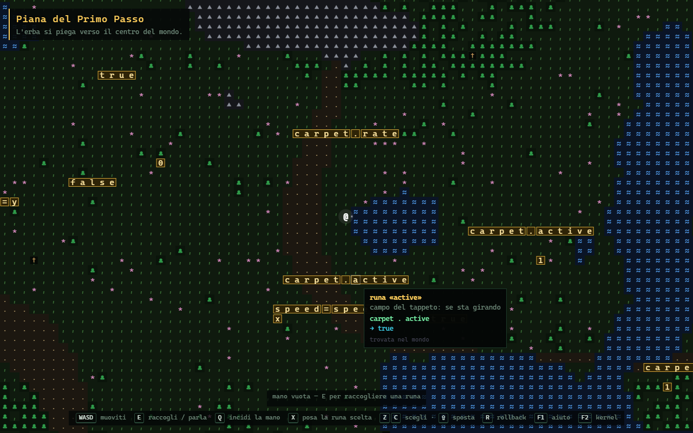
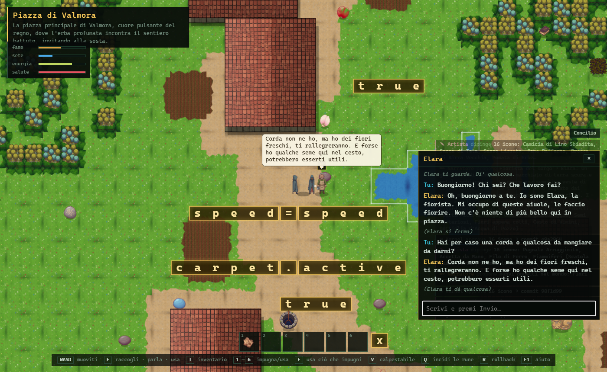
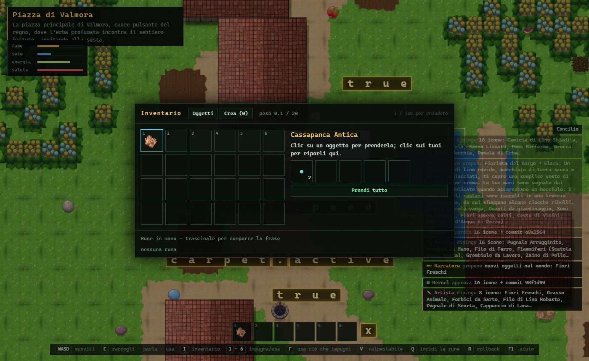
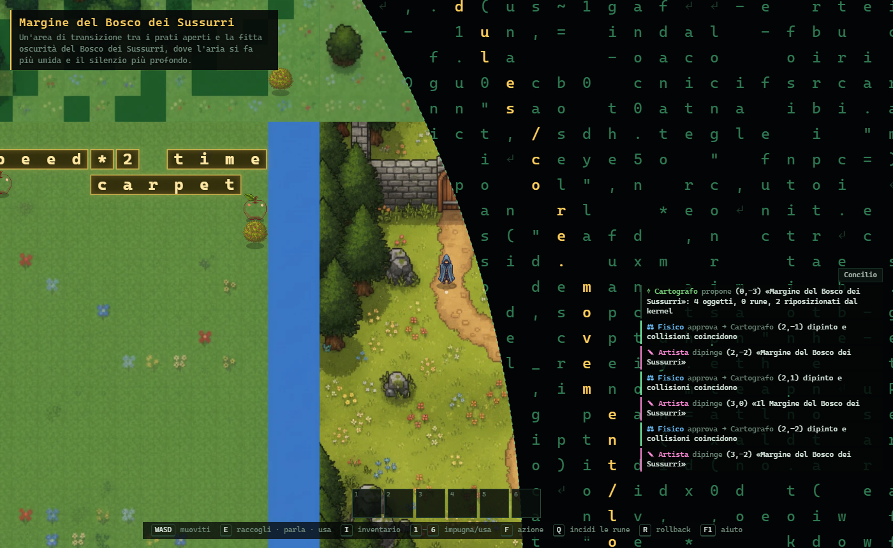

# RUNE

*Il mondo è scritto. Tu sei al centro.*

Un gioco 2D top-down a grafica semplice e contenuti ricchissimi, generato da IA in ogni suo aspetto
tranne il kernel. Un **Concilio di agenti** su Google Gemini (Narratore, Cartografo, Artista, Fisico,
Ingegnere, Arbitro) scrive la storia, inventa gli ambienti come programmi di regole in stile
[MarkovJunior](https://github.com/mxgmn/MarkovJunior), riempie il mondo di oggetti, ricette e persone
(ognuna con un nome e le sue tasche), ne scrive il codice e dipinge a lotti tile, sprite animati e icone.
Cammini in un regno che sembra infinito, ma un **tappeto** ti riporta sempre al centro. Nel terreno
brillano **rune**: token Lua veri. Ciò che è scritto sul tappeto si esegue. Componi la frase giusta e il
tappeto si ferma: puoi camminare fino al bordo ed entrare nella **corona**, il codice sorgente
dell'universo, e riscriverlo.



| Elara, un individuo simulato | Inventario e contenitori | Oltre il bordo: la corona |
|---|---|---|
|  |  |  |

## Avvio

```bash
npm install
echo GEMINI_API_KEY=la-tua-chiave > .env   # facoltativo: senza, il gioco gira offline
npm run dev                                # http://localhost:5173
npm test
```

Al primo avvio con Gemini parte la **Genesi**: descrivi il mondo che vuoi e il Concilio lo crea in circa
un minuto (~60 chiamate a `gemini-3.1-flash-lite`); poi l'Artista dipinge a lotti texture, sprite e
icone (~15-25 immagini con `gemini-3.1-flash-lite-image` per tutto il mondo, riusate ovunque). Il testo costa
poco: il mondo continua a crescere di oggetti e ricette mentre esplori. La chiave resta sul server di sviluppo: il browser
parla con un proxy locale. Senza chiave (o con `?offline`) i luoghi sono abbozzati e gli agenti rispondono
con un modello locale.

## Comandi di gioco

| Tasto | Azione |
|---|---|
| `WASD` / frecce | muoviti |
| `E` / spazio | raccogli; davanti a cose e persone apre il menu: parla (chat libera), apri, esamina, dormi, attingi… e **Altro…**: scrivi cosa fai, il Concilio giudica, l'oggetto impara |
| `I` / `Tab` | inventario: trascina per riordinare, su un altro oggetto per **combinare**, fuori per posare; borse e sacche si aprono; **Altro…** su ogni oggetto; scheda **Crea** con le ricette e **Altro…** per inventarne |
| `1`–`6` | impugna o usa gli oggetti della prima riga |
| `F` | usa ciò che impugni su ciò che hai davanti |
| `Q` / `X` | incidi tutte le rune in mano / solo quella scelta (`Z` `C` per scegliere, `Shift` per spostare) |
| `T` | pronuncia le rune magiche della frase, in ordine, consumandole: un incantesimo (le sequenze nuove le nomina il Concilio; costa mana, da 3 rune serve un cristallo) |
| `R` | rollback all'ultimo commit valido |
| `V` | mostra in rosso ciò che non si può attraversare |
| `G` | mostra/nasconde il Concilio · `F1` aiuto · `Esc` chiudi |
| nella corona | `E` alla porta di un edificio per entrare; dentro: scaffali (file), quadri (sprite, «ridipingi»), bacheca, scale; il Referente accoglie le tue richieste |

Fame, sete ed energia calano: mangia, bevi, dormi. Passa il mouse su una runa per vederne il valore vivo.
Rune che si toccano formano una riga di codice; ogni runa è una casella, e una volta raccolta è un oggetto nella
borsa delle rune: dalla borsa componi la frase da incidere (`Q`) o pronunciare (`T`). Gli NPC hanno un mestiere, una
famiglia e una giornata loro; ciò che il Concilio decide sulle tue azioni diventa una regola del mondo. Il giorno dura dieci minuti: di notte
servono luci. Oltre il bordo, la corona è un archivio: ogni cartella una stanza, ogni file un oggetto da
aprire, e gli agenti del Concilio che ci lavorano (con `E` ci parli).

<details>
<summary>Spoiler: come si esce</summary>

Nella piazza iniziale ci sono `x`, `speed = speed` e la runa magica `luce`. Le rune del tappeto
(`carpet`, `active`…) si trovano solo lontano dall'inizio, a qualche luogo di distanza. Raccogli `carpet`,
`.`, `active`, prendi `=` dal centro di `speed = speed`, trova un `false`. Ordina la mano in
`carpet . active = false`, premi `Q`, e cammina dritto per 44 passi. Ma ci sono molti altri modi.
</details>

## Per chi sviluppa

Leggi **[AGENTS.md](AGENTS.md)**: architettura, Concilio, regole inviolabili, convenzioni (vale per
persone, Claude Code e Gemini CLI). Design originale in [docs/design.md](docs/design.md), decisioni in
[docs/adr/](docs/adr/README.md).

## Riferimenti e ispirazioni

- Dan Harmon
    - Community: Digital Estate Planning
    - Rick and Morty: M. Night Shaym-Aliens!
- South Park: Grounded Vindaloop
- Matrix
- Westworld
- Project Zomboid
- Cyberpunk 2077
