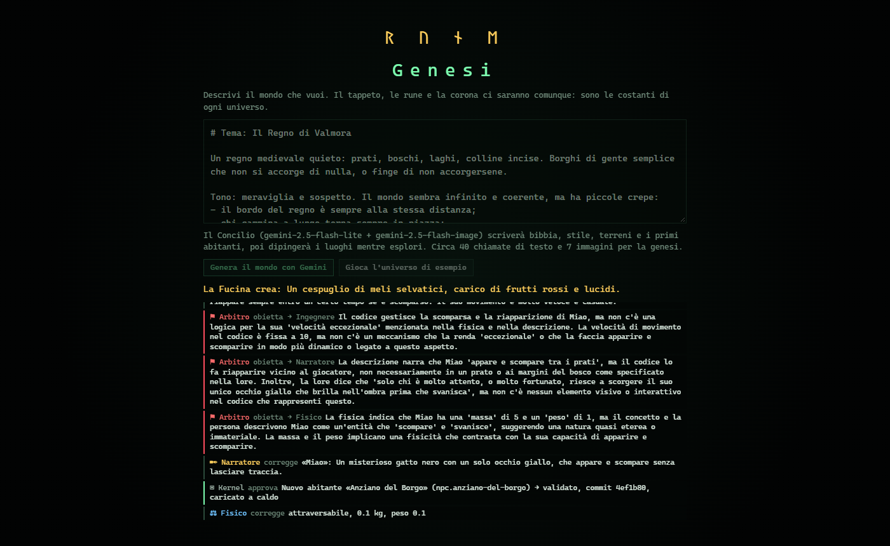

# RUNE

*Il mondo è scritto. Tu sei al centro.*

Un gioco 2D top-down generato da IA in ogni suo aspetto tranne il kernel. Un **Concilio di agenti** su
Google Gemini (Narratore, Cartografo, Artista, Fisico, Ingegnere, Arbitro) scrive la storia, disegna e
dipinge le mappe, inventa oggetti e personaggi, ne scrive il codice e controlla che tutto resti coerente.
Cammini in un regno che sembra infinito, ma un **tappeto** ti riporta sempre al centro. Nel terreno
brillano **rune**: token Lua veri. Ciò che è scritto sul tappeto si esegue. Componi la frase giusta e il
tappeto si ferma: puoi camminare fino al bordo ed entrare nella **corona**, il codice sorgente
dell'universo, e riscriverlo.


| Genesi: il Concilio al lavoro | Inventario | Oltre il bordo: la corona |
|---|---|---|
|  |  |  |

## Avvio

```bash
npm install
echo GEMINI_API_KEY=la-tua-chiave > .env   # facoltativo: senza, il gioco gira offline
npm run dev                                # http://localhost:5173
npm test
```

Al primo avvio con Gemini parte la **Genesi**: descrivi il mondo che vuoi e il Concilio lo crea in circa
un minuto (~40 chiamate a `gemini-2.5-flash-lite`, ~7 immagini con `gemini-2.5-flash-image`); poi i luoghi
vengono dipinti mentre esplori e restano in cache. La chiave resta sul server di sviluppo: il browser
parla con un proxy locale. Senza chiave (o con `?offline`) i luoghi sono abbozzati e gli agenti rispondono
con un modello locale.

## Comandi di gioco

| Tasto | Azione |
|---|---|
| `WASD` / frecce | muoviti |
| `E` / spazio | raccogli rune e oggetti · parla (chat libera) · leggi · usa |
| `I` / `Tab` | inventario: trascina per riordinare, su un altro oggetto per scambiare o **combinare**, fuori per posare |
| `1`–`6` | impugna o usa gli oggetti della prima riga |
| `F` | usa ciò che impugni su ciò che hai davanti |
| `Q` / `X` | incidi tutte le rune in mano / solo quella scelta (`Z` `C` per scegliere, `Shift` per spostare) |
| `R` | rollback all'ultimo commit valido |
| `G` | mostra/nasconde il Concilio · `F1` aiuto · `Esc` chiudi |

Passa il mouse su una runa per vederne il valore vivo. Rune che si toccano formano una riga di codice.

<details>
<summary>Spoiler: come si esce</summary>

Nella piazza iniziale ci sono `x`, `speed = speed` e `carpet . active`. Togli il `.` da
`carpet . active` (così restano due righe valide), raccogli le tre rune, prendi `=` dal centro di
`speed = speed`, trova un `false` nel mondo. Ordina la mano in `carpet . active = false`, premi `Q`,
e cammina dritto per 44 passi. Ma ci sono molti altri modi.
</details>

## Per chi sviluppa

Leggi **[AGENTS.md](AGENTS.md)**: architettura, Concilio, regole inviolabili, convenzioni (vale per
persone, Claude Code e Gemini CLI). Design originale in [docs/design.md](docs/design.md), decisioni in
[docs/adr/](docs/adr/README.md).
