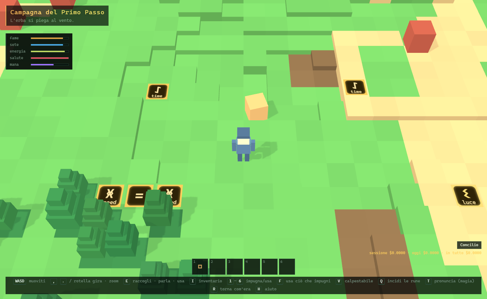
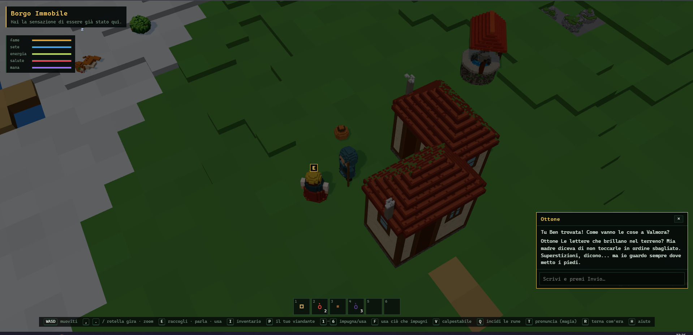
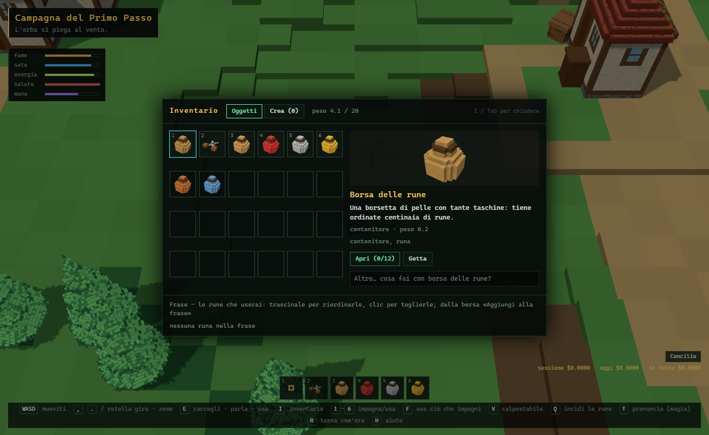
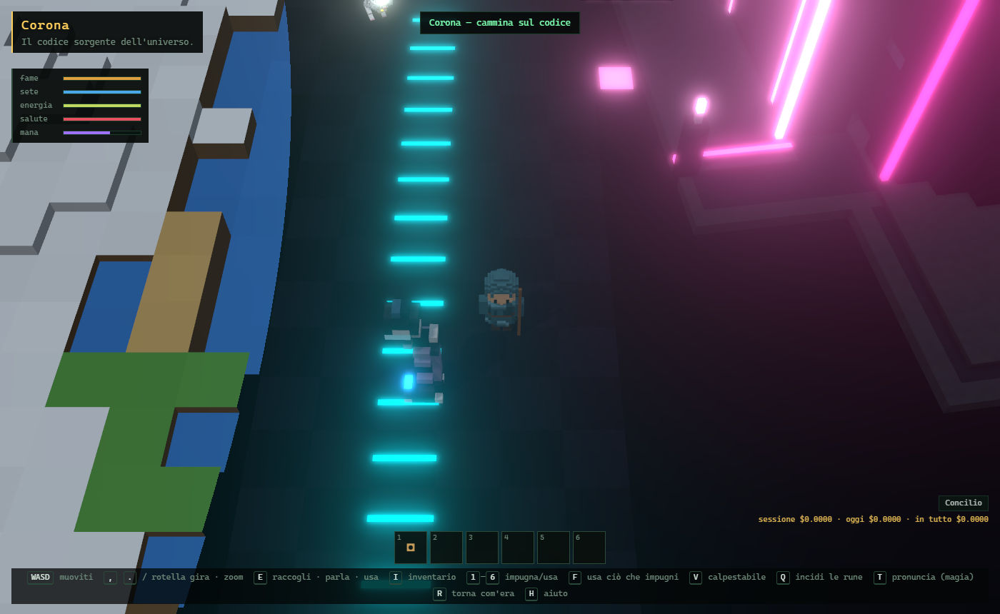

# QUINE42

*Il mondo è scritto. Tu sei al centro.*

Un gioco 3D visto dall'alto in 3/4, fatto di voxel semplici e di contenuti ricchissimi, generato da IA in ogni
suo aspetto tranne il kernel. Un **Concilio di agenti** su Google Gemini (Narratore, Cartografo, Artista,
Scultore, Fisico, Ingegnere, Arbitro) scrive la storia, inventa gli ambienti come programmi di regole in stile
[MarkovJunior](https://github.com/mxgmn/MarkovJunior), riempie il mondo di oggetti, ricette e persone (ognuna con
un nome, una famiglia, un mestiere e le sue tasche), ne scrive il codice e **scolpisce** l'aspetto di ogni cosa:
ogni tipo di cosa è un programma MarkovJunior che costruisce un modello a voxel, e ogni individuo è un seme di quel
programma. Nessuna immagine generata: solo testo.
Cammini in un regno che sembra infinito, ma un **tappeto** ti riporta sempre al centro. Nel terreno
brillano **rune**: token Lua veri. Ciò che è scritto sul tappeto si esegue. Componi la frase giusta e il
tappeto si ferma: puoi camminare fino al bordo ed entrare nella **corona**, il codice sorgente
dell'universo, e riscriverlo.



| Una persona con la chat | L'inventario con le icone dei modelli | Oltre il tappeto: la corona |
|---|---|---|
|  |  |  |

## Avvio

```bash
npm install
echo GEMINI_API_KEY=la-tua-chiave > .env   # facoltativo: senza, il gioco gira offline
npm run dev                                # http://localhost:5173
npm test
```

Al primo avvio con Gemini parte la **Genesi**: descrivi il mondo che vuoi e il Concilio lo crea in circa
un minuto (~60 chiamate a `gemini-3.1-flash-lite`); poi lo Scultore scrive i programmi dei modelli che
mancano, uno per tipo (da $0,01 a $0,16 l'uno, secondo la classe), e l'Artista li giudica dalle foto. Le varianti
sono semi diversi, gratis; le icone sono foto dei modelli. Il mondo continua a crescere di luoghi, oggetti e
persone mentre esplori; il costo in dollari è nel pannello del Concilio. La chiave resta sul server di sviluppo: il browser
parla con un proxy locale. Senza chiave (o con `?offline`) i luoghi sono abbozzati, gli agenti rispondono
con un modello locale e le cose hanno i modelli del seme.

## Comandi di gioco

| Tasto | Azione |
|---|---|
| `WASD` / frecce | muoviti; il mouse sopra cose, persone e rune dice cosa sono |
| `E` / spazio | raccogli; davanti a cose e persone apre il menu: parla (chat libera), apri, esamina, dormi, attingi, «Apri la porta»… e **Altro…**: scrivi cosa fai, il Concilio giudica, la cosa impara (se ne cambia la forma, lo Scultore scrive la regola sul suo modello) |
| tasto destro | il menu della cosa o del terreno sotto il mouse (scavare, attingere, tagliare…) |
| `I` / `Tab` | inventario: trascina per riordinare, su un altro oggetto per **combinare**, fuori per posare; borse e sacche si aprono; **Altro…** su ogni oggetto; scheda **Crea** con le ricette e **Altro…** per inventarne |
| `1`–`6` | impugna o usa gli oggetti della prima riga; `X` posa |
| `F` | usa ciò che impugni su ciò che hai davanti |
| `Z` `C` / rotella | scegli una runa della frase (`Shift` per spostarla) |
| `Q` | incidi la frase nel terreno davanti a te |
| `T` | pronuncia le rune magiche della frase, in ordine, consumandole: un incantesimo (le sequenze nuove le nomina il Concilio; costa mana, da 3 rune serve un cristallo) |
| `R` | torna all'ultimo stato valido |
| `V` | mostra in rosso ciò che non si può attraversare |
| `H` / `F1` aiuto · `Esc` chiudi | oltre il bordo: `G` il registro del Concilio, `F2` la console |
| nella corona | `E` alla porta di un edificio per entrare; dentro: scaffali (file), la Galleria dei modelli («riscolpisci»), bacheca, scale; il Referente accoglie le tue richieste |

Fame, sete ed energia calano: mangia, bevi, dormi. Passa il mouse su una runa per vederne il valore vivo.
Rune che si toccano formano una riga di codice; ogni runa è una lastra su una casella, e una volta raccolta è un oggetto nella
borsa delle rune: dalla borsa componi la frase da incidere (`Q`) o pronunciare (`T`). Gli NPC hanno un mestiere, una
famiglia e una giornata loro; ciò che il Concilio decide sulle tue azioni diventa una regola del mondo. Il giorno dura dieci minuti: di notte
servono luci. Oltre il bordo, la corona è uno studio: ogni cartella un edificio, ogni file uno scaffale da
aprire, e le squadre del Concilio che ci lavorano (con `E` ci parli).

<details>
<summary>Spoiler: come si esce</summary>

Nella piazza iniziale ci sono `x`, `speed = speed` e la runa magica `luce`. Le rune del tappeto
(`carpet`, `active`…) si trovano solo lontano dall'inizio, a qualche luogo di distanza. Raccogli `carpet`,
`.`, `active`, prendi `=` dal centro di `speed = speed`, trova un `false`. Componi la frase
`carpet . active = false`, premi `Q`, e cammina dritto per 42 passi. Ma ci sono molti altri modi.
</details>

## Per chi sviluppa

Leggi **[AGENTS.md](AGENTS.md)**: architettura, Concilio, regole inviolabili, convenzioni (vale per persone, Claude Code
e Antigravity). Come è organizzata la documentazione e come ci siamo arrivati: [docs/README.md](docs/README.md).

| Dove | Cosa |
|---|---|
| [docs/adr/](docs/adr/README.md) | le decisioni, una per file |
| [docs/plans/backlog.md](docs/plans/backlog.md) | i task, fatti e da fare, uno per sessione |
| [docs/userchats/to-do.md](docs/userchats/to-do.md) | le richieste nuove, in testo libero: le pianifica la pipeline |
| [docs/pipeline/](docs/pipeline/README.md) | la pipeline agentica: piano, domande, consumi, il diario dell'orchestratore |
| [lab/](lab/README.md) | il laboratorio di MarkovJunior: sandbox 3D, editor dei modelli |
| [docs/design.md](docs/design.md) | il design originale |

```bash
npm run dev          # il gioco, con il proxy di Gemini e il server degli universi
npm test             # i test in Node, con i modelli offline
npm run typecheck
npm run build        # poi npx vite preview: la build servita con il proxy
```

In sviluppo: `?skip` salta intro e Genesi, `?offline` usa i modelli locali, `?universo=<nome>` apre un altro universo di
`universes/`, `?dev&teleport=46,0` porta oltre il tappeto, `?viandante=<id>` sceglie il viandante della scheda in multigiocatore.
In console `window.quine` è il kernel.

### La pipeline agentica

Il lavoro va avanti per task, eseguiti da agenti (Claude Code, Antigravity con Gemini 3.8 Flash o Gemini 4 Argon) in parallelo,
ciascuno nel suo worktree, entro i limiti di consumo di ogni abbonamento ([ADR-0072](docs/adr/0072-la-pipeline-agentica.md),
[ADR-0079](docs/adr/0079-l-ambiente-dell-orchestratore.md)). Si lancia così, in un terminale:

```bash
node tools/pipeline/pipeline.mjs orchestra                 # l'orchestratore su Claude Code (poi Argon, poi Gemini)
node tools/pipeline/pipeline.mjs orchestra --agente argon  # su Gemini 4 Argon
```

Il processo esegue i task e tiene la conversazione con un agente **orchestratore**: gli scrivi in chat richieste, bug, domande,
correzioni; lui le trasforma in task, stima, sceglie il provider secondo i crediti rimasti, li fa eseguire, ti riporta gli esiti, fa
verificare nel browser e integra. Non lavora sul codice: delega. Quando i suoi crediti finiscono passa la mano a un altro provider
partendo dal suo quadro (`docs/pipeline/quadro.md`), senza perdere gli eventi in corso. Le richieste si possono scrivere anche in
`docs/userchats/to-do.md`. Comandi e regole: [docs/pipeline/README.md](docs/pipeline/README.md).

### Generare con gli abbonamenti

Il Concilio chiama Gemini a consumo con la chiave in `.env`. I compiti lenti (Genesi, Fucina, modelli dello Scultore, sessioni
del Concilio, meccaniche) possono invece girare sull'abbonamento personale di chi gioca in locale, con Claude Code
([ADR-0077](docs/adr/0077-generare-con-gli-abbonamenti.md), [ADR-0106](docs/adr/0106-la-coda-delle-cli-blindata.md): Antigravity non può escludere gli strumenti e non sta sulla coda), a costo zero nel registro dei consumi; il resto resta sulle API
(o sui modelli locali offline). Solo in singola e in sviluppo, mai sul server del multigiocatore: l'abbonamento è personale.

1. **Impostare la tabella**: in `universe.json` del proprio universo (in `universes/<nome>/universe.json` o nel seme `universe/universe.json`):

```json
"ai": {
  "provider": "claude",
  "agenti": { "scultore": "claude", "narratore": "api" }
}
```

`provider` stabilisce il provider predefinito (`api` o `claude`) per ogni agente che `agenti` non nomina; `agenti` definisce le eccezioni per singolo agente.

2. **Accendere la coda**: `QUINE_CODA=1` nel `.env`. Senza, la route non c'è e il gioco resta sulle API. Risponde solo da questa macchina e alla pagina del gioco.

3. **Lanciare il servitore della coda**: in un terminale separato (richiede la CLI `claude` installata e collegata al proprio account). La CLI gira in una cartella vuota, senza strumenti, MCP, hook né impostazioni della macchina; se non lo conferma, il servitore si ferma:

```bash
npm run abbonamento
```

4. **Avviare il gioco**:

```bash
npm run dev                               # http://localhost:5173
```

All'avvio in singola o sviluppo, se il servitore è attivo il gioco costruisce automaticamente i modelli instradati (`RoutedAiModels`): la schermata introduttiva (`#models`) e il pannello del Concilio (`G`) mostrano quali agenti vanno su quale abbonamento e quante richieste sono in coda o in corso. Se il servitore non è avviato o si interrompe, le richieste ricadono in modo trasparente sulle API (o sui modelli locali se offline).

## Riferimenti e ispirazioni

- Dan Harmon
    - Community: Digital Estate Planning
    - Rick and Morty: M. Night Shaym-Aliens!
- South Park: Grounded Vindaloop
- Matrix
- Westworld
- The Truman Show
- The Hitchhiker's Guide to the Galaxy
- Project Zomboid
- Cyberpunk 
- Dungeons & Dragons

> Tutti i marchi, i titoli e le opere citate appartengono ai rispettivi proprietari e sono menzionati esclusivamente a scopo di tributo e ispirazione culturale, senza alcuna affiliazione o sponsorizzazione.

## Ringraziamenti

Un ringraziamento speciale a:
- **Maxim Gumin**, per l'invenzione di [MarkovJunior](https://github.com/mxgmn/MarkovJunior) e i suoi paradigmi di riscrittura deterministica di pattern, che danno forma a ogni voxel e struttura di questo universo.
- Gli autori e la comunità open source di **three.js**, **wasmoon** (Lua in WebAssembly), **Vite** e **TypeScript**.
- I modelli di intelligenza artificiale che animano le squadre del Concilio (Google Gemini e Claude Code), instancabili compagni di viaggio nella costruzione del mondo.
- E a chiunque si fermi ad ascoltare, a raccogliere una runa o a cercare una via per superare il tappeto.

## Licenza

Questo progetto è rilasciato sotto licenza source-available non-commerciale:
- **Codice sorgente**: [PolyForm Noncommercial License 1.0.0](LICENSE.md)
- **Asset, mondo, modelli 3D e testi**: [Creative Commons Attribution-NonCommercial-ShareAlike 4.0 International (CC BY-NC-SA 4.0)](LICENSE.md)

Il codice è aperto: chiunque può leggerlo, imparare, compilarlo, fare Pull Request e giocarci in locale con la propria API key di Google Gemini. È fatto divieto assoluto di monetizzazione, vendita diretta o indiretta, o fornitura come servizio di hosting a pagamento. Dettagli completi in [LICENSE.md](LICENSE.md).
