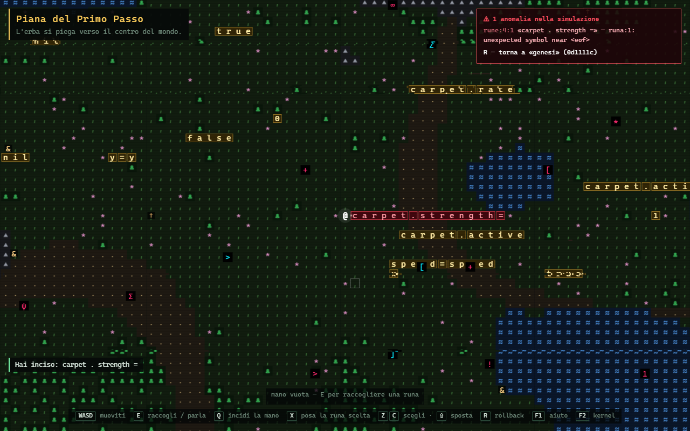

# RUNE

*Il mondo è scritto. Tu sei al centro.*

Un gioco 2D top-down in cui il mondo è fatto del proprio codice sorgente. Cammini in un regno che
sembra infinito, ma un **tappeto** ti riporta sempre al centro. Nel terreno brillano **rune**: token Lua
veri, legati a simboli veri. Ciò che è scritto sul tappeto si esegue. Componi la frase giusta e il
tappeto si ferma: puoi camminare fino al bordo ed entrare nella **corona**, il codice sorgente
dell'universo, e riscriverlo.


| Una frase sbagliata spezza la simulazione | Oltre il bordo: la corona |
|---|---|
|  |  |

## Avvio

```bash
npm install
npm run dev        # http://localhost:5173
npm test           # 28 test: kernel headless, sandbox, validatore, repository
```

## Comandi di gioco

| Tasto | Azione |
|---|---|
| `WASD` / frecce | muoviti |
| `E` / spazio | raccogli la runa sotto di te o davanti; parla; nella corona: riscrivi il codice |
| `Q` | incidi davanti a te tutte le rune che hai in mano |
| `X` | posa solo la runa selezionata |
| `Z` `C` / rotella | scegli una runa in mano · con `Shift` la sposti |
| `R` | rollback all'ultimo commit valido |
| `F1` | aiuto · `F2` console del kernel · `Esc` chiudi |

Passa il mouse su una runa per vederne il valore vivo. Rune che si toccano formano una riga di codice.

<details>
<summary>Spoiler: come si esce</summary>

Nella piazza iniziale ci sono `x`, `speed = speed` e `carpet . active`. Togli il `.` da
`carpet . active` (così restano due righe valide), raccogli le tre rune, prendi `=` dal centro di
`speed = speed`, trova un `false` nel mondo. Ordina la mano in `carpet . active = false`, premi `Q`,
e cammina dritto per 44 passi. Ma ci sono molti altri modi.
</details>

## Per chi sviluppa

Leggi **[AGENTS.md](AGENTS.md)**: architettura, regole inviolabili, convenzioni (vale per persone,
Claude Code e Gemini CLI). Design originale in [docs/design.md](docs/design.md), decisioni in
[docs/adr/](docs/adr/README.md).
