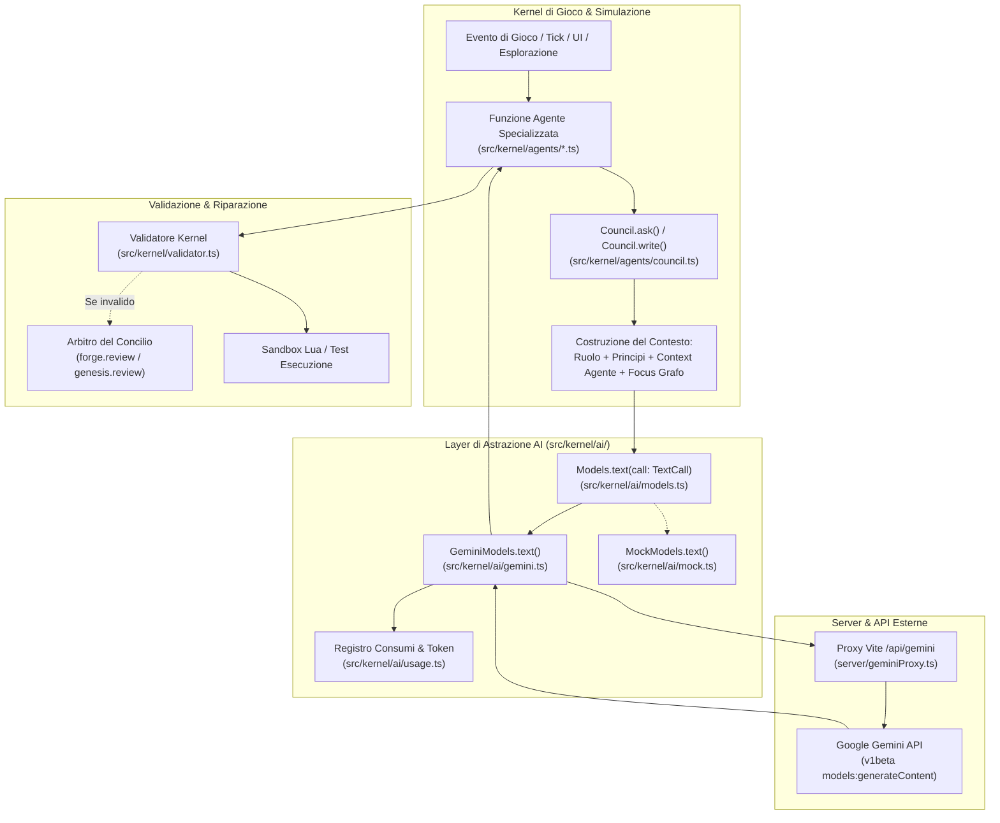
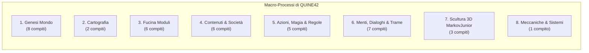
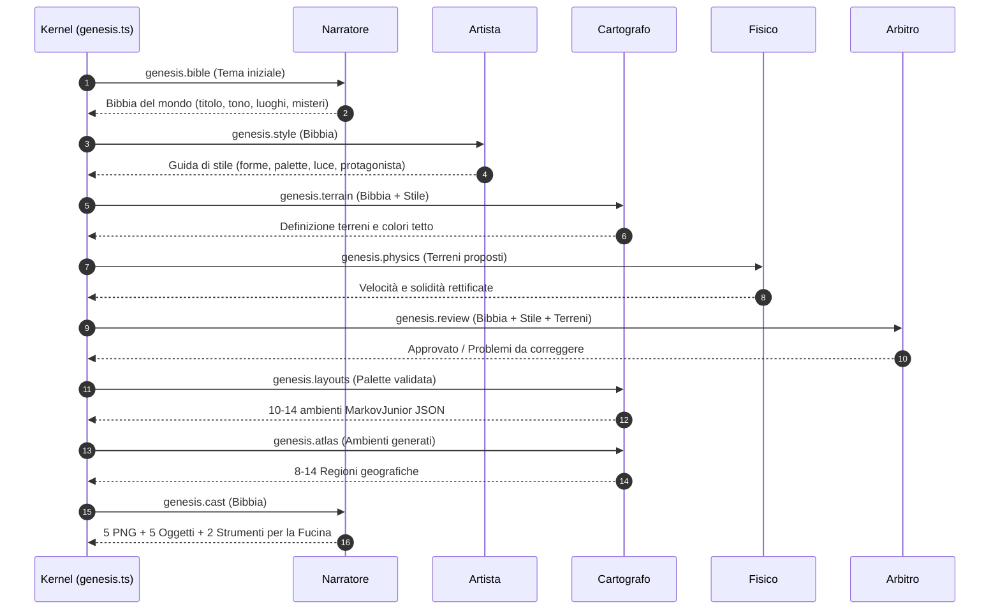
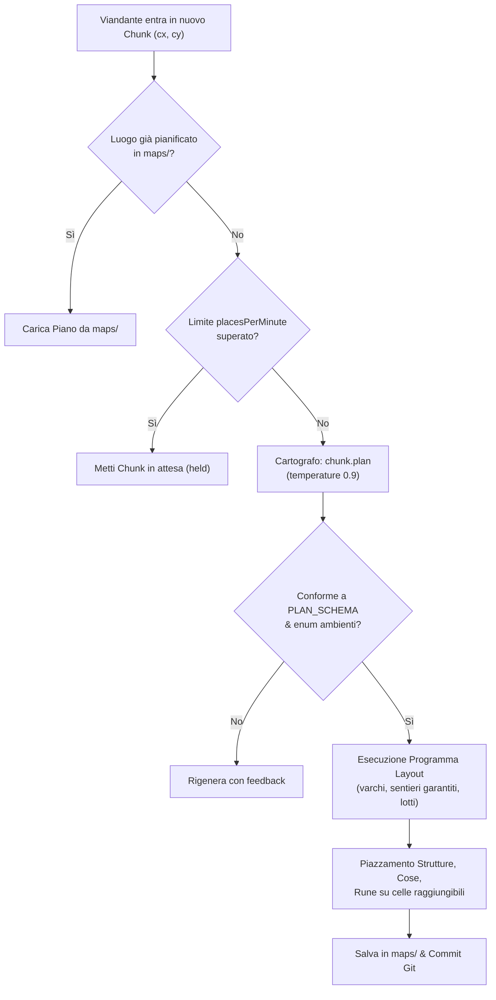
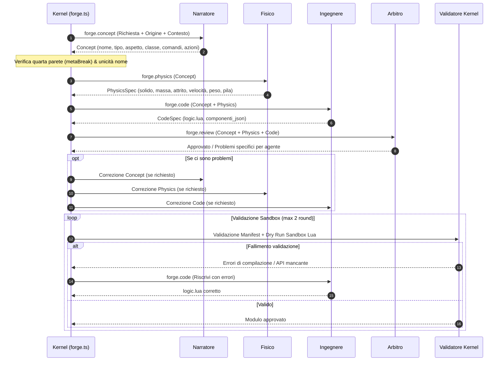
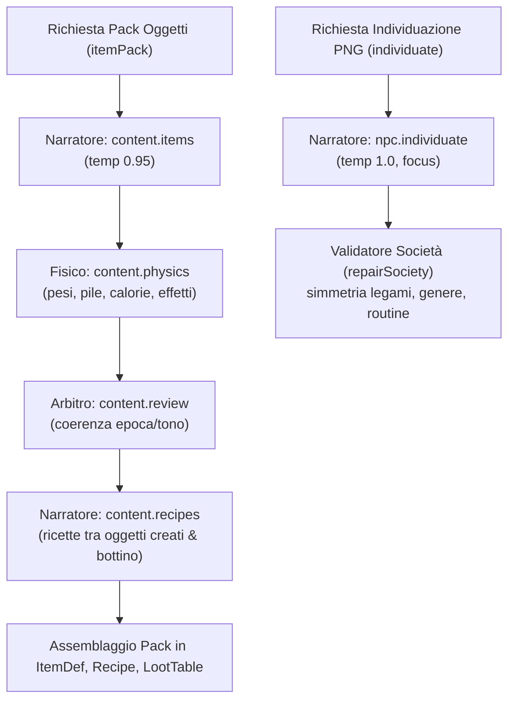
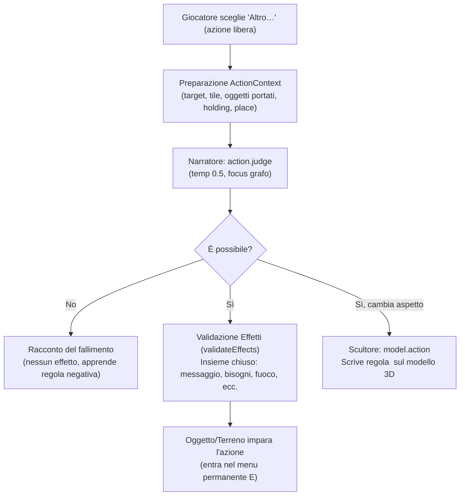
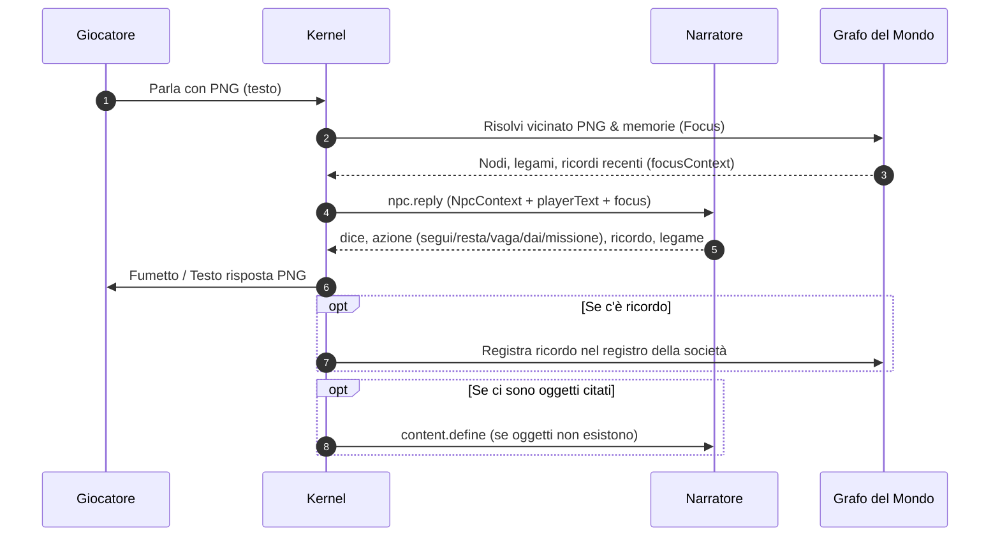
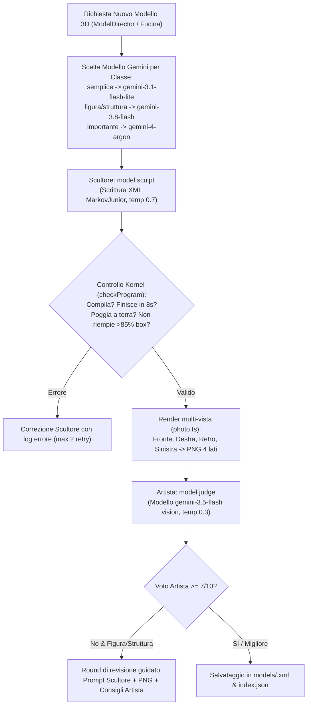
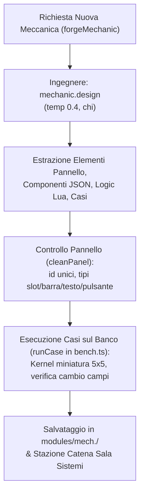

# Il Grafo delle Conversazioni con Gemini in QUINE42

> Documento di riferimento per l'architettura dei compiti IA, la costruzione dei prompt,
> gli schemi di risposta e la localizzazione multi-lingua (I18N).
> Riferimento task: **T67** (da `docs/plans/backlog.md` e `docs/userchats/to-do-2026-10-29.md`).

---

## 1. Visione d'insieme e Architettura delle Conversazioni

Nel mondo di QUINE42, il gioco vive su **due tavoli** ([ADR-0025](file:///H:/projects/rune/.claude/worktrees/t67/docs/adr/ADR-0025-due-tavoli-quarta-parete.md)): il **Concilio degli Agenti** all'esterno (il Dungeon Master che crea e fa evolvere il mondo) e il **Viandante** all'interno con le persone e le cose che popolano la simulazione (per cui il mondo è reale).

Tutta la generazione di contenuti narrativi, cartografici, fisici, logici e visivi avviene tramite interazioni con modelli LLM di Google Gemini gestite dal kernel TypeScript (`src/kernel/`). Nessuna logica Lua chiama direttamente i modelli.

### 1.1 Flusso di chiamata end-to-end

Il flusso unificato di qualsiasi richiesta generativa attraversa i seguenti livelli:



### 1.2 La struttura unificata di `TextCall`

Tutte le richieste transitano per l'interfaccia [`TextCall`](file:///H:/projects/rune/.claude/worktrees/t67/src/kernel/ai/models.ts#L17-L35) in `src/kernel/ai/models.ts`:

```typescript
export interface TextCall {
  agent: string;          // Id agente ('narratore', 'cartografo', 'scultore', ecc.)
  task: string;           // Nome stabile del compito ("chunk.plan", "forge.concept"...)
  system: string;         // Istruzione di sistema (ruolo, principi, contesto, focus)
  prompt: string;         // Prompt utente (template + variabili dinamiche)
  schema?: Schema;        // Schema OpenAPI subset per output JSON strutturato
  images?: string[];      // Data URL (image/png) per input visivi multimodali
  temperature?: number;   // Temperatura campionamento (tipicamente 0.2 - 0.95)
  data?: unknown;         // Payload per MockModels offline in test/sviluppo
  model?: string;         // Override modello (es. classi Scultore o Artista)
  thinking?: Thinking;    // Livello di ragionamento ('low', 'medium', 'high', 'off')
  chi?: string;           // Identificativo pagante ('io', id viandante o 'comune')
}
```

### 1.3 Struttura del Prompt di Sistema e Context Caching

Gemini applica il caching sul prefisso del prompt (context caching automatico per prompt ricorrenti). Per massimizzare il riuso della cache di sistema, [`Council.write()`](file:///H:/projects/rune/.claude/worktrees/t67/src/kernel/agents/council.ts#L298-L315) assembla la `systemInstruction` disponendo le parti da quella più stabile a quella più volatile:

1. **Ruolo dell'Agente**: letto da `universe/prompts/agents/<agent>.md` (o fallback sintetico).
2. **Principi del Concilio** ([`COUNCIL_PRINCIPLES`](file:///H:/projects/rune/.claude/worktrees/t67/src/kernel/fourthwall.ts#L8-L27)): divieto assoluto di rottura della quarta parete, divieto di duplicazione delle rune o creazione di nuovi glifi magici, aderenza alla fisica e verosimiglianza del mondo.
3. **Fetta di contesto dell'agente** ([`Council.context(agent)`](file:///H:/projects/rune/.claude/worktrees/t67/src/kernel/agents/council.ts#L218-L270)): porzione di conoscenza del mondo abilitata per quel ruolo.
4. **Istruzioni di sistema aggiuntive** (`opts.system`): ad esempio esempi XML per lo Scultore.
5. **Focus del Grafo** ([`focusContext`](file:///H:/projects/rune/.claude/worktrees/t67/src/kernel/agents/council.ts#L276-L288)): vicinato a 2 passi nel grafo del mondo ([ADR-0045](file:///H:/projects/rune/.claude/worktrees/t67/docs/adr/ADR-0045-grafo-del-mondo.md)) per i compiti narrativi contestualizzati (budget massimo di 2800 caratteri, ~700 token).

---

## 2. Il Concilio e le Fette di Contesto

Gli 8 agenti del Concilio accedono ciascuno a una specifica vista filtrata del mondo (`WorldView`):

| Agente | Ruolo Principale | File Prompt Ruolo | Contesto Condiviso Assegnato |
|---|---|---|---|
| **Narratore** (`narratore`) | Bibbia, individui PNG, dialoghi, trame, oggetti, esamina, azioni libere | [`prompts/agents/narratore.md`](file:///H:/projects/rune/.claude/worktrees/t67/universe/prompts/agents/narratore.md) | Bibbia estesa (o sintesi se focused), catalogo moduli, canone delle rune, regole del mondo, partita |
| **Cartografo** (`cartografo`) | Piani dei luoghi (18×18), ambienti MarkovJunior, atlante geografico | [`prompts/agents/cartografo.md`](file:///H:/projects/rune/.claude/worktrees/t67/universe/prompts/agents/cartografo.md) | Bibbia sintetica, palette terreni, catalogo moduli posizionabili, atlante regioni |
| **Artista** (`artista`) | Direzione artistica, valutazione visiva multi-vista dei modelli 3D | [`prompts/agents/artista.md`](file:///H:/projects/rune/.claude/worktrees/t67/universe/prompts/agents/artista.md) | Guida di stile (`world/style.md`), tono della bibbia |
| **Scultore** (`scultore`) | Programmi MarkovJunior XML per modelli 3D e `<action>` dinamiche | [`prompts/agents/scultore.md`](file:///H:/projects/rune/.claude/worktrees/t67/universe/prompts/agents/scultore.md) | Guida di stile, ruoli con classi iniettate (`@@CLASSES@@`), scala voxel (`@@TILE@@`), palette (`@@PALETTE@@`), esempi modelli |
| **Musicista** (`musicista`, T225) | Programmi sonori MarkovJunior XML (`sound.compose`), per gli ambienti senza musica e su richiesta | `prompts/agents/musicista.md` | Testa della bibbia, scale, strumenti e soglie iniettati (`@@SCALES@@`, `@@INSTRUMENTS@@`, `@@LIMITS@@`), un esempio della libreria |
| **Fisico** (`fisico`) | Fisica dei moduli (solidità, massa, attrito, velocità) e proprietà terreni | [`prompts/agents/fisico.md`](file:///H:/projects/rune/.claude/worktrees/t67/universe/prompts/agents/fisico.md) | Palette terreni, tono della bibbia, regole stabilite |
| **Ingegnere** (`ingegnere`) | Codice Lua (`logic.lua`), interfacce (`UiPanel`), meccaniche e casi banco | [`prompts/agents/ingegnere.md`](file:///H:/projects/rune/.claude/worktrees/t67/universe/prompts/agents/ingegnere.md) | Sintesi bibbia, palette terreni, regole partita |
| **Arbitro** (`arbitro`) | Controllo coerenza tra storia, grafica, fisica e codice; sessioni Concilio | [`prompts/agents/arbitro.md`](file:///H:/projects/rune/.claude/worktrees/t67/universe/prompts/agents/arbitro.md) | Bibbia, stile, palette terreni, canone rune, regole stabilite, partita |
| **Referente** (`referente`) | Accoglienza del viandante trasceso nella corona e smistamento compiti | [`prompts/agents/referente.md`](file:///H:/projects/rune/.claude/worktrees/t67/universe/prompts/agents/referente.md) | Bibbia, catalogo moduli, regole stabilite, partita |

---

## 3. Registro Dettagliato dei Compiti degli Agenti (38 Tasks)

Di seguito sono analizzati tutti i compiti suddivisi per macro-processo.



---

### Macro-Processo 1: La Genesi dell'Universo

La Genesi avviene all'avvio di un nuovo universo o creazione da tema ([`planGenesis`](file:///H:/projects/rune/.claude/worktrees/t67/src/kernel/agents/genesis.ts#L188-L336) in `src/kernel/agents/genesis.ts`).



#### 1. `genesis.bible`
- **Agente**: `narratore`
- **Modello predefinito**: `gemini-3.1-flash-lite` (configurabile in `universe.json`)
- **Caller**: [`planGenesis()`](file:///H:/projects/rune/.claude/worktrees/t67/src/kernel/agents/genesis.ts#L190-L197) in `src/kernel/agents/genesis.ts`
- **Contesto**: `data: { theme }`, principles, ruolo Narratore.
- **Prompt utente**:
  ```text
  Crea la bibbia di un nuovo universo a partire da questo tema:
  {theme}

  Per chi ci vive il mondo è reale (vedi i principi). Scrivi un mondo semplice e concreto, fatto di persone e mestieri. Le rune sono come le dice il canone: non aggiungere nulla. Elenca 6-10 luoghi, 4-6 personaggi con mestieri concreti, 6-10 fatti, 2-4 leggende raccontate dalla gente (storie di persone, bestie, dei, re del passato: mai sul mondo stesso, né sulle rune oltre il canone).
  [L'Arbitro ha obiettato: {feedback}]
  ```
- **Response Schema** (`BIBLE_SCHEMA`):
  `OBJECT` con: `titolo` (str), `tono` (str), `sintesi` (str), `storia` (str), `luoghi` (arr str), `personaggi` (arr str), `fatti` (arr str), `misteri` (arr str).
- **Validazione & Retry**: Sottoposto a [`bibleBreaks()`](file:///H:/projects/rune/.claude/worktrees/t67/src/kernel/fourthwall.ts#L50). Se infrange la quarta parete o inventa comportamenti per le rune, il kernel rigetta e ripete una volta prima di ripulire con [`cleanBible()`](file:///H:/projects/rune/.claude/worktrees/t67/src/kernel/fourthwall.ts).

#### 2. `genesis.style`
- **Agente**: `artista`
- **Modello predefinito**: `gemini-3.1-flash-lite`
- **Caller**: [`planGenesis()`](file:///H:/projects/rune/.claude/worktrees/t67/src/kernel/agents/genesis.ts#L198-L205) in `src/kernel/agents/genesis.ts`
- **Contesto**: `data: { theme, bible }`, bibbia generata.
- **Prompt utente**:
  ```text
  Scrivi la guida di stile per tutti i modelli di questo universo: è un gioco 3D in cui ogni cosa (persone, animali, alberi, rocce, oggetti, edifici) è un modello a voxel (20 voxel per casella) costruito da un programma di regole, visto dall'alto in 3/4. Dì lo stile (semplice e leggibile da lontano), le forme e le proporzioni, la palette (pochi colori ben distinti), la luce, 3-6 regole e l'aspetto del protagonista.
  Titolo: {bible.titolo}
  Tono: {bible.tono}
  Sintesi: {bible.sintesi}
  [L'Arbitro ha obiettato: {feedback}]
  ```
- **Response Schema** (`STYLE_SCHEMA`):
  `OBJECT` con: `stile` (str), `forme` (str), `palette` (arr str), `luce` (str), `regole` (arr str), `protagonista` (str).
- **Destinazione**: Salvato in `world/style.md` tramite [`styleMarkdown()`](file:///H:/projects/rune/.claude/worktrees/t67/src/kernel/agents/genesis.ts#L147).

#### 3. `genesis.terrain`
- **Agente**: `cartografo`
- **Caller**: [`planGenesis()`](file:///H:/projects/rune/.claude/worktrees/t67/src/kernel/agents/genesis.ts#L206-L213) in `src/kernel/agents/genesis.ts`
- **Contesto**: Bibbia + Stile.
- **Prompt utente**:
  ```text
  Definisci 14-20 tipi di terreno per le mappe di questo universo, esterni e interni.
  Tono: {bible.tono}
  Luoghi: {bible.luoghi}
  Stile: {style.stile}; palette {style.palette}
  Codici obbligatori (un carattere ciascuno), adattati al tema:
  {BASE_CODES: g, p, t, w, r, h, f, d, s, j, o, k, n con significato e strato}
  Aggiungine altri... Colori ben distinti tra loro.
  [Da correggere: {feedback}]
  ```
- **Response Schema** (`TERRAIN_SCHEMA`):
  `OBJECT` con: `terreni` (arr di oggetti con `codice`, `nome`, `descrizione`, `colore`, `strato`, `solido`, `velocita`), `tetto` (str #rrggbb).
- **Validazione**: [`terrainErrors()`](file:///H:/projects/rune/.claude/worktrees/t67/src/kernel/agents/genesis.ts#L159): codici singoli, non riservati (`?*/[]`), codici base obbligatori presenti, colori hex validi, max 24 terreni.

#### 4. `genesis.physics`
- **Agente**: `fisico`
- **Caller**: [`planGenesis()`](file:///H:/projects/rune/.claude/worktrees/t67/src/kernel/agents/genesis.ts#L241-L247) in `src/kernel/agents/genesis.ts`
- **Contesto**: Elenco terreni proposti dal Cartografo.
- **Prompt utente**:
  ```text
  Rivedi la fisica di questi terreni: cosa si può attraversare e a che velocità (moltiplicatore 0.3-1.5).
  {elenco terreni}
  Regole fisse: g, p, f, d calpestabili; w, t, r, h invalicabili.
  ```
- **Response Schema** (`PHYS_SCHEMA`):
  `OBJECT` con: `terreni` (arr di oggetti con `codice`, `solido`, `velocita`, `nota`).

#### 5. `genesis.review`
- **Agente**: `arbitro`
- **Caller**: [`planGenesis()`](file:///H:/projects/rune/.claude/worktrees/t67/src/kernel/agents/genesis.ts#L259-L265) in `src/kernel/agents/genesis.ts`
- **Contesto**: Bibbia + Guida Stile + Terreni. Temperatura: 0.2.
- **Prompt utente**:
  ```text
  Verifica la coerenza tra bibbia, guida di stile e terreni di questo universo nascente. Segnala solo contraddizioni concrete.
  Bibbia: {JSON}
  Stile: {JSON}
  Terreni: {JSON}
  ```
- **Response Schema** (`REVIEW_SCHEMA`):
  `OBJECT` con: `approvato` (bool), `problemi` (arr con `agente`: enum narratore/artista/cartografo, `problema`: str).

#### 6. `genesis.layouts`
- **Agente**: `cartografo`
- **Caller**: [`designLayouts()`](file:///H:/projects/rune/.claude/worktrees/t67/src/kernel/agents/cartography.ts#L139-L154) in `src/kernel/agents/cartography.ts`
- **Contesto**: Palette terreni definitiva. Temperatura: 0.7.
- **Prompt utente**:
  ```text
  Scrivi 10-14 ambienti per i luoghi di questo mondo, ognuno come programma di riscrittura MarkovJunior (vedi il tuo ruolo per la sintassi) che trasforma la bozza procedurale.
  Varietà! Servono: borghi e villaggi..., campagne coltivate..., boschi..., luoghi speciali con i timbri del kernel: castello, torre, tempio...
  Timbri disponibili: {STAMP_SHAPES}
  Codici dei terreni utilizzabili: {paletteSummary}
  [ALCUNI PROGRAMMI ERANO INVALIDI, correggili: {feedback}]
  ```
- **Response Schema** (`LAYOUTS_SCHEMA`):
  `OBJECT` con: `ambienti` (arr con `id`, `nome`, `descrizione`, `tipo`: enum esterno/interno/misto, `programma_json`: stringa JSON del programma MarkovJunior).
- **Validazione**: Esecuzione di prova in [`checkLayout()`](file:///H:/projects/rune/.claude/worktrees/t67/src/kernel/layout.ts) e riparazione automatica sintattica con [`repairProgram()`](file:///H:/projects/rune/.claude/worktrees/t67/src/mj/engine.ts).

#### 7. `genesis.atlas`
- **Agente**: `cartografo`
- **Caller**: [`drawAtlas()`](file:///H:/projects/rune/.claude/worktrees/t67/src/kernel/agents/cartography.ts#L189-L203) in `src/kernel/agents/cartography.ts`
- **Contesto**: Ambienti generati approvati. Temperatura: 0.8.
- **Prompt utente**:
  ```text
  Disegna la geografia del mondo: 8-14 regioni attorno al borgo di partenza (che è al centro). Ognuna ha un nome proprio, una frase, un ambiente tra quelli disponibili, una direzione e una distanza (in luoghi) dal centro, e un raggio.
  Rendila credibile...
  Ambienti: {elenco ambienti}
  ```
- **Response Schema**: `regioni` (arr di oggetti con `nome`, `descrizione`, `ambiente`, `direzione`: enum 8 punti cardinali, `distanza`: int 2-12, `raggio`: int 1-3).

#### 8. `genesis.cast`
- **Agente**: `narratore`
- **Caller**: [`planGenesis()`](file:///H:/projects/rune/.claude/worktrees/t67/src/kernel/agents/genesis.ts#L308-L314) in `src/kernel/agents/genesis.ts`
- **Contesto**: Bibbia approvata.
- **Prompt utente**:
  ```text
  Scegli i primi abitanti e le prime cose di «{bible.titolo}»: 5 npc molto diversi tra loro (almeno 3 persone di mestieri, età e generi diversi, e 1 animale; nessuno uguale a un altro), 5 oggetti che stanno nel mondo (almeno 3 mobili o contenitori: letto, credenza, cassa, banco da lavoro…, e 1-2 cose all'aperto con cui fare qualcosa: pozzo, altare, falò…), 2 strumenti speciali. Per ognuno una richiesta di una frase per la Fucina, coerente con la bibbia.
  ```
- **Response Schema** (`CAST_SCHEMA`):
  `OBJECT` con: `moduli` (arr di oggetti con `tipo`: enum npc/oggetto/strumento, `richiesta`: stringa descrittiva per la Fucina).

---

### Macro-Processo 2: Cartografia ed Esplorazione

La generazione dei chunk avviene man mano che il viandante esplora il mondo ([`planChunk`](file:///H:/projects/rune/.claude/worktrees/t67/src/kernel/agents/cartography.ts#L83-L115)) o quando viene richiesto un ambiente specifico al Referente ([`designEnvironment`](file:///H:/projects/rune/.claude/worktrees/t67/src/kernel/agents/cartography.ts#L247-L288)).



#### 9. `chunk.plan`
- **Agente**: `cartografo`
- **Caller**: [`Kernel.planPlace()`](file:///H:/projects/rune/.claude/worktrees/t67/src/kernel/kernel.ts#L1435) / [`planChunk()`](file:///H:/projects/rune/.claude/worktrees/t67/src/kernel/agents/cartography.ts#L83)
- **Contesto**: `PlanContext` (coordinate `cx, cy`, proporzioni terreno procedurale, vicini, ambienti, catalogo, frammenti di runa, oggetti desiderati citati nelle chat, se start, tentativo, regione dell'atlante, se struttura importante).
- **Prompt utente**:
  ```text
  Progetta il luogo ({ctx.cx}, {ctx.cy}). Terreno di partenza: {ctx.terrain}.
  [Luoghi confinanti: {ctx.neighbors}. Mantieni continuità...]
  Ambienti disponibili ("ambiente" = uno di questi id): {ctx.layouts}
  [È la piazza di partenza: scegli un ambiente abitato e accogliente.]
  [Questo luogo fa parte della regione «{ctx.region.nome}»...]
  Oggetti e personaggi: 2-6 voci, "modulo" = ESATTAMENTE uno degli id qui sotto; "dove": dentro, fuori, ovunque... {ctx.catalog}
  "a_terra": 0-4 nomi di oggetti comuni...
  "nuovi": quasi sempre vuoto; solo un oggetto concreto o un personaggio...; per una cosa, "takeable": true se un viandante può sollevarla e posarla altrove (T292)
  "rune": 0-2 frammenti presi esattamente da questo elenco: {ctx.fragments}...
  "strutture": 0-2 edifici o costruzioni di questo luogo...
  ["importante" (al più una struttura): solo per un luogo notevole...]
  [IL TENTATIVO PRECEDENTE È STATO SCARTATO: {ctx.feedback}. Correggi.]
  ```
- **Response Schema** (`PLAN_SCHEMA` con `ambiente` ristretto via enum agli id validi):
  `luogo` (`nome`, `descrizione`), `ambiente` (str id), `oggetti` (arr di `modulo` e `dove`: enum dentro/fuori/ovunque), `a_terra` (arr str), `nuovi` (arr di `concetto`, `dove` e `takeable` facoltativo: bool, T292, ADR-0168: passa alla Fucina e ha l'ultima parola), `rune` (arr str), `strutture` (arr di `concetto`, `importante`: bool).
- **Validazione**: Rune validate una a una; se una riga non compila, viene scartata; gli oggetti devono corrispondere al catalogo; l'ambiente deve esistere.

#### 10. `cartographer.environment`
- **Agente**: `cartografo`
- **Caller**: [`designEnvironment()`](file:///H:/projects/rune/.claude/worktrees/t67/src/kernel/agents/cartography.ts#L247) via richiesta del Referente nella corona o master.
- **Contesto**: Richiesta utente, luogo attuale del viandante, tavolozza terreni, ambienti esistenti, timbri disponibili.
- **Prompt utente**:
  ```text
  Ti chiedono: «{request}». Il viandante si trova a «{ctx.here}».
  Ambienti esistenti: {ctx.layouts}
  Terreni: {paletteSummary}
  Se serve, scrivi un ambiente nuovo come programma (puoi usare i timbri: {ctx.stamps}) e aggiungi terreni nuovi... Poi collocalo nell'atlante: una regione con nome proprio, direzione e distanza in luoghi da dove si trova il viandante...
  [IL TENTATIVO PRECEDENTE NON ANDAVA: {ctx.feedback}]
  ```
- **Response Schema** (`ENV_SCHEMA`):
  `usa_ambiente` (str opt), `id` (str), `nome` (str), `descrizione` (str), `tipo` (esterno/interno/misto), `programma_json` (str), `nuovi_terreni` (arr terreni), `regione` (oggetto `REGION_SCHEMA`).

---

### Macro-Processo 3: La Fucina dei Moduli

La Fucina ([`forge()`](file:///H:/projects/rune/.claude/worktrees/t67/src/kernel/agents/forge.ts#L256-L381)) genera nuovi elementi completi di gioco (PNG, oggetti, strumenti).



#### 11. `forge.concept`
- **Agente**: `narratore`
- **Caller**: [`forge()`](file:///H:/projects/rune/.claude/worktrees/t67/src/kernel/agents/forge.ts#L260-L280) in `src/kernel/agents/forge.ts`
- **Contesto**: `data: { request }`, terreni ammessi, nomi esistenti, se permissivo (trasceso).
- **Prompt utente**:
  ```text
  Richiesta ({req.origin}): {req.prompt}
  [Il viandante è trasceso... Accogli la sua richiesta come vuole lui...]
  [Deve essere di tipo "{req.kind}".]
  Terreni validi per "contesto.terreni": {codes}. "rarita" tra 0.02 e 0.5.
  Per un npc: un mestiere o un ruolo concreto del mondo... in "persona" la scheda del tipo... in "porta" 3-6 oggetti comuni...
  [Esistono già: {req.existingNames}...]
  Per un oggetto: in "azioni" 1-4 cose concrete... se mobile "contenitore"...; "takeable" true se un viandante può sollevarlo e posarlo altrove (una credenza, una cassa), false se è fisso o costruito sul posto (un pozzo, un forno, una statua)
  [Chi l'ha chiesto ha deciso: si solleva e si posa altrove / resta dov'è (T292, il Cartografo)]
  Per uno strumento: in "comandi" al massimo due voci: "usa" e "azione"...
  Non creare moduli per elementi del terreno...
  [L'Arbitro ha obiettato: {feedback}]
  ```
- **Response Schema** (`CONCEPT_SCHEMA`):
  `nome`, `tipo` (npc/oggetto/strumento), `descrizione`, `lore`, `aspetto`, `classe` (enum classi MJ), `contesto` (`terreni`, `luoghi`, `rarita`), `interazione` (parla/leggi/usa/nessuna), `comandi` (arr di `azione` usa/azione e `descrizione`), `persona` (str opt), `unico` (bool), `azioni` (arr `id`, `etichetta`, `richiede`), `contenitore` (`capienza`, `bottino`), `porta` (arr str), `tags` (arr str), `takeable` (bool, T292, ADR-0168: il kernel lo scrive nel manifest solo per un `oggetto` di classe `furniture`, `object` o `pebble` non grande; il riassunto dice «si può spostare»).
- **Filtro Quarta Parete**: [`metaBreak()`](file:///H:/projects/rune/.claude/worktrees/t67/src/kernel/fourthwall.ts#L50) controlla nome, descrizione, persona e lore. Rifiuta termini come codice, pixel, simulazione, Concilio.

#### 12. `forge.physics`
- **Agente**: `fisico`
- **Caller**: [`forge()`](file:///H:/projects/rune/.claude/worktrees/t67/src/kernel/agents/forge.ts#L281-L294) in `src/kernel/agents/forge.ts`
- **Contesto**: `Concept` formulato dal Narratore.
- **Prompt utente**:
  ```text
  Definisci la fisica di questo elemento in modo coerente con ciò che è e con l'aspetto descritto:
  {JSON concept}
  Unità: raggio in caselle (0.2-0.5), velocita in caselle/s (0 se non si muove da solo), massa in kg, attrito 0-1, peso in unità di inventario (il giocatore porta 20 senza rallentare).
  [L'Arbitro ha obiettato: {feedback}]
  ```
- **Response Schema** (`PHYSICS_SCHEMA`):
  `solido` (bool), `spingibile` (bool), `massa` (num), `attrito` (num), `raggio` (num), `velocita` (num), `peso` (num), `impilabile` (bool), `max_pila` (int), `equipaggiabile` (bool), `note` (str opt).

#### 13. `forge.code`
- **Agente**: `ingegnere`
- **Caller**: [`forge()`](file:///H:/projects/rune/.claude/worktrees/t67/src/kernel/agents/forge.ts#L295-L309) in `src/kernel/agents/forge.ts`
- **Contesto**: `Concept` + `PhysicsSpec`. Temperatura: 0.3.
- **Prompt utente**:
  ```text
  Scrivi logic.lua per questo modulo.
  Concetto: {JSON concept}
  Fisica: {JSON physics}
  Funzioni obbligatorie: {requiredHooks: on_act, on_use, on_action, ecc.}
  In "componenti_json" eventuali componenti extra come oggetto JSON (stringa)... Niente stato nelle variabili Lua.
  [DA CORREGGERE: {feedback}]
  ```
- **Response Schema** (`CODE_SCHEMA`):
  `logic` (stringa codice Lua), `componenti_json` (str JSON opt), `note` (str opt).

#### 14. `forge.review`
- **Agente**: `arbitro`
- **Caller**: [`forge()`](file:///H:/projects/rune/.claude/worktrees/t67/src/kernel/agents/forge.ts#L340-L346) in `src/kernel/agents/forge.ts`
- **Contesto**: Concept + Physics + Code. Temperatura: 0.2.
- **Prompt utente**:
  ```text
  [Il viandante è trasceso... rifiuta solo ciò che distruggerebbe l'universo...]
  Verifica la coerenza tra narrativa, aspetto, fisica e codice di questo modulo. Segnala solo incoerenze concrete, indicando l'agente responsabile.
  Concetto: {JSON}
  Fisica: {JSON}
  logic.lua: {code.logic}
  ```
- **Response Schema** (`REVIEW_SCHEMA`):
  `approvato` (bool), `problemi` (arr di `agente`: enum narratore/fisico/ingegnere e `problema`: str).

#### 15. `forge.fix`
- **Agente**: `ingegnere`
- **Caller**: [`repairLogic()`](file:///H:/projects/rune/.claude/worktrees/t67/src/kernel/agents/forge.ts#L384-L401) in `src/kernel/agents/forge.ts` quando un modulo fallisce a runtime.
- **Contesto**: Manifest, codice Lua attuale, stacktrace dell'errore. Temperatura: 0.2.
- **Prompt utente**:
  ```text
  Il modulo {manifest.id} («{manifest.name}», {manifest.description}) è entrato nell'universo ma fallisce durante il gioco.
  Errore a runtime: {error}
  logic.lua attuale:
  {logic}
  Correggilo mantenendo lo stesso comportamento previsto. Usa solo l'API documentata.
  [Il validatore ha rifiutato la correzione precedente: {feedback}]
  ```
- **Response Schema** (`CODE_SCHEMA`): `logic` (codice corretto), `componenti_json`, `note`.

#### 16. `craft.judge`
- **Agente**: `narratore`
- **Caller**: [`judgeCombination()`](file:///H:/projects/rune/.claude/worktrees/t67/src/kernel/agents/forge.ts#L416-L432) in `src/kernel/agents/forge.ts`
- **Contesto**: Due oggetti combinati dall'inventario. Temperatura: 0.4.
- **Prompt utente**:
  ```text
  Il giocatore prova a combinare «{a.name}» ({a.description}) con «{b.name}» ({b.description}). Ha senso nel mondo e fisicamente? Se sì, cosa ne esce (uno strumento)? Strumenti già esistenti: {knownItems}. Sii severo: la maggior parte delle combinazioni non produce nulla.
  ```
- **Response Schema** (`JUDGE_SCHEMA` in forge.ts):
  `possibile` (bool), `risultato` (str opt), `descrizione` (str opt), `spiegazione` (str).

---

### Macro-Processo 4: Pacchetti di Contenuti e Società

Generazione in massa di oggetti comuni, ricette, tabelle di bottino e individui della società ([`src/kernel/agents/content.ts`](file:///H:/projects/rune/.claude/worktrees/t67/src/kernel/agents/content.ts)).



#### 17. `content.items`
- **Agente**: `narratore`
- **Caller**: [`itemPack()`](file:///H:/projects/rune/.claude/worktrees/t67/src/kernel/agents/content.ts#L89-L106) in `src/kernel/agents/content.ts`
- **Contesto**: Quantità richiesta, oggetti esistenti, hint, tag comuni. Temperatura: 0.95.
- **Prompt utente**:
  ```text
  Inventa {opts.count} oggetti per questo mondo, del genere che si trova spesso nelle case, nelle botteghe, nei campi e nei boschi (stile Project Zomboid: tanti oggetti comuni, utili, credibili; pochi rari).
  Varia le categorie: cibo, bevande, medicine, attrezzi, armi, materiali, luci, vestiario, contenitori, varie.
  [Includi, se coerenti con il mondo: {opts.hints}...]
  [Esistono già (non ripeterli): {opts.existing}...]
  "effetti" (da -50 a 60) solo per ciò che si consuma... "pila"... "peso"... "tag"... Tag comuni da usare: {opts.tags}.
  [L'Arbitro ha obiettato: {feedback}]
  ```
- **Response Schema**: `oggetti` (arr di `ITEM_SCHEMA`: `nome`, `descrizione`, `categoria`, `peso`, `pila`, `tag`, `effetti`, `impugnabile`, `contenitore`, `posto`, `bonus`, `aspetto`, `forma`: enum 30 forme comuni).

#### 18. `content.physics`
- **Agente**: `fisico`
- **Caller**: [`itemPack()`](file:///H:/projects/rune/.claude/worktrees/t67/src/kernel/agents/content.ts#L111-L126) in `src/kernel/agents/content.ts`
- **Contesto**: Oggetti proposti. Temperatura: 0.2.
- **Prompt utente**:
  ```text
  Controlla peso, pila ed effetti di questi oggetti: correggi solo ciò che è fisicamente incoerente (una incudine non pesa 1, un'ascia non si impila, il pane non dà 60 di energia).
  {oggetti con peso, pila, effetti}
  ```
- **Response Schema**: `correzioni` (arr di oggetti con `nome`, `peso` opt, `pila` opt, `effetti` opt, `nota` opt).

#### 19. `content.review`
- **Agente**: `arbitro`
- **Caller**: [`itemPack()`](file:///H:/projects/rune/.claude/worktrees/t67/src/kernel/agents/content.ts#L136-L142) in `src/kernel/agents/content.ts`
- **Contesto**: Oggetti corretti dal Fisico. Temperatura: 0.2.
- **Prompt utente**:
  ```text
  Questi oggetti sono coerenti con il mondo (epoca, tono, tecnologia)? Segnala solo quelli fuori posto.
  {oggetti con categoria e descrizione}
  ```
- **Response Schema**: `approvato` (bool), `problemi` (arr con `agente`: enum narratore, `problema`: str).

#### 20. `content.recipes`
- **Agente**: `narratore`
- **Caller**: [`itemPack()`](file:///H:/projects/rune/.claude/worktrees/t67/src/kernel/agents/content.ts#L151-L190) in `src/kernel/agents/content.ts`
- **Contesto**: Nomi di tutti gli oggetti noti e nuovi. Temperatura: 0.6.
- **Prompt utente**:
  ```text
  Scrivi 6-10 ricette di fabbricazione usando SOLO questi oggetti (nomi esatti): {names}.
  Ogni ricetta: ingredienti consumati, attrezzi necessari ma non consumati, un risultato. Devono avere senso...
  Poi "bottino": tabelle di cosa si trova dove. Chiavi consigliate: comune, cucina, cassa, bottega, terreno, contadino, bosco. Ogni voce sceglie per "tag" o per "oggetto", con un peso.
  ```
- **Response Schema**: `ricette` (arr con `nome`, `ingredienti`, `attrezzi`, `risultato`), `bottino` (arr con `tabella`, `voci`: arr con `tag`/`oggetto` e `peso`).

#### 21. `content.define`
- **Agente**: `narratore`
- **Caller**: [`defineItems()`](file:///H:/projects/rune/.claude/worktrees/t67/src/kernel/agents/content.ts#L196-L207) in `src/kernel/agents/content.ts` quando PNG parlano di oggetti non ancora esistenti.
- **Contesto**: Nomi citati e contesto conversazionale. Temperatura: 0.6.
- **Prompt utente**:
  ```text
  Nel mondo si è parlato di: {names} ({context}). Definisci ognuno come oggetto del mondo, coerente con la bibbia. Se qualcosa non può esistere in questo mondo, omettilo.
  ```
- **Response Schema**: `oggetti` (arr di `ITEM_SCHEMA`).

#### 22. `npc.individuate`
- **Agente**: `narratore`
- **Caller**: [`individuate()`](file:///H:/projects/rune/.claude/worktrees/t67/src/kernel/agents/content.ts#L296-L318) in `src/kernel/agents/content.ts`
- **Contesto**: Archetipo PNG, specie (`persona` o `animale`), luogo, società esistente (`people.json`), nomi da evitare, focus grafo. Temperatura: 1.0.
- **Prompt utente**:
  ```text
  Crea un individuo di questo tipo di personaggio: «{archetype.name}» ({archetype.description}), {specie}.
  Scheda del tipo: {archetype.persona}
  Luogo in cui si trova: {ctx.place}
  [LA SOCIETÀ DEL MONDO: {ctx.society}]
  Dagli un nome proprio, un carattere e una storia brevi e suoi..., un genere, un mestiere, un dettaglio d'aspetto, e 3-6 cose che porta con sé...
  Inseriscilo nella società: dagli una famiglia (1-3 legami) e, quando ha senso, legalo a persone già conosciute usando ESATTAMENTE i loro nomi...
  {relationRules(specie)}
  [Nomi già presi o troppo simili, da NON usare: {ctx.avoid}...]
  Descrivi la sua giornata in "routine": mattina, giorno, sera, notte...
  Preferisci oggetti comuni già esistenti: {ctx.common}...
  In "persona" scrivi la scheda in seconda persona ("Sei …")... Sei una persona del mondo: non sai nulla di giochi, codice o simulazioni.
  ```
- **Response Schema** (`INDIVIDUAL_SCHEMA`):
  `nome`, `persona`, `aspetto`, `porta` (arr str), `mestiere`, `genere` (maschio/femmina), `eta`, `storia`, `famiglia` (arr di `nome` e `legame`), `routine` (arr di 4 voci: `quando`, `fa`, `dove`, `azione`).
- **Post-processing**: Validato e simmetrizzato da [`repairSociety()`](file:///H:/projects/rune/.claude/worktrees/t67/src/kernel/society.ts).

---

### Macro-Processo 5: Azioni Libere, Magia e Regole di Gioco

Gestione delle azioni impreviste dei giocatori («Altro…»), creazione dinamica di incantesimi e regole ([`src/kernel/agents/effects.ts`](file:///H:/projects/rune/.claude/worktrees/t67/src/kernel/agents/effects.ts)).



#### 23. `action.judge`
- **Agente**: `narratore`
- **Caller**: [`judgeAction()`](file:///H:/projects/rune/.claude/worktrees/t67/src/kernel/agents/effects.ts#L103-L124) in `src/kernel/agents/effects.ts`
- **Contesto**: `ActionContext` (testo giocatore, target con tag/container, inventario, holding, terreno, terreni esistenti, evocabili, tabelle bottino, luogo, se trasceso, se shape). Temperatura: 0.5.
- **Prompt utente**:
  ```text
  Il viandante, davanti a «{t.name}» ({t.kind}: {t.description}...), scrive: «{ctx.text}».
  Porta: {ctx.carrying}. Impugna: {ctx.holding}. Sotto la cosa: {ctx.tile}. Luogo: {ctx.place}.
  [Il viandante è trasceso... Asseconda ciò che vuole fare...] / [Giudica come il Concilio: è possibile...]
  Se sì, scegli gli effetti (al massimo 4) SOLO da questo elenco:
  {EFFECTS_GUIDE: messaggio, bisogni, crea_oggetto, consuma, distruggi, apri, contenitore, terreno, fuoco, luce, scudo, spingi, evoca, stato, togli_stato, legame, ricordo, nascita}
  Terreni esistenti: {ctx.terrains}. Cose evocabili: {ctx.summonable}. Tabelle di bottino: {ctx.loot}.
  Sii fedele alla fisica...
  Fai evolvere il gioco: se l'azione apre una meccanica nuova sensata... rendila possibile con uno "stato"...
  [Se ciò che il viandante fa cambia l'aspetto della cosa... scrivi in "forma" come cambia...]
  ```
- **Response Schema** (`JUDGE_SCHEMA`):
  `possibile` (bool), `racconto` (str), `effetti` (arr di `EFFECT_SCHEMA`), `ripetibile` (bool), `etichetta` (str 1-3 parole), `serve` (str opt), `forma` (str opt).
- **Validazione**: Validazione effetti chiusi con [`validateEffects()`](file:///H:/projects/rune/.claude/worktrees/t67/src/kernel/validator.ts). Se ripetibile, memorizzato in `world/rules.json` e nell'`ItemDef.actions`.

#### 24. `craft.free`
- **Agente**: `narratore`
- **Caller**: [`judgeCraft()`](file:///H:/projects/rune/.claude/worktrees/t67/src/kernel/agents/effects.ts#L214-L225) in `src/kernel/agents/effects.ts`
- **Contesto**: Testo digitato, inventario del giocatore, oggetti noti. Temperatura: 0.4.
- **Prompt utente**:
  ```text
  Il viandante vuole fabbricare: «{text}».
  Porta con sé: {carrying}.
  Oggetti che esistono già nel mondo: {known}.
  Si può fare con ciò che porta, a mano, in modo credibile? Se sì: "risultato" (nome), "quantita", "ingredienti" consumati e "attrezzi" usati, SOLO tra le cose che porta e con nomi esatti; se il risultato non esiste ancora, descrivilo. Se no, "possibile" falso e spiega cosa manca. Sii severo come un artigiano vero.
  ```
- **Response Schema** (`CRAFT_SCHEMA`):
  `possibile` (bool), `racconto` (str), `risultato` (str opt), `descrizione` (str opt), `quantita` (int opt), `ingredienti` (arr di `oggetto` e `quantita`), `attrezzi` (arr str).

#### 25. `spell.name`
- **Agente**: `narratore`
- **Caller**: [`nameSpell()`](file:///H:/projects/rune/.claude/worktrees/t67/src/kernel/agents/effects.ts#L158-L176) in `src/kernel/agents/effects.ts`
- **Contesto**: Rune magiche pronunciate con 'T', incantesimi noti, terreni. Temperatura: 0.7.
- **Prompt utente**:
  ```text
  Il viandante pronuncia, in quest'ordine, le rune: {runes con nome, elemento, descrizione}.
  Incantesimi già noti: {known}
  Decidi cosa fa questa sequenza ({seq}). L'ordine conta. Deve derivare dagli elementi delle rune, essere coerente con gli incantesimi noti e con il mondo; più rune = più forte e più costoso. Effetti (al massimo 4) SOLO da questo elenco:
  {EFFECTS_GUIDE}
  Terreni esistenti: {terrains}...
  ```
- **Response Schema** (`SPELL_SCHEMA`):
  `nome` (str 1-2 parole), `descrizione` (str), `costo` (int 3-40 mana/energia), `effetti` (arr `EFFECT_SCHEMA`).

#### 26. `council.session`
- **Agente**: `arbitro`
- **Caller**: [`councilSession()`](file:///H:/projects/rune/.claude/worktrees/t67/src/kernel/agents/effects.ts#L252-L260) in `src/kernel/agents/effects.ts`, attivata ogni 12 luoghi esplorati.
- **Contesto**: Sintesi eventi e regole recenti. Temperatura: 0.6.
- **Prompt utente**:
  ```text
  Sessione del Concilio. Ecco come il viandante sta vivendo il mondo:
  {summary}

  Il mondo deve evolvere restando coerente. Serve un intervento? Al massimo uno: "oggetti", "abitante", "cosa", "meccanica", oppure "nessuno". Interveni solo se serve davvero.
  ```
- **Response Schema** (`SESSION_SCHEMA`):
  `valutazione` (str), `intervento` (enum nessuno/oggetti/abitante/cosa/meccanica), `richiesta` (str opt).

#### 27. `player.death`
- **Agente**: `narratore`
- **Caller**: [`judgeDeath()`](file:///H:/projects/rune/.claude/worktrees/t67/src/kernel/agents/effects.ts#L292-L300) in `src/kernel/agents/effects.ts` alla morte del viandante.
- **Contesto**: Causa della morte, livello morte della partita (0-4), punizione canonica, oggetti portati, stati attivi, luogo. Temperatura: 0.4.
- **Prompt utente**:
  ```text
  Il viandante è morto ({ctx.cause}) a {ctx.place}. Torna alla vita: decidi cosa gli costa.
  La punizione della morte in questo mondo è scelta per sempre: {ctx.punishment}. Rispettala alla lettera, né più né meno.
  Porta: {ctx.carried}. Condizioni: {ctx.states}.
  "perde_tutto" toglie tutto ciò che porta e ogni condizione. Altrimenti scegli gli effetti (al massimo 6) SOLO tra: consuma, togli_stato, stato, bisogni (negativi), messaggio. I bisogni tornano comunque pieni prima degli effetti.
  ```
- **Response Schema** (`DEATH_SCHEMA`):
  `racconto` (str), `perde_tutto` (bool), `ripartenza` (enum qui/piazza), `effetti` (arr `EFFECT_SCHEMA`).
- **Fallback Offline**: In caso di errore o modello offline, [`fallbackDeath()`](file:///H:/projects/rune/.claude/worktrees/t67/src/kernel/partita.ts#L45) in `partita.ts`.

---

### Macro-Processo 6: Menti, Dialoghi, Trame e Referente

Interazione dialogica con PNG nel mondo e con gli agenti nella corona ([`src/kernel/agents/minds.ts`](file:///H:/projects/rune/.claude/worktrees/t67/src/kernel/agents/minds.ts)).



#### 28. `npc.reply`
- **Agente**: `narratore`
- **Caller**: [`npcReply()`](file:///H:/projects/rune/.claude/worktrees/t67/src/kernel/agents/minds.ts#L65-L89) in `src/kernel/agents/minds.ts`
- **Contesto**: `NpcContext` (persona, mood, mode, carrying, place, history ultimi 10 turni, fatti percepiti, ricordi, legame con viandante, segreti delle trame, nome viandante). Temperatura: 0.9. Focus del grafo attivo.
- **Prompt utente**:
  ```text
  Interpreta questo personaggio, in prima persona, restando sempre nel personaggio.
  SCHEDA DEL PERSONAGGIO
  {npc.persona}
  [Parli con {named}, un viandante...]
  Stato: umore {npc.mood}; ora stai {npc.mode}... luogo: {npc.place}... porti con te: {npc.carrying}...
  [Per il viandante sei: {npc.bond}]
  [I TUOI RICORDI: {npc.memories}]
  [Cose che sai e che non dici apertamente: {npc.secrets}]
  Fatti che percepisci: {JSON npc.facts}
  {history conversazione}
  Il viandante dice: «{playerText}»
  Rispondi in "dice" (1-3 frasi, italiano, stile del personaggio). Scegli "azione": segui, resta, vaga, dai (nome esatto in "oggetto"), missione, nessuna... In "ricordo" ciò che ricorderai. "legame" solo se il rapporto cambia davvero. Sei una persona del tuo mondo: non sai nulla di giochi, codice, computer o simulazioni...
  ```
- **Response Schema** (`REPLY_SCHEMA`):
  `dice` (str), `azione` (enum nessuna/segui/resta/vaga/dai/missione), `oggetto` (str opt), `umore` (str), `oggetti_citati` (arr str), `ricordo` (str opt), `importanza` (int 1-3), `legame` (str opt).

#### 29. `npc.dialogue`
- **Agente**: `narratore`
- **Caller**: [`npcDialogue()`](file:///H:/projects/rune/.claude/worktrees/t67/src/kernel/agents/minds.ts#L217-L230) in `src/kernel/agents/minds.ts` quando due PNG si incontrano.
- **Contesto**: Scheda di A e B (mestiere, legame, azione attuale, ricordi, segreti), luogo. Temperatura: 0.95.
- **Prompt utente**:
  ```text
  A e B si incontrano a «{place}». {a.legame ? B è legame di A : Si conoscono appena.}
  A: {who(a)}
  B: {who(b)}
  Scrivi 2-4 battute brevi e vive, nel loro modo di parlare, coerenti con il loro legame e con ciò che ricordano; se c'è una trama, lasciate intuire qualcosa senza spiegarla. Il viandante li sta ascoltando.
  ```
- **Response Schema** (`DIALOGUE_SCHEMA`):
  `battute` (arr di `chi`: enum a/b e `dice`: str max 140 caratteri), `ricordo_a` (str opt), `ricordo_b` (str opt).

#### 30. `plot.weave`
- **Agente**: `narratore`
- **Caller**: [`weavePlot()`](file:///H:/projects/rune/.claude/worktrees/t67/src/kernel/agents/minds.ts#L281-L298) in `src/kernel/plots.ts`
- **Contesto**: Società (`world/people.json`), luoghi e regioni (`atlas.json`), fatti recenti (`world/bible.json`). Temperatura: 0.9. Focus grafo attivo.
- **Prompt utente**:
  ```text
  Intreccia una trama orizzontale tra le persone di questo mondo, alla maniera di Westworld: una storia semplice che si scopre poco a poco, che coinvolge 2-4 persone secondo i loro legami e le loro giornate, in luoghi che esistono. Sta dentro il mondo... mai allusioni al gioco né altri simboli luminosi nel terreno.
  PERSONE
  {society}
  LUOGHI E REGIONI
  {places}
  [COSE SUCCESSE DI RECENTE: {recent}]
  [DA CORREGGERE: {feedback}]
  Dai 3-6 tappe nei prossimi giorni (chi fa cosa, dove, quando, cosa si lascia sfuggire, quale indizio lascia). Se ha senso, una persona chiede aiuto al viandante (missione: porta, vai, parla)... Usa solo nomi esistenti.
  COERENZA: ognuno è ciò che l'elenco dice... Gli animali fanno cose da animali: non parlano, non scrivono... Le rune fanno solo ciò che dice il canone.
  ```
- **Response Schema** (`PLOT_SCHEMA`):
  `titolo`, `mistero` (str due frasi), `coinvolti` (arr str), `tappe` (arr di `giorno` 0-3, `momento` mattina/giorno/sera/notte, `chi`, `dove`, `cosa`, `battuta`, `indizio`), `missione` (`da`, `testo`, `tipo`: porta/vai/parla, `oggetto`, `a`, `luogo`, `ricompensa`).
- **Validazione**: Validata dal kernel con [`reviewPlot()`](file:///H:/projects/rune/.claude/worktrees/t67/src/kernel/plots.ts): controllo partecipanti, legami parentela veri, animali non parlanti, ecc.

#### 31. `text.examine`
- **Agente**: `narratore`
- **Caller**: [`examine()`](file:///H:/projects/rune/.claude/worktrees/t67/src/kernel/agents/minds.ts#L104-L113) su azione "Esamina"
- **Contesto**: Nome, descrizione, lore dell'oggetto o entità, fatti del mondo. Temperatura: 0.9.
- **Prompt utente**:
  ```text
  Il viandante osserva da vicino «{what.name}» ({what.description}; {what.lore}). Descrivi in 2-3 frasi cosa nota: dettagli concreti, materiali, odori, un piccolo indizio narrativo. Contesto: {JSON facts}.
  ```
- **Response Schema** (`READ_SCHEMA`): `testo` (str).
- **Caching**: Memorizzato permanentemente dal kernel nel componente `meta.esamina` per non richiamare mai due volte Gemini sullo stesso oggetto.

#### 32. `text.read`
- **Agente**: `narratore`
- **Caller**: [`narrate()`](file:///H:/projects/rune/.claude/worktrees/t67/src/kernel/agents/minds.ts#L118-L127) su lettura cartelli/iscrizioni
- **Contesto**: Nome, descrizione, lore, fatti misurabili del mondo (distanza dal centro, quote). Temperatura: 0.9.
- **Prompt utente**:
  ```text
  Il viandante legge «{what.name}» ({what.description}; {what.lore}). Scrivi ciò che c'è scritto, breve (max 2 righe), nel tono del mondo. Fatti misurabili del mondo da usare se pertinenti: {JSON facts}.
  ```
- **Response Schema** (`READ_SCHEMA`): `testo` (str max 2 righe).

#### 33. `referente.coordinate`
- **Agente**: `referente`
- **Caller**: [`referenteReply()`](file:///H:/projects/rune/.claude/worktrees/t67/src/kernel/agents/minds.ts#L148-L165) quando il giocatore interagisce con il Referente nella corona
- **Contesto**: Cronologia conversazione, richiesta giocatore. Temperatura: 0.6.
- **Prompt utente**:
  ```text
  Il viandante è trasceso: ha lasciato la simulazione ed è un membro del Concilio. Dagli retta su tutto, con entusiasmo, tranne ciò che distruggerebbe l'universo, lui stesso o le leggi del gioco.
  {past conversazione}
  Il viandante dice: «{text}»
  Capisci cosa chiede e affidalo alla squadra giusta con "incarico": oggetto/cosa/personaggio, ambiente, regola, riscolpisci (in "bersaglio" cosa riscolpire), oggetti, meccanica, runa (in "rune" le parole chieste), nessuno. In "risposta" rispondi tu, breve e cordiale.
  ```
- **Response Schema** (`REFERENTE_SCHEMA`):
  `risposta` (str), `incarico` (enum nessuno/oggetto/personaggio/cosa/ambiente/regola/riscolpisci/oggetti/meccanica/runa), `richiesta` (str opt), `bersaglio` (str opt), `rune` (arr str opt), `rifiuto` (str opt se violerebbe leggi fisiche o distruggerebbe universo).

#### 34. `agent.chat`
- **Agente**: qualsiasi dei membri del Concilio (`AgentId`)
- **Caller**: [`agentReply()`](file:///H:/projects/rune/.claude/worktrees/t67/src/kernel/agents/minds.ts#L180-L191) quando il giocatore interagisce con un avatar del Concilio negli uffici della corona
- **Contesto**: Identità agente, cronologia chat. Temperatura: 0.8.
- **Prompt utente**:
  ```text
  Il viandante è uscito dal tappeto ed è entrato nell'archivio della corona, dove il Concilio lavora sul codice del mondo. Ti ha raggiunto e ti parla. Rispondi come te stesso (il tuo ruolo nel Concilio), in 1-3 frasi, in italiano: puoi spiegare cosa fai, cosa c'è nei file, come sono fatte le cose del mondo.
  {past conversazione}
  Il viandante dice: «{text}»
  Se ti chiede di creare qualcosa (un personaggio, un oggetto, uno strumento) e ha senso per il mondo, accetta e scrivi la richiesta in "richiesta_fucina"; altrimenti lascialo vuoto.
  ```
- **Response Schema** (`AGENT_CHAT_SCHEMA`):
  `risposta` (str), `richiesta_fucina` (str opt).

---

### Macro-Processo 7: Modellazione 3D MarkovJunior e Azioni Modello

Costruzione di modelli voxel procedurali generati dallo Scultore e giudicati dall'Artista ([`src/kernel/agents/sculptor.ts`](file:///H:/projects/rune/.claude/worktrees/t67/src/kernel/agents/sculptor.ts)).



#### 35. `model.sculpt`
- **Agente**: `scultore`
- **Modello per classe**:
  - `semplice` (vegetazione, rocce, oggetti, mobili): `gemini-3.1-flash-lite`
  - `figura` (persona, animale, bestia): `gemini-3.8-flash`
  - `struttura` (edificio, monumento, grande): `gemini-3.8-flash`
  - `importante` (strutture notevoli: castelli, torri mago): `gemini-4-argon`
- **Caller**: [`write()`](file:///H:/projects/rune/.claude/worktrees/t67/src/kernel/agents/sculptor.ts#L214-L236) via [`sculpt()`](file:///H:/projects/rune/.claude/worktrees/t67/src/kernel/agents/sculptor.ts#L242-L269)
- **Contesto**: Ruolo `sculptorRole(c.files)`, esempi XML della stessa classe o famiglia, immagini delle 4 viste se in revisione. Temperatura: 0.7. Non-JSON (output testuale raw XML).
- **Prompt utente**:
  ```text
  Scolpisci: {req.nome}
  Com'è: {req.aspetto}
  [Dove si trova: {req.contesto}]
  Classe: {cls.id} · scatola {box} voxel · alto almeno {minHeight}
  [Vale per molte cose di questo genere: il colore principale è la lettera C...]
  [Il suo programma attuale: {req.previous}... Si desidera: {req.desiderio}... Rifallo...]
  [Il tuo programma: {previous.xml}... L'immagine allegata lo mostra da quattro lati. L'Artista gli ha dato {voto}/10. Problemi: ... Consigli: ... Miglioralo...]
  [Non va: {last.error}. Correggilo e rispondi con il programma completo.]
  ```
- **Validazione Kernel**: [`checkProgram()`](file:///H:/projects/rune/.claude/worktrees/t67/src/kernel/agents/sculptor.ts#L147): compilazione MJX, run entro 8.000 ms, voxel grounding su z=0, altezza minima, densità volumetrica non oltre 85% del bounding box.

#### 36. `model.judge`
- **Agente**: `artista`
- **Modello**: `gemini-3.5-flash` (visione multimodale)
- **Caller**: [`judge()`](file:///H:/projects/rune/.claude/worktrees/t67/src/kernel/agents/sculptor.ts#L190-L208) in `src/kernel/agents/sculptor.ts`
- **Contesto**: `images: [views(checked)]` (foglio sprite PNG con vista fronte, destra, retro, sinistra). Temperatura: 0.3.
- **Prompt utente**:
  ```text
  {describe(req, cls)}
  L'immagine mostra il modello da quattro lati (fronte, destra, retro, sinistra). Giudicalo.
  ```
- **Response Schema** (`CRITIQUE_SCHEMA`):
  `voto` (int 0-10), `riconoscibile` (bool), `problemi` (arr str), `consigli` (arr str).

#### 37. `model.action`
- **Agente**: `scultore`
- **Modello**: Modello della classe del target (`gemini-3.1-flash-lite` o `gemini-3.8-flash`)
- **Caller**: [`sculptAction()`](file:///H:/projects/rune/.claude/worktrees/t67/src/kernel/agents/sculptor.ts#L356-L385) in `src/kernel/agents/sculptor.ts` (attivato quando un'azione libera altera l'aspetto di un modello proprio, ADR-0044).
- **Contesto**: Lettere palette attive del modello finito (`actionLetters`), colore di sfondo. Temperatura: 0.4.
- **Prompt utente**:
  ```text
  Il viandante, davanti a «{req.nome}», fa: «{req.testo}». Il Concilio ha deciso che il suo aspetto cambia così: {req.cambia}.
  Scrivi UNA regola <action name="{req.azione}" label="{req.etichetta}">nodi</action> per il programma qui sotto: i nodi girano una volta sul modello finito e lo cambiano...
  Usa SOLO le lettere del modello finito (la cella vuota è {background}): {letters}. Cambia una parte del modello, non svuotarlo; metti steps sulle regole che potrebbero ripetersi all'infinito...
  Il programma:
  {req.xml}
  Rispondi con la sola <action>.
  ```
- **Validazione**: [`checkAction()`](file:///H:/projects/rune/.claude/worktrees/t67/src/kernel/agents/sculptor.ts#L328): compila, finisce in 8s, cambia almeno un voxel, non cancella oltre il 50% dei voxel visibili.

---

### Macro-Processo 8: Progettazione Meccaniche e Interfacce

Creazione di nuove meccaniche di gioco via interfaccia e casi di prova del banco ([`src/kernel/agents/mechanics.ts`](file:///H:/projects/rune/.claude/worktrees/t67/src/kernel/agents/mechanics.ts)).



#### 38. `mechanic.design`
- **Agente**: `ingegnere`
- **Caller**: [`designMechanic()`](file:///H:/projects/rune/.claude/worktrees/t67/src/kernel/agents/mechanics.ts#L73-L89) in `src/kernel/agents/mechanics.ts`
- **Contesto**: Richiesta, oggetti esistenti (con slot/posto), meccaniche già presenti, feedback. Temperatura: 0.4.
- **Prompt utente**:
  ```text
  Il Concilio introduce una meccanica nel gioco: «{request}».
  Oggetti esistenti (con il posto dove si indossano, se c'è): {ctx.items}...
  Meccaniche già presenti: {ctx.mechanics}...
  Scrivi un modulo di sistema con un pannello (il kernel lo disegna come scheda dell'inventario) e la sua logica Lua. Vedi il tuo ruolo, sezione «Meccaniche e interfacce», per gli elementi del pannello e l'API (ui.slot, items.bonus, stati del viandante). La meccanica deve avere conseguenze vere nel gioco...
  In "casi" 1-3 casi d’uso, come esempi per chi visita la Sala sistemi: il kernel li esegue con il tuo codice in un mondo in miniatura...
  [IL TENTATIVO PRECEDENTE NON ANDAVA: {ctx.feedback}]
  ```
- **Response Schema** (`MECHANIC_SCHEMA`):
  `nome`, `descrizione`, `pannello` (`titolo`, `elementi`: arr di `tipo`: slot/barra/testo/pulsante, `id`, `etichetta`, `accetta`, `campo`, `max`), `componenti_json` (str JSON), `logica` (str Lua), `casi` (arr di `titolo`, `racconto`, `viandante_json`, `oggetti`, `passi`, `durata`, `guarda`, `righe`).
- **Validazione**: Validazione pannello con [`cleanPanel()`](file:///H:/projects/rune/.claude/worktrees/t67/src/kernel/agents/mechanics.ts#L107); esecuzione casi con il codice Lua reale in kernel miniaturizzato tramite [`runCase()`](file:///H:/projects/rune/.claude/worktrees/t67/src/kernel/bench.ts).

---

## 4. Censimento dei Testi Sparsi nel Codice per la Localizzazione (I18N)

In vista della traduzione del gioco in quattro lingue (fase finale della Milestone I), tutti i testi hardcoded in italiano attualmente distribuiti nei file TypeScript devono essere raccolti a fattor comune.

Di seguito il censimento esaustivo categorizzato per tipologia, file sorgente e funzione.

### 4.1 Prompt Utente e Istruzioni Agentiche nel Codice TypeScript

Queste stringhe sono template di prompt dinamici attualmente cablati nel sorgente:

| File Sorgente | Righe | Task / Scopo | Variabili Interpolate |
|---|---|---|---|
| [`src/kernel/agents/genesis.ts`](file:///H:/projects/rune/.claude/worktrees/t67/src/kernel/agents/genesis.ts) | 194 | `genesis.bible`: Istruzioni tema e bibbia | `{theme}`, `{feedback}` |
| [`src/kernel/agents/genesis.ts`](file:///H:/projects/rune/.claude/worktrees/t67/src/kernel/agents/genesis.ts) | 202 | `genesis.style`: Direttive di stile | `{bible.titolo}`, `{bible.tono}`, `{bible.sintesi}`, `{feedback}` |
| [`src/kernel/agents/genesis.ts`](file:///H:/projects/rune/.claude/worktrees/t67/src/kernel/agents/genesis.ts) | 210 | `genesis.terrain`: Specifiche palette terreni | `{bible.tono}`, `{bible.luoghi}`, `{style.stile}`, `{style.palette}`, `{BASE_CODES}` |
| [`src/kernel/agents/genesis.ts`](file:///H:/projects/rune/.claude/worktrees/t67/src/kernel/agents/genesis.ts) | 244 | `genesis.physics`: Revisione fisica terreni | `{terreni}` |
| [`src/kernel/agents/genesis.ts`](file:///H:/projects/rune/.claude/worktrees/t67/src/kernel/agents/genesis.ts) | 262 | `genesis.review`: Arbitraggio genesi | `{bible}`, `{style}`, `{terreni}` |
| [`src/kernel/agents/genesis.ts`](file:///H:/projects/rune/.claude/worktrees/t67/src/kernel/agents/genesis.ts) | 311 | `genesis.cast`: Richiesta cast iniziale | `{bible.titolo}` |
| [`src/kernel/agents/cartography.ts`](file:///H:/projects/rune/.claude/worktrees/t67/src/kernel/agents/cartography.ts) | 84-101 | `chunk.plan`: Istruzioni pianificazione luogo | `{cx, cy}`, `{terrain}`, `{neighbors}`, `{layouts}`, `{catalog}`, `{wanted}`, `{fragments}`, `{region}` |
| [`src/kernel/agents/cartography.ts`](file:///H:/projects/rune/.claude/worktrees/t67/src/kernel/agents/cartography.ts) | 143-151 | `genesis.layouts`: Regole scrittura layout | `{STAMP_SHAPES}`, `{paletteSummary}`, `{feedback}` |
| [`src/kernel/agents/cartography.ts`](file:///H:/projects/rune/.claude/worktrees/t67/src/kernel/agents/cartography.ts) | 194-198 | `genesis.atlas`: Tracciamento geografia | `{layouts}` |
| [`src/kernel/agents/cartography.ts`](file:///H:/projects/rune/.claude/worktrees/t67/src/kernel/agents/cartography.ts) | 255-263 | `cartographer.environment`: Nuovo ambiente | `{request}`, `{here}`, `{layouts}`, `{paletteSummary}`, `{stamps}`, `{feedback}` |
| [`src/kernel/agents/forge.ts`](file:///H:/projects/rune/.claude/worktrees/t67/src/kernel/agents/forge.ts) | 265-277 | `forge.concept`: Istruzioni concetto modulo | `{origin}`, `{prompt}`, `{kind}`, `{codes}`, `{existingNames}`, `{feedback}` |
| [`src/kernel/agents/forge.ts`](file:///H:/projects/rune/.claude/worktrees/t67/src/kernel/agents/forge.ts) | 286-290 | `forge.physics`: Istruzioni fisica modulo | `{concept}`, `{feedback}` |
| [`src/kernel/agents/forge.ts`](file:///H:/projects/rune/.claude/worktrees/t67/src/kernel/agents/forge.ts) | 300-306 | `forge.code`: Istruzioni logic.lua modulo | `{concept}`, `{physics}`, `{requiredHooks}`, `{feedback}` |
| [`src/kernel/agents/forge.ts`](file:///H:/projects/rune/.claude/worktrees/t67/src/kernel/agents/forge.ts) | 343 | `forge.review`: Revisione coerenza modulo | `{concept}`, `{physics}`, `{code}` |
| [`src/kernel/agents/forge.ts`](file:///H:/projects/rune/.claude/worktrees/t67/src/kernel/agents/forge.ts) | 389-395 | `forge.fix`: Riparazione codice rotto | `{manifest.id}`, `{name}`, `{error}`, `{logic}`, `{feedback}` |
| [`src/kernel/agents/forge.ts`](file:///H:/projects/rune/.claude/worktrees/t67/src/kernel/agents/forge.ts) | 426 | `craft.judge`: Combinazione due oggetti | `{a.name}`, `{a.description}`, `{b.name}`, `{b.description}`, `{knownItems}` |
| [`src/kernel/agents/content.ts`](file:///H:/projects/rune/.claude/worktrees/t67/src/kernel/agents/content.ts) | 94-103 | `content.items`: Pacchetto oggetti comuni | `{count}`, `{hints}`, `{existing}`, `{tags}`, `{feedback}` |
| [`src/kernel/agents/content.ts`](file:///H:/projects/rune/.claude/worktrees/t67/src/kernel/agents/content.ts) | 114 | `content.physics`: Correzione pesi/effetti | `{oggetti}` |
| [`src/kernel/agents/content.ts`](file:///H:/projects/rune/.claude/worktrees/t67/src/kernel/agents/content.ts) | 139 | `content.review`: Coerenza pacchetto oggetti | `{oggetti}` |
| [`src/kernel/agents/content.ts`](file:///H:/projects/rune/.claude/worktrees/t67/src/kernel/agents/content.ts) | 154-158 | `content.recipes`: Scrittura ricette e loot | `{names}` |
| [`src/kernel/agents/content.ts`](file:///H:/projects/rune/.claude/worktrees/t67/src/kernel/agents/content.ts) | 201 | `content.define`: Oggetti citati in chat | `{names}`, `{context}` |
| [`src/kernel/agents/content.ts`](file:///H:/projects/rune/.claude/worktrees/t67/src/kernel/agents/content.ts) | 282-290 | Regole legami parentela (`relationRules`) | `{specie}` |
| [`src/kernel/agents/content.ts`](file:///H:/projects/rune/.claude/worktrees/t67/src/kernel/agents/content.ts) | 302-315 | `npc.individuate`: Individuo da archetipo | `{archetype}`, `{place}`, `{society}`, `{avoid}`, `{common}` |
| [`src/kernel/agents/effects.ts`](file:///H:/projects/rune/.claude/worktrees/t67/src/kernel/agents/effects.ts) | 84-101 | Guida agli effetti (`EFFECTS_GUIDE`) | - |
| [`src/kernel/agents/effects.ts`](file:///H:/projects/rune/.claude/worktrees/t67/src/kernel/agents/effects.ts) | 105-119 | `action.judge`: Giudizio azione libera | `{target}`, `{text}`, `{carrying}`, `{holding}`, `{tile}`, `{place}`, `{terrains}` |
| [`src/kernel/agents/effects.ts`](file:///H:/projects/rune/.claude/worktrees/t67/src/kernel/agents/effects.ts) | 166-171 | `spell.name`: Nome e formula incantesimo | `{runes}`, `{known}`, `{seq}`, `{terrains}` |
| [`src/kernel/agents/effects.ts`](file:///H:/projects/rune/.claude/worktrees/t67/src/kernel/agents/effects.ts) | 215-220 | `craft.free`: Fabbricazione libera | `{text}`, `{carrying}`, `{known}` |
| [`src/kernel/agents/effects.ts`](file:///H:/projects/rune/.claude/worktrees/t67/src/kernel/agents/effects.ts) | 256 | `council.session`: Sessione periodica | `{summary}` |
| [`src/kernel/agents/effects.ts`](file:///H:/projects/rune/.claude/worktrees/t67/src/kernel/agents/effects.ts) | 293-298 | `player.death`: Punizione alla morte | `{cause}`, `{place}`, `{punishment}`, `{carried}`, `{states}` |
| [`src/kernel/agents/minds.ts`](file:///H:/projects/rune/.claude/worktrees/t67/src/kernel/agents/minds.ts) | 69-82 | `npc.reply`: Dialogo con abitante | `{persona}`, `{named}`, `{mood}`, `{mode}`, `{place}`, `{carrying}`, `{facts}`, `{history}`, `{playerText}` |
| [`src/kernel/agents/minds.ts`](file:///H:/projects/rune/.claude/worktrees/t67/src/kernel/agents/minds.ts) | 108 | `text.examine`: Descrizione "Esamina" | `{what.name}`, `{what.description}`, `{what.lore}`, `{facts}` |
| [`src/kernel/agents/minds.ts`](file:///H:/projects/rune/.claude/worktrees/t67/src/kernel/agents/minds.ts) | 122 | `text.read`: Lettura testo su cose | `{what.name}`, `{what.description}`, `{what.lore}`, `{facts}` |
| [`src/kernel/agents/minds.ts`](file:///H:/projects/rune/.claude/worktrees/t67/src/kernel/agents/minds.ts) | 154-158 | `referente.coordinate`: Accoglienza corona | `{past}`, `{text}` |
| [`src/kernel/agents/minds.ts`](file:///H:/projects/rune/.claude/worktrees/t67/src/kernel/agents/minds.ts) | 183-186 | `agent.chat`: Dialogo membri Concilio | `{past}`, `{text}` |
| [`src/kernel/agents/minds.ts`](file:///H:/projects/rune/.claude/worktrees/t67/src/kernel/agents/minds.ts) | 223-227 | `npc.dialogue`: Chiacchiera tra due PNG | `{place}`, `{a.legame}`, `{who(a)}`, `{who(b)}` |
| [`src/kernel/agents/minds.ts`](file:///H:/projects/rune/.claude/worktrees/t67/src/kernel/agents/minds.ts) | 286-293 | `plot.weave`: Intreccio trama orizzontale | `{society}`, `{places}`, `{recent}`, `{feedback}` |
| [`src/kernel/agents/sculptor.ts`](file:///H:/projects/rune/.claude/worktrees/t67/src/kernel/agents/sculptor.ts) | 173-181 | `model.sculpt`: Descrizione oggetto da scolpire | `{req.nome}`, `{req.aspetto}`, `{req.contesto}`, `{cls.id}`, `{box}` |
| [`src/kernel/agents/sculptor.ts`](file:///H:/projects/rune/.claude/worktrees/t67/src/kernel/agents/sculptor.ts) | 192 | `model.judge`: Richiesta voto all'Artista | `{descrizione}` |
| [`src/kernel/agents/sculptor.ts`](file:///H:/projects/rune/.claude/worktrees/t67/src/kernel/agents/sculptor.ts) | 366-371 | `model.action`: Regola `<action>` su modello | `{nome}`, `{testo}`, `{cambia}`, `{azione}`, `{etichetta}`, `{background}`, `{letters}`, `{xml}` |
| [`src/kernel/agents/mechanics.ts`](file:///H:/projects/rune/.claude/worktrees/t67/src/kernel/agents/mechanics.ts) | 77-85 | `mechanic.design`: Progettazione meccanica | `{request}`, `{items}`, `{mechanics}`, `{feedback}` |

### 4.2 Descrizioni nei Campi degli Schemi JSON di Gemini (`description`)

Gemini riceve e segue rigorosamente le descrizioni dei campi dello schema. Queste stringhe sono attualmente in italiano e orientano la generazione:

- `src/kernel/agents/cartography.ts`:
  - `REGIONS_SCHEMA`: `description: 'nome proprio della regione (es. «Rocca di Montenero», «Dune del Sale»)'`, `description: 'in luoghi dal punto di partenza (2-12)'`, `description: '1 = un luogo e i suoi vicini, 2-3 = una zona vasta'`.
  - `ENV_SCHEMA`: `description: "se un ambiente esistente va già bene, il suo id"`, `description: 'il programma MarkovJunior come JSON'`.
- `src/kernel/agents/content.ts`:
  - `ITEM_SCHEMA`: `description: 'solo per borse, sacche, cesti... quante cose ci stanno dentro (2-12)'`, `description: 'solo per ciò che si indossa o si impugna: testa, corpo, gambe...'`, `description: 'moltiplicatore, es. 0.95 per armatura...'`, `description: 'la forma comune a cui somiglia'`.
  - `INDIVIDUAL_SCHEMA`: `description: 'giovane, adulto, anziano…'`, `description: 'due frasi: da dove viene, cosa le è successo'`, `description: 'ciò che QUESTO individuo è per quella persona, al suo genere...'`, `description: 'la sua giornata: 4 voci, una per momento'`.
- `src/kernel/agents/effects.ts`:
  - `EFFECT_SCHEMA`: `description: 'nome di un oggetto'`, `description: 'stato/togli_stato: il nome della condizione'`, `description: 'terreno: nome del terreno risultante'`, `description: 'secondi'`, `description: 'evoca: nome di ciò che compare'`.
  - `JUDGE_SCHEMA`: `description: "cosa succede, 1-2 frasi, seconda persona"`, `description: "vero se è un'azione sensata che si può rifare sempre..."`, `description: "l'azione come voce di menu, 1-3 parole"`.
- `src/kernel/agents/forge.ts`:
  - `CONCEPT_SCHEMA`: `description: "com'è fatto: forma, proporzioni, materiali, colori..."`, `description: 'true per un individuo con un nome... false per animali, oggetti comuni'`, `description: 'per mobili e casse: quanti posti e quale tabella di bottino'`.
- `src/kernel/agents/minds.ts`:
  - `REPLY_SCHEMA`: `description: 'solo per "dai": il nome esatto di ciò che porti'`, `description: 'oggetti concreti di cui si è parlato'`, `description: 'cosa ricorderai di questo scambio, in terza persona e breve'`, `description: 'solo se il vostro rapporto è cambiato davvero'`.
  - `REFERENTE_SCHEMA`: `description: "la richiesta riformulata per la squadra..."`, `description: 'per "riscolpisci": il nome di ciò da riscolpire'`, `description: 'per "runa": le parole del codice chieste'`.
  - `PLOT_SCHEMA`: `description: 'la verità nascosta, in due frasi'`, `description: '0 = oggi, 1 = domani…'`, `description: 'cosa chiede al viandante, in prima persona'`.
- `src/kernel/agents/mechanics.ts`:
  - `ELEMENT`: `description: 'slot: il suo id; pulsante: azione on_ui'`, `description: 'barra/testo: componente.campo del viandante'`.
  - `CASE`: `description: 'il caso in poche parole'`, `description: 'cosa si vede succedere, prima e dopo'`, `description: 'cosa succede, in ordine...'`.

### 4.3 Testi dei Principi del Concilio e Filtri Quarta Parete

- [`src/kernel/fourthwall.ts`](file:///H:/projects/rune/.claude/worktrees/t67/src/kernel/fourthwall.ts):
  - Costante [`COUNCIL_PRINCIPLES`](file:///H:/projects/rune/.claude/worktrees/t67/src/kernel/fourthwall.ts#L8-L27): Principi dei due tavoli inviati a ogni chiamata del Concilio.
  - Regex [`META_RE`](file:///H:/projects/rune/.claude/worktrees/t67/src/kernel/fourthwall.ts#L30-L48): Espressioni regolari per il controllo della quarta parete (simulazione, crepe della realtà, 42 passi, ecc.).
  - Messaggi di feedback in caso di violazione: `"rompe la quarta parete («...»): dentro il mondo nessuno sa di codice, simulazioni o del Concilio."`

### 4.4 Testi di Narrazione, Feedback di Gioco e Fallback

- [`src/kernel/partita.ts`](file:///H:/projects/rune/.claude/worktrees/t67/src/kernel/partita.ts):
  - Livelli della morte [`DEATH_LEVELS`](file:///H:/projects/rune/.claude/worktrees/t67/src/kernel/partita.ts#L9-L15) (nessuna, lieve, media, dura, spietata e descrizioni).
  - Racconti di fallback della morte [`fallbackDeath()`](file:///H:/projects/rune/.claude/worktrees/t67/src/kernel/partita.ts#L45-L62):
    - `"Ti rialzi nel punto della caduta. Hai ancora tutto con te."`
    - `"Riapri gli occhi nella piazza. Le tue cose sono ancora con te."`
    - `"Riapri gli occhi nella piazza. Metà di ciò che portavi è andata perduta."`
    - `"Riapri gli occhi nella piazza. Non ti resta niente, nemmeno ciò che avevi imparato a essere."`
    - `"Riapri gli occhi nella piazza. È un nuovo giorno, e una nuova vita."`
- [`src/kernel/society.ts`](file:///H:/projects/rune/.claude/worktrees/t67/src/kernel/society.ts):
  - Nomi dei legami parentela e formule sociali ([`RELATION_WORDS`](file:///H:/projects/rune/.claude/worktrees/t67/src/kernel/society.ts#L10-L15)).
  - Attività e fasi del giorno ([`DAY_PHASES`](file:///H:/projects/rune/.claude/worktrees/t67/src/kernel/society.ts#L22): mattina, giorno, sera, notte; luoghi: casa, lavoro, piazza, in giro).
- [`src/kernel/bench.ts`](file:///H:/projects/rune/.claude/worktrees/t67/src/kernel/bench.ts):
  - Etichette dei campi del banco (`needs.health` → 'salute', `needs.hunger` → 'fame', `body.solid` → 'c\'è', ecc.).

### 4.5 Testi dell'Interfaccia Utente (UI / HUD / Editor / Studio)

- [`src/ui/hud.ts`](file:///H:/projects/rune/.claude/worktrees/t67/src/ui/hud.ts):
  - Etichette barre bisogni: Fame, Sete, Energia, Salute, Mana.
  - Voci del menu di sistema e pulsanti principali (Diario, Borsa, Frase, Concilio).
  - Testi del diario delle missioni (Obiettivo, Da chi, Ricompensa, Stato).
- [`src/ui/actions.ts`](file:///H:/projects/rune/.claude/worktrees/t67/src/ui/actions.ts):
  - Voci fisse dei menu contestuali: «Parla», «Esamina», «Leggi», «Usa», «Prendi», «Raccogli», «Apri», «Altro…».
  - Dialoghi modali per input testuale «Altro…» e fabbricazione libera.
- [`src/ui/inventory.ts`](file:///H:/projects/rune/.claude/worktrees/t67/src/ui/inventory.ts):
  - Categorie inventario: Cibo, Bevande, Medicine, Attrezzi, Armi, Materiali, Luci, Vestiario, Contenitori, Varie, Rune.
  - Comandi slot: Impugna, Indossa, Usa, Posa, Sposta.
- [`src/ui/chat.ts`](file:///H:/projects/rune/.claude/worktrees/t67/src/ui/chat.ts):
  - Placeholder input, etichette bottoni, indicatori di digitazione.
- [`src/ui/studio.ts`](file:///H:/projects/rune/.claude/worktrees/t67/src/ui/studio.ts) & [`src/master.ts`](file:///H:/projects/rune/.claude/worktrees/t67/src/master.ts):
  - Testi dei pannelli della Direzione, Ufficio Luoghi, Torre della Magia, Sala Sistemi, Biblioteca, Galleria Artista, Tavolo della Situazione.
- [`src/ui/genesis.ts`](file:///H:/projects/rune/.claude/worktrees/t67/src/ui/genesis.ts):
  - Schermata di Genesi, scelta modalità (singola/multiplayer), regolazione livello morte, prompt del tema.

---

## 5. Proposta di Centralizzazione e Formato per la Localizzazione (I18N)

In accordo con quanto indicato nel to-do del 29/10/2026, la fase I si concluderà con la localizzazione in quattro lingue (Italiano, Inglese, Francese, Spagnolo/Tedesco).

### 5.1 Struttura gerarchica dei file proposta

Per non appesantire il kernel e separare nettamente le aree di contenuto, si consiglia una directory `universe/i18n/<lang>/` (o `src/i18n/<lang>/` per le stringhe di sistema kernel/UI):

```
src/i18n/
  it/
    kernel.json      # Messaggi di sistema, notifiche, bisogni, morte fallback
    ui.json          # HUD, menu contestuali, bottoni, pannelli inventario e chat
    actions.json     # Etichette azioni standard (Parla, Esamina, Leggi, Altro...)
universe/i18n/
  it/
    principles.md    # Principi del Concilio e filtro quarta parete
    canon.md         # Il canone delle rune
    prompts/
      agents/        # Ruoli markdown (narratore.md, cartografo.md...)
      tasks/         # Template dei prompt per ogni task (chunk.plan, forge.concept...)
      schemas/       # Descrizioni I18N dei campi degli schemi OpenAPI
```

### 5.2 Formato raccomandato per i template di prompt

Il formato raccomandato è **YAML o JSON con stringhe di template a chiavi denominate**:

```yaml
# universe/i18n/it/prompts/tasks/chunk.yaml
chunk_plan:
  prompt: |
    Progetta il luogo ({cx}, {cy}). Terreno di partenza: {terrain}.
    {neighbors_clause}
    Ambienti disponibili ("ambiente" = uno di questi id):
    {layouts_list}
    {start_clause}
    {region_clause}
    Oggetti e personaggi: 2-6 voci, "modulo" = ESATTAMENTE uno degli id qui sotto...
  clauses:
    neighbors: "Luoghi confinanti: {neighbors}. Mantieni continuità..."
    start: "È la piazza di partenza: scegli un ambiente abitato e accogliente."
    region: "Questo luogo fa parte della regione «{region_name}» ({region_desc})..."
    rejected_feedback: "IL TENTATIVO PRECEDENTE È STATO SCARTATO: {feedback}. Correggi."
```

### 5.3 Vantaggi della centralizzazione per la Pipeline e gli Abbonamenti (T68)

Centralizzare tutte le specifiche di conversazione in un catalogo dichiarativo produce due benefici strategici immediati:
1. **Traduzione trasparente**: la traduzione di prompt e descrizioni di schema permette di generare universi nativamente in lingua (ad es. un universo nativo inglese o spagnolo senza traduzioni a posteriori).
2. **Supporto Coda Abbonamenti CLI (T68)**: un processo server/daemon che evada le richieste del Concilio tramite Claude Code o Antigravity potrà consumare le stesse specifiche formali di input/output senza dover dipendere direttamente dal runtime del browser.
