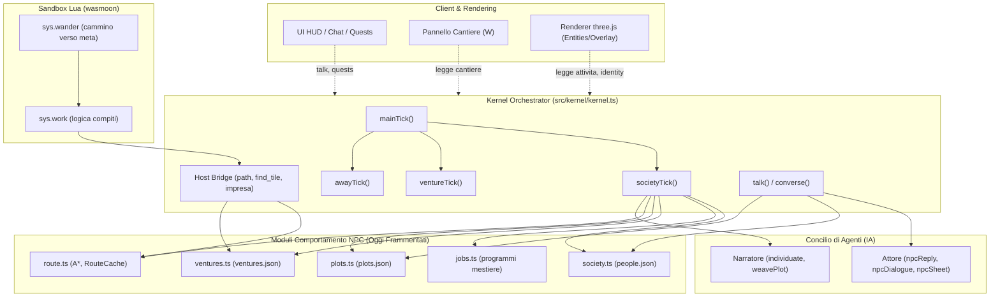

# Il comportamento degli NPC: mestieri, scopi comuni, vite lunghe (T245)

Un progetto, nessun codice. Risponde alla richiesta dell'autore del 04/11: l'intero comportamento degli individui gestito con l'IA, non solo le
chat, ma **con programmi dove si può** e con l'IA solo dove un programma non basta; un grado di realismo e di spesa scelto in lobby dal solo
master e fisso a partita in corso. Ciò che dice del kernel di oggi è letto nel codice (file e funzioni sono nominati); ciò che propone è
da approvare. La misura da cui parte è [`espressivita.md`](espressivita.md) (T183), in particolare il cantiere.

## In breve

1. **Un mestiere è un programma, non una frase.** Oggi la routine di un individuo è testo («lavora al campo di grano») che il kernel
   traduce in un posto dove stare e in una posa (`inferActivity`, `placeFor`, `attivita`): il contadino sta chino sul campo e il campo non
   cambia mai. Qui il mestiere diventa un **programma di mestiere**: dati dell'universo (un modulo `data` con `mestieri`), scritti **una
   volta per mestiere** dal Narratore, validati, riusati da ogni individuo con quel mestiere; i sotto-compiti sono un vocabolario chiuso di
   **comportamenti Lua** del kernel (`vai`, `prendi`, `porta`, `trasforma`, `raccogli`, `produci`, `costruisci`…) che cambiano il mondo davvero
   (caselle, oggetti, contenitori). L'IA non dice mai «cosa fare adesso»: dice una volta com'è fatta la giornata di un mestiere.
2. **Tre livelli decidono, e il gioco regge a ogni livello.** Il kernel tiene orologio, posti, assegnazioni, contabilità e salvataggio; Lua
   esegue i compiti; il Narratore scrive i programmi, le imprese e le riflessioni; l'Attore, se acceso, sceglie ai **bivi** (i soli punti in
   cui due individui con lo stesso mestiere farebbero cose diverse) a partire dalla scheda. Senza Attore i bivi li decide il Narratore, e a
   grado zero li decide un'estrazione del seme: lo stesso mondo, con meno sfumature e nessuna chiamata in più.
3. **Lo scopo comune è un'impresa**: un file dell'universo (`world/imprese.json`) che vive mesi, con fasi, materiali, squadra e stato, e il
   cui progresso è **funzione di ciò che è stato portato e lavorato**, mai di una memoria a parte. Un edificio cresce a vista per **stadi** del
   modello già scolpito (platea, muri, tetto, finiture): nessun programma MarkovJunior nuovo, il programma della struttura è quello di
   `lab/banco/pattern.md`, mostrato a pezzi.
4. **Tre gradi in lobby** (una manopola nuova, `vite`): **Cronaca** (0: solo programmi, nessuna chiamata in più), **Vita** (0,5), **Teatro**
   (1). Costo stimato in più per un'ora di gioco: 0 $, circa 0,18 $, circa 0,60 $ con l'Attore sul suo modello (0,10 $ e 0,29 $ su Flash-Lite),
   sopra il 0,96 $ di oggi. La manopola è un coefficiente come gli altri: la lobby, il blocco a partita in corso e il server la fanno rispettare
   **senza codice nuovo** (ADR-0133).
5. **Tutto entra in un universo esistente senza wipe**, con due cautele: la manopola `vite` deve avere 0 come valore quando manca (oggi un
   coefficiente assente vale 1), e la memoria durevole dei moduli (`D` di T183) deve esistere prima che nascano meccaniche che la vorrebbero.
6. **Nove task**, il primo di una settimana: il magazzino durevole e i comportamenti con tre mestieri scritti a mano, senza IA. Da lì ogni
   passo è visibile nel gioco.

## 0. Com'è oggi, letto nel codice

**La giornata.** `Individual.routine` (`src/kernel/society.ts`) ha quattro passi (`mattina giorno sera notte`), ognuno con `fa` (testo
libero, 60 caratteri), `dove` (`casa | lavoro | piazza | in giro`) e `azione` tra 14 attività (`ACTIVITIES`). Il Narratore la scrive in
`npc.individuate` (`agents/content.ts`) insieme a persona, storia (300 caratteri), famiglia (4 legami), cose portate. Una volta al secondo
`societyTick` (`kernel.ts`) legge la fase del giorno (`dayPhase`, un giorno dura 600 s, `DAY_SECONDS`), al cambio di fase mette
`attivita {tipo, ferma}` e una `meta` scelta da `placeFor` (un letto, una casella di campo, una riva, il margine del bosco, un lotto per
casa e bottega, il centro per la piazza); `sys.wander` (`universe/modules/sys.wander/logic.lua`) ci cammina; arrivati, `ferma` tiene
l'individuo lì e il renderer mostra la posa. **Nessuna azione cambia il mondo**: `zappa` non ara, `cucina` non cuoce, `commercia` non vende.

**Le parole.** Due individui a meno di 2,4 caselle si salutano per legame senza chiamate (`greeting`); se il viandante è a meno di 10
caselle, una conversazione vera (`npc.dialogue`) al più ogni 40 / `dialoghi` secondi, una alla volta (`meetings`, `converse`). Con il
viandante: `npc.reply` sceglie una tra `segui resta vaga dai missione nessuna` (`NPC_ACTIONS` in `agents/minds.ts`) e produce ricordo,
peso, legame, oggetti citati; con l'Attore acceso recita dalla scheda (ADR-0116). I ricordi sono al più 30 per individuo, pesati 1-3
(`remember`); `people.json` tiene al più 200 individui (`addIndividual`).

**Le trame.** `plotTick` fa accadere le tappe al cambio di fase, viste o no: `meta`, battuta, ricordo; una trama nuova quando nessuna
è aperta, nei giorni multipli di 1 / `trame`, al più tre per sessione (`plotsWoven`). Le missioni sono `porta | vai | parla`.

**La memoria che dura.** Da Lua durano solo le caselle cambiate (`plan.edits`) e lo stato del viandante; un `singleton` torna al manifest,
`form.done` non si salva, `world.set_tile` dice no su un luogo non caricato, un luogo lontano per Lua non esiste, e da Lua non si chiede
nulla al Concilio (`durata.test.ts`, righe `LIMIT`). Il tempo del mondo si ferma col mondo; un mondo di molti vuoto si salva e si ferma
dopo 5 minuti (ADR-0114). I luoghi lontani si scaricano con le loro entità (`unloadChunk`): un individuo che non è in un luogo caricato
non esiste come entità, esiste solo in `people.json`.

**Chi paga.** `payerOf` (`cards.ts`): `genesis. council. plot. review. npc.dialogue forge.fix model.* sound.compose content.*` sono
`comune`, diviso tra i collegati (ADR-0081); il resto è del viandante che agisce. Ogni compito ha una manopola in `CENSUS`
(`coefficients.ts`); a 0 nessuna chiamata (`knobOfTask`); le manopole si fissano entrando (ADR-0133).

**Il cantiere di T183.** `tests/espressivita/moduli/mech.cantiere` fa crescere una casa 5×5 per caselle (platea, muri, finiture) con
muratori che portano un pezzo dalla catasta; lo stato è il lavoro stesso, quindi sopravvive alla riapertura; manca il materiale e lo dice,
muore il muratore e ne cerca un altro. Si ferma su: contatori e accordi che non sono caselle (`D`), crescere per forme (`F`), lavorare dove
nessuno guarda (`O`), chiedere al Narratore (`R`), il banco (`Y`).

### Cosa hanno imparato gli altri

**Generative Agents** (Park, O'Brien, Cai, Morris, Liang, Bernstein, UIST 2023, [arXiv 2304.03442](https://arxiv.org/abs/2304.03442)):
25 agenti in una cittadina («Smallville»), ognuno con un **flusso di memoria** in linguaggio naturale, un recupero per recenza, importanza e
pertinenza, **riflessioni** generate quando l'importanza accumulata supera una soglia, e **piani** della giornata in 5-8 punti poi
raffinati ora per ora e minuto per minuto. Risultati: comportamenti credibili ed emergenti (una festa organizzata passando parola, una
candidatura), al prezzo di una chiamata quasi per ogni azione: con GPT-3.5 due giorni di gioco di 25 agenti sono costati, secondo i
resoconti del tempo, migliaia di dollari di token ([Tech Xplore](https://techxplore.com/news/2023-04-scientists-believable-human-interactions-ai.html),
[i-programmer](https://i-programmer.info/news/105-artificial-intelligence/16247-ai-agents-organize-a-party.html)); una stima
indipendente conta circa 6000 chiamate per quei due giorni ([aiunderstanding.org](https://aiunderstanding.org/learn/generative-agents-and-simulated-societies)).
Le tre lezioni per noi: la coerenza viene dalla memoria più la riflessione, non dal modello più grosso; il piano va fatto a grana grossa e
raffinato solo dove serve; **il costo è il nemico**, e qui ogni chiamata la paga chi gioca.

**Project Sid** (Altera.AL, 2024, [arXiv 2411.00114](https://arxiv.org/abs/2411.00114), [codice](https://github.com/altera-al/project-sid)):
da 50 a 1000 agenti in Minecraft con l'architettura **PIANO**: moduli **concorrenti** (percezione, memoria, obiettivi, azione, parola,
consapevolezza sociale) e un **collo di bottiglia** che decide, così che ciò che l'agente dice e ciò che fa restino coerenti. Risultati:
ruoli specializzati che nascono da soli, regole collettive adottate e cambiate, trasmissione culturale e religiosa fra villaggi. La
lezione: più agenti non vuol dire più chiamate per agente se la parola e l'azione passano da un punto solo, e gli agenti hanno bisogno di
uno **scopo condiviso** e di istituzioni (ruoli, tasse, leggi) per produrre qualcosa che si veda.

Qui le due lezioni si rovesciano in una regola: **i programmi fanno il quotidiano, l'IA fa i bivi**. Ciò che Smallville chiedeva al modello
a ogni passo (dove vado, cosa faccio) qui è un programma di mestiere; ciò che Sid faceva con moduli concorrenti qui lo fa il kernel con
un ciclo e Lua; al modello restano la scrittura una tantum (il programma, l'impresa, la scheda) e la scelta ai bivi, entro un ritmo.

## 1. Dal mestiere ai sotto-compiti alle azioni nel mondo

### 1.1 Tre strati

| Strato | Chi lo scrive | Dove sta | Quante volte |
|---|---|---|---|
| **Il mestiere** come parola («contadino», «impiegata del catasto») | il Narratore, in `npc.individuate` | `Individual.mestiere`, com'è oggi | una per individuo |
| **Il programma di mestiere**: la giornata in sotto-compiti con parametri | il Narratore (compito nuovo `job.program`), riparato e validato dal kernel; nel seme alcuni scritti a mano | `universe/modules/lavoro.<slug>/manifest.json`, `kind: data`, campo `mestieri` | **una per mestiere per universo**, riusata da tutti |
| **I comportamenti**: cosa vuol dire `trasforma`, `porta`, `costruisci` | il kernel, in Lua, nel modulo nuovo `sys.lavoro` del seme | `universe/modules/sys.lavoro/logic.lua` | una per kernel |

Il risultato della scomposizione sta nell'universo come dati (regola 5, cartella `modules/` in `councilMayWrite`), timbrato con la carta
come ogni contenuto (`commitContent`), e arriva ai client come ogni manifest (`playerFiles` toglie `logic`; `mestieri` è un campo da
nominare nell'elenco, regola 8f, perché il renderer sappia la posa di ogni compito).

### 1.2 Il programma di mestiere

L'esempio dell'autore, «lavora al campo di grano», scomposto:

```json
{
  "id": "lavoro.contadino", "name": "Il contadino", "kind": "data",
  "mestieri": [{
    "id": "contadino", "nomi": ["contadino", "contadina", "bracciante", "ortolano"],
    "posto": { "casella": "campo" },
    "porta": ["zappa", "semi"],
    "giornata": {
      "mattina": [
        { "fa": "vai", "dove": "lavoro" },
        { "fa": "trasforma", "da": "campo", "a": "arato", "durata": 40, "posa": "zappa", "dice": "Terra dura, stamattina." }
      ],
      "giorno": [
        { "fa": "trasforma", "da": "arato", "a": "seminato", "con": "semi", "durata": 30, "posa": "zappa" },
        { "fa": "raccogli", "casella": "maturo", "oggetto": "grano", "lascia": "campo", "posa": "zappa" }
      ],
      "sera": [
        { "fa": "porta", "oggetto": "grano", "a": "entita:granaio" },
        { "fa": "vai", "dove": "piazza" }, { "fa": "chiacchiera" }
      ],
      "notte": [ { "fa": "vai", "dove": "casa" }, { "fa": "riposa" } ]
    },
    "bivi": [
      { "quando": "manca:semi", "opzioni": ["compra:semi", "chiedi:vicino", "aspetta"] },
      { "quando": "pioggia", "opzioni": ["ripara", "continua"] }
    ]
  }]
}
```

Regole della forma, che il validatore applica (ogni riferimento deve esistere, come per i piani dei luoghi):

- `fa` è uno del **vocabolario chiuso** dei comportamenti (sotto); un compito ignoto rende invalido il programma, che torna al Narratore col
  motivo (regola 2).
- Ogni `casella` è un codice della palette dell'universo (`world.terrain` più i terreni aggiunti); ogni `oggetto` è nel registro dei contenuti
  (`content.items`); `entita:<tag>` è un tag di un modulo esistente (`has_tag`); `dove` è `casa | lavoro | piazza | impresa | casella:<codice> | entita:<tag>`.
- Al più 6 compiti per fase, `durata` fra 5 e 300 secondi del mondo, `posa` tra le `ACTIVITIES` (un compito senza `posa` prende quella
  che `inferActivity` ricava dal suo nome).
- **Prova a secco nel banco**: il programma gira un giorno intero su un luogo pianificato di prova con un individuo finto (`runCase`, con la
  primitiva `Y` di T183: oggi i luoghi del banco non sono mai pianificati); se un compito non trova mai il suo posto (nessuna casella `campo`
  in nessun terreno dell'universo) il programma torna al Narratore con la riga precisa.

**Come si abbina un individuo a un programma.** `mestiere` è testo libero; il kernel lo normalizza (minuscole, senza articoli) e cerca in
`nomi`; se non trova, cerca per le parole (`contadino` in «contadino del Rovo»); se non trova ancora, mette il mestiere in coda a un
**`JobDirector`** (come il `ModelDirector` per i modelli che mancano: uno alla volta, un ritmo, un tetto `ai.maxMestieri`), che chiede al
Narratore `job.program` con il contesto: la bibbia, i terreni e gli oggetti che esistono, i programmi già scritti (così «bracciante» diventa
un nome in più del contadino e non un programma nuovo), i principi dei due tavoli. Finché il programma non c'è, o se la manopola non
lascia passare la chiamata, l'individuo vive **come oggi** (`sys.wander`, posa da `inferActivity`): nulla peggiora. Il seme porta una
dozzina di programmi scritti a mano, generici per ogni epoca (contadino, boscaiolo, pescatore, pastore, fabbro, oste, mercante, guardia,
sacerdote, scrivano, cuoco, impiegato): a grado zero sono i soli, e `inferActivity` sceglie il più vicino.

### 1.3 I comportamenti Lua

Un vocabolario chiuso, nel modulo `sys.lavoro` del seme (un modulo nuovo arriva agli universi esistenti con `upgradeFromSeed`, perché non
l'hanno mai avuto; **non** in `core.*`, che un universo può aver riscritto: la trappola 6 di T183). Ogni comportamento è una funzione pura
`(id, compito, stato, dt) → finito | continua | fallito:<motivo>`; lo stato del compito in corso sta nel componente `lavoro {compito,
passo, da, inizio}` dell'individuo (regola 4: stato nei componenti).

| Comportamento | Cosa fa nel mondo | Primitive del `Host` che usa |
|---|---|---|
| `vai {dove}` | cammina fino al posto (casa, lavoro, piazza, una casella, un'entità, il cantiere dell'impresa) | `world.find_tile` (nuova), `world.nearest`, `world.path` (nuova), `world.free` |
| `prendi {oggetto, da}` | prende da un contenitore (`entita:`), da terra o da un deposito dell'impresa | `world.open`, `inventory.add/remove` |
| `porta {oggetto, a}` | porta ciò che ha a un contenitore o al deposito dell'impresa | come sopra |
| `trasforma {da, a, con?, durata}` | dopo `durata` di lavoro la casella sotto i piedi passa da `da` ad `a`, consumando `con` | `world.tile`, `world.set_tile` (dura in `plan.edits`) |
| `raccogli {casella, oggetto, lascia}` | una casella `maturo` → `lascia`, l'oggetto nell'inventario | come sopra |
| `produci {oggetto, con, durata, a}` | a un banco (`entita:`) consuma `con` e produce `oggetto` (le ricette del registro, `content.recipes`) | `items.find`, `inventory.*` |
| `usa {entita}` | come «Usa» del viandante: `on_act` del modulo (il forno, il pozzo, la campana) | `host.act` (nuova: oggi `on_act` lo chiama solo il viandante) |
| `costruisci` | il prossimo passo dell'impresa a cui appartiene (vedi 3.4) | `world.impresa` (nuova) |
| `pattuglia {percorso}` | un giro fra due o più posti | `vai` |
| `riposa`, `mangia`, `prega`, `chiacchiera`, `aspetta {durata}` | la posa di oggi, ferma | nessuna |

**La maturazione** (il grano che cresce) non è un comportamento: è del **kernel**. Un terreno dichiara `tiles[].matura {dopo: <giorni>,
in: <codice>}` (campo nuovo del generatore, con un valore predefinito nel kernel, trappola 5 di T183); al cambio di fase il kernel fa
maturare le caselle dei luoghi caricati, e al ritorno quelle dei luoghi che erano scaricati (sezione 5). Lo stato di una casella è il
suo codice più la data in cui è stata scritta: `plan.edits` oggi tiene l'indice e il codice; serve anche **il giorno** (campo nuovo del
salvataggio, in avanti; vedi 6).

**Il budget del tick.** `sys.wander` è già il sistema più caro (~5 ms con 100 entità). `sys.lavoro` gira solo per gli individui con un
programma nei luoghi caricati, con il cammino calcolato dal kernel (`world.path` restituisce il prossimo punto di una via già calcolata e
tenuta in cache per posto di partenza e arrivo, A* sulle caselle del luogo: la primitiva `N` di T183) e al più **12 individui al lavoro
per luogo caricato**; oltre, i restanti vivono come oggi. Il costo è misurato dal `meter` della Sala sistemi come per ogni sistema.

### 1.4 Le primitive del `Host` che servono (tutte aggiuntive)

| Lettera (T183) | API | Perché |
|---|---|---|
| `D` | `world.store_get(chiave)`, `world.store_set(chiave, valore)` | contatori, accordi, consegne: tutto ciò che non è una casella; un file per modulo, un tetto in byte per modulo e per universo, mai in `playerFiles` |
| `N` | `world.path(x, y, tx, ty)` → prossimo punto; `world.find_tile(codice, x, y, r)` → casella libera più vicina | camminare e trovare il posto senza scrivere un A* in Lua a ogni modulo |
| `L` | `world.place(modulo, x, y)` | posare cose che durano (il cumulo del cantiere, una staccionata), in `plan.objects` |
| `F'` | `world.form_stage(id, stadio)` | lo stadio di una struttura (3.4), salvato nel piano con la struttura |
| — | `world.impresa()` da `costruisci` | il prossimo compito dell'impresa a cui l'individuo appartiene, deciso dal kernel |
| — | `host.act(id, user, azione)` | un individuo che «usa» una cosa come fa il viandante |
| `R` | **no** | Lua non chiede nulla al Concilio: i bivi li raccoglie il kernel (2.3), con ritmo e pagante |

Ogni API nuova segue la convenzione: `Host` + `prelude.lua` + `LUA_API` del validatore + prompt dell'Ingegnere + `AGENTS.md`. Nessuna toglie
o cambia di senso un'API esistente (regola 1 di T183 per i cambi senza wipe).

## 2. Chi decide cosa

| Decide | Kernel | Lua (`sys.lavoro`) | Narratore | Attore (se acceso) |
|---|---|---|---|---|
| Che ore sono, che fase è, chi è caricato | ● | | | |
| Il programma di un mestiere | valida, abbina, tiene la coda | | **scrive una volta** | |
| Cosa fa adesso un individuo | sceglie il compito dalla fase e dall'impresa | **esegue** | | |
| Dove sta il campo, il letto, il banco | `placeFor`, `find_tile` | | | |
| Un bivio (manca un materiale, pioggia, qualcuno chiede aiuto, una lite) | raccoglie, ritma, **sceglie col seme a grado 0** | | sceglie se l'Attore è spento | **sceglie dalla scheda** |
| Un'impresa nuova e le sue fasi | nasce da regole o da una trama; valida | | **scrive** | |
| Chi lavora a cosa | assegna per mestiere, vicinanza, disponibilità | | | |
| Cosa ricorda, cosa pensa dopo mesi | tiene la cronaca per righe | | **riflette** (compito nuovo) | |
| Cosa dice mentre lavora | le righe `dice` del programma | | | battute, come oggi |
| Un evento di vita (nozze, nascita, trasloco) | decide per regole e calendario | | racconta | |
| Salvare, committare, rollback | ● | | | |

**A Attore spento il gioco regge uguale**: i bivi sono un compito `npc.decide` il cui interprete è `kernel.interpreter()`, come oggi
`npc.reply`: l'Attore col suo modello se acceso, altrimenti il Narratore; e a grado zero nessun modello, il kernel estrae l'opzione dal seme
dell'universo e dal nome dell'individuo (ADR-0055: mai dall'orologio), pesata dai tratti (sezione 8). Lo stesso bivio nello stesso mondo con
lo stesso seme dà la stessa scelta.

### 2.1 Che cos'è un bivio

Un bivio è il solo punto in cui due individui con lo stesso programma farebbero cose diverse. Li dichiara il programma (`bivi`, con
`quando` da un elenco chiuso: `manca:<oggetto>`, `bloccato`, `pioggia`, `notte`, `chiesto:<cosa>`, `lite`, `impresa:ferma`, `impresa:finita`)
e li alza Lua con `fallito:<motivo>` o con il kernel (il viandante ha chiesto qualcosa). Le opzioni sono chiuse e tutte eseguibili senza
IA: `compra:<oggetto>`, `chiedi:vicino`, `chiedi:viandante`, `aspetta`, `ripara`, `continua`, `rinuncia`, `va_a_casa`, `aiuta`, `ignora`.
L'Attore riceve scheda, ricordi, tratti, la situazione in tre righe e le opzioni; risponde con un'opzione e una battuta (schema con `enum`, come
`NPC_ACTIONS`). Un'opzione fuori elenco vale `aspetta`. **Mai Lua libero dal modello.**

### 2.2 Il ritmo dei bivi

Un bivio costa una chiamata solo se c'è un viandante a meno di 10 caselle (come i dialoghi: chi non si vede non recita) e nei limiti della
manopola: al più `stretch(1, vite)` bivi al giorno per individuo e uno ogni 20 secondi del mondo in tutto, con la stessa regola dei
dialoghi (`lastTalk`). Gli altri bivi, e tutti quelli fuori vista, li decide il seme. A grado 1 un individuo vicino può avere un bivio per
fase; a 0,5 uno al giorno; a 0 nessuno.

### 2.3 Chi paga

Ciò che il viandante causa lo paga lui (chiede aiuto, porta materiale e il bivio è «accetto?»); ciò che il mondo fa da sé è `comune`
(`job.program`, `impresa.plan`, `npc.reflect`, `npc.life`, e `npc.decide` alzato da Lua o dal calendario). `payerOf` resta la politica;
`npc.decide` chiesto dal viandante passa `chi` esplicito dopo l'`await`, come `npc.reply` (regola 8i, V-022). Senza nessun collegato con
crediti le spese comuni vanno ai modelli locali (8i): a mondo vuoto non si chiama nessuno, vedi 5.

## 3. Lo scopo comune: l'impresa

### 3.1 Il nome e il perimetro

**Impresa** (voce nuova del glossario, inglese `venture`): un lavoro di molti verso un risultato che si vede, lungo giorni o mesi. Un
edificio è il caso dell'autore, ma il tipo è generale: una **costruzione** (casa, pozzo, ponte, strada, mura, un tempio), un **raccolto**
(tutta la valle miete in tre giorni), una **festa** (preparare la piazza, cucinare, suonare), una **ricerca** (qualcuno è sparito, si
battono i boschi), una **bonifica** (dopo un'alluvione o un incendio: la primitiva `A` di T183), un **viaggio** (una carovana che parte e
torna), un'**elezione** (lo scenario 17 di T183: comizi, voto, insediamento). Ogni tipo ha le sue fasi e i suoi compiti, ma la forma del file
e le regole di squadra, materiali, morte e intervento sono le stesse.

### 3.2 Come nasce e dove vive

Nasce da: una **trama** (il Narratore in `plot.weave` può proporre un'impresa al posto di una missione: «i Rovi ricostruiscono la casa
bruciata»); una **sessione del Concilio** (l'Arbitro decide che il villaggio ha bisogno di un pozzo); il **Referente** nella corona (il
master chiede «fate costruire un ponte»); una **regola del kernel** senza chiamate (un edificio distrutto genera la sua ricostruzione; il
raccolto nasce ogni anno dal calendario; un lotto vuoto con tre famiglie senza casa genera una casa comune, con `commonHouse` ADR-0134);
un **giudizio del Narratore** su un «Altro…» del viandante («organizzo una festa»), con un effetto nuovo `impresa`.

Vive in `world/imprese.json` (cartella `world/`, in `councilMayWrite`; **non** in `playerFiles`: il client vede l'impresa solo per ciò che
c'è nel mondo e per il pannello del cantiere, 3.6):

```json
{ "imprese": [{
  "id": "i-14", "titolo": "La casa nuova dei Rovi", "tipo": "costruzione", "stato": "in corso",
  "luogo": "3_-2", "lotto": 1, "modello": "casa-di-pietra", "taglia": "grande", "seme": 4211,
  "fasi": [
    { "nome": "platea",   "materiali": { "pietra": 40 },            "lavoro": 1800, "stadio": 0.2 },
    { "nome": "muri",     "materiali": { "pietra": 120, "legno": 20 }, "lavoro": 7200, "stadio": 0.7 },
    { "nome": "tetto",    "materiali": { "legno": 60, "paglia": 30 },  "lavoro": 3600, "stadio": 0.9 },
    { "nome": "finiture", "materiali": { "legno": 10 },               "lavoro": 1800, "stadio": 1 }
  ],
  "portati": { "pietra": 52, "legno": 0, "paglia": 0 }, "lavorato": 2100,
  "squadra": [ { "nome": "Baldo", "ruolo": "capomastro" }, { "nome": "Ivo", "ruolo": "manovale" }, { "nome": "Nives", "ruolo": "manovale" } ],
  "inizio": 12, "ultimo": 15, "nato_da": "trama:t-4", "carta": { "autore": "narratore", "pagante": "comune", "titolare": "ada" }
}] }
```

Il **progresso è derivato**: la fase corrente è la prima le cui `materiali` non sono tutti in `portati` o il cui `lavoro` cumulato non è
raggiunto da `lavorato`; lo stadio visibile è quello della fase compiuta. Niente contatore separato da tenere coerente: come il cantiere
di T183, «lo stato del lavoro è il lavoro stesso», solo che qui le due grandezze (portato, lavorato) stanno in un file che dura, non in
un `singleton` che torna al manifest. Il file è scritto prima di ogni commit come `carte.json` e sopravvive al rollback come i consumi?
**No**: un'impresa fa parte della storia del mondo, il rollback la riporta indietro con tutto il resto (regola 6); solo i saldi stanno fuori.

### 3.3 Come se la dividono

Il kernel assegna, senza chiamate: ogni fase dice i **ruoli** che vuole (`capomastro: muratore`, `manovale: qualunque`, `carpentiere:
falegname`), e il kernel cerca nella società per mestiere, poi per vicinanza (stesso luogo, poi i vicini del grafo), poi chiunque sia
libero; al più 6 per impresa. Per chi è in squadra l'impresa **prende il posto della fase `lavoro`** della giornata: il suo programma di
mestiere resta per mattina, sera e notte, e per il giorno il compito è `costruisci`, cioè il prossimo passo che il kernel dà: portare un
materiale che manca dal posto dove si trova (il bosco per il legno, con il programma del boscaiolo che **produce** legno e lo porta al
deposito: l'economia nasce da qui, senza mercato), o lavorare sul lotto. Chi fornisce materiali senza essere in squadra (il boscaiolo del
paese) li porta al deposito come compito `porta` della sua giornata, se l'impresa lo chiede: il kernel mette l'impresa come
destinazione preferita dei prodotti dei mestieri che ne producono.

Un individuo con l'Attore acceso può **rifiutare** o **lasciare** la squadra (un bivio `chiesto:impresa` quando il kernel lo assegna, pesato
dai tratti: l'avaro chiede «e a me cosa viene?», il diffidente rifiuta il lavoro del comune); a grado zero i tratti decidono col seme.

### 3.4 Un edificio che cresce a vista, per stadi del modello

I programmi delle strutture (`lab/banco/pattern.md`, T181) crescono già come un cantiere: il lotto, il progetto su z=0, le colonne, le
scale, le facce. Ma un programma gira in un colpo (8 s di `MODEL_TIME`) e un semi diverso dà una pianta diversa: **non si può eseguirlo a
tappe** senza riscriverlo e senza fissare in anticipo cosa viene prima. La proposta è l'opposto: il programma gira **una volta sola**, al
nascere dell'impresa, col suo `seme`, e il risultato (la griglia di voxel, in cache come ogni forma, ADR-0108) si mostra **filtrato per
stadio**:

| Stadio | Cosa si vede | Come si calcola, dalla griglia finita |
|---|---|---|
| 0 | il lotto segnato: picchetti e corda (modello del kernel `cantiere-picchetti`) | niente del modello |
| platea (0,2) | il piano terra pieno | i voxel con z ≤ quota del primo pavimento |
| muri (0,7) | muri e pilastri fino al primo solaio, poi fino alla base del tetto; **impalcature** attorno (modello del kernel `impalcatura`, scalato al lotto) | voxel con z ≤ h(stadio), con h che sale dal primo pavimento alla base del tetto (le quote vengono da `floors` in `src/mj/mesh.ts`: la cima di ogni tratto pieno di ogni colonna) |
| tetto (0,9) | l'edificio intero, impalcature ancora su, luci spente | tutti i voxel; i voxel luminosi (ADR-0046) restano spenti |
| 1 | finito: impalcature sparite, luci accese | tutto |

La palette non ha classi di voxel (una lettera è un colore): per questo gli stadi sono quote, non materiali, e le finiture (la porta che
si monta, le finestre) restano a un'`<action>` opzionale del modello. Il filtro è una funzione pura `(griglia, stadio) → griglia` in `src/mj/mesh.ts` accanto a `mesh`, usata da `render/forms.ts` quando la
struttura ha `stadio < 1`; il piano del luogo salva lo stadio con la struttura (`maps/`, campo nuovo `strutture[].stadio`, in avanti; T183:
«campo nuovo nel salvataggio funziona avanti»). L'impronta e i pavimenti seguono lo stadio (a 0,2 non si entra, a 0,7 si entra e non si sale
dove il solaio manca); i muri bloccano a caselle come sempre (regola 10). Gli interni degli individui (`placeFor` con `interiorPoints`) valgono
dallo stadio `tetto`. **Non serve nessun nodo MarkovJunior nuovo** e funziona con ogni modello già scolpito, vecchi universi compresi.

Varianti più care, per dopo: eseguire davvero il programma a tappe con `steps` (coerente ma chiede programmi scritti apposta, e lo
Scultore non li sa ancora scrivere: T156); un'animazione `<action>` per stadio (la `F` di T183), buona per i dettagli (la porta che viene
messa, la finestra che si monta) sopra il filtro.

**Coerenza visiva nel tempo**: `lavorato` cresce solo quando qualcuno è davvero sul lotto a lavorare (nel luogo caricato) o per contabilità
(5): lo stadio sale a scatti di fase, mai all'indietro; fra una fase e l'altra l'edificio sta fermo con le impalcature, come un cantiere vero.
Il tempo tipico: una casa grande con tre persone, 4 giorni di mondo (40 minuti di gioco) se il materiale c'è; un forte, mesi.

### 3.5 Cosa succede se

- **Chi lavora muore** (o sparisce da `people.json`): al cambio di giorno il kernel toglie dalla squadra chi non c'è più, cerca un
  sostituto come in 3.3; con `persone` > 0 un individuo nuovo può nascere vicino al cantiere (è `npc.individuate` di oggi, sul tipo adatto).
  Senza nessuno la squadra è vuota e l'impresa è `ferma`, visibile (impalcature e cumulo restano) e riprende quando qualcuno torna. **Mai
  dipende da uno** (T183 lo prova per il cantiere di prova).
- **Manca il materiale**: la fase aspetta, `stato: attesa`, il deposito si vede vuoto, chi è in squadra dice la riga del programma («manca
  la pietra») e torna al suo mestiere; il kernel alza il bivio `impresa:ferma` (chi va a cercarla, chi rinuncia). A grado ≥ 0,5 la prossima
  trama ha l'impresa nel contesto (`plot.weave` riceve «imprese aperte»): il Narratore può farne una missione per il viandante («portaci 20
  pietre»), ed è l'unico aggancio con le missioni, senza compiti nuovi.
- **Il viandante interviene**: porta materiale al deposito (conta in `portati`, i presenti lo ricordano con peso 2, la carta dell'impresa
  conta un utilizzo); rompe caselle o voxel con gli effetti (la fase si rifà: progresso derivato); uccide (sopra); «Altro…» sul cantiere →
  giudicato dal Narratore come ogni azione libera, con l'effetto nuovo `impresa {azione: ferma | riprendi | materiale:<oggetto>:<n> | lascia:<nome>}`,
  effetto **del kernel** e non di `core.effects` (trappola 3 di T183); e in multigiocatore vale la regola 8b: un giocatore non riscrive il file,
  può solo agire nel mondo.
- **Il luogo è scaricato**: sezione 5.
- **L'impresa finisce**: `stato: finita`, l'edificio diventa una struttura come le altre (casa dei Rovi: `placeFor` la dà loro come `casa`),
  un ricordo di peso 3 per la squadra, un evento di vita (8), la carta dell'impresa resta nella collezione.

### 3.6 Cosa si vede e cosa si legge

Dentro il mondo: picchetti, impalcature, cumulo, gente che porta e lavora, la casa che sale per stadi, le righe `dice`. Un pannello
(`manifest.ui` di `sys.lavoro`: «Il cantiere», fase e cosa manca) si apre sul cumulo con «Esamina», i campi arrivano al client con la
primitiva `W` di T183 (un elenco, regola 8f). Nel registro del Concilio ogni fase compiuta è una riga (`impresa.fase`, nessuna chiamata).
Nessun meta-gioco: fasi, materiali e ruoli sono parole del mondo (regola 0, con il lessico).

## 4. I costi, con i numeri

Le ipotesi sono quelle di `HOUR` in `coefficients.ts` (40 luoghi nuovi all'ora, 6 giorni di mondo all'ora, 1,5 individui per luogo) e i
pesi di `WEIGHT.testo` (3500 token di prompt di cui 1500 in cache, 500 di risposta); i prezzi sono quelli di `prices.ts` letti il
22/10/2026. Una chiamata di testo costa **0,13 ¢** su `gemini-3.1-flash-lite` e **0,35 ¢** su `gemini-3.8-flash` (il modello dell'Attore).
Base di oggi, seme a pieno dettaglio: 358 chiamate e 0,96 $ l'ora; con l'Attore 413 e 1,17 $ (ADR-0116).

### 4.1 I compiti nuovi

| Compito | Agente, modello | Quando | Manopola | Pagante |
|---|---|---|---|---|
| `job.program` | Narratore, testo | un mestiere senza programma, uno alla volta (`JobDirector`), ×1,5 per i rinvii del validatore | `vite` (a 0: solo i programmi del seme) | `comune` |
| `impresa.plan` | Narratore, testo | un'impresa nuova: 1 chiamata, più 1 per fase che il validatore rimanda; al più una impresa ogni `stretch(3, vite)` giorni per universo | `vite` (a 0: solo le imprese dalle regole del kernel, con fasi del seme) | `comune` |
| `npc.decide` | Attore (o Narratore), suo modello | un bivio di un individuo a meno di 10 caselle, al più `stretch(1, vite)` al giorno per individuo e uno ogni 20 s | `vite` (a 0: il seme) | `comune`; il viandante se l'ha causato |
| `npc.reflect` | Narratore, testo | un individuo con ≥ 3 righe nuove di cronaca, ogni `stretch(3, vite)` giorni, solo se incontrato | `vite` (a 0: mai; la cronaca resta per righe) | `comune` |
| `npc.life` | Narratore, testo | un evento di vita deciso dal calendario (8.3): al più uno al giorno per universo | `vite` (a 0: testo da modello del kernel) | `comune` |

Tutti in `CENSUS` con la manopola (il test `regolazioni.test.ts` lo pretende); tutti con risposta in `MockAiModels` e voce nel registro.

### 4.2 Per NPC, per ora, per universo, per mese

Un'ora di gioco con il viandante che vede ~6 individui alla volta e ne incontra 60 in tutto:

| | Cronaca (`vite` 0) | Vita (0,5) | Teatro (1) |
|---|---|---|---|
| Chiamate per NPC visto, per giorno di mondo | 0 | ≈ 1,2 (1 bivio, 1/6 di riflessione) | ≈ 4,3 (4 bivi, 1/3 di riflessione) |
| `npc.decide` all'ora | 0 | 36 | 144 |
| `npc.reflect` all'ora | 0 | 20 | 40 |
| `impresa.plan` all'ora | 0 | 6 | 12 |
| `npc.life` all'ora | 0 | 3 | 6 |
| `job.program` (prima ora, poi quasi 0) | 0 | 10 | 20 |
| **Chiamate in più all'ora** | **0** | **≈ 75** | **≈ 220** |
| **Dollari in più all'ora**, Attore su 3.8 Flash | **0** | **≈ 0,18 $** | **≈ 0,60 $** |
| Dollari in più all'ora, bivi su Flash-Lite | 0 | ≈ 0,10 $ | ≈ 0,29 $ |
| Totale dell'ora sopra 0,96 $ | 0,96 $ | ≈ 1,14 $ | ≈ 1,56 $ |

Per universo: i programmi di mestiere sono un costo **una tantum**, circa 40 mestieri in una vita di universo, 60 chiamate, **0,08 $**.
Per mese: un universo di beta giocato 2 ore al giorno da tre viandanti insieme (60 ore al mese, spese comuni divise per tre): Vita
**≈ 11 $ al mese**, Teatro **≈ 36 $**, cioè 4 $ e 12 $ a testa. Il tetto di spesa di ogni viandante e i budget di sessione (`maxText`)
capano tutto come oggi. Le righe entrano in `hourlyEstimate` (una riga per compito, con l'Attore sul suo modello per `npc.decide`), e la
lobby le mostra accanto alla manopola con il testo di `COEFFICIENT_INFO.minimo`: «gli individui lavorano e costruiscono secondo i
programmi; nessuno riflette né sceglie».

«Low Detail» (circa un quinto delle chiamate che il mondo fa da sé): `vite: 0,2`, cioè un bivio ogni 5 giorni per individuo e una
riflessione ogni 15: in pratica Cronaca con qualche sorpresa.

### 4.3 Ciò che non costa chiamate e costa invece calcolo

Il cammino (`world.path`), la contabilità dei luoghi scaricati, il filtro per stadio, la maturazione: tutto nel kernel o in Lua, misurato
dal `meter` e dal budget del tick (ADR-0105). Il rischio vero di un mondo di mesi non è il modello, è il **tick** che cresce con le entità:
da qui i tetti (12 al lavoro per luogo, 6 per impresa, 20 imprese aperte per universo) e la contabilità invece della simulazione fuori vista.

## 5. Luoghi non caricati e il server dei mondi di molti

**Due regimi.** Un luogo caricato (entro `WORLD_BEYOND_EDGE` di un viandante) simula tutto: Lua, cammino, caselle. Un luogo scaricato
non ha entità: i suoi individui esistono solo in `people.json`. Oggi là non succede nulla, tranne le tappe delle trame, che sono «accadute»
per decreto (`plotTick`: ricordo e stato, senza corpo). La proposta è la stessa idea estesa: **contabilità** al cambio di fase, nel kernel,
senza Lua e senza chiamate:

- per ogni impresa con il luogo scaricato: `lavorato += ritmo × membri vivi × durata della fase di giornata`, se i materiali della fase ci
  sono; `portati` cresce di ciò che i mestieri fornitori producono al giorno (un numero per programma: `produce {oggetto: n al giorno}`);
- per ogni mestiere con un posto: il suo prodotto del giorno nel deposito del luogo (`world.store` del luogo, `D`): il granaio si riempie;
- le caselle con `matura` passano di stadio per data;
- i bivi fuori vista li decide il seme, subito.

**Al ritorno** (il luogo si carica: `O` di T183, `on_return(luogo, trascorso)`): il kernel applica la contabilità al mondo prima di dare il
luogo a Lua: le caselle della fase raggiunta dall'impresa (dalla pianta del lotto, `plan.edits` per indice), lo stadio della struttura, le
caselle mature, il deposito. Il viandante che torna dopo una settimana trova la casa ai muri, il campo maturo, il granaio pieno: **vede il
risultato, non il lavoro**, che è ciò che chiede l'autore (coerenza visiva per passi) senza simulare dove nessuno guarda. Un modulo generato
può dichiarare `on_return` e ricevere `trascorso`: la primitiva c'è per le meccaniche future, ma le imprese e i mestieri non ne hanno bisogno.

**Il tempo a mondo fermo.** T183 lo dice: «un mese di calendario è un mese di gioco» è una decisione. Proposta: **resta così**. Il mondo di molti
si ferma vuoto (ADR-0114) e l'orologio con lui; da soli il mondo è nel browser. Se il tempo scorresse da fermo, chi torna dopo una
settimana reale troverebbe la casa finita senza averla vista crescere, e le spese comuni di quel tempo non avrebbero nessuno a cui andare.
Un'opzione del master per dopo (`partita.orologio: scorre`), con un tetto (al più 3 giorni di mondo recuperati per riapertura).

**Il server (regola 8g).** La contabilità sta nel processo del mondo, dentro il tick, come tutto il resto: niente segreti nuovi, niente rotte
nuove. A mondo acceso ma senza nessuno (i 5 minuti) nessun compito nuovo chiama i modelli: `comune` senza collegati con crediti va ai
modelli locali (8i), e per `npc.decide` la regola è più severa: senza un viandante vicino il bivio è del seme, non dei modelli locali, così
nessuno paga per ciò che nessuno vede. Il sorvegliante (`healthy` da `pronto`) non cambia: la contabilità è una funzione dell'orologio,
costa microsecondi per fase.

**Il client sottile (ADR-0059).** `attivita` è già in `ENTITY_PARTS`; servono `lavoro.posa` per la posa dei compiti (o si scrive in
`attivita.tipo`, e allora nulla cambia: è la via proposta), lo stadio della struttura nel piano del luogo (già `playerFiles`), i campi del
pannello (`W`). Il kernel specchio non simula: disegna.

## 6. Senza wipe: cosa entra in un universo esistente, e cosa va nel kernel 0.9.0

Dalla tabella «Il costo di una primitiva aggiunta dopo» di T183, caso per caso:

| Cosa | Genere (T183) | Entra senza wipe? | Cautela |
|---|---|---|---|
| `world.store`, `world.path`, `world.find_tile`, `world.place`, `world.form_stage`, `world.impresa`, `host.act` | API Lua in più | **sì** | mai togliere né cambiare di senso; `LUA_API` del validatore |
| `sys.lavoro`, i programmi del seme `lavoro.*`, i modelli `impalcatura`, `cantiere-picchetti` | moduli e modelli nuovi del seme | **sì** (`upgradeFromSeed`: mai avuti) | un universo che li cancella apposta non li riceve: giusto così |
| `mestieri` nei manifest `data`, `matura` nei `tiles`, `stadio` nelle strutture di `maps/` | campo nuovo nel manifest e nel salvataggio | **sì** | il kernel regge il campo assente (predefinito nel kernel); il campo nuovo sopravvive solo in avanti |
| `world/imprese.json` | file nuovo | **sì** | assente = nessuna impresa |
| `tratti`, `opinioni`, `cronaca` in `people.json` | campo nuovo in un file del mondo | **sì** | individui vecchi: tratti neutri dal seme finché una riflessione non li scrive |
| il giorno in `plan.edits` | formato di file che cambia | **sì, con migrazione alla lettura** | una voce senza giorno vale «oggi»; si legge il vecchio per sempre |
| `vite` in `COEFFICIENT_KEYS` | campo nuovo in `universe.json → ai` | **sì, con una regola** | **`repairCoefficients` dà 1 a una chiave assente**: un universo vecchio avrebbe Teatro senza averlo scelto. `vite` assente deve valere **0** (una riga nel riparatore e nel test) |
| i cinque compiti in `CENSUS` | censimento | sì | `payerOf`, `MockAiModels`, registro |
| l'effetto `impresa` | effetto nuovo | sì, **nel kernel** | non in `core.effects` (trappola 3) |
| il filtro per stadio | derivato dal modello | sì | non tocca i piani: il modello finito è lo stesso di prima |

Nessuna di queste chiede un wipe. Due cose però **devono venire prima** che gli universi ufficiali nascano, perché dopo costerebbero
ogni giorno (la divisione di T183):

1. **`D`, il magazzino durevole**: ogni meccanica forgiata prima nasce smemorata, e le imprese senza non si contano.
2. **`vite` con 0 come predefinito** e la riga in `CENSUS`: aggiungere una manopola dopo è possibile, ma con il predefinito sbagliato un
   universo esistente cambierebbe spesa da solo.

E, dalla lista di T183, **`plan.tiles` fissato** (i luoghi salvati come caselle) prima del primo cambio di caso: non è di questo progetto
ma lo condiziona, perché `trasforma` e `raccogli` scrivono per indice in `plan.edits`.

**Proposta per il kernel 0.9.0** (Fase I, criterio 5 di `docs/fasi.md`): `D`, `vite` a 0, `plan.tiles`, `sys.lavoro` con i comportamenti e
i programmi del seme, il filtro per stadio e `world/imprese.json` con le imprese dalle regole del kernel (Cronaca intero). **Per il 1.0.0** (Fase
III, dai requisiti della beta): `job.program` e `impresa.plan` dal Narratore, i bivi dell'Attore, riflessioni, eventi di vita, tratti e
opinioni, la contabilità fuori vista con `on_return`. Tutto il secondo gruppo è aggiuntivo: la beta può giocare Cronaca e dire cosa le manca.

## 7. La spezzatura in task

Le stime sono nella scala della pipeline (percentuale della finestra); l'ordine è di dipendenza. Ogni task ha il suo turno di test, typecheck e, dove
cambia ciò che si vede, la verifica nel browser.

| Task | Cosa | Stima | Dipende da | Fase proposta |
|---|---|---|---|---|
| **T245a** | `D`: `world.store_get/set` (file per modulo, tetto in byte, fuori da `playerFiles`); il salvataggio conserva i campi ignoti (T183, regola 4); `vite` in `COEFFICIENT_KEYS` con 0 assente, in lobby e in `hourlyEstimate` (riga vuota finché non ci sono compiti) | 7 % | — | 0.9.0 |
| **T245b** | `sys.lavoro` con i comportamenti, `world.path` e `world.find_tile` nel `Host`, `matura` nei terreni, il giorno in `plan.edits`; **tre programmi scritti a mano** nel seme (contadino, boscaiolo, pescatore) e il campo che cambia davvero; test del banco su un luogo pianificato (`Y`) | 12 % | T245a | 0.9.0 |
| **T245c** | Gli altri nove programmi del seme per le quattro ambientazioni (T152), `produci` e `usa` (`host.act`), il deposito del luogo; verifica nel browser di una giornata di tre mestieri | 7 % | T245b | 0.9.0 |
| **T245d** | Le imprese: `world/imprese.json`, assegnazione, materiali, morte e sostituzione, le imprese dalle regole del kernel (ricostruzione, casa comune, raccolto), `costruisci`, il pannello del cantiere con `W`; test di durata (mesi di orologio, riaperture) | 12 % | T245b | 0.9.0 |
| **T245e** | L'edificio per stadi: filtro `(griglia, stadio)`, impalcature e picchetti, impronta e pavimenti per stadio, `stadio` nel piano; browser: una casa che sale in quattro fasi | 9 % | T245d | 0.9.0 |
| **T245f** | Fuori vista: contabilità al cambio di fase, `on_return`, maturazione e stadio al ritorno; sul server dei mondi di molti con due viandanti lontani | 9 % | T245d, T245e | 0.9.0 o 1.0.0 |
| **T245g** | Il Narratore scrive: `job.program` con `JobDirector` e validatore, `impresa.plan` dalle trame e dal Referente, effetto `impresa`, `CENSUS`, mock, registro; i costi misurati su un universo | 10 % | T245c, T245d | 1.0.0 |
| **T245h** | I bivi: `npc.decide` con l'Attore o il Narratore, opzioni chiuse, ritmo, chi paga; tratti e opinioni in `people.json` e nella scheda; a grado 0 il seme | 10 % | T245g | 1.0.0 |
| **T245i** | Vite lunghe: cronaca per righe, `npc.reflect`, `npc.life` con il calendario (nozze, nascite, traslochi, cambio mestiere, morte naturale), vicinato e colleghi derivati dal grafo; un universo di prova fatto invecchiare 90 giorni di mondo | 10 % | T245h | 1.0.0 |

Il primo task utile da vedere nel gioco è **T245b**: un contadino che ara, semina e miete, senza una chiamata. Il glossario riceve le voci
nuove (impresa, programma di mestiere, comportamento, bivio, cronaca, tratti) nei task che le portano nel codice; ogni task con una decisione
architetturale scrive il suo ADR e la riga in `AGENTS.md`.

## 8. Legami e vite lunghe: famiglia, vicinato, colleghi

Gli esempi non sono il perimetro. Ciò che regge in generale una vita lunga mesi è **quattro cose**, tutte dati dell'individuo o derivate:

1. **I legami** (`famiglia`, già simmetrici e verificati da `repairSociety`): famiglia, coniuge, figli con il viandante (`legame`,
   `nascita` esistono); nuovi legami nascono dagli eventi di vita (8.3) e dalle imprese (chi lavora insieme tre settimane diventa
   `collega`, poi `amico` o `rivale` secondo i tratti: una regola del kernel, al più un legame nuovo al mese per individuo).
2. **Il vicinato**, **derivato**, non scritto: gli individui con la `casa` nello stesso luogo e in lotti vicini (`placeFor` è deterministico
   per nome, quindi i vicini sono sempre gli stessi), e i **colleghi**: stesso posto di lavoro o stessa impresa. Il grafo del mondo li ha già
   come archi (`graph.ts`), `focusOn` li porta nei prompt. Un viandante che vive mesi in un luogo ha gli stessi vicini, che lo salutano, lo
   ricordano, e con l'Attore gli parlano delle loro cose.
3. **La cronaca**: per ogni individuo, al più 24 righe scritte dal kernel con **testo da modello** («giorno 14: ha portato 12 pietre al
   cantiere dei Rovi», «giorno 20: ha litigato con Ivo per il turno»), senza chiamate; è la memoria di ciò che ha fatto, distinta dai
   ricordi (ciò che gli è stato detto). Le righe vecchie si comprimono in `storia` con una riflessione, oppure si perdono: la storia non
   cresce senza limite.
4. **I tratti e le opinioni**: sotto.

### 8.1 La personalità nei dati

`Individual.tratti`: otto assi chiusi, da −1 a 1, nelle parole del mondo (`coraggio`, `apertura`, `avidita`, `lealta`, `fede`, `collera`,
`curiosita`, `diffidenza`); `Individual.opinioni`: al più 6 voci `{su, testo, forza 1-3}` in testo libero, del mondo (regola 0: nulla che nomini
il nostro mondo, il filtro `metaBreak` le passa; in un'ambientazione moderna il Narratore scrive opinioni della sua città, dei suoi potenti,
delle sue istituzioni, non delle nostre). Le scrive il Narratore in `npc.individuate` (schema esteso); gli individui vecchi li ricevono alla
prima riflessione, e nel frattempo valgono tratti neutri estratti dal seme. Entrano nell'**impronta della scheda** (`sheetFingerprint`): se
cambiano, la scheda si riscrive, come per i legami.

Giovanni, il collega dell'ufficio moderno, «di destra e complottista»: nei dati è `diffidenza 0,8`, `apertura −0,6`, `lealta 0,5` (alla sua
cerchia), opinioni «i signori del catasto mentono» forza 3, «gli stranieri della valle portano guai» forza 2. **Cambia ciò che fa, non solo
ciò che dice**: ai bivi non sceglie mai `chiedi:guardia`; rifiuta l'impresa del comune e accetta quella del vicino; alla fase `giorno` è
sempre alla sua scrivania, con gli stessi colleghi, perché il programma dell'impiegato è lo stesso di tutti; nei dialoghi (scheda) porta il
discorso sui suoi sospetti; in un'elezione (T183, scenario 17) vota chi promette di cacciare i signori del catasto. Tutto questo a grado zero
è nel seme e nei pesi; con l'Attore è recitato.

### 8.2 Coerenza per mesi

Le opinioni cambiano **solo** con `npc.reflect`, che riceve cronaca e ricordi nuovi e può: aggiungere una riga alla storia, cambiare la forza
di un'opinione di ±1, aggiungerne una se ne ha meno di 6, togliere la più debole. I tratti si muovono di al più 0,1 per riflessione.
Nessuna battuta, nessun bivio, nessuna trama scrive tratti o opinioni: così una scheda e un comportamento restano gli stessi per settimane,
e un cambiamento ha sempre una causa nella cronaca (Generative Agents: la riflessione nasce dall'importanza accumulata, qui dalle righe
nuove della cronaca con peso). Il validatore rifiuta una riflessione che contraddice i legami (`relationKind`) o rompe la quarta parete.

### 8.3 Gli eventi di vita

Decisi dal **calendario del kernel** con regole senza chiamate, pesate dai tratti e dal seme: due fidanzati da 30 giorni si sposano
(legame `coniuge`, una festa come impresa di un giorno); una coppia sposata da 60 giorni ha un figlio (`nascita`, esiste); una famiglia senza
casa e un lotto libero → una casa comune come impresa; un individuo senza lavoro e un mestiere richiesto → cambia mestiere (regola:
`persone` lo permette); un individuo con età «anziano» ha una probabilità al giorno di morire nel letto (una tomba, un ricordo di peso 3 per
la famiglia, una trama possibile). Al più **uno al giorno per universo**, mai nel luogo del viandante mentre lo guarda (accade al cambio di
fase, come le tappe). Il Narratore lo racconta con `npc.life` (due righe e un ricordo) quando la manopola lo lascia; a zero vale il testo del
kernel. Ogni evento è una riga di cronaca per chi è coinvolto, e, se è una morte o una nascita, un commit (`persone: …`).

### 8.4 Il costo non cresce con la storia

La cronaca è per righe con un tetto; i ricordi hanno già il tetto di 30; la riflessione è una chiamata ogni tre giorni **per chi è stato
incontrato**, non per i 200 di `people.json`; gli eventi di vita sono uno al giorno per universo; i vicini e i colleghi sono derivati.
Un universo di 200 individui dopo sei mesi costa, in chiamate, quanto uno di 20 dopo una settimana: il prezzo di una vita lunga è
nel disco (`people.json` oggi 142 KB per `valmora`, T183), non nei token.

## 9. I gradi di realismo, in lobby

| Grado | `vite` | Cosa fanno gli individui | Cosa si vede di diverso | Chiamate e spesa in più, all'ora |
|---|---|---|---|---|
| **Cronaca** | 0 | lavorano secondo i programmi del seme e quelli già scritti; le imprese nascono dalle regole del kernel; i bivi li decide il seme pesato dai tratti; eventi di vita con testo del kernel | campi che cambiano, granai che si riempiono, case che salgono, nozze e nascite; nessuno riflette, nessuno cambia idea | **0**, 0 $ |
| **Vita** | 0,5 | un bivio al giorno per chi è vicino, con l'Attore se acceso; una riflessione ogni 6 giorni per chi è stato incontrato; un mestiere nuovo ogni due; un'impresa dal Narratore ogni 6 giorni | gli individui vicini scelgono con la loro voce, cambiano idea dopo settimane, le imprese hanno titoli e fasi scritti dal Narratore e le trame se ne occupano | ≈ 75, ≈ 0,18 $ (0,10 $ su Flash-Lite) |
| **Teatro** | 1 | un bivio per fase per chi è vicino; riflessione ogni 3 giorni; ogni mestiere nuovo ha il suo programma; un'impresa ogni 3 giorni; ogni evento di vita raccontato | ogni giornata vicina al viandante ha sorprese; le vite lunghe si leggono nelle schede e nelle chiacchiere | ≈ 220, ≈ 0,60 $ (0,29 $ su Flash-Lite) |

Il cursore è continuo come gli altri coefficienti (0,25 vale «un bivio ogni 4 giorni»); le tre tacche hanno i nomi, e **Low Detail** porta
`vite` a 0,2. **I minimi della lobby** (ADR-0086) valgono: `minimi.coefficienti.vite` è un minimo come gli altri (`withinMinimums` in
`readConfig`), così un master può pretendere che chi entra non giochi sotto Vita. **L'Attore** (ADR-0116) decide solo chi recita i bivi, non
quanti: acceso, `npc.decide` va al suo modello; spento, al Narratore; la stima dell'ora lo dice, come per le battute.

**Dove si fissa e come il server lo fa rispettare**: `vite` è una chiave di `ai.coefficienti`, quindi entra con il master nel messaggio
`entra` (`regolazioni`, `repairAiSettings` la passa perché `coefficienti` è già nell'elenco), si fissa quando entra il primo viandante e si
sblocca quando esce l'ultimo (`settingsLocked`), `keepSettings` riscrive un `universe.json` che dice altro, `takeBranch` la toglie dal ramo
del master, `/api/universe` rifiuta da fuori un commit che cambi `ai` in un universo di molti (ADR-0133, decisioni 4-6). **Nessun codice del
server cambia**: il test di T245a afferma che `vite` segue la stessa sorte di `dialoghi`. Da soli vale la stessa regola dalla lobby alla
ricarica della pagina. Chi non è il master la vede e non la tocca; il tetto di ogni viandante resta suo.

## 10. Coesione: l'NPC come oggetto (T326)

Risponde alla richiesta dell'autore del 06/11: **basso accoppiamento e alta coesione interna dell'oggetto NPC**. Oggi il comportamento è in parte implementato (T245a-f, integrati via T280, T297, T300), ma sparso tra `src/kernel/society.ts`, `jobs.ts`, `ventures.ts`, `route.ts`, `plots.ts`, il modulo Lua `sys.work` e i `job.<trade>`, e soprattutto diluito in decine di metodi e campi di stato dentro `src/kernel/kernel.ts`.
Questa sezione mappa lo stato attuale, ne riporta le misure puntuali e definisce il confine unico (`src/kernel/npc/`) con la sua facciata stretta e la tabella di transizione per il rifacimento (T327).

### 10.1 La mappa del comportamento attuale

Tutto ciò che riguarda il comportamento di un individuo (decidere, camminare, lavorare, imprese, routine, ricordi, legami, fuori vista), classificato file per file con i numeri di riga e la rete di chiamate.

#### A. File per file: tipi, funzioni, stato e numeri di riga

1. **`src/kernel/society.ts` (571 righe)**: la società, l'identità, la parentela e la memoria episodica.
   - *Tipi*: `DayPhase` (L13), `Where` (L15), `Activity` (L20), `RoutineStep` (L39), `Memory` (L47), `Relation` (L56), `Species` (L63), `Gender` (L64), `Individual` (L66), `IndividualSheet` (L92), `People` (L120), `SocietyRepair` (L348), `Between` (L155), `Kind` (L157).
   - *Costanti*: `DAY_PHASES` (L14), `WHERES` (L16), `ACTIVITIES` (14 attività visive, L19), `ACTIVITY_ICON` (L23), `KINDS` (22 tipi di legame, L169), `RELATION_WORDS` (L196), `BINDING_WORDS` (L255), `NAME_POOL` (L298).
   - *Funzioni*:
     - `inferActivity` (L28): deduce l'attività visiva (`Activity`) dal testo descrittivo del compito (`fa`) e dal luogo (`dove`).
     - `sheetFingerprint` (L98): calcola l'impronta hash dei dati stabili dell'individuo per invalidare la scheda dell'Attore.
     - `remember` (L104), `memorySummary` (L113): gestione della memoria episodica (capping a 30 ricordi, espulsione dei più leggeri/vecchi).
     - `readPeople` (L126), `withWandererIds` (L139): lettura e normalizzazione di `world/people.json`.
     - `reverseRelation` (L230), `relationProblem` (L235), `relationsAgree` (L245), `relationKind` (L258): coerenza semantica, limiti di specie/genere e reciprocità dei legami familiari e sociali.
     - `similarNames` (L292), `freshName` (L310), `guessGender` (L328): rilevamento omonimie per distanza di Levenshtein, estrazione nomi freschi deterministici dal seme e stima genere da nome/lavoro/legami.
     - `renameIn` (L359), `renameDeep` (L363), `applyRenames` (L371): propagazione coerente delle ridenominazioni in testi e trame.
     - `repairSociety` (L381), `checkSociety` (L523), `addIndividual` (L528): validazione e riparazione simmetrica dell'intero registro sociale.
     - `societySummary` (L534): resoconto compatto delle persone note e attese per i prompt del Narratore.
     - `dayPhase` (L542): orologio del mondo → fase della giornata (`morning`, `day`, `evening`, `night`).
     - `defaultRoutine` (L552): routine predefinita su quattro fasi per individui privi di routine specifica.
     - `greeting` (L562): battute deterministiche di saluto per legame quando due individui si incrociano a meno di 2,4 caselle.

2. **`src/kernel/jobs.ts` (219 righe)**: i programmi dei mestieri e la validazione dei compiti.
   - *Tipi*: `JobBehaviour` (L15), `JobTask` (L28), `JobProgram` (L54), `JobWorld` (L66).
   - *Costanti*: `WORK_MODULE` (`sys.work`, L11), `JOB_BEHAVIOURS` (14 comportamenti: `go`, `take`, `carry`, `transform`, `gather`, `produce`, `use`, `build`, `patrol`, `rest`, `eat`, `pray`, `chat`, `wait`, L14), `JOB_PHASES` (L17), `MAX_TASKS` (6 per fase, L19), `MIN_DURATION` (5 s, L20), `MAX_DURATION` (300 s, L21), `MAX_REPEAT` (12, L23), `WORKERS_PER_PLACE` (12 per chunk, L25).
   - *Funzioni*:
     - `validateJobProgram` (L81): valida il programma dai moduli `data` contro la palette dell'universo, il registro oggetti e i tag dei moduli.
     - `normalTrade` (L180): normalizzazione del testo del mestiere (minuscole, rimozione articoli e specificazioni).
     - `matchJob` (L193): abbinamento deterministico dell'individuo al programma di mestiere (nome esatto, poi per parole chiave).
     - `dailyProduce` (L207): estrazione di cosa il mestiere raccoglie o produce in un giorno, per l'accounting dei luoghi scaricati.

3. **`src/kernel/ventures.ts` (393 righe)**: le imprese, le squadre e il lavoro collettivo.
   - *Tipi*: `VentureType` (L12), `VentureState` (L13), `VenturePhase` (L29), `VentureRole` (L39), `VentureMember` (L46), `VentureTask` (L52), `Venture` (L60), `VentureProgress` (L181), `VentureCandidate` (L307), `VentureStep` (L328).
   - *Costanti*: `VENTURES_FILE` (`world/ventures.json`, L10), `VENTURE_TYPES` (L11), `ANY_TRADE` (`any`, L15), `MAX_TEAM` (6, L18), `MAX_OPEN` (12, L19), `MAX_KEPT` (40, L20), `YEAR_DAYS` (24, L22), `HARVEST_DAY` (16, L23), `HARVEST_DAYS` (3, L25), `SITE_REACH` (3.5 caselle, L27).
   - *Funzioni*:
     - `readVenture` (L108), `readVentures` (L159), `writeVentures` (L177): lettura e scrittura sicura di `world/ventures.json`.
     - `ventureProgress` (L203): calcolo derivato della fase corrente, stadio visibile, materiali e lavoro residui.
     - `ventureState` (L221): determinazione dello stato (`active`, `waiting`, `stopped`, `finished`) in base a squadra e materiali.
     - `stillNeeded` (L233): conteggio materiali mancanti per completare la fase attiva.
     - `addWork` (L249): accumula secondi-uomo di lavoro e restituisce le fasi chiuse.
     - `bring` (L262): consuma materiali consegnati aggiornando il conteggio `brought`.
     - `ventureId` (L279): generazione id deterministico dell'impresa.
     - `housePhases` (L288): fasi standard di costruzione per classe di edificio (`building`, ecc.).
     - `fillTeam` (L318): composizione e rimpiazzo della squadra per mestiere, vicinanza e disponibilità.
     - `nextStep` (L338): determina il prossimo passo per un membro al lavoro (`take`, `carry`, `build`).
     - `missingWords` (L362): formattazione dei materiali mancanti per il pannello del cantiere.
     - `openVentures` (L372), `pruneVentures` (L379): filtraggio delle imprese aperte e archiviazione delle concluse eccedenti.

4. **`src/kernel/route.ts` (174 righe)**: navigazione A* su caselle e cache dei percorsi.
   - *Tipi*: `Cell` (L7), `StepTest` (L59).
   - *Costanti*: `ROUTE_NODES` (4000 nodi massimi, L10).
   - *Classi/Funzioni*:
     - `Heap` (L20): heap binario per coda di priorità di A*.
     - `findRoute` (L67): A* a 8 direzioni senza taglio spigoli, con test di passaggio tra centri casella (`step`) e tolleranza `near`.
     - `RouteCache` (L123): cache LRU con TTL (600 tick) per memorizzare cammini per meta e verificare i singoli passi (`step`).

5. **`src/kernel/plots.ts` (236 righe)**: trame orizzontali, tappe e missioni per gli NPC.
   - *Tipi*: `Beat` (L12), `Quest` (L24), `Plot` (L34), `QuestGoal` (L47), `PlotReview` (L142).
   - *Costanti*: `QUEST_GOALS` (L48), `PLOTS_FILE` (`world/plots.json`, L50).
   - *Funzioni*:
     - `readPlots` (L52), `writePlots` (L63): persistenza di `world/plots.json`.
     - `secretsOf` (L68): estrazione delle trame e delle tappe note all'individuo per alimentare il prompt di dialogo.
     - `activeQuests` (L80): missioni accettate dal viandante.
     - `plotText` (L87): estrazione testo completo per filtro quarta parete.
     - `plotFromRaw` (L95): conversione della risposta del Narratore in struttura `Plot`.
     - `canonBreak` (L128): filtro per impedire che le trame attribuiscano alle rune comportamenti contrari al canone.
     - `reviewPlot` (L155): validazione della trama rispetto alle persone note nel registro, ruoli animali, legami dichiarati e quarta parete.

6. **`src/kernel/kernel.ts` (65 metodi e 17 campi di stato dedicati al comportamento NPC, ~1.470 righe)**:
   - *Campi di stato in `Kernel`*:
     - `sheeting`: cache promesse generazione schede Attore (L2258).
     - `individuating`: lock asincrono per non individuare due volte la stessa entità (L6580).
     - `greeted`: cooldown saluti tra coppie di individui (L6657).
     - `lastPhase`: tracciamento cambio fase routine per entità (L6658).
     - `queuedSpeech`: battute cadenzate nel tempo (L6659).
     - `talking`: lock conversazione in corso (L6660).
     - `lastTalk`: timestamp ultimo dialogo generato (L6661).
     - `worldPhase`: fase orologio per scatto tappe trame (L6662).
     - `plotsWoven`: contatore trame generate nella sessione (L6665).
     - `jobCache`: cache dei programmi validati dai manifest dei moduli (L6842).
     - `routes`: istanza `RouteCache` per la navigazione (L6843).
     - `maturedPhase`: tracciamento fase maturazione terreno (L6844).
     - `ventureList`: elenco in memoria delle imprese attive e storiche (L6922).
     - `venturesDirty`: flag di persistenza per `world/ventures.json` (L6923).
     - `ventureDayDone`: giorno dell'ultimo controllo regole imprese (L6924).
     - `ventureTime`: timestamp ultimo tick lavoro imprese (L6925).
     - `awayDone`: giorno dell'ultimo accounting fuori vista (L7408).
     - `actingAs`: profondità ricorsione `actAs` (L7509).
   - *Metodi*:
     - *Identità e schede*: `ensureSheet` (L2265), `ensureIdentity` (L6566), `individuate` (L6582), `speciesOf` (L6677), `individualOf` (L6733), `updateIndividual` (L6737).
     - *Orologio e coerenza*: `day` (L6668), `when` (L6672), `reviewSociety` (L6690), `reviewPlots` (L6708).
     - *Memoria e legami*: `rememberAbout` (L6750), `rememberWanderer` (L6756), `wandererWord` (L6762), `setBond` (L6767), `bondOf` (L6779).
     - *Ciclo ed esecuzione*: `societyTick` (L6788), `routineNow` (L6651), `placeFor` (L7991).
     - *Mestieri*: `jobPrograms` (L6847), `workTick` (L6877), `actAs` (L7516), `placeDeposit` (L7536).
     - *Imprese*: `ventures` (L6928), `touchVentures` (L6932), `bodyOfName` (L6937), `ventureOfMember` (L6947), `ventureWorkable` (L6952), `canBring` (L6958), `placeOfPerson` (L6964), `ventureCandidates` (L6970), `staffVentures` (L6980), `startVenture` (L6993), `ventureOfRuin` (L7003), `householdsOf` (L7035), `freeArea` (L7048), `ventureRules` (L7097), `ventureTick` (L7176), `phasesClosed` (L7222), `ventureDone` (L7229), `ventureStage` (L7239), `syncVenturePlan` (L7248), `ventureIntoPlan` (L7269), `spawnPlannedHouse` (L7297), `ventureStepFor` (L7309), `ventureBring` (L7323), `cantierePanels` (L7375).
     - *Fuori vista e maturazione*: `awayTick` (L7416), `returnToPlace` (L7473), `onReturn` (L7502), `matureTick` (L7642), `matureChunk` (L7650).
     - *Movimento e percorsi*: `routeStep` (L7547), `stepFree` (L7586), `walkable` (L7596), `tileCodeOf` (L7611), `findTile` (L7620).
     - *Interazione e dialoghi*: `meetings` (L7668), `converse` (L7698), `entityOf` (L7733), `talk` (L8063), `noteMentions` (L8142).
     - *Trame e missioni*: `plotTick` (L7741), `weaveStory` (L7784), `updatePlots` (L7822), `quests` (L7831).

7. **Il confine sandbox / Host (`src/kernel/sandbox.ts` e `prelude.lua`)**:
   - `Host.path(x, y, tx, ty, r)` (L24, L369, L811) → `world.path` in Lua.
   - `Host.find_tile(code, x, y, r)` (L32, L370, L812) → `world.find_tile` in Lua.
   - `Host.act(user, target, action)` (L26, L813) → `host.act` in Lua.
   - `Host.impresa(id)` (L28, L372, L814) → `world.impresa` in Lua.
   - `Host.impresa_porta(id, item)` (L30, L373, L815) → `world.impresa_porta` in Lua.
   - `Host.store_get(key)` / `store_set(key, value)` (L34-36, L817-818) → `world.store_get` / `world.store_set` in Lua per i depositi dei mestieri in `sys.work`.

8. **I moduli Lua dell'universo**:
   - `universe/modules/sys.work/logic.lua` (365 righe): esegue i compiti del programma (`go`, `transform`, `gather`, `produce`, `use`, `build`, `patrol`, `rest`, ecc.); legge il componente `mestiere`, manipola `lavoro` e `carico`, cambia caselle con `world.set_tile`, assegna `attivita` e `meta`.
   - `universe/modules/sys.wander/logic.lua` (56 righe): legge `meta` e `mind`, muove fisicamente il corpo verso la destinazione e anima il cammino.
   - `universe/modules/sys.follow/logic.lua`: legge `mind.mode == 'segui'`, muove l'individuo al seguito del viandante.

#### B. La rete delle chiamate: chi chiama chi



---

### 10.2 Le misure dello stato attuale

1. **Quanti moduli toccano lo stato di un NPC**:
   - **11 moduli nel kernel (`src/kernel/`)**:
     - `kernel.ts`: manipola tutti i componenti ECS (`identity`, `mind`, `attivita`, `mestiere`, `lavoro`, `carico`, `meta`) e tutti i file (`people.json`, `ventures.json`, `plots.json`).
     - `society.ts`: gestisce `people.json` e `Individual`.
     - `jobs.ts`: definisce `JobProgram`, `JobTask` e valida i programmi dei mestieri.
     - `ventures.ts`: gestisce `ventures.json`, squadre, materiali e progresso.
     - `plots.ts`: gestisce `plots.json` e le tappe associate ai nomi degli NPC.
     - `route.ts`: calcola percorsi A* per gli spostamenti degli NPC.
     - `graph.ts`: importa `readPeople` per creare nodi e archi di relazione nel grafo del mondo.
     - `cards.ts`: importa `readPeople` per associare quote e attribuzioni di carte ai residenti.
     - `clone.ts`: legge `people.json` e `plots.json` durante il cloning dell'universo.
     - `internalNames.ts`: definisce le traduzioni dei campi di `people.json`, `ventures.json`, `jobs` ed ECS.
     - `migrations.ts`: applica le migrazioni di schema a `people.json`, `ventures.json`, `plots.json` e componenti ECS.
   - **8 moduli server, sessione e client**:
     - `server/wanderer.ts`: legge `people.json` per ricavare legami del viandante per il sito.
     - `src/session/files.ts`: include `people.json` e `plots.json` in `publicFiles`/`playerFiles` ed esclude `ventures.json`.
     - `src/session/protocol.ts`: serializza per il client sottile i componenti `identity`, `mind`, `attivita`.
     - `src/session/server.ts`: sincronizza lo stato ECS degli NPC tra i client in multigiocatore.
     - `src/session/thin.ts`: deserializza i componenti degli NPC nel kernel specchio.
     - `src/render/entities.ts`: legge `attivita.tipo` e `identity.name` per disegnare le mesh dei personaggi e le pose.
     - `src/render/renderer.ts`: interroga lo stato delle entità per il culling e l'animazione.
     - `src/ui/chat.ts`: legge `mind` e `identity` per l'interfaccia di dialogo.
   - **2 moduli degli agenti IA**:
     - `src/kernel/agents/content.ts`: `individuate` genera identità e routine con il Narratore.
     - `src/kernel/agents/minds.ts`: `npcReply`, `npcDialogue`, `npcSheet`, `weavePlot`.
   - **3 sistemi Lua dell'universo**:
     - `sys.work`: scrive `lavoro`, `carico`, `attivita`, `meta`; legge `mestiere`.
     - `sys.wander`: scrive `attivita`; legge `meta` e `mind`.
     - `sys.follow`: legge `mind.mode`.
   - *Totale*: **24 moduli software** distribuiti su tutto lo stack toccano direttamente lo stato di un NPC.

2. **Quante funzioni di `kernel.ts` sono comportamento NPC**:
   - **65 funzioni** in `src/kernel/kernel.ts`.
   - Volume: **1.470 righe di codice** su 8.773 (il **16,7%** dell'intero orchestratore principale) appartengono strettamente a identità, routine, mestieri, cantieri, percorsi, dialoghi, trame e contabilità fuori vista.

3. **I cicli di import**:
   - **Ciclo diretto di valori**: `src/kernel/society.ts` ⇄ `src/kernel/wanderers.ts`.
     - `society.ts` (L10) importa valori `{ SOLO, WANDERER_NAME, wandererOf }` da `wanderers.ts` per legare ricordi e parentela dell'individuo al viandante.
     - `wanderers.ts` (L10) importa valori `{ freshName, guessGender, similarNames }` da `society.ts` per battezzare i viandanti.
   - **Cicli indiretti**:
     - `cards.ts` → `graph.ts` → `society.ts` → `wanderers.ts` → `types.ts` → `cards.ts`.
     - `plots.ts` → `wanderers.ts` → `society.ts` → `plots.ts`.
   - *Causa di fondo*: la mancanza di un confine autonomo porta `society.ts` a dipendere dall'infrastruttura del giocatore umano (`wanderers.ts`) per ottenere costanti di sistema, mentre `wanderers.ts` riusa utility linguistiche sepolte dentro `society.ts`.

---

### 10.3 La proposta: un confine unico (`src/kernel/npc/`) e una facciata stretta

La proposta per T327 consiste nel confinare l'intero dominio dell'NPC nel package **`src/kernel/npc/`**, esponendo all'esterno una sola facciata coesa: la classe **`NpcSubsystem`** (in `src/kernel/npc/index.ts`).

#### 10.3.1 Proprietà dello stato: cosa entra e cosa esce

- **Chi possiede lo stato**:
  - `src/kernel/npc/` è l'**unico titolare** dei file su disco `world/people.json` e `world/ventures.json`. Nessun altro modulo vi accede direttamente in scrittura.
  - È l'**unico titolare** della logica dei componenti ECS comportamentali: `identity`, `mind`, `attivita`, `mestiere`, `lavoro`, `carico`. Il `Kernel` principale si limita a fornire l'istanza `Ecs` per la manipolazione delle entità e a gestire i componenti fisici (`pos`, `body`, `glyph`, `chunk`, `origin`).
  - Incapsula interamente le cache e i registri transitori: `jobCache` (programmi validati), `RouteCache` (cammini memorizzati), `sheeting` (promesse schede Attore in generazione), `greeted` (cooldown saluti).

- **Cosa entra attraverso la facciata (`NpcSubsystem`)**:
  - *Il battito del tempo*: `tick(time: number, dt: number)`. Il sottosistema calcola giorno e fase, aggiorna le routine, esegue `workTick`, `ventureTick`, fa avanzare l'accounting fuori vista al cambio di fase/giorno, verifica gli incontri tra individui e fa scattare le tappe delle trame.
  - *Ciclo dei luoghi*:
    - `onChunkLoaded(chunk: Chunk, plan: ChunkPlan): void`: applica stadi delle imprese, maturazione dei campi e allineamento degli edifici ricostruiti.
    - `onChunkUnloaded(chunk: Chunk): void`: scarica le entità NPC del luogo.
  - *Interazioni del viandante*:
    - `talk(id: Id, text: string, wandererId: string): Promise<NpcReply>`: coordina l'interazione, la scheda Attore, la memoria dell'NPC e l'eventuale accettazione di missioni.
    - `bringToVenture(wandererId: string, item?: string): number`: preleva risorse dal sacco del viandante vicino al cantiere e le consegna all'impresa.
  - *Le primitive per il `Host` (bridge per Lua)*:
    - `routeStep(x, y, tx, ty, r)`: calcola il passo successivo A*.
    - `findTile(code, x, y, r)`: trova la casella richiesta più vicina.
    - `actAs(user, target, action)`: esegue `on_act` per conto dell'NPC.
    - `ventureStep(id)`: restituisce il compito del cantiere per `costruisci`.
    - `ventureBring(id, item)`: consegna materiali da parte di un membro dell'impresa.
  - *Query pure per UI, Grafo e Pannelli*:
    - `individualOf(name: string): Individual | undefined`
    - `bondOf(name: string, wandererId: string): string | undefined`
    - `activeQuests(wandererId?: string): QuestInfo[]`
    - `cantierePanel(wandererPos: { x: number; y: number }): CantiereFields | undefined`
    - `societySummary(): string`
    - `reviewAll(): { societyFixes: string[]; plotFixes: string[] }`

- **Cosa esce dalla facciata verso il Kernel**:
  - L'NPC non conosce la classe `Kernel`. Riceve all'avvio un'interfaccia di contesto ristretta e minimale (`NpcContext`):
    ```ts
    export interface NpcContext {
      readonly config: { seed: string; chunkSize: number; circleRadius: number };
      readonly ecs: Ecs;
      readonly files: FileMap;
      readonly content: Content;
      readonly modules: ReadonlyMap<string, ModuleEntry>;
      readonly council: Council;
      readonly interpreter: () => Interpreter;
      // Mutazioni fisiche e persistenza autorizzate
      setTile(x: number, y: number, code: string): void;
      tileAt(x: number, y: number): string | undefined;
      free(x: number, y: number, r: number, z?: number): boolean;
      speak(id: Id, text: string): void;
      saveChunkSoon(chunk: Chunk): void;
      commit(message: string, agent: string, task: string, who?: string): void;
      logCouncil(agent: string, verb: string, text: string, to?: string, task?: string): void;
    }
    ```

#### 10.3.2 Cosa va dentro, cosa resta fuori e perché

| Componente | Dove sta | Perché |
|---|---|---|
| **Società, persone, legami, schede** | **Dentro** (`src/kernel/npc/society.ts`) | È il nucleo dell'identità dell'individuo, della sua parentela e della sua memoria durevole. |
| **Mestieri e programmi di lavoro** | **Dentro** (`src/kernel/npc/jobs.ts`) | Definisce la giornata dell'NPC, i compiti ammessi e l'abbinamento ai programmi. |
| **Imprese e cantieri** | **Dentro** (`src/kernel/npc/ventures.ts`) | È lo scopo comune che coordina squadre, materiali e stadi degli edifici. |
| **Navigazione A\* e cammino** | **Dentro** (`src/kernel/npc/route.ts`) | È il supporto al movimento degli NPC tra le caselle del mondo; non serve ad altri sottosistemi. |
| **Luoghi della routine (`placeFor`)** | **Dentro** (`src/kernel/npc/places.ts`) | Trova deterministiche caselle libere, letti e banchi per far svolgere i compiti della giornata. |
| **Trame e dialoghi** | **Dentro** (`src/kernel/npc/plots.ts`, `dialogues.ts`) | Le storie orizzontali muovono gli NPC alle tappe e scandiscono gli scambi verbali. |
| **Contabilità fuori vista** | **Dentro** (`src/kernel/npc/accounting.ts`) | Avanza il lavoro e la produzione nei luoghi non caricati al cambio di fase. |
| **Generazione nomi e generi** | **Dentro** (`src/kernel/npc/names.ts`) | Modulo puro che isola il pool dei nomi e la stima del genere, spezzando il ciclo tra `society.ts` e `wanderers.ts`. |
| *Sistemi Lua (`sys.work`, `sys.wander`)* | **Fuori** (`universe/modules/`) | **Regola 1**: il kernel è TypeScript, la logica di gioco gira in Lua nella sandbox wasmoon isolata. L'NPC nel kernel fornisce i dati (`mestiere`) e le primitive (`Host`), Lua esegue. |
| *Agenti del Concilio (`agents/`)* | **Fuori** (`src/kernel/agents/`) | Narratore e Attore sono modelli IA generali esterni al mondo fisico; l'NPC invia richieste formattate (`npcReply`, `npcSheet`) e riceve risposte tipizzate. |
| *Rendering (`render/`)* | **Fuori** (`src/render/`) | Il renderer three.js osserva lo stato specchiato (`attivita.tipo`, `pos`, mesh); non partecipa mai alle decisioni dell'NPC. |
| *Viandanti (`wanderers.ts`)* | **Fuori** (`src/kernel/wanderers.ts`) | I viandanti sono giocatori umani con account, crediti e websocket. L'NPC conosce il viandante solo come identificatore stringa (`wandererId`). |

#### 10.3.3 Dipendenze ammesse: una direzione sola (DAG)

Nessun ciclo di dipendenze. La gerarchia è aciclica e strettamente unidirezionale:

```
[UI / Renderer / Server Session]
              │
              ▼
        [kernel.ts]
              │ (chiama solo la facciata pubblica)
              ▼
   [src/kernel/npc/index.ts] ◄── (NpcSubsystem)
     ├── society.ts ──► names.ts
     ├── jobs.ts
     ├── ventures.ts
     ├── plots.ts
     ├── route.ts
     ├── places.ts
     ├── dialogues.ts
     └── accounting.ts
              │
              ▼
 [Kernel base: ecs, rng, types, internalNames, fourthwall]
```

- **Regola di confine**: nessun file al di fuori di `src/kernel/npc/` può importare moduli interni al package, ma deve passare esclusivamente da `src/kernel/npc/index.ts` (o da un eventuale `types.ts` dedicato).
- **Test architetturale (in T327)**: un test di verifica statica (`tests/npc-architecture.test.ts`) analizzerà gli import con `fs` e fallirà se:
  1. `kernel.ts` o altri moduli esterni importano un file interno di `npc/` saltando `index.ts`.
  2. Un modulo interno a `npc/` importa `kernel.ts`, `wanderers.ts` o codice di rendering/sessione.
  3. Si riscontra un ciclo di import all'interno del package `npc/`.

#### 10.3.4 Come si appoggiano T245g, T245h, T245i senza toccare file esterni

Il confine unico accoglierà le tre estensioni future della Fase III senza aprire file nuovi nella radice del kernel:

1. **T245g (Il Narratore scrive mestieri e imprese)**:
   - `JobDirector`: classe interna `src/kernel/npc/jobDirector.ts` governata dalla facciata. Riceve la richiesta quando un mestiere non ha programma e interroga il Narratore con ritmo e tetto `ai.maxMestieri`.
   - `impresa.plan`: validatore e parser delle imprese scritte dal Narratore integrati dentro `src/kernel/npc/ventures.ts`.
   - L'effetto `impresa`: gestito nel dispatcher della facciata. Zero modifiche alla radice di `src/kernel/`.

2. **T245h (I bivi degli NPC)**:
   - `npc.decide`: implementato in `src/kernel/npc/decisions.ts`. Raccoglie i bivi sollevati da `sys.work` (`fallito:<motivo>`), applica il ritmo e chiama l'Attore (o estrae dal seme a grado 0).
   - `tratti` e `opinioni`: aggiunti all'interfaccia `Individual` e gestiti direttamente nei metodi interni di `src/kernel/npc/society.ts` (`readPeople`, `repairSociety`).

3. **T245i (Vite lunghe)**:
   - `npc.reflect` e `npc.life`: implementati in `src/kernel/npc/life.ts`. Il calendario scandisce gli eventi di vita (nozze, nascite, decessi) durante `tick()` nella facciata.
   - `cronaca`: array di righe di testo archiviato in `Individual`, gestito e compresso da `src/kernel/npc/life.ts`.
   - Nessun file nuovo all'esterno del package.

---

### 10.4 Tabella di transizione «com'è → come sarà» (Guida passo per passo per T327)

| Aspetto | Com'è oggi (Frammentato) | Come sarà con T327 (Coeso in `src/kernel/npc/`) |
|---|---|---|
| **Collocazione dei moduli** | Sparso su 5 file in `src/kernel/` (`society.ts`, `jobs.ts`, `ventures.ts`, `route.ts`, `plots.ts`) più 1.470 righe in `kernel.ts`. | Raggruppato nel package dedicato `src/kernel/npc/` con moduli interni specializzati e facciata unica `index.ts`. |
| **Metodi in `kernel.ts`** | 65 metodi privati e pubblici in `kernel.ts` che gestiscono identità, routine, percorsi, squadre, bivi, dialoghi. | **0 metodi di comportamento NPC** in `kernel.ts`. Solo istanziazione di `NpcSubsystem` e chiamate ad alto livello (`npc.tick()`, `npc.talk()`). |
| **Stato in `kernel.ts`** | 17 campi di stato privati (`ventureList`, `routes`, `sheeting`, `jobCache`, `talking`, `queuedSpeech`, ecc.). | **1 solo campo in `kernel.ts`**: `private npc: NpcSubsystem`. Tutto lo stato, timer e cache sono incapsulati dentro il sottosistema. |
| **Proprietà di `world/people.json`** | Letto e scritto promiscuamente da `kernel.ts`, `society.ts`, `graph.ts`, `cards.ts`. | Posseduto **esclusivamente** da `src/kernel/npc/`. Gli altri moduli leggono dati o estratti immutabili via facciata (`npc.people()`, `npc.summary()`). |
| **Proprietà di `world/ventures.json`** | Letto e scritto da `kernel.ts` e `ventures.ts`; manipolato durante il salvataggio dei piani. | Posseduto **esclusivamente** da `src/kernel/npc/ventures.ts`. Il salvataggio del file è gestito internamente al sottosistema. |
| **Componenti ECS NPC** | `kernel.ts`, `sys.work`, `sys.wander` leggono e scrivono direttamente `identity`, `mind`, `attivita`, `mestiere`, `lavoro`, `carico`. | Il sottosistema NPC è il solo gestore TypeScript di questi componenti. Lua li manipola tramite le consuete API ECS. |
| **Ciclo `society` ⇄ `wanderers`** | Dipendenza circolare bidirezionale: `society.ts` importa `wanderers.ts`, e `wanderers.ts` importa `society.ts`. | **Ciclo spezzato**: estrazione di `src/kernel/npc/names.ts` (puro) per nomi e generi. `society.ts` riceve `wandererId` come stringa opaca. |
| **Host Bridge (`sandbox.ts`)** | `kernel.ts` implementa i metodi dell'`Host` (`path`, `find_tile`, `act`, `impresa`, `impresa_porta`) chiamando logiche interne. | `kernel.ts` delega ogni metodo dell'`Host` direttamente alla facciata: `this.npc.routeStep(...)`, `this.npc.ventureStep(...)`. |
| **Navigazione e percorsi** | `route.ts` separato, ma `RouteCache`, `stepFree`, `walkable`, `findTile` implementati dentro `kernel.ts`. | A\* (`findRoute`), cache (`RouteCache`) e calcolo cammino su caselle e modelli interamente incapsulati in `src/kernel/npc/route.ts`. |
| **Trame e dialoghi** | Divisi tra `plots.ts`, agenti del Concilio e metodi `plotTick`/`converse`/`talk` in `kernel.ts`. | Coordinamento dialoghi, orologio tappe e gestione missioni accentrati in `src/kernel/npc/dialogues.ts` e `plots.ts`. |
| **Fuori vista (accounting)** | Logica complessa in `kernel.ts` (`awayTick`, `returnToPlace`) che manipola sia le imprese sia i depositi dei mestieri. | Incapsulato in `src/kernel/npc/accounting.ts`, attivato pulitamente da `npc.onPhaseChange()` e `npc.onChunkLoaded()`. |
| **Estensioni T245g-i** | Rischio di creare nuovi moduli sparsi nella radice di `src/kernel/` e aggiungere altri metodi a `kernel.ts`. | Nuove funzionalità (JobDirector, bivi, cronaca, vita) alloggiano come moduli interni in `src/kernel/npc/` senza toccare `kernel.ts`. |

### 10.5 Com'è stato fatto (T327, ADR-0166): ciò che è cambiato rispetto alla proposta

T327 ha seguito la tabella 10.4 riga per riga; dove la proposta non reggeva l'ha corretta così.

| Proposta (10.3) | Fatto (T327) | Perché |
|---|---|---|
| Una facciata, `npc/index.ts` (o un `types.ts`) | **Due facce**: `npc/index.ts` (la classe `Npc`, il comportamento: la chiama il kernel) e `npc/model.ts` (i dati e le loro parole: grafo, carte, sito, rendering, suono, gli agenti che scrivono persone, i viandanti) | L'NPC chiama gli agenti (`individuate`, `npcReply`, `weavePlot`) e gli agenti leggono il vocabolario delle persone: con un barile unico `npc/index → people → agents/content → npc/index` è un ciclo. I dati non importano il comportamento né il codice degli agenti. |
| `NpcContext` stretto (configurazione, ECS, file, contenuto, moduli, Concilio, interprete, sette mutazioni) | **`NpcHost`** (`npc/host.ts`), una sessantina di voci in cinque gruppi: universo e commit, mondo, luoghi e collisioni, viandanti, Concilio | Le persone toccano davvero le collisioni e i pavimenti (la via), i lotti e gli interni (casa, letto), le strutture (le imprese), i doni e le missioni dei viandanti, le carte e le mancanze (le trame). Stretta, la porta avrebbe portato dentro pezzi del mondo o il kernel intero; larga ma a elenco, dice tutto ciò da cui l'NPC dipende. |
| `npc/names.ts` per spezzare il ciclo `society` ⇄ `wanderers` | **`src/kernel/wandererIds.ts`**: `SOLO`, `WANDERER_NAME`, `validWandererId`, `wandererOf`; `bondWith` e `memoriesFor` in `npc/society.ts`; `wanderers.ts` ridice tutti e sei | Il ciclo nasceva da ciò che la società prendeva dai viandanti, l'id, non dai nomi; `guessGender` legge le parole dei legami, e i nomi restano con la società. |
| `society`, `jobs`, `ventures`, `plots`, `route`, `places`, `dialogues`, `accounting`, `names` | Dati: `society`, `plots`, `jobs`, `ventures`, `route` (spostati con `git mv`), `model`. Comportamento: `people` (chi sono, schede, ricordi, legami, nascite, le revisioni), `places` (dove vanno e la via), `trades` (programmi, deposito, `world.act`, ciò che matura), `worksites` (le imprese al lavoro), `away` (fuori vista), `speech` (le battute a tempo), `stories` (trame e missioni), `talk` (incontri e dialoghi), `host`, `index` | Una parte per ciò che possiede uno stato suo; le dipendenze in una direzione: la facciata → `talk` → `stories` → `people`, `places`, `speech`; `worksites` → `people`, `trades`; `away` → `worksites`, `trades`; `trades` → `places`. |
| 0 metodi NPC in `kernel.ts`, un campo | Un campo (`npc`), la porta (`npcHost()`), **0 metodi di comportamento**, 15 deleghe di una riga per l'API di prima (`talk`, `quests`, `ventures`, `ensureIdentity`…) | Interfaccia, sessione, laboratorio e test chiamano il kernel come prima; il comportamento è tutto di là. |
| L'orologio (`day`), `spawnPlannedHouse`, `placeFor`… in `npc/` | `placeFor` sì (`places.ts`); **restano del kernel** l'orologio (`day`, `DAY_SECONDS`: lo usa `setTile`), la stesura delle strutture (`spawnPlannedHouse`, che usa `settleLots`, e `spawnLot`, il ramo di `syncVenturePlan` che rifà il lotto), `worldFacts` (lo usa anche «Esamina»), `NPC_CAP`, lo studio dei personaggi | Sono del mondo; l'NPC li chiede alla porta (`day()`, `phase()`, `spawnPlannedHouse`, `spawnLot`, `worldFacts()`). |
| `world/people.json` posseduto «esclusivamente» da `npc/` | Lo **scrive** solo `npc/` (oltre alle migrazioni e al clone, che portano file interi); il kernel, il grafo, le carte, il sito lo **leggono** da `npc/model` | Leggere un formato non è possedere uno stato. `world/plots.json` lo scrive anche la revisione della quarta parete del kernel, che ritira ogni contenuto fuori dal mondo, trame comprese. |
| I componenti (`identity`, `mind`, `activity`, `job`, `work`, `load`) gestiti solo da `npc/` | Li decide `npc/`; il kernel mette `mind` a chi nasce con una persona (`spawnModuleEntity`) e legge `mind` e `identity` per «Esamina» e il passaggio del mouse; la sessione li porta ai client; Lua li usa come prima | Lo spawn e la vista sono del kernel; ciò che un individuo fa è delle persone. |
| `Host.impresa`, `Host.impresa_porta` | `world.venture`, `world.venture_bring` (i nomi del contratto 0.5, T308b) → `npc.ventureStep`, `npc.ventureBring` | — |
| Il test sulle importazioni «di chiunque» | `tests/npc-architecture.test.ts` sul **prodotto** (`src/`, `server/`, `site/`, `tools/`); i test e il laboratorio possono aprire l'interno | Sono banchi: provano un pezzo (`addWork`, `findRoute`, lo stato privato di una parte). |

Trovato spostando e lasciato com'era (T327 non cambia comportamento): gli incontri guardano `activity.tipo`, il campo di prima del contratto 0.5 (oggi `kind`): chi dorme saluta ancora chi passa.

## Sicurezza

Nessuna superficie nuova nasce da questo documento. Ne nascerebbero, con i task, queste, ciascuna con la sua voce nel registro al momento:

- **Il confine `src/kernel/npc/` (T326, T327, fatto)**: nessuna superficie nuova; l'incapsulamento riduce la superficie d'attacco isolando l'accesso in scrittura a `world/people.json` e `world/ventures.json` e toglie la manipolazione diretta dei componenti ECS dell'NPC da parte di moduli esterni.

- **`D`**: un modulo generato scrive su disco: tetto in byte per modulo e per universo, chiavi solo stringhe semplici, mai in
  `playerFiles` né `publicFiles`, nessun percorso (resta dentro un file del mondo, `paths.ts`).
- **`world.path` e la contabilità**: lavoro del kernel chiesto da Lua: entra nel budget del tick (ADR-0105), con i tetti di 1.3 e 4.3.
- **I cinque compiti nuovi**: ognuno con pagante, manopola, limite di `heavy` dove lo causa un messaggio (regola 8e), prompt tagliato
  (`words`); `npc.decide` è l'unico che un viandante può causare, e passa `chi` dopo l'`await` (V-022).
- **I bivi**: opzioni a `enum`, mai testo eseguito; una risposta fuori elenco vale `aspetta`.
- **I programmi di mestiere**: dati validati per riferimento, mai Lua dal Narratore; la prova a secco gira nel banco con i limiti della sandbox.
- **`world/imprese.json` e l'effetto `impresa`**: li scrive solo il kernel; un giocatore agisce nel mondo, non nel file (regola 8b); il
  pannello del cantiere espone i soli campi nominati (regola 8f).
- **La manopola `vite`**: nessuna rotta né messaggio nuovo; passa da `regolazioni` e da ciò che ADR-0133 già fa rispettare.
