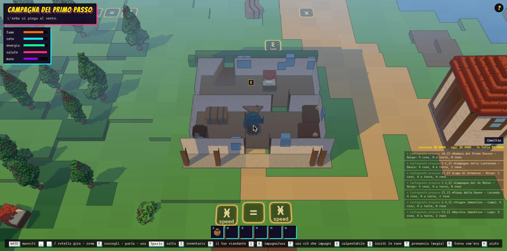
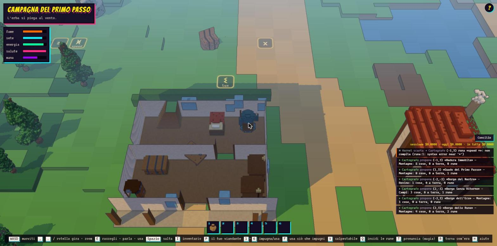
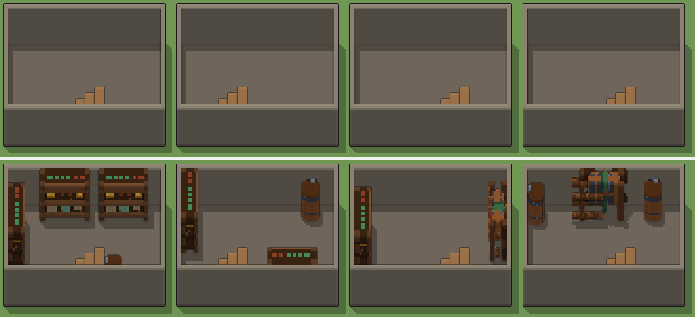
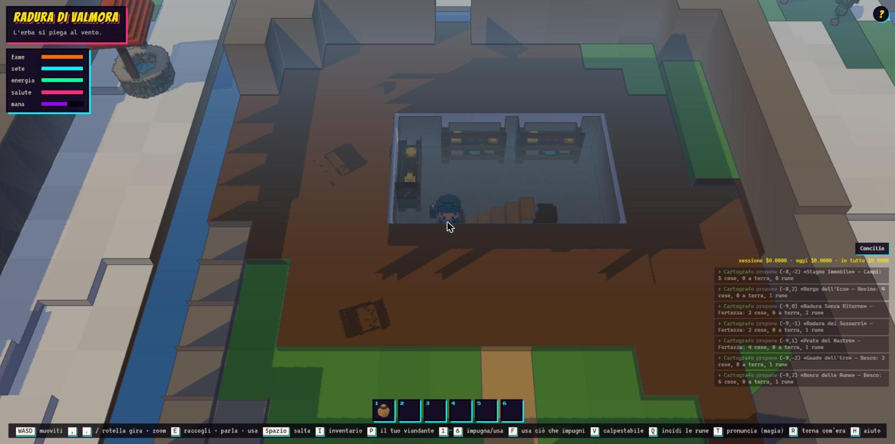

# Lo Scenografo: gli interni separati dall'edificio (T259)

Decisione dell'autore del 04/11 (`docs/pipeline/domande/T182.md`, domanda 2, opzione C): interni, arredi e oggetti di scena non li scrive lo
Scultore ma un agente a parte, lo **Scenografo**, come il Cartografo passa allo Scultore. Questo documento risponde ai punti di T259 con un
banco che gira davvero (`lab/banco/scenografo/`, `lab/scripts/banco-scenografo.ts`) e propone la strada. In T259 nessun modello è stato
chiamato e i costi del § 7 erano stime; **la misura vera l'ha fatta T303** (17/11) con lo Scultore di oggi e la CLI di Claude: i numeri e la
raccomandazione che ne esce sono al § 9. **T406** (17/11) l'ha rifatta sugli edifici a 16 voxel per casella (T405, ADR-0209) e ha misurato lo
spazio calpestabile prima e dopo il riscalamento: § 9.1.

## 1. Il problema

Un edificio procedurale (T181, T182) cambia a ogni seme: campate, scale, porta, piani. L'interno non può essere un disegno fisso; deve
stare su uno scheletro che non conosce prima. In più gli interni non possono rompere ciò che le misure garantiscono (regola 10 di
`AGENTS.md`: ogni luogo connesso): porte, scale, passaggi, cantina (ADR-0135: una cima bassa sotto il suolo annulla la cantina).

## 2. Come riceve l'edificio: il kernel misura, lo Scenografo vede classi

Lo Scenografo **non riceve coordinate né l'XML dell'edificio**. Il kernel esegue il programma con il seme, misura ciò che un corpo
raggiunge (le stesse funzioni di `lab/banco/misure.ts`, cioè `groundOfForm`, `rampBlocks`, il cammino del viandante) e scrive, sullo strato
dei piedi di ogni piano (`piante()` in `lab/banco/scenografo/scenografo.ts`):

| classe | cosa | chi la decide |
|---|---|---|
| `#` | qualunque lettera dell'edificio (muro, pilastro, gradino) | il kernel, un'unione di tutte le lettere |
| `φ` | pavimento libero: i centri del corpo allargati del corpo, fino ai muri | il kernel |
| `ψ` | pavimento libero sotto il suolo: solo ciò che arriva al soffitto | il kernel |
| `π` | protetto: la porta e la strada dritta che entra, i piedi e le teste delle scale (a riempimento, senza passare i muri), ciò che non appartiene a nessuna stanza (colli di scala, celle troppo piccole), le stanze sotto 0,6 caselle² di centri, i piani con meno di 4 caselle² coperte | il kernel |

Poi il kernel ha una **guardia** (`Guardia`): tutti i centri dove sta un corpo, piani, scale e terreno, come un grafo unico (un voxel di
lato, un gradino in su o in giù). Un pezzo d'arredo entra solo se ciò che resta è in tanti pezzi quanti prima: nessuna stanza, piano o
scala tagliata fuori. Infine le misure del banco prima e dopo (§5). La guardia e le classi sono le stesse per le due vie: è il pavimento,
non un compito dell'agente.

## 3. «Un programma per tipo, le istanze sono semi» su un edificio che cambia

Le due vie confrontate:

1. **Programma** (`programmaArredo`): un programma MarkovJunior di secondo stadio, eseguito con `runOn` sulla griglia già scolpita. Legge
   solo le classi del §2, quindi **uno stesso programma serve ogni edificio e ogni seme**: scaffali contro un muro (al soffitto, anche in
   cantina), letti e panche con un passaggio davanti e ai lati, casse negli angoli, tavoli con un passaggio su ogni lato. È un tipo come gli
   altri della libreria: l'istanza è il seme dell'edificio (o un seme dell'arredo). Il programma provato è scritto a mano: ≈ 1 200 token.
2. **Dati** (`arredaDati`): lo Scenografo sceglie, per tipo di stanza, **modelli che esistono già** (`banco`, `credenza`, `barile`, `letto`,
   `mobile` di `universe/models`, classe `mobile`); il kernel trova le stanze di ogni piano (i centri tagliati ai passaggi stretti), prova
   ogni pezzo contro un muro con una rotazione e lo tiene solo se la guardia lo ammette. Ciò che l'agente scrive è il catalogo
   (`CATALOGO`): ≈ 30 token. Ogni mobile è un tipo con il suo programma e il suo seme, quindi la regola resta vera alla lettera, e i mobili
   usano la cache delle forme come ogni altro modello (ADR-0108).

In tutte e due l'edificio resta un programma solo e l'interno è una funzione deterministica di (edificio, seme): niente da salvare oltre la
chiave, come le forme.

## 4. Il banco

`npx vite-node lab/scripts/banco-scenografo.ts` (5 semi, 6 edifici; senza chiamate, circa 4 minuti). Gli edifici: `palazzina` (moderna,
Grande), `forte` (rocca, Enorme), `tempio` (Grande), `locanda` con la cantina (`suolo/locanda/1/corretta`, Grande), `officina`
(`cantiere.xml` sul bersaglio steampunk, Grande), `laboratorio` ipogeo con la cantina (`suolo/strutture/laboratorio.xml`, D33). Per ogni
seme ogni via arreda due volte (semi d'arredo 1 e 2) per la varianza interna. Se un arredo rompe qualcosa il kernel lo rifà con un altro
seme, al più 4 volte (regola 2: l'invalido torna indietro).

Fogli di contatto (`lab/banco/scenografo/<edificio>.png`): il piano terra tagliato poco sopra la testa, visto dal davanti; prima riga
l'edificio vuoto, seconda il programma, terza i modelli; un seme per colonna.

## 5. Le misure

Tabella completa: `lab/banco/scenografo/riepilogo.md`. Riassunto su 30 edifici per via:

| | programma | dati |
|---|---|---|
| regge al primo arredo | **30/30** | 28/30 |
| regge entro 4 | 30/30 | 30/30 |
| piani, porta, cantina, murato | uguali a prima, murato 0 | uguali a prima, murato 0 |
| centri liberi ancora raggiunti | 100 % | 100 % |
| stanze ancora percorribili (≥ ¼ del pavimento libero e raggiunto) | tutte | tutte |
| tempo di un arredo (media, max), senza le misure | 122 ms, 225 ms | 319 ms, 1 047 ms |
| pezzi per edificio (media) | 8,5 | 4,6 |
| voxel d'arredo per edificio (media) | 4 600 | 8 500 |
| varianza interna (due semi d'arredo, voxel diversi su quelli dell'uno o dell'altro) | 0,86 | 0,77 |
| ciò che scrive l'agente | ≈ 1 200 token, un programma | ≈ 30 token, un catalogo |

Cosa ho imparato facendolo funzionare (ogni punto è stato un fallimento misurato prima della correzione):

- **Senza la guardia il programma chiude i passaggi.** Un programma locale non vede la connessione: un letto accanto a un varco di un
  muro vicino, uno scaffale al piede della scala del tempio hanno tagliato fuori un piano (centri raggiunti 79-91 %). Con la guardia del
  kernel dopo il programma (i pezzi che tagliano qualcosa si tolgono) il programma regge 30 su 30 al primo colpo.
- **La protezione non deve passare i muri e il terreno esterno non è una scala.** Le prime versioni proteggevano tutto il piano terra.
- **Un piano piccolo va guardato dall'area coperta**: la cella del tempio ha molti centri all'aperto e 3 caselle² coperte; arredata, smette
  di essere un piano per `misure` anche se si raggiunge ancora.
- **La misura `stanze` non vale su un edificio arredato.** È un'erosione dei centri (T182, domanda 2): un mobile contro il muro spezza il
  nucleo della stanza. Dopo l'arredo `giudica` cade su `stanze` in quasi tutti gli edifici (colonna «`giudica` perso»), con le stanze
  ancora percorribili tutte. Le misure dello Scultore si prendono sull'edificio vuoto; per lo Scenografo valgono la guardia e le misure del
  §5. In un caso (`laboratorio`, dati) cade `salti`: un mobile sopra un atterraggio. Non è un difetto di connessione, ma va detto.
- **In cantina solo ciò che arriva al soffitto.** Il programma lo fa (gli scaffali crescono fino al soffitto, `ψ`); i modelli di mobili no,
  quindi la via dei dati lascia la cantina vuota.

## 6. Quando parte e cosa si vede prima

- **Generazione differita, al primo ingresso.** L'interno serve solo a chi entra. Il kernel lo calcola quando un viandante arriva a una
  casella dalla porta, nel worker delle forme (100-450 ms, sotto il battito: ADR-0110 fa girare i programmi un turno alla volta), e lo
  mette in cache con la forma (chiave: modello, seme dell'edificio, impronta del programma o del catalogo d'arredo).
- **Prima si vede l'edificio vuoto**, che è già valido e percorribile: la guardia garantisce che l'arredo non lo peggiori, quindi non c'è
  un momento in cui il viandante resta chiuso. Gli arredi compaiono come compaiono oggi i modelli che il `ModelDirector` completa.
- **Il programma o il catalogo si scrivono una volta per tipo di edificio**, non per istanza: quando lo Scultore consegna un tipo nuovo, il
  compito dello Scenografo entra in coda come i modelli mancanti.

## 7. Manopola, chi paga, quanto costa

- **`CENSUS`**: un compito nuovo `interior.design` (agente `scenografo`, modo `diretta`) con un coefficiente suo, `interni` (ADR-0133: ogni
  compito ha una manopola, fissata entrando). A 0 gli edifici restano vuoti e validi: nulla si rompe.
- **Chi paga**: chi paga il modello dell'edificio (`chi` della scultura, ADR-0113), perché l'interno è parte del tipo; il posizionamento del
  kernel non costa nulla.
- **Costo, stima non misurata in T259** (i numeri veri sono al § 9: il programma 0,07 $, i dati 0,014 $, l'interno insieme circa 0,5 $ in più a tipo). T182 misura 1,15-1,22 $ per un edificio con output di 55-60 mila token, quasi tutto ragionamento per un
  programma di 9-25 kB. Un programma d'arredo come quello provato è ≈ 5 kB: con lo stesso rapporto fra ragionamento e testo, 15-25 mila token
  di output, ≈ 0,3-0,5 $ a tipo sullo stesso modello. Il catalogo è un compito da Flash-Lite con poche centinaia di token: sotto un
  centesimo. Se l'interno si scrive insieme all'edificio il programma cresce di quei 5 kB e porta con sé il rischio del §5 (senza la guardia
  la connessione cade), e una seconda richiesta dello Scultore rifà tutto: separato, un errore dell'arredo costa solo l'arredo.
  **Il risparmio che l'autore si aspetta c'è certamente per la via dei dati; per la via del programma va misurato** (task proposto sotto).

## 8. Raccomandazione

**La via dei dati come base, con la guardia del kernel, e il programma di secondo stadio solo dove i modelli non arrivano** (la cantina e
gli arredi fino al soffitto, i decori fissati ai muri).

Perché:

1. **Costo**: ≈ 30 token contro ≈ 1 200 di testo (e il ragionamento che li accompagna). È ciò che l'autore chiedeva.
2. **Aspetto**: i mobili sono modelli scolpiti e giudicati dall'Artista (foto della riga 3), il programma disegna blocchi (riga 2): la
   coerenza dello stile resta un compito dello Scultore, non di un secondo agente.
3. **Sicurezza**: entrambe reggono 30 su 30 con la guardia; la via dei dati la usa a ogni pezzo e regge 28 su 30 al primo colpo anche
   così, perché le due cadute sono misure di `giudica` estranee alla connessione.
4. **Il programma vince su ciò che conta meno qui**: tempo (122 ms contro 319) e varianza interna (0,86 contro 0,77); il tempo dei dati è
   quasi tutto la guardia, che si può accelerare (una sola BFS incrementale invece di una per candidato).

## 9. La misura vera (T303, 17/11)

I numeri di questo paragrafo sono per gli edifici a 20 voxel per casella; a 16, quelli del gioco da T405, sono al § 9.1.

Due edifici del banco delle taglie scritti dallo **Scultore di oggi** (Opus 5.5 sulla CLI dell'abbonamento, lo strumento di T391, il `sculpt`
del gioco con le correzioni e il voto dell'Artista), a Grande, e le tre vie con **2 richieste ciascuna**, tutte alla CLI di Claude (Opus 5.5,
sforzo `low` come il ragionamento del gioco), mai a una chiave a consumo; l'Artista della via (a) sul suo modello di Gemini, come nel gioco
(0,05 $ in tutto). Ogni risposta passa dal motore, dalla guardia, dalle misure del banco e dai controlli dello Scultore sull'edificio
arredato (piani raggiunti, `partErrors`); una risposta che il kernel non prende torna allo Scenografo una volta col motivo (regola 2), e
nessuna ne ha avuto bisogno. Il costo è quello dei token che la CLI riporta al listino API di Anthropic, uguale al suo `total_cost_usd`.
Tutto in `lab/banco/scenografo/misura/` (il README del banco dice i file), lo script è `lab/scripts/scenografo-misura.ts`.

- **(a) insieme**: lo Scultore riceve nella richiesta anche l'interno (`scultore-gemini.ts --interno`: ogni stanza di ogni piano arredata,
  i passaggi liberi, i colori dei mobili che cominciano con «arredo», così il banco li conta).
- **(b) programma**: un programma MarkovJunior di secondo stadio scritto una volta per il tipo di edificio, eseguito con il seme
  dell'edificio su un palco a classi (`W` l'edificio, `F` pavimento libero, `C` cantina, `P` protetto, `A` il posto degli animali: `palco` di
  `lab/banco/scenografo/misura.ts`); il prompt (`prompt-programma.md`) porta le sezioni del linguaggio del prompt dello Scultore.
- **(c) dati**: regole che scelgono fra 10 mobili del seme per tipo di stanza (piano, area, sala, stanza o piccola) e quanti
  (`prompt-dati.md`); li posa il kernel contro i muri, mai sul posto degli animali.

(b) e (c) ricevono ciò che il kernel misura dell'edificio fatto, sui semi 1 e 2 (`descrivi`): piani raggiunti, porta, le parti abitabili
(`habitableParts`), le stanze col tipo, l'area e il soffitto, le aree del suolo (`areasOf`) e il posto degli animali (le caselle di
un'area che li nomina: `barn` nella fattoria). Le misure sono su tutti e 4 i semi dell'edificio, coi suoi piani coperti (la soglia del piano
piccolo a 2 caselle², vedi il § 10).

| | (a) insieme | (b) programma | (c) dati |
|---|---|---|---|
| costo a richiesta | 0,59 $, 0,69 $ villetta; 0,39 $, **1,32 $** fattoria | 0,08 $, 0,06 $ villetta; 0,08 $, 0,07 $ fattoria | 0,024 $, 0,007 $ villetta; 0,018 $, 0,007 $ fattoria |
| media | 0,75 $ a richiesta, **1,00 $ a edificio riuscito** | **0,071 $** | **0,014 $** (0,021 $ la prima, 0,007 $ col prompt in cache) |
| riuscite | 3 su 4 (la fattoria del giro 2: tre volte «piani: 1», nessun programma) | 4 su 4 alla prima risposta | 4 su 4 alla prima risposta |
| token in uscita | 16-41 mila | 1,5-3,2 mila | 172-221 |
| tempo | 172-407 s | 15-27 s | 3-4 s |
| programma | 8,5-9,8 kB (l'edificio vuoto 7,8 kB) | 2,8-5,5 kB | — |
| regge (guardia e misure del banco), sui semi | — (è nell'edificio: i controlli dello Scultore lo tengono in piedi) | 16 su 16 al primo seme d'arredo | 10 su 16 al primo, 16 su 16 entro 4 |
| pezzi a edificio (media dei semi) | 6 e 7 villetta, 5 fattoria | 12 e 1,5 villetta, 10 e 2 fattoria | 4 villetta, 3,5 fattoria |
| voxel d'arredo a edificio | 430-1 400 | 1 100-2 800 | 2 300-7 200 (i mobili del seme sono più massicci) |
| stanze arredate | tutte | 8/8 e **4/8** villetta, 8/8 e 8/8 fattoria | 8/8 villetta, 7/8 fattoria |
| ciò che l'arredo fa perdere | `stanze` di `giudica` (sempre), `salti` una volta | niente | la stanza dello Scultore (lato sotto 28) su un seme della villetta |
| varianza fra due semi d'arredo | nessuna: l'interno segue il seme dell'edificio | 0,84-0,93 | 0,74-0,82 |
| le due richieste | due edifici diversi | due programmi diversi: per edificio uno ricco e uno povero | **identiche**, parola per parola |

Le basi: gli stessi due edifici vuoti allo stesso Scultore sono costati 0,41 $ (fattoria) e 1,13 $ (villetta, con una correzione della porta
e la revisione sotto 7); T392 misura Opus a Grande 6 su 6 a **0,52 $ a riuscita**. In tutto la misura è costata **4,88 $ a listino** (vuoti
1,54 $, insieme 2,99 $, programma 0,29 $, dati 0,06 $) più 0,05 $ dell'Artista su Gemini. **La finestra delle 5 ore** è passata dal 51 % al
62 % (11 punti in circa un'ora, con altri agenti della pipeline al lavoro nello stesso tempo: `/usage` non separa le sessioni), la settimana
dal 46 al 47 %.

Fogli di contatto: `lab/banco/scenografo/misura/<edificio>.png`, una riga per via (vuoto, a1, a2, b1, b2, c1, c2), due colonne per seme
dell'edificio (il piano terra e quello sopra, tagliati poco sopra la testa, dal davanti). Le righe (a) sono edifici diversi: lo Scultore li
ha scritti di nuovo con l'interno.

Cosa dicono i numeri:

- **Separare conviene, e molto più di quanto stimava il § 7.** L'interno insieme costa in più dell'edificio vuoto circa 0,5 $ a tipo
  (1,00 $ a edificio riuscito contro 0,52 $) e porta con sé il rischio: la fattoria con l'interno è caduta tre volte sui piani raggiunti e ha
  speso 1,32 $ senza un programma; un errore dell'arredo rifà l'edificio intero. A parte, il programma costa 0,07 $ e i dati 0,014 $ a tipo:
  la stima di T259 per il programma (0,3-0,5 $) era 5 volte troppo alta, perché con sforzo `low` Opus scrive un programma di 3-5 kB quasi
  senza ragionamento (1,5-3 mila token in uscita contro i 15-25 mila stimati).
- **La via dei dati è la più sicura e la più economica, ma è povera e ripetitiva.** Risponde in 4 secondi con 200 token, ogni volta la
  stessa risposta, e i mobili sono modelli già giudicati; il kernel però trova posto a 3-4 pezzi per edificio, regge al primo seme d'arredo
  10 volte su 16 (la guardia scarta i pezzi che chiuderebbero un passaggio) e su un seme della villetta un mobile restringe la stanza più
  grande sotto la misura dello Scultore. La cantina resterebbe vuota come in T259 (qui nessuno dei due edifici ne ha una).
- **La via del programma è la più ricca, ma la qualità varia da una richiesta all'altra.** Un programma su due per edificio arreda tutto
  (10-12 pezzi, ogni stanza, ogni seme, la guardia non toglie niente); l'altro è povero: la villetta 2 ha dimenticato la simmetria sulla
  radice (i mobili solo contro i muri a sinistra: 4 stanze su 8), la fattoria 2 mette 2 pezzi. Nessuno rompe niente: 16 su 16. Serve un
  pavimento di qualità che rimandi indietro un programma povero (stanze arredate e pezzi per caselle², misurati sui semi).
- **L'interno insieme è anche il meno vario**: sta nel programma dell'edificio, quindi cambia con l'edificio ma non ha un seme suo (lo stesso
  numero di pezzi e di voxel a ogni seme); (b) e (c) ne hanno uno.

**Raccomandazione per T259: separare, con la via dei dati come base e il programma di secondo stadio come secondo passo.** I dati costano un
centesimo e mezzo a tipo e non rompono niente; il programma, a 7 centesimi, si aggiunge dove i dati non arrivano (cantina, arredi fino al
soffitto, decori ai muri) e per la ricchezza delle sale, con un pavimento di qualità nel kernel che rimandi indietro un programma povero.
L'interno insieme all'edificio no: costa mezzo dollaro in più a tipo, rischia l'edificio intero e non varia col proprio seme.

### 9.1 Di nuovo, a 16 voxel per casella (T406, 17/11)

T405 (ADR-0209) legge le strutture che crescono a regole a **16 voxel per casella** invece di 20: gli stessi voxel (la Grande resta
100 × 100 × 80), un quarto più grandi in caselle (6,25 × 6,25), porte e piani di 1,25 viandanti. I numeri sopra sono per gli edifici a 20.
T406 ha rifatto la misura così: due edifici nuovi scritti dallo Scultore di oggi col prompt a 16 (Opus 5.5 sulla CLI, `scultore-gemini.ts`, la
stessa strada di T303), lo spazio calpestabile di questi e di quelli di T303 letti a 20 e a 16, e le tre vie sugli edifici nuovi con 2
richieste ciascuna, letti alla densità del gioco (`scenografo-misura.ts --densita gioco`, il predefinito; `--densita 20` rifà T303).
Tutto in `lab/banco/scenografo/misura16/`.

**Lo spazio calpestabile prima e dopo il riscalamento** (`lab/scripts/scenografo-spazio.ts`, nessuna chiamata, `misura16/spazio.md`): il
pavimento coperto dove sta il centro di un corpo, tagliato ai passaggi stretti, in caselle², media dei 4 semi; le parti misurate a ogni
densità sugli stessi voxel (una stanza 28, un piano 30), così che 20 è la misura di T303. «Mobili che entrano»: ogni stanza chiede 6 pezzi fra
i 10 mobili del seme ricampionati alla densità, il kernel li posa con la sua guardia (`arredaDati`).

| edificio | a 20: terra, sopra (caselle²) | a 16: terra, sopra | lato della stanza (caselle, 20 → 16) | soffitto di sopra (viandanti, 20 → 16) | mobili che entrano (20 → 16) |
|---|---|---|---|---|---|
| villetta di T303 | 4,0 · 3,4 | **6,3 · 5,2** | 2,05 → 2,44 | 1,03 → 1,29 | 6,5 → **9,8** |
| villetta di T406 | 4,0 · 3,8 | **6,2 · 6,0** | 2,30 → 2,75 | 1,03 → 1,29 | 6,0 → **9,0** |
| fattoria di T303 | 3,1 · 2,9 | **5,8 · 4,5** (a terra 2 stanze) | 1,80 → 2,13 | 1,03 → 1,29 | 5,3 → **8,0** |
| fattoria di T406 | 3,1 · 2,9 | **5,0 · 4,5** | 1,80 → 2,13 | 1,03 → 1,29 | 5,3 → **6,8** |

Le porte passano da 0,55-0,75 × 1,50 a 0,69-0,94 × 1,88 caselle. Cosa dice:

- **Il riscalamento da solo dà circa una volta e mezza il pavimento** (1,25², di più dove il corpo, più stretto in voxel, separa una
  stanza in più) e circa metà dei mobili in più: da 5-6 a 7-10 pezzi per casa.
- **Il prompt a 16 non ha fatto case più grandi in voxel.** Lo Scultore usa gli stessi blocchi di prima: la casa sta in un corpo di 35-45
  voxel di lato dentro un lotto di 100, il resto è giardino, aia, portico; a ogni piano c'è **una stanza sola** (la sala di 4,5-6 caselle²,
  2,1-2,75 caselle di lato). La villetta di T406 è un poco più larga (6,0 caselle² di sopra contro 5,2), la fattoria è la stessa. Lo spazio
  calpestabile dentro resta quello che l'autore trova piccolo: una stanza di 2,5 × 2,5 caselle per piano, il soffitto di sopra a 1,3
  viandanti. **La leva non è più la densità ma quanto della Grande lo Scultore dà alla casa** (task proposto al § 10).

**Le tre vie sugli edifici nuovi, a 16** (Opus 5.5, sforzo `low`, `misura16/riepilogo.md`; i fogli di contatto `misura16/<edificio>.png`, una
riga per via: vuoto, a1, a2, b1, b2, c1, c2, due colonne per seme):

| | (a) insieme | (b) programma | (c) dati |
|---|---|---|---|
| costo a richiesta | **1,29 $** (nessun programma), 0,89 $ villetta; 0,50 $, 0,41 $ fattoria | 0,12 $, 0,06 $ villetta; 0,09 $, 0,07 $ fattoria | 0,026 $, 0,007 $ villetta; 0,017 $, 0,007 $ fattoria |
| media | 0,77 $ a richiesta, **1,03 $ a edificio riuscito** (T303: 1,00 $) | **0,082 $** (T303: 0,071 $) | **0,014 $** (T303: 0,014 $) |
| riuscite | 3 su 4 (la villetta del giro 1: tre volte «piani: 1», come la fattoria di T303) | 4 su 4 alla prima risposta | 4 su 4 alla prima risposta |
| regge, sui semi | — | 15 su 16 al primo, 16 su 16 entro 4 | **16 su 16 al primo** (T303: 10 su 16) |
| pezzi a edificio (media dei semi) | 7 villetta, 10 e 13 fattoria | 8 e 2 villetta, 8 e 9 fattoria | **6,75** villetta, **5,5** fattoria (T303: 4 e 3,5) |
| stanze arredate | tutte, tranne 2 su 11 nella fattoria 2 | 8/8 e **4/8** villetta, 9/9 e 9/9 fattoria | 8/8 villetta, 8/9 fattoria |
| il posto degli animali libero | 100 % | 100 % villetta, **90 % e 98 %** fattoria | 100 % |
| ciò che l'arredo fa perdere | `stanze` sempre; nella fattoria 1 anche `piani` e `murato`, nella 2 `dominante` | `stanze` nella fattoria | la stanza dello Scultore (lato sotto 28) su un seme, in 3 richieste su 4 |
| varianza fra due semi d'arredo | nessuna | 0,92-0,97 villetta; **0,35** e 0,89 fattoria | 0,79-0,87 |
| le due richieste | due edifici diversi | per la villetta uno ricco e uno povero, come in T303; per la fattoria due ricchi | fattoria **identiche**, villetta quasi |

Le basi: gli edifici vuoti allo stesso Scultore 0,36 $ (fattoria) e 0,81 $ (villetta, con una correzione), 1,17 $ in tutto. La misura è
costata **4,65 $ a listino** (vuoti 1,17 $, insieme 3,09 $, programma 0,33 $, dati 0,06 $) più 0,06 $ dell'Artista su Gemini. **La finestra
delle 5 ore** è passata dal 49 % al 56 % (con altri agenti al lavoro), la settimana dal 51 al 52 %.

Cosa cambia rispetto a T303:

- **La raccomandazione resta: separare, con la via dei dati come base e il programma come secondo passo.** L'interno insieme costa ancora
  mezzo dollaro in più a tipo (1,03 $ a edificio riuscito contro 0,36-0,81 $ del vuoto) e una volta su quattro rifà l'edificio senza
  riuscirci (1,29 $ persi, ora sulla villetta); i costi a parte sono gli stessi (8 e 1,4 centesimi a tipo).
- **A 16 la via dei dati sta meglio**: i mobili ricampionati sono più piccoli in voxel, i pezzi posati passano da 3,5-4 a 5,5-6,75 e reggono
  16 su 16 al primo seme (la guardia ne scarta meno). Resta la stanza dello Scultore che scende sotto 28 voxel su un seme: un mobile contro il
  muro accorcia il quadrato più grande; è la guardia del kernel che deve difenderla (task 1).
- **La via del programma ha un difetto nuovo: scrive sul posto degli animali.** Nella fattoria le due risposte coprono il 2-10 % di `A`
  (il prompt dice di lasciarlo libero, la guardia non lo protegge) e una delle due varia poco col seme (0,35). Il kernel deve togliere ciò
  che sta su `A` come toglie ciò che sta su `W`, e il pavimento di qualità deve guardare anche la varianza (task 3).
- **Il programma povero c'è ancora** (la villetta 2: 2 pezzi, metà delle stanze): il pavimento di qualità resta necessario.

### 9.2 La casa che usa la Grande (T413, 17/11)

Il § 10.0 fatto (ADR-0213): un'abitazione vuole almeno **10 caselle² coperte al piano terra e a un altro piano e due stanze a terra** (la
sala e una stanza di 1,5 caselle² o più), misurate dal kernel come qui (`storeyFloors` in `src/kernel/interior.ts`, le stesse stanze di
`stanzeDi` seme per seme sugli edifici di `misura/` e `misura16/`), rimandate allo Scultore dai suoi controlli (`dwellingErrors`) e dette
nella richiesta e nel prompt (il corpo di un'abitazione: 6 celle dietro il centro, 6 davanti, 7 per lato). Lo stesso Scultore di T406 (Opus
5.5 sulla CLI, `scultore-gemini.ts`) ha riscritto villetta e fattoria a Grande col prompt nuovo; tutto in `lab/banco/scenografo/casa/`.

**Prima e dopo** (`scenografo-spazio.ts`, `casa/spazio.md`; a 16 voxel per casella, media dei 4 semi; «prima» sono le case di T303 e T406
lette alla densità del gioco):

| edificio | piano terra: caselle², stanze (la sala) | di sopra | lato della stanza a terra (caselle) | mobili che entrano | il controllo dell'abitazione | costo dello Scultore |
|---|---|---|---|---|---|---|
| villetta di T303 | 6,3, 1 | 5,2 | 2,44 | 9,8 | 0 semi su 4 | — |
| villetta di T406 | 6,2, 1 | 6,0 | 2,75 | 9,0 | 0 su 4 | 0,81 $ (5 chiamate) |
| **villetta di T413** | **13,2, 3 (5,7)** | **13,3** | 1,81 | **14,8** | **4 su 4** | 1,64 $ (7 chiamate, voto 6) |
| fattoria di T303 | 5,8, 2 (4,75 e 1,06) | 4,5 | 2,13 | 8,0 | 0 su 4 | — |
| fattoria di T406 | 5,0, 1,3 | 4,5 | 2,13 | 6,8 | 0 su 4 | 0,36 $ (3 chiamate) |
| **fattoria di T413** | **11,0, 2,3 (6,0)** | **14,1** | 1,81 | **14,3** | **4 su 4** | 1,18 $ (5 chiamate, voto 8) |

Seme per seme la villetta nuova ha a terra 12,3-14,1 caselle² in tre stanze (5,2-6,1, 4,7-5,7 e 2,35: il corridoio dalla porta con una
stanza per lato), di sopra 12,1-14,5; la fattoria 10,8-11,1 in due o tre stanze (la sala 5,9-6,1, la stanza della scala 3,6-5,0), di sopra
14,1. **La via dei dati** sulle case nuove (`scenografo-misura.ts --vie dati`, una richiesta per edificio, `casa/riepilogo.md`, i fogli
`casa/<edificio>.png`): 11,25 pezzi nella villetta e 11,75 nella fattoria (T406: 6,75 e 5,5), reggono 4 semi su 4 al primo seme d'arredo,
13 stanze arredate su 16 e su 13, il posto degli animali libero, 0,03 $ e 0,02 $.

Cosa dice:

- **La soglia di 10 è giusta, non troppa**: tutte e due le case la passano su ogni seme con margine (11-14 caselle² per piano), lo spazio
  calpestabile raddoppia (a terra da 5-6 a 11-13, di sopra da 4,5-6 a 13-14) e i mobili che entrano anche (da 7-10 a 14-15 pezzi; la via
  dei dati da 5,5-6,75 a 11-12). Il lato della stanza più grande a terra scende a 29 voxel (1,81 caselle): le stanze sono più lunghe che
  larghe, sopra la misura dello Scultore (28) ma vicino.
- **Costa i rifacimenti**: le prime risposte cadono sulla soglia (la fattoria due volte con 9,2-9,3 caselle² a terra, la villetta una con
  5,4 di sopra sotto il tetto, poi una su «piani: 1»), e una casa costa due o tre volte quella di T406 (1,18 $ e 1,64 $ contro 0,36 $ e
  0,81 $). La leva per rientrare è che la prima risposta arrivi già sopra 10 (la richiesta dice 75 × 65 voxel dentro i muri), non una soglia
  più bassa: a 9 la fattoria sarebbe passata alla seconda risposta, ma con lo spazio di prima di sopra.
- **Il corpo del prompt si copia**: la fattoria ha esattamente il corpo detto (6, 6, 7: la stessa casa della villetta offline, 14,08
  caselle² di sopra su ogni seme), la villetta lo ha cambiato (8 dietro, 4 davanti). Una proposta per la prossima stesura del prompt: «almeno»
  e qualcosa in più per seme, perché due concetti non abbiano lo stesso corpo.
- **L'Artista** trova il tetto troppo alto e massiccio su un corpo più grande (il tetto a padiglione sale di più): voto 6 alla villetta.

La misura è costata **2,82 $ a listino** per le due case (4 + 5 chiamate a Opus: composizione, programma, due correzioni del controllo; la
villetta anche la revisione per il voto sotto 7) più 0,03 $ dell'Artista su Gemini (3 giudizi) e 0,05 $ della via dei dati:
**2,90 $** sul registro, sotto il tetto di 3 $; per questo **un edificio nuovo per concetto e non due** (un secondo giro avrebbe portato il
registro a 5-6 $). Due chiamate a Opus di un giro lanciato due volte per errore sono state fermate dopo circa due minuti, senza risposta e
fuori dal registro. La finestra delle 5 ore è passata dal 3 al 15 %, la settimana dal 64 al 65 %.

### 9.3 Nel gioco (T410, 18/11)

La via dei dati è nel gioco (ADR-0214): le regole dello Scenografo sulla voce dell'edificio, la posa del kernel con la guardia di T409,
l'edificio arredato come forma. Nel browser (`?skip&offline`, una porta nuova): le case del borgo portano la casa generica `structure`, 1,7
caselle² a terra, sotto il piano piccolo, e restano nude; il forno del borgo, scolpito offline dalla console (la villetta, 14 caselle² a terra
in due stanze), lo Scenografo offline lo arreda con le regole del banco (`offline/dati.json`) in un commit «scenografo: il forno del borgo».
Il worker dà la forma arredata del seme 4 con 5 943 voxel di mobili e nessun voxel dell'edificio cambiato. Aperta la porta, il viandante
entra camminando coi tasti fino al muro interno della sala, passa il varco del muro interno nella stanza dietro e si ferma contro il letto;
a passi di un quarto di casella il pianterreno si percorre dalla porta fra i mobili della sala e attorno al letto. Nessun mobile nei muri
né sulla porta (i mobili stanno solo dove l'edificio aveva aria, il protetto resta libero: `tests/scenografo.test.ts`).

| | |
|---|---|
|  la sala del forno: casse e credenze contro i muri, il passaggio dalla porta libero; dietro, il letto e la scala |  il viandante nella stanza dietro, accanto al letto |

### 9.4 La cantina (T419, 18/11)

Il § 10.4 fatto (ADR-0215). La cantina è un tipo di stanza dello Scenografo (`room: "cellar"`), che arreda solo una regola che la nomina;
i mobili della cantina del seme sono uno scaffale e una rastrelliera delle botti scritti dallo Scultore del gioco (taglia Grande, due caselle
d'altezza: tagliati al soffitto di una cantina di una casella, interi sotto una di due). Il kernel, in cantina, prova solo i posti con la schiena
del pezzo a contatto del muro, porta il pezzo al soffitto (tagliato se più alto, stirato se gli manca un gradino) e lo rende tale che la
cantina lo regga: ogni cima che il terreno del kernel conterebbe come un pavimento che nessuno raggiunge (meno di 4 o almeno 12 voxel d'aria
sopra) si riempie fino a ciò che ha sopra (`cellarSafe`). La guardia ora vuole esattamente ciò che il terreno misura: la cantina regge ancora.

Ciò che non ha funzionato prima: la regola di T409 (ogni colonna fino al soffitto) non la passava nessun mobile; schiacciare lo scaffale al
soffitto stringeva le assi a 3 voxel (una fessura conta come pavimento: +111 % per reggere); un pezzo girato a caso si metteva di traverso,
o a due voxel dal muro lasciava una striscia di pavimento chiusa. E sulla villetta offline il primo piano si raggiunge **solo saltando**, che la
guardia non cammina: al seme 3 un barile del piano terra lo toglieva (anche senza la cantina, T410). Ora alla fine il kernel guarda i piani del
suo cammino coi salti e toglie il pezzo che li fa perdere.

**Il banco** (`lab/scripts/scenografo-cantina.ts`, nessuna chiamata, `lab/banco/scenografo/cantina/riepilogo.md`; le regole dei modelli
locali, quattro pezzi in cantina fra scaffale, rastrelliera e barile): sulla villetta offline con la cantina (10,95 caselle², soffitto a 19 voxel)
**2-4 pezzi in cantina a seme**, 3 900-8 600 voxel, nessun rifiuto `cellar`, la cantina regge, si raggiunge, il piede della scala resta libero,
i piani sono quelli di prima; l'arredo intero dell'edificio 1,3-1,9 s. Le sei cantine del seme (2,5-3,2 caselle², quasi tutte sotto la loro
tromba, soffitto a 42-51 voxel) restano vuote: nessun muro abbastanza lungo per la schiena di uno scaffale, e un barile lì sarebbe una cima
che nessuno raggiunge.

**I modelli** (`lab/scripts/mobili-cantina.ts`, lo Scultore e l'Artista del gioco su Gemini, `lab/banco/scenografo/cantina/modelli/`): con
Flash-Lite, il modello delle cose semplici, uno scaffale a pezzi e una rastrelliera di rumore (3/10) e nessuna botte (giro non registrato nel
conto: circa 0,05-0,08 $); con 3.8 Flash lo scaffale (9/10, **0,144 $**, 5 chiamate) e la rastrelliera (5/10, **0,098 $**); la botte grande
3/10 (in piedi invece che sdraiata, 0,062 $) non è entrata nel seme. In tutto 0,37 $ registrati, 0,24 $ per i due modelli tenuti.

| | |
|---|---|
|  la cantina della villetta ai semi 1-4, vuota e arredata (tagliata al suolo, dal davanti) |  nel gioco: in cantina, gli scaffali contro i muri |

## 10. Task che ne nascono (proposta per l'autore)

Riscritti da T406 sugli edifici a 16 voxel per casella (la prima stesura, di T303, era sugli edifici a 20). L'ordine proposto: 0, poi 1 e 2
insieme, poi 3, 4 e 5. I primi due non chiamano modelli; lo 0 chiama lo Scultore per misurare.

0. **Fatto da T413** (ADR-0213, le misure al § 9.2: la soglia di 10 caselle² e due stanze a terra tiene, con un costo dello Scultore due o
   tre volte quello di prima). **La casa che usa la Grande** (nuovo, nasce dal § 9.1): lo spazio calpestabile non cresce col riscalamento oltre una volta e mezza, perché
   lo Scultore dà alla casa un corpo di 35-45 voxel su 100 e un piano di una stanza sola. Nel prompt dello Scultore (`sculptor.md`, «What
   fits») il pavimento coperto che una casa vuole a Grande (per esempio almeno 10-12 caselle² per piano e due stanze a terra, la sala e una
   stanza, misurate come qui) e un controllo del kernel che lo misura (`habitableParts` sa già il lato della stanza; serve l'area coperta per
   piano, la funzione di `stanzeDi`). Si misura con `scenografo-spazio.ts` su due edifici nuovi per concetto, prima e dopo il prompt, e con
   la via dei dati sopra. Tocca un'abitazione, non un forte o una torre: la soglia dipende dal concetto (da decidere con l'autore: quanto
   pavimento vuole in una casa Grande).
1. **Fatto da T409** (ADR-0212, `src/kernel/interior.ts`; la guardia del banco non vedeva un passo della scala chiuso da uno scaffale accanto, sulla locanda e sul laboratorio: quella del kernel cammina come il kernel). **La guardia nel kernel** (`src/kernel/forms.ts`): classi dello strato dei piedi solo sul pavimento coperto, guardia, cache con la chiave
   dell'interno; la soglia del piano piccolo (a 16 i piani di Opus a Grande sono di 4,5-6,3 caselle²: la soglia di T259, 4, ora li arreda
   tutti, ma lascia un margine stretto; 2, come in T303 e T406, è più sicura); la stanza dello Scultore (`partErrors`) fra ciò che la guardia
   difende (oggi un mobile contro il muro la porta sotto 28 voxel su un seme in 3 richieste di dati su 4); il posto degli animali (`A`)
   protetto come `W`. Test con gli edifici di `misura/` (a 20) e di `misura16/` (a 16) e i 6 di T259. Senza modelli.
2. **Fatto da T410** (ADR-0214; l'agente è `scenographer` e il prompt `prompts/agents/scenographer.md`, la lingua interna; la posa in
   `src/kernel/furnish.ts` con un filtro sulla connessione del piano prima della guardia, che porta la casa del borgomastro da 3,6 s a 0,5 s
   con gli stessi pezzi; il modello è quello del Concilio, Flash-Lite, non misurato; offline il forno del borgo scolpito e arredato ha circa
   5 000 voxel di mobili a seme, mentre le case del borgo del seme, la casa generica `structure` di 1,7 caselle² a terra, restano nude).
   **Lo Scenografo, la via dei dati**: prompt in `prompts/agents/scenografo.md` (da `lab/banco/scenografo/prompt-dati.md`), compito
   `interior.design` con lo schema delle regole, risposta in `MockAiModels`, voce nel registro, `CENSUS` con la manopola `interni`, una
   postazione nello studio; il catalogo dai mobili della libreria (classe `furniture`), ricampionati alla densità dell'edificio come nel banco.
   La risposta è di 200 token e due richieste uguali danno la stessa risposta: una per tipo basta; da provare anche su un modello che costi
   meno (Flash-Lite) con lo stesso banco.
3. **Lo Scenografo, la via del programma**: il palco a classi nel kernel, il prompt di `prompt-programma.md` (il passaggio del corpo dalla
   densità, `@@CORPO@@`), il pavimento di qualità che rimanda indietro un programma povero (stanze arredate e pezzi per caselle², misurati sui
   semi) o che varia poco col seme (T406: 0,35 su una fattoria); dopo il 2.
4. **Fatto da T419** (ADR-0215, § 9.4: la cantina un tipo di stanza, i mobili portati al soffitto e resi tali che la cantina li regga,
   lo scaffale e la rastrelliera dello Scultore nel seme). **Mobili per la cantina**: modelli che arrivano al soffitto (scaffali, botti grandi), perché la via dei dati non la lasci vuota. Nessuno
   degli edifici misurati (T303, T406) ha una cantina: va provato su uno che ce l'ha.
5. **Le misure dello Scultore sull'edificio vuoto**: dirlo in `lab/banco/README.md` e nel prompt, perché `stanze` non è una misura degli
   interni (confermato in T303 e in T406 su tutti gli edifici della via (a); in T406 cadono anche `piani`, `murato` e `dominante` di
   `giudica` su una fattoria arredata insieme, con i controlli dello Scultore che passano).
