# I sotterranei oggi: funzionano? (T412, 17/11)

Domanda dell'autore (17/11): «credo che i sotterranei non siano mai riusciti allo Scultore: fammi capire se funzionano e in caso li
arrediamo; se è troppo complesso li rimandiamo». Il progetto è [ADR-0091](../adr/0091-i-sotterranei.md); di T52 è fatto solo T52b (il
modello che scende). Qui: le cantine nel kernel di oggi (0.9.1, strutture a 16 voxel per casella), nel browser, negli universi, e quanto
costa finire. Nessun modello chiamato, nessun codice di gioco cambiato.

## In breve

- **Nel kernel funzionano.** Le 6 voci del seme con `cellar` e le 18 degli universi di Claude Cloud tengono la cantina a ogni seme
  (`groundOfForm`: ogni pavimento sotto il suolo si raggiunge dal piano terra). Nel browser si scende la scala fino a −1,19 caselle, dalla
  cantina si esce solo per la scala, si risale. `tests/cellar.test.ts` è verde, ma misura a 20 voxel per casella.
- **Non si vedono.** Il terreno si abbassa solo sulle caselle il cui centro cade sulla cantina. Una cantina del seme è larga 1,75 caselle,
  e a 16 voxel per casella i suoi bordi non stanno sui bordi delle caselle: delle 7,4 caselle² della locanda se ne aprono 3, e il resto
  della cantina resta sotto l'erba. T52e, il taglio che fa vedere sotto terra, non c'è. Chi scende si vede in una fossa stretta, e dal
  piano terra la tromba della scala finisce nell'erba.
- **Ci sono già nel mondo, ma nessuno le chiede.** Nessun agente scrive `cellar`: né il Cartografo né lo Scultore (T52f) né il
  `ModelDirector`. Le cantine entrano solo quando il concetto di una struttura ha il nome di una voce del seme che ne ha una (`locanda`,
  `fucina`, `torre-di-guardia`, …), oppure per riuso (`model.reuse`). Aurora le ha in 6 luoghi (`lab/banco/universi-cloud/INTEGRAZIONE.md`).
  Dentro non ci va niente: `interiorPoints` arreda solo il piano terra.
- **Raccomandazione: per ora l'arredo si rimanda**, perché una cantina arredata oggi non si vedrebbe. Si può fare subito un pezzo piccolo
  e senza modelli: aprire il terreno su tutta la cantina (il buco a copertura, § 4). Da riprendere dopo T410/T411, in quest'ordine: buco,
  T52e senza strati, cantina nella via dei dati dello Scenografo con i mobili del § 10.4, T52f. T52d (gli strati) viene per ultimo, o in
  forma ridotta.

## 1. Il kernel di oggi, sulle voci con `cellar`

Misurate con `lab/scripts/misura-cantine.ts` (nuovo, senza chiamate). Lo script fa girare ogni voce come la fa girare il gioco (`Forms`,
in linea, ogni seme della classe) e ne misura il buco, i pavimenti sotto il suolo, quelli raggiunti dal piano terra e i piani raggiungibili.
Con `--universo <cartella>` misura le voci di un universo sul disco, dopo averlo portato al contratto di oggi con le migrazioni.

| voce (seme) | vpt | griglia | cantina (voxel) | tiene | buco (caselle²) | pavimento raggiunto (caselle²) | pavimento della cantina | piani raggiungibili (caselle dal fondo) |
|---|---|---|---|---|---|---|---|---|
| struttura-fucina | 16 | 100×100×100 | 20 (1,25 caselle) | sì | 7,32 | 6,24 | −1,19 | 0,06 · 1,38 · 3,38 |
| struttura-locanda | 16 | 100×100×100 | 20 | sì | 7,32 | 6,24 | −1,19 | 0,06 · 1,38 · 3,38 |
| struttura-torre-di-guardia | 16 | 100×100×100 | 20 | sì | 7,32 | 6,24 | −1,19 | 0,06 · 1,38 · 3,38 |
| struttura-fucina-nanica | 16 | 100×100×100 | 20 | sì | 7,37 | 6,24 | −0,63 | 0,63 · 1,38 · 3,38 |
| struttura-torre-del-mago | 16 | 100×100×100 | 20 | sì | 7,37 | 6,24 | −0,63 | 0,63 · 1,38 · 3,38 |
| struttura-locanda-del-cinghiale (Enorme) | 16 | 120×120×112 | 16 (1 casella) | sì | 7,37 | 6,24 | −0,63 | 0,38 · 1,13 · 3,13 |

Gli universi di Claude Cloud (`lab/banco/universi-cloud/`, kernel 0.1.5 portati a 0.9) hanno altre 18 voci con `cellar`: 6 per
neapolis, 6 per orichalcum, 6 per sidera, in classe Grande a `vpt: 20` (dalla migrazione 0.8 → 0.9) o Enorme a 16. **Tengono tutte e 18**:
buco di 4,7 caselle² a 20 o di 7,3 a 16, pavimento a −0,5 o −0,95 caselle. Le voci sono di due famiglie, «primi» e «gemelli» (T269, T273),
scritte a mano su due programmi: per questo i numeri si ripetono.

Cosa dicono le misure:

- **La cantina dei programmi di prima resta la stessa in voxel.** Una voce che non dice `vpt` è a 16 (ADR-0209), ma `cellarVoxels`
  tiene 20 voxel per casella di cantina. La cantina scende di 1,25 caselle, il fondo sotto il suolo è di 20 voxel come quando fu scritta,
  e tiene.
- **Il pavimento** delle tre voci «prime» è un voxel sopra il fondo, a −1,19 caselle dal suolo (19 voxel). Quello delle tre «gemelle» è a
  −0,63 (10 voxel). Si scende per una scala di 3 voxel a gradino (`stepOf(16)` = 3): sei gradini da −1 a −16, poi −19.
- **Il controllo dei piani conta la cantina come un piano.** `reachableStoreys` elenca la cantina (0,06 o 0,63 caselle dal fondo) accanto
  al piano terra e a quello di sopra. Oggi non ha conseguenze, perché le voci sono scritte a mano. Quando lo Scultore scriverà le cantine
  (T52f), però, «almeno due piani raggiungibili» (ADR-0162) passerebbe anche per una casa di un piano con la cantina: in T52f il controllo
  deve escludere ciò che sta sotto `base`.
- **`tests/cellar.test.ts` è ancora vero (6 su 6), ma misura a 20.** Da T405 le due case di prova dicono `vpt: 20`. Il caso a 16 è coperto
  da questa misura e dal browser, non da un test. Va aggiunto quando si tocca il buco (§ 4).

## 2. Nel browser

Build e preview su una porta libera, `?skip&offline`, il tappeto fermo. La locanda del seme (`struttura-locanda`, seme 1) è posata dalla
console come in T52b, su un'entità `object.well` con la forma della locanda e il componente `structure`, a (−19,5, −10,5) accanto al borgo,
in un punto senza altre strutture. Il cammino è quello del corpo (`free` col raggio 0,2 e `floorAt` passo per passo), lungo la tromba della
scala.

- **Si scende.** Il viandante va da +2 voxel (il piano terra) a −1, −7, −13 e −19 voxel. In cantina `structureAt` è la locanda, e la
  casa si taglia sopra di lui come ogni struttura in cui si è.
- **Dalla cantina non si esce altrove.** Verso ovest il corpo si ferma a x = 39,5 voxel, contro il muro a 36; verso nord a y = 9,4,
  contro il muro a 6.
- **Si risale.** Lungo la scala il viandante torna da −19 a +2 voxel e quindi fuori.
- **Si vede poco.** `holesIn` apre 3 caselle, una colonna di 1 × 3 (−20, −13…−11), mentre la cantina copre parti di 15 caselle: quelle
  piene per metà o meno restano terreno pieno. In cantina il viandante sta in una fossa larga una casella e il resto della cantina è sotto
  l'erba e la neve. Dal piano terra, dove la casa ha la tromba della scala, si vede l'erba, con i gradini che vi scendono dentro.

| | |
|---|---|
| 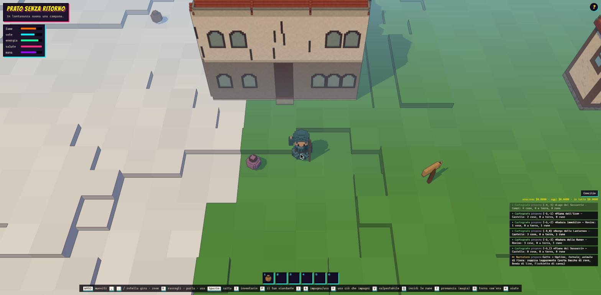 fuori, davanti alla locanda | 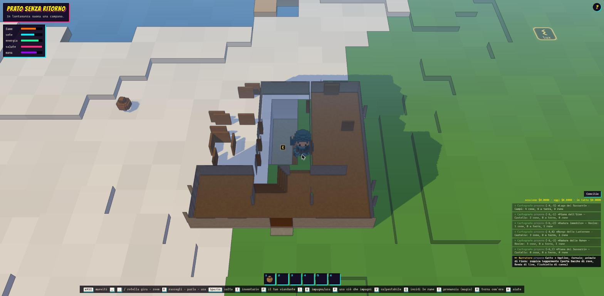 sulla scala, a −7 voxel: la casa tagliata, la tromba |
| 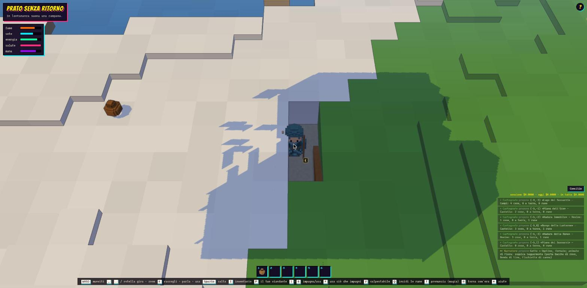 in cantina, a −19: la fossa di una casella, il resto sotto il terreno | 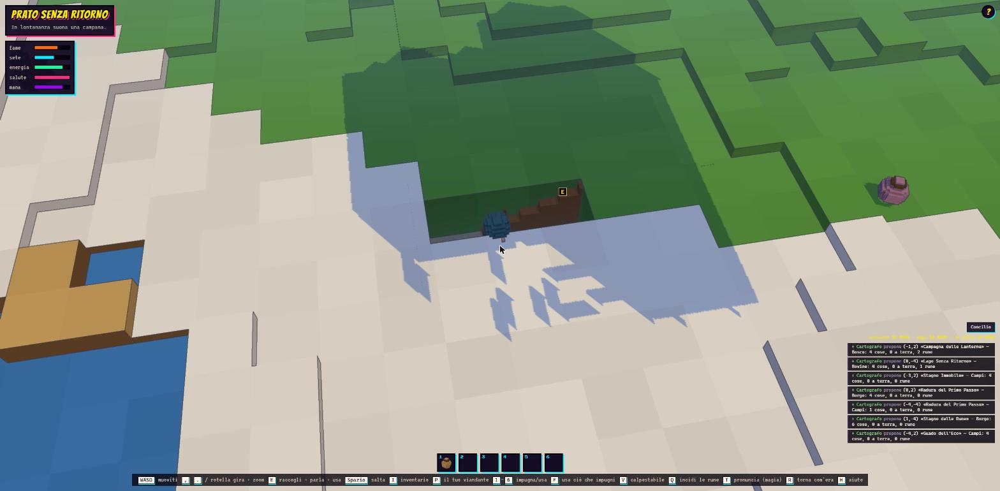 la stessa, la camera girata: i gradini che scendono nella fossa |
| 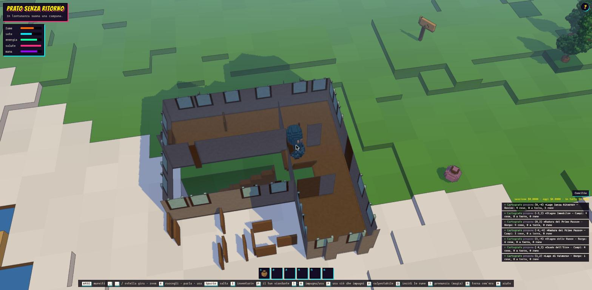 risalito al piano terra: dove c'è la tromba, l'erba | |

Il primo tentativo era su un punto che `free` dava libero ma dove c'era già una casa del borgo (l'entità 24, la forma `structure`). Le due
forme si sovrapponevano e il corpo si fermava sulla scala. Non è un difetto delle cantine: le misure sopra sono sul secondo punto, libero.

## 3. Negli universi

- **`universes/` della cartella principale** contiene soltanto `valmora`, `valmora copy 2` e `valmora new`, universi del 2D (con `assets/`,
  senza `models/`): nessuna cantina.
- **Gli universi di Claude Cloud** (`npm run universi:cloud`): aurora usa le 6 voci del seme, posate in 6 luoghi (la locanda e la fucina
  nanica nella Campagna del Primo Passo, la fucina, la torre del mago, la torre di guardia, la locanda del cinghiale); neapolis, orichalcum
  e sidera hanno 6 voci ciascuno (§ 1). Sono tutte scritte a mano, nessuna dallo Scultore.
- **Nessun universo generato dal Concilio** ha una voce con `cellar`. Non può averla, perché nessun compito la chiede.

Quindi il difetto del buco si vede già oggi, ovunque una di queste voci è posata: per esempio nella locanda di aurora.

## 4. Quanto costa finire, sul kernel di oggi

Cosa è cambiato da ADR-0091 (30/10):

- **I nomi.** Dal contratto 0.4-0.5 `sotto` è `cellar` e il codice è in inglese. Lo schema del Cartografo avrà `structures[].cellar` e una
  lista `under` accanto a `inside`, `outside` e `anywhere` (`Where`, T310b). Gli strati diventano `layer: 'stratum'`, e il campo del piano
  `strata`, con `PlaceView.strata`. Le migrazioni non hanno niente da portare, perché nessun piano ha strati.
- **La densità.** A 16 voxel per casella la cantina di una voce nuova (senza `vpt`) è `cellar · 20` voxel, cioè 1,25 caselle: T52f deve
  scegliere se tenerla così o portarla a `cellar · 16`. Il buco a caselle intere funziona male se la cantina non è allineata alle caselle
  (§ 2). La cantina di prova di T52b era di 3 × 3 caselle a 20, allineata: per questo allora sembrava giusto.
- **Lo Scultore delle strutture.** Oggi scrive le strutture senza scheletro, a regole, con le parti del seme (`part-stair`, `part-door`…;
  ADR-0182, ADR-0183) e senza `size` (`withoutSize`). Così la scatola si allunga da sola sotto (`sizeFor` con `under`, `soil` sulla radice
  passa `base` al compilatore), e la nota di T52b su `withSize` vale solo per le classi a scatola fissa. Una cantina, per lo Scultore,
  sarebbe una parte nuova del seme (`part-cellar`: la scala che scende al fondo e le fondamenta), da elencare nella richiesta come le altre.
- **I controlli.** `reachableStoreys` e `habitableParts` vedono la cantina come un piano (§ 1). Il metro dell'ottima (ADR-0210) non ha
  cantine.
- **I lotti di più luoghi** (ADR-0206, ADR-0208) hanno il piano a un livello (`blockLevel`): una gargantuesca con la cantina non cambia il
  conto.
- **Lo Scenografo** (`docs/design/scenografo.md`) non esiste ancora nel gioco (T410 è la via dei dati). Il § 10.4 chiede mobili che
  arrivino al soffitto, perché la via dei dati non lasci vuota la cantina. Nessuna misura dello Scenografo (T303, T406) ha avuto un
  edificio con la cantina.

Le stime sono nella stessa unità del backlog (quota della finestra di Claude); il costo in modelli è a parte.

| pezzo | cosa | stima | modelli | dipende da |
|---|---|---|---|---|
| **buco a copertura** (nuovo) | `holesIn`: una casella si apre se una parte abbastanza grande delle sue colonne è cantina, non solo il centro. Le fondamenta dei programmi del seme scendono al fondo, quindi il fianco del buco è il muro del modello. Un test a 16 in `cellar.test.ts` e la verifica nel browser sulla locanda. | 1 % | nessuno | — |
| **T52e senza strati** | `kernel.underground()`, il taglio a caselle in un disco attorno a chi sta sotto, le colonne tagliate di un colore di terra, il sole e il cielo attenuati. Senza il disco una fossa di 1,25 caselle nasconde alla camera in 3/4 circa una casella dietro il muro sud: con cantine larghe 1,75 caselle è metà. | 3 % | nessuno | buco |
| **cantina nella via dei dati** (§ 10.4) | la cantina come classe di stanza nello Scenografo (il pavimento coperto sotto `base`, raggiunto dalla scala), i mobili da cantina (il seme ha `barile`; servono scaffali e botti grandi, 2-3 modelli dello Scultore, della classe dei mobili), un edificio con la cantina nel banco dello Scenografo. | 2 % | 2-3 modelli | T410, T52e |
| **T52f** | il Cartografo chiede `structures[].cellar` e mette cose `under`, il `ModelDirector` chiede la voce con `cellar`, `part-cellar` e il prompt dello Scultore, `reachableStoreys` senza la cantina, le cose `under` sui pavimenti sotto il suolo raggiunti dalla porta (ADR-0064), `MockAiModels`, test offline. | 4 % | qualche struttura in più per mondo: la cantina allunga la richiesta, e una che non regge torna senza cantina | buco; prima di T411 se si vuole che i modelli rigenerati abbiano cantine |
| **T52d** | terreni `stratum` (predefiniti nel seme e scritti dal Cartografo alla Genesi), bozza per colonna, programma `subsoil` facoltativo dell'ambiente, `strata` nel piano e in `PlaceView`, schema, mock, validatore. Si vede solo nei tagli di T52e. | 4 % (ridotto ai predefiniti del seme e alla bozza, senza Cartografo né programma: 1,5 %) | 2-4 terreni e un programma per ambiente alla Genesi | T52e |

Finire tutto costa circa 14 %, più le chiamate dello Scultore per i mobili e per le cantine delle strutture nuove. Il minimo perché una cantina
arredata si veda è buco + T52e + cantina nella via dei dati: circa 6 %, dopo T410.

## 5. Raccomandazione

**Rimandare l'arredo**, perché oggi una cantina arredata non si vedrebbe: il terreno copre metà della cantina e non c'è il taglio. Le
cantine nel kernel invece funzionano: si scende, si risale, e da sotto non si esce altrove. L'unica cosa da fare subito, piccola e senza
modelli, è **il buco a copertura** (1 %), perché il difetto si vede già oggi in aurora, dovunque è posata una delle 6 voci del seme. Poi,
quando la Fase I lo permette, in quest'ordine:

1. il buco a copertura, con il test a 16;
2. T52e senza strati (il disco, la luce);
3. la cantina nella via dei dati dello Scenografo (dopo T410), con i mobili del § 10.4;
4. T52f, se le strutture nuove devono avere cantine: prima di T411, se si vuole che le abbiano anche i modelli rigenerati;
5. T52d per ultimo, ridotto ai predefiniti del seme.

## 6. Dopo T415: il buco a copertura

Fatto il primo passo del § 5 (kernel 0.9.3). Il terreno si apre su tutta l'impronta della cantina e solo lì: una casella che la
cantina copre in parte si apre sulle sue sotto-celle, 16 per lato (`holeCover`, `HOLE_CELLS`), con i fianchi dove incontrano il resto.
Dove il terreno resta il kernel sta sul terreno, dove si apre sui pavimenti della cantina: disegno e corpo dicono la stessa cosa,
quindi non ci sono fosse in cui si cammina a mezz'aria. Sul buco non si posano alberi né rocce del terreno.

`lab/scripts/misura-cantine.ts` dice ora anche le caselle aperte prima (il centro della casella sulla cantina) e l'area aperta dopo,
col modello posato al centro di una casella e non girato:

| voci | vpt | caselle toccate | aperte prima | area aperta dopo (caselle²) |
|---|---|---|---|---|
| fucina, locanda, torre di guardia (seme), bistrot (neapolis) | 16 | 15 | 3 | 7,32 (tutto il buco) |
| fucina nanica, torre del mago, locanda del cinghiale (seme), officina meccanica (orichalcum) | 16 | 15 | 6 | 7,37 (tutto il buco) |
| 8 voci «prime» degli universi di Claude Cloud | 20 | 12 | 3 | 4,72 (buco 4,68) |
| 8 voci «gemelle» degli universi di Claude Cloud | 20 | 8 | 6 | 4,77 (buco 4,72) |

A 16 voxel per casella le sotto-celle stanno sui voxel e l'area aperta è il buco esatto. A 20 (le voci di prima) una sotto-cella
prende la colonna sotto il suo centro e il bordo si sposta al più di 1/32 di casella: lo 0,04 caselle² in più. `tests/cellar.test.ts`
prova ora le due densità: a 16 la casa di prova tocca 5 × 5 caselle, 16 in parte, e ogni sua colonna di voxel sta sotto il terreno aperto,
il terreno attorno resta intero, e le facce del terreno che il renderer abbassa coprono proprio i 60 × 60 voxel della cantina.

Nel browser (`?skip&offline`, la locanda posata come nel § 2 a (−19,5, −10,5)): `holesIn` dà 15 caselle, 12 in parte, 7,32 caselle²
aperte. Dal piano terra la tromba scende sui gradini di pietra, non più nell'erba; si scende per la scala fino a −19 voxel e in cantina
si vede tutta la cantina, coi suoi muri, il pavimento e la scala, anche con la camera girata; si risale a +2 voxel lungo lo stesso cammino.

| | |
|---|---|
| 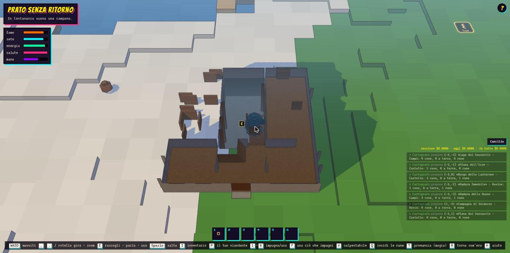 sulla scala, a −7 voxel | 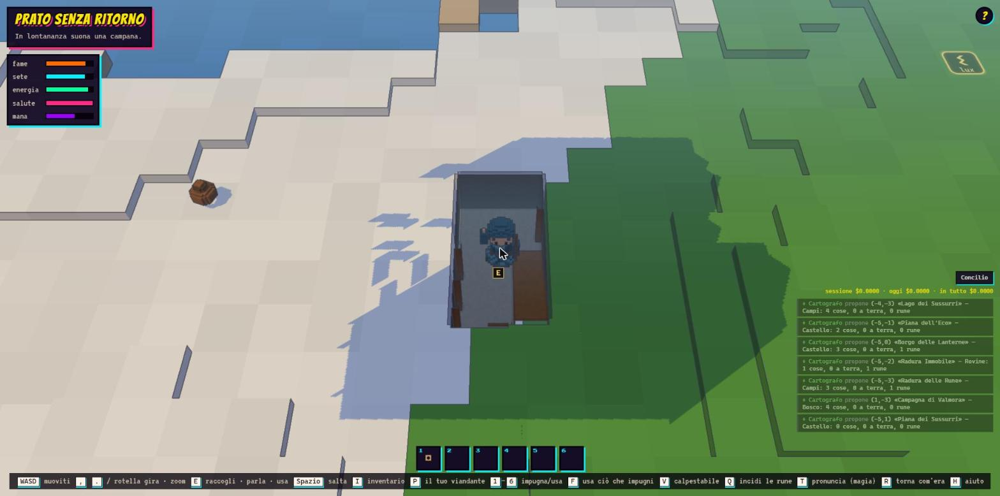 in cantina, a −19: tutta la cantina aperta |
| 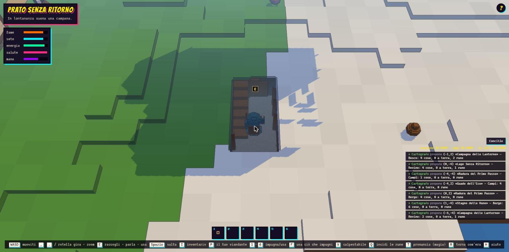 la stessa, la camera girata: la scala | 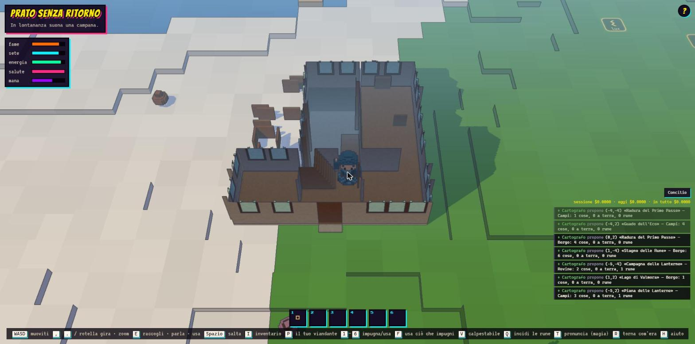 risalito al piano terra: la tromba sui gradini |

Resta T52e: il taglio attorno a chi sta sotto, gli strati e la luce attenuata. Con la cantina larga 1,75 caselle la camera in 3/4 la vede già
quasi tutta; una cantina più larga ne avrà bisogno.

## 7. Dopo T416: vedere sotto terra, senza strati

Fatto il secondo passo del § 5 (kernel 0.9.4, ADR-0091 «Attuazione»). Chi sta più di un gradino sotto il suolo (`kernel.underground()`) ha
attorno un disco di caselle (raggio 6, 3 caselle più lungo verso la camera) in cui non si disegna ciò che sta più di 1,15 caselle sopra il
suo pavimento: terreno, strutture, alberi, cose. Le colonne tagliate hanno in cima un tappo di terra, quelle attorno al disco il fianco fino
al taglio; il sole e il cielo scendono con la profondità, fino a un terzo a 2 caselle. Le bande degli strati sui tagli verranno con T418.

Nel browser (`?skip&offline`, la locanda posata come nel § 2 a (−19,5, −10,5), il cammino del corpo dalla cantina al piano terra trovato con
`free` e `floorAt` a passi di 0,05): sul piano terra non si è sotto terra e non si taglia niente. Scendendo, il taglio si accende al primo
gradino sotto il suolo (−0,25 caselle, taglio a +0,9) e scende con il viandante fino a −1,19 (taglio a −0,04). In cantina il disco è un
cerchio di terra attorno a lei: la casa sopra, gli alberi e la neve non ci sono, e dalla camera in 3/4 si vede tutta la cantina, coi muri,
il pavimento e la scala. Girata la camera, il disco si allunga dall'altra parte. Risaliti, il terreno torna intero.

| | |
|---|---|
| 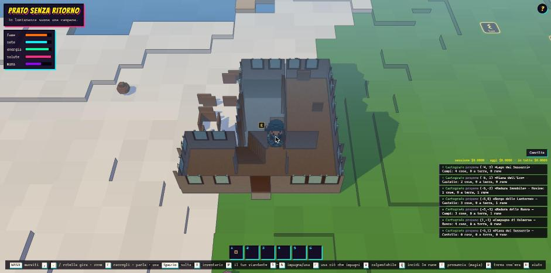 sul piano terra: nessun taglio | 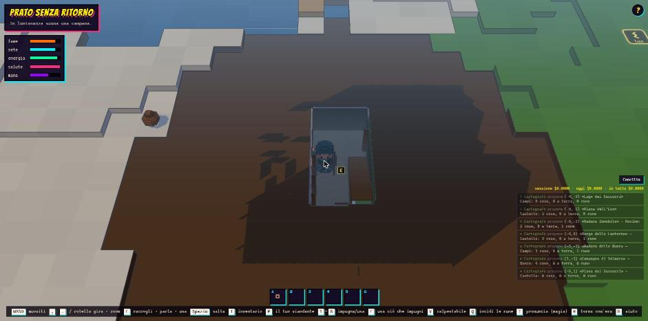 in cantina, a −1,19: il disco di terra, tutta la cantina |
| 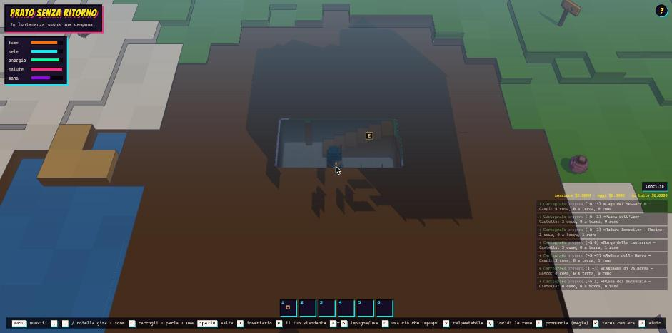 la stessa, la camera girata di un quarto | 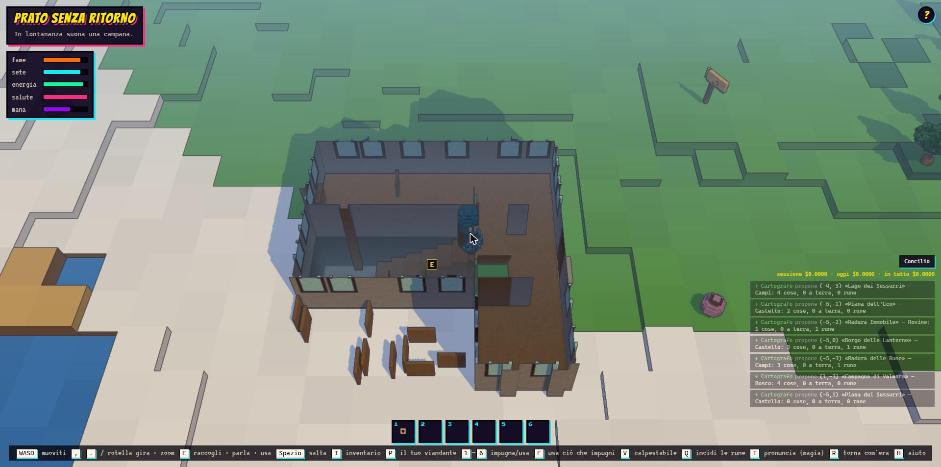 risalito al piano terra: il terreno intero |

Le ombre restano: la casa tagliata ombreggia ancora la cantina e il disco (la sua ombra si vede sulla terra). Con le cantine del seme il taglio
cade appena sotto il suolo, quindi il disco cambia colore più che altezza; con una cantina di 2 caselle (T52f) il taglio scende di quasi una
casella e le colonne tagliate si vedranno sui fianchi.

## 8. Dopo T418: gli strati, ridotti

Fatto il terzo passo del § 5 nella forma ridotta (kernel 0.9.5, ADR-0091 «Attuazione»). Sotto ogni casella ci sono quattro righe di strati,
una per casella di profondità, scelte dalla bozza procedurale (terra e argilla sopra la roccia viva, sabbia compatta sotto la sabbia, fango
sotto l'acqua, roccia sotto la roccia) e da un hash della casella e del seme: lo stesso mondo ha sempre gli stessi strati. I terreni degli
strati sono `strata` del generatore (cinque nel seme); il piano li tiene, un piano di prima li ricalcola. Nel taglio i tappi hanno il colore
dello strato a cui la colonna arriva, e i fianchi attorno al disco sono a bande, una per strato.

Nel browser (`?skip&offline`, la locanda posata come nel § 2 a (−19,5, −10,5), il viandante messo sul pavimento della cantina a (−19,75, −12),
−1,19 caselle): in cantina il taglio è a −0,04 dal suolo, quindi i tappi sono tutti della prima riga, terra marrone, e i fianchi sono alti
4 centesimi: le bande non si vedono (14). Per vederle, solo per l'aspetto, il taglio è stato abbassato dalla console di 1,9 caselle (come
avrebbe una cantina di due o tre caselle, T52f): i tappi sono della seconda riga, a chiazze di terra e argilla rossa secondo le colonne, e
le pareti attorno al disco hanno la terra in alto, l'argilla e più giù la roccia viva; i colori della mesh del taglio lo confermano (terra,
argilla, roccia viva e fango sotto il lago a nord). Le pareti stanno nell'ombra della casa tagliata, che resta (§ 7), e la luce a cartone
sui fianchi le smorza: le bande si leggono soprattutto dalle linee d'inchiostro fra uno strato e l'altro (15-17). Rimesso il taglio vero e
risaliti, il taglio si spegne.

| | |
|---|---|
| 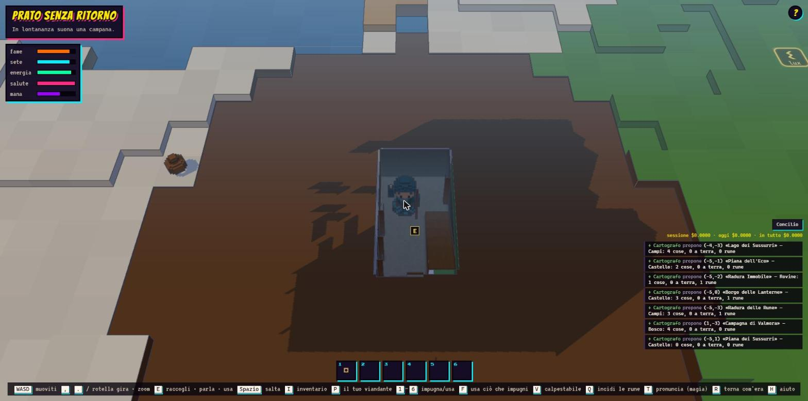 in cantina, col taglio vero: i tappi di terra | 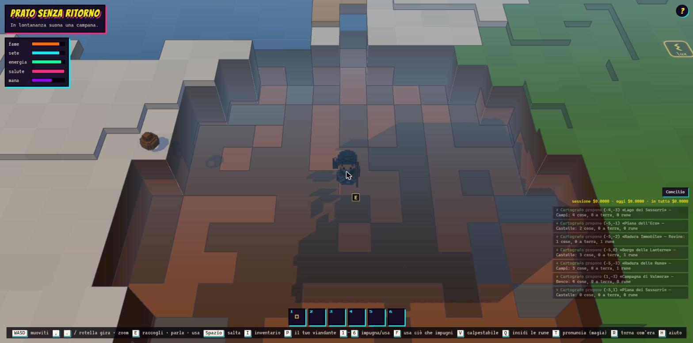 il taglio 1,9 caselle più giù: terra e argilla sui tappi, le pareti a bande |
| 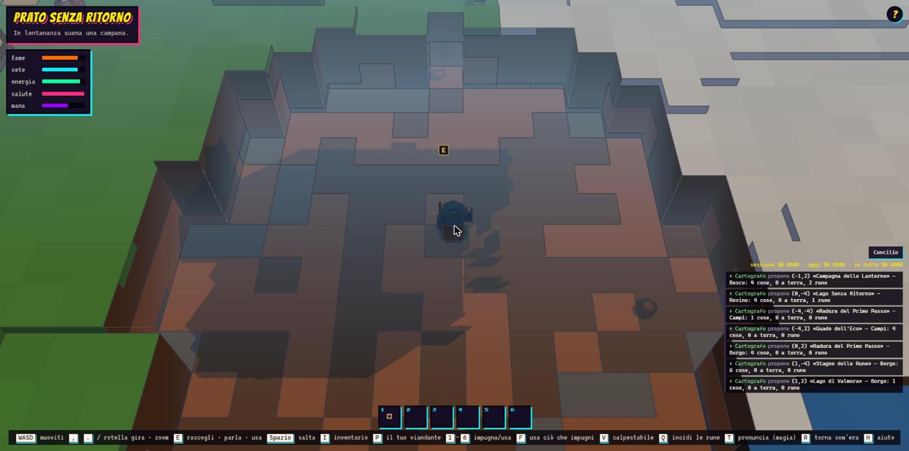 la stessa, la camera girata di mezzo giro | 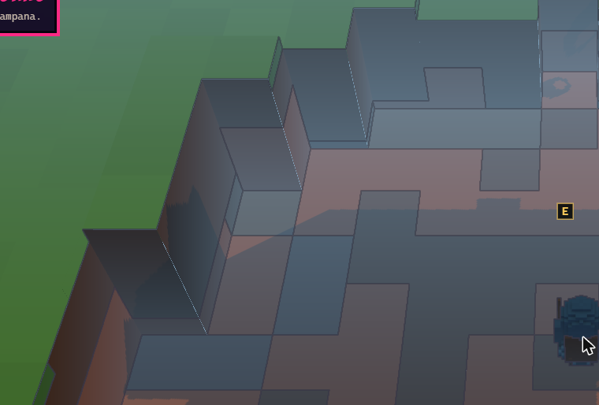 una parete da vicino, nell'ombra della casa |

Restano, per un task dopo: il Cartografo che scrive gli strati del suo mondo alla Genesi, il programma `sottosuolo` degli ambienti, la
profondità dalla cantina più profonda, le bande sui fianchi del buco (coperti dai muri della cantina) e l'ombra della casa tagliata.

## 9. Dopo T417: il Cartografo e lo Scultore chiedono le cantine

Fatto il quarto passo del § 5 (T52f, kernel 0.9.6, ADR-0091 «Attuazione»). Il Cartografo può dire `cellar: true` su una struttura del piano e
mettere cose `under`; il `ModelDirector` chiede la voce con la cantina (una casella, due per le taglie rare), solo per le strutture che crescono
a regole; lo Scultore la scava con una parte del seme nuova, `part-cellar`, e i suoi controlli vogliono la cantina che regge e che si raggiunge
dalla porta, o la struttura entra senza. La cantina non conta più come piano. Le cose `under` vanno sul pavimento della cantina, lontane dal
piede della scala.

- **La scala della cantina** non è quella di `part-stair`: sopra la cantina il kernel vuole, per ogni colonna sotto il corpo, un pavimento
  entro un gradino dai piedi (la regola della tromba, T52b). Una scala che sale di due voxel per uno in avanti non la passa, perché il corpo è
  largo 9 voxel. La scala di `part-cellar` va quindi a pedate di 5 e alzate di 3, come quelle delle cantine del seme: sei pedate per una
  cantina di 20 voxel, una striscia di 40 × 10 voxel lungo il muro davanti della cantina. Per una cantina di due caselle (40 voxel) le pedate
  sono 13, quindi serve una stanza di più di 70 voxel.
- **Le correzioni del kernel**, emerse dalle cantine scritte dallo Scultore e dal browser. (1) La regola della tromba faceva aria anche del
  pavimento del piano terra sopra la cantina e della scala del piano di sopra posata lì, perciò la villetta con la cantina non saliva più al
  primo piano: ora è tromba solo una colonna vuota al livello del suolo. (2) Chi sta in cantina era fermato dai mobili del piano terra sopra
  di lui: un modello tutto sopra la testa non ferma. (3) `floorAt` posava una cosa della cantina sul ripiano della credenza sopra di essa: un
  pavimento più di un gradino sopra i piedi non è sotto di essi. (4) Il kernel e il renderer posavano ogni cosa al suolo sotto il suo
  centro: la cassapanca in cantina sbarrava la scala come se fosse al piano terra e non si vedeva (era dentro il taglio). Ora una cosa in
  cantina sta alla sua altezza (`SolidForm.stand`, `restsAt`) e la sua altezza va ai client (`below`, fra le `ENTITY_PARTS`). (5) «Un
  modello tutto sotto i piedi non ferma» guardava la scatola del modello, non i suoi voxel: chi stava sulle pedate alte si fermava sopra la
  cassapanca. (6) Le cose del piano terra si posavano sulla pedata più alta, che il pavimento conta come piano terra, e sporgevano sulla
  tromba; ora stanno a tre quarti di casella dalla tromba, e le cose della cantina a 1,2 caselle dal piede della scala e a tre quarti dai
  suoi fianchi.
- **Offline** la villetta dello Scultore ha la cantina quando la richiesta la vuole (a Grande, Enorme e Gargantuesca con una casella; con due la
  sua stanza è corta e la villetta entra senza) e i piani di `MockAiModels` chiedono ogni tanto «la casa con la cantina» con una cassapanca
  giù. Il test `tests/cellar-asked.test.ts` pianifica il borgo con quella casa, la fa scolpire offline e ripianifica: la cassapanca sta sul
  pavimento della cantina, sotto il suolo, raggiunta dalla porta e lontana dalla scala.

Nel browser (`?skip&offline`): due luoghi accanto all'inizio chiedevano «la casa con la cantina» con una cassapanca giù (prima della regola
che li tiene lontani dall'inizio; restano nel profilo del browser). La casa `0,-1` portava la generica finché il `ModelDirector`, chiamato
dalla console, non ha fatto scolpire offline la villetta: la voce `struttura-la-casa-con-la-cantina` ha `cellar: 1`. Ripianificato il luogo,
la cassapanca sta sul pavimento della cantina, a −0,44 caselle, con il suolo a 0,75. Il viandante, mosso a passi di un quarto di voxel lungo la
scala come il corpo (`free` e `floorAt`), scende dal piano terra fino al pavimento della cantina senza un passo bloccato. Lì il taglio di
T416 apre la cantina, e si vedono la cassapanca, la scala a pedate lungo il muro davanti e i muri; la cassapanca lo ferma a 0,72 caselle. Poi
risale al piano terra e il taglio si spegne.

| | |
|---|---|
| 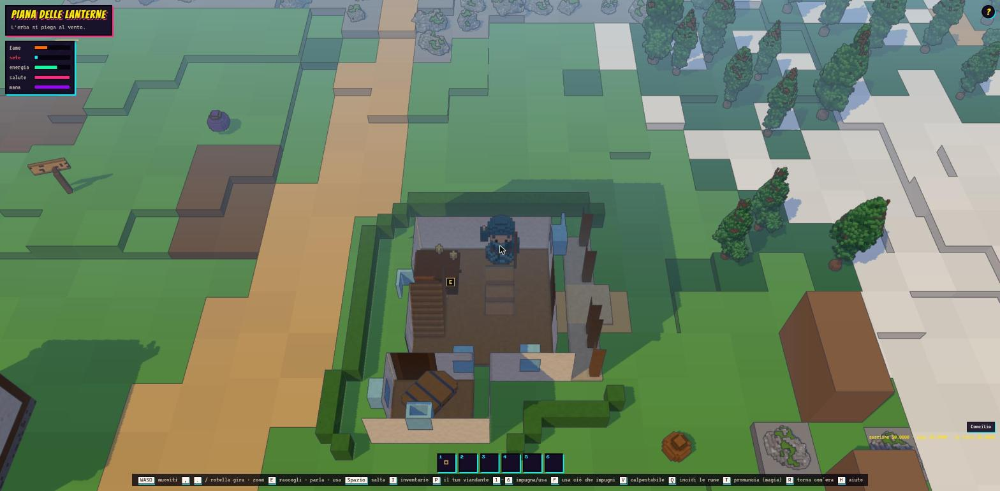 in cima alla scala della cantina, al piano terra | 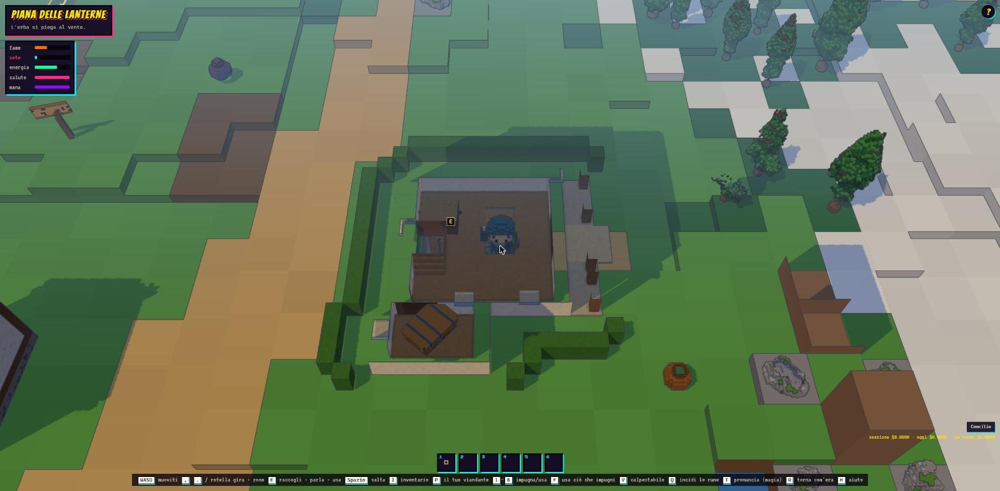 a metà scala, 0,62 caselle sotto il suolo |
| 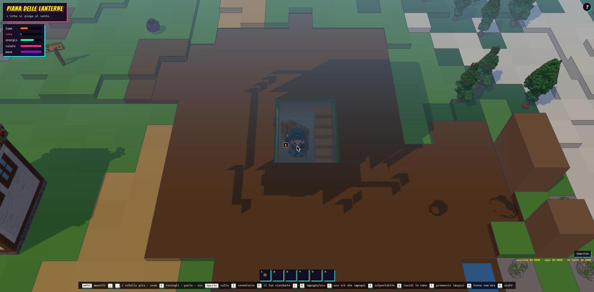 in cantina, a −1,19: la cassapanca, la scala | 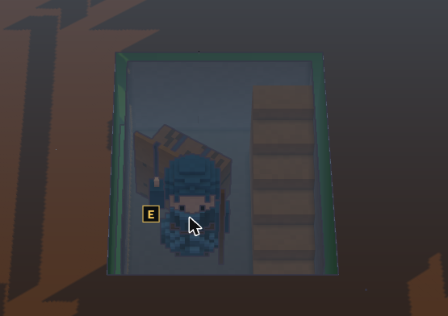 la stessa, da vicino |
| 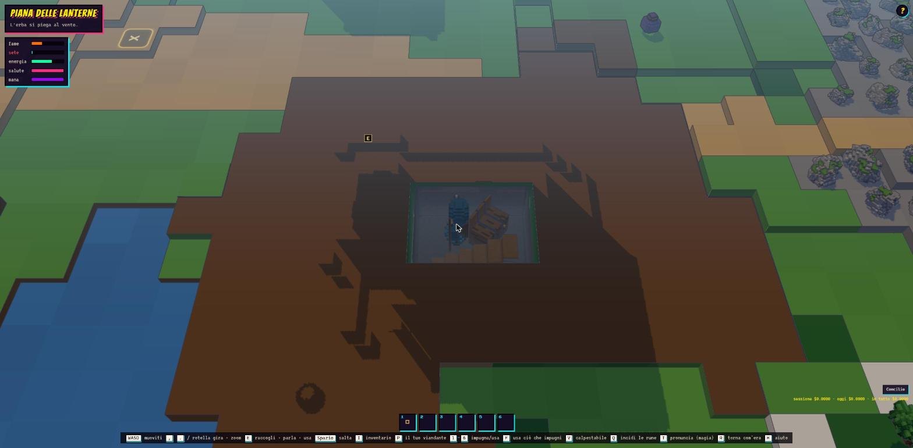 la camera girata: le pedate davanti, la cassapanca | |

Restano: l'arredo della cantina nella via dei dati dello Scenografo (T419) e la rigenerazione dei modelli con le cantine (T411).
