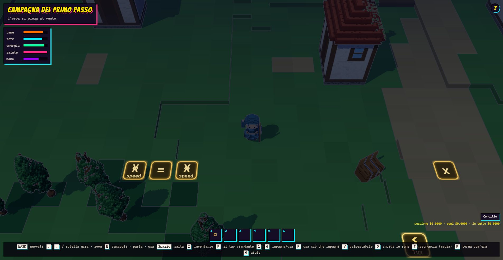
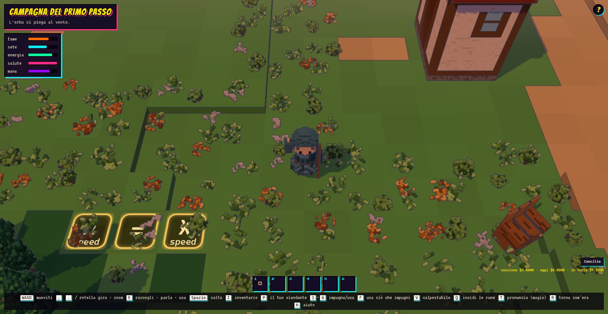
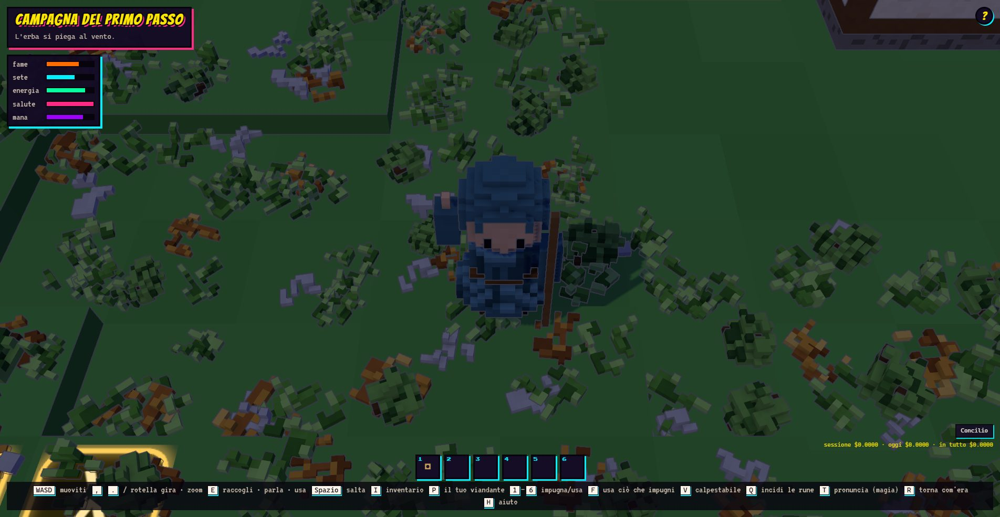
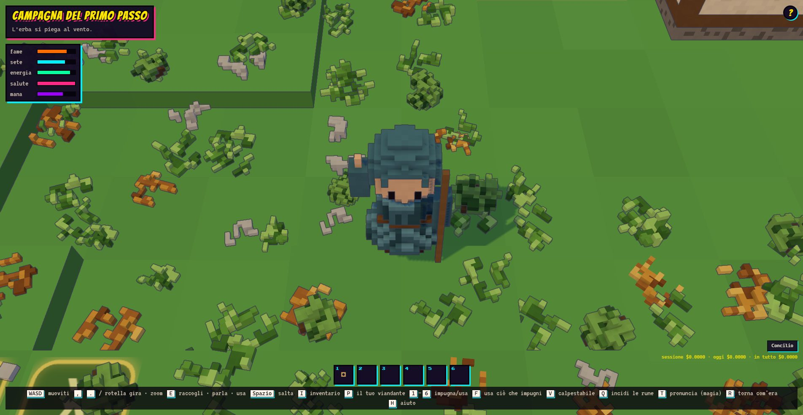
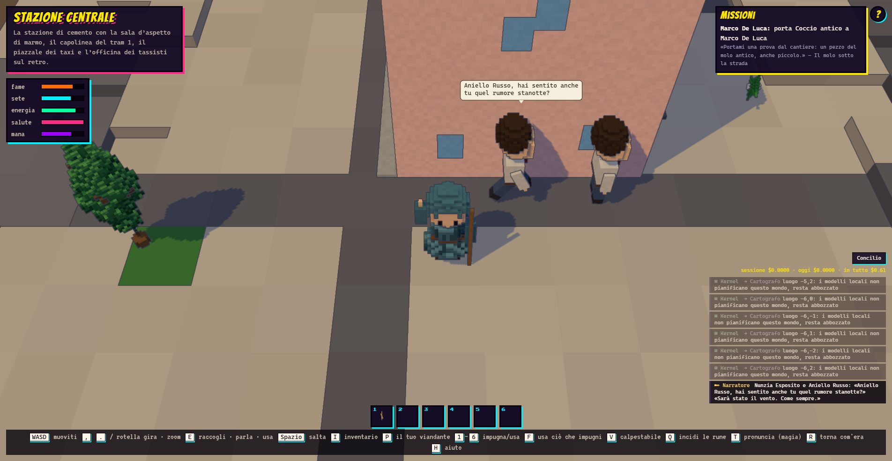
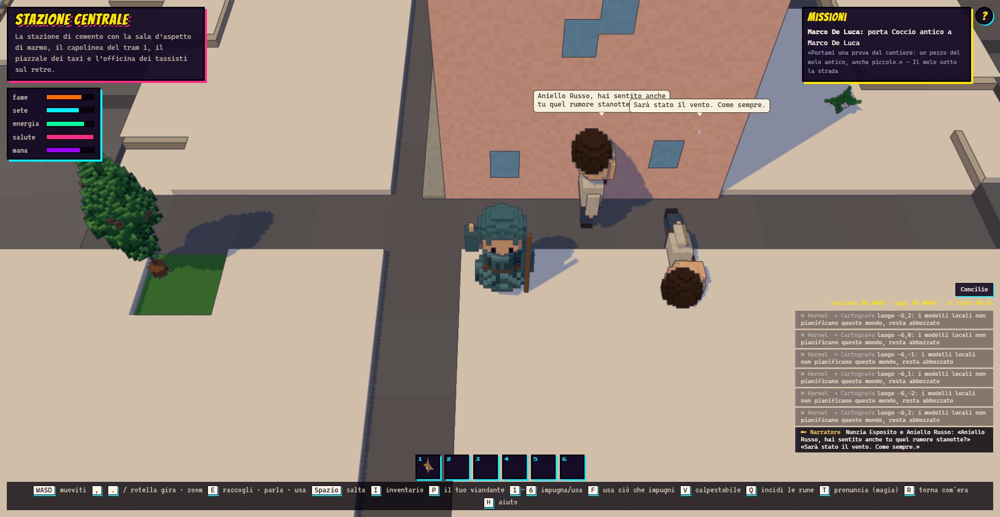
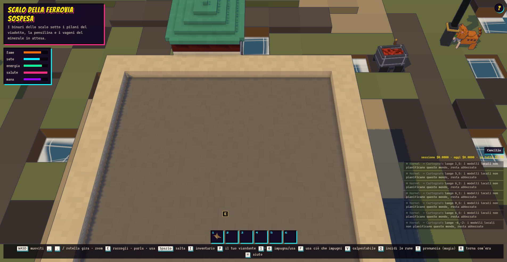
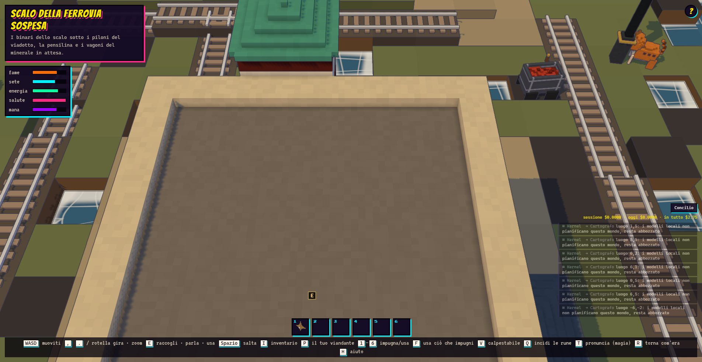

# Il terreno ricco del Paesaggista: il sottobosco, gli scavi, le strade, i binari, i modelli riusati a semi (T509)

Data: 2026-11-27 · Fase III · Richiesta: l'autore, 26/11 ([`docs/userchats/to-do-2026-11-26.md`](../userchats/to-do-2026-11-26.md)) ·
Studi gemelli: [`terreno-3d.md`](terreno-3d.md) (T459), [`scultori-specializzati.md`](scultori-specializzati.md) (T458),
[`strutture-modulari.md`](strutture-modulari.md) (T522), [`gpu.md`](gpu.md) (T331) · Laboratorio e misure: [`lab/terreno-ricco/`](../../lab/terreno-ricco/README.md) ·
Domande: [`docs/pipeline/domande/T509.md`](../pipeline/domande/T509.md)

> «Il paesaggista attualmente non crea una vegetazione folta: aggiungiamo arbusti, cespugli, foglie secche, erba, brecciolino, pietre, grano,
> balle spostate dal vento (mesa) ecc... Inoltre il paesaggista dovrebbe poter modificare il terreno anche sottraendo, per esempio per mettere
> una strada e i marciapiedi in neapolis. Oppure una ferrovia in mesa. Attualmente è possibile creare una "strada asfaltata"? Diamo un po' di
> tridimensionalità al terreno. Creiamo modelli variabili e riutilizziamoli cambiando il seme.»

Niente codice del gioco: il documento dice che cosa cambierebbe, perché, quanto costa e in che ordine. Ogni fatto sul kernel di oggi (0.10.40)
è letto nel codice, con il file. **I numeri sono misurati**: in Node sul kernel offline, sul seme e sulle cinque copie degli universi della
run #2 (`beta-run-2/universes/`, lette dal loro git, i piani da `maps/`, niente scritto: [`misure/node.md`](../../lab/terreno-ricco/misure/node.md));
nel browser con `misura-frame.mjs --sottobosco` (Chrome headless sulla RTX 2070 di T459 e T331: [`misure/frame.json`](../../lab/terreno-ricco/misure/frame.json)).
Nessun modello è stato chiamato.

## In breve

1. **Perché è rada.** Sulla terra che si cammina non cresce niente: il renderer mette i modelli dei terreni solo sulle caselle di bosco (una
   ogni due) e di roccia, e la terra (prato, sabbia, sentiero, strada) è un quadrato di un colore. Misurato su 263 luoghi di sei universi:
   **la terra nuda è il 99-100 % della terra che si cammina in ogni universo**; le cose del Cartografo sono 3,3-5 a luogo (personaggi e
   mobili), quelle del Paesaggista 0 in quattro universi su cinque. Il Paesaggista viene chiamato solo per i modelli dei terreni di bosco e di
   roccia (al più quattro per universo, alla Genesi) e per le cose delle sue classi: tre universi su cinque indossano soltanto i nove modelli
   del seme (i platani di `neapolis` sono l'albero del seme).
2. **Il sottobosco è una copertura dei terreni**: modelli piccoli (un ciuffo d'erba, foglie secche, sassolini, un arbusto, spighe), un
   programma per tipo e molti semi, sparsi a istanze con un hash sulla terra di ogni terreno che li vuole, come oggi i boschi: niente
   entità, niente sul filo, niente stato. Lo dice il terreno (`TerrainDef.cover`), lo sceglie la Genesi dal nome e dalla descrizione (in
   `sidera` il prato è «asfalto bagnato»), lo scolpisce il Paesaggista in una classe nuova (`cover`). **Misurato nel browser**: a due istanze
   per casella sui luoghi caricati alla camera più lontana (8 944 istanze, 1,45 milioni di triangoli in più) la GPU resta a 2,8 ms in mediana
   (oggi 3,2) con una InstancedMesh per forma per la finestra; per luogo (222 oggetti) le draw call raddoppiano; fusa in una mesh
   per luogo pesa 65 MB a una istanza per casella contro 0,27. Le ombre del sottobosco costano più del sottobosco: niente ombre.
3. **Le cose che il vento porta** (i cespugli rotolanti di `mesa`): un sistema Lua che le porta sul vento di T484 costa **0,25 ms a cosa a tick**
   (otto rotolanti, un ottavo del frame); lo stesso lavoro nel kernel 6-8 µs. Una primitiva del kernel (`physics.drift`), non il Lua.
4. **Lo scavo**: tre vie, guardate sulla regola 10. **Il rientro** (`TerrainDef.inset`, meno di un livello, solo aspetto: la strada più bassa
   del marciapiede, il cordolo dove si toccano) non tocca il kernel; **lo scavo del layout** (`cut`, uno o due livelli dove il layout scrive il
   codice, terra mossa come le rampe) fa fossi e trincee che il corpo e l'acqua sentono, entro il gradino; **un programma del Cartografo** non
   serve. I binari sono **modelli allineati**: il verso dai vicini dello stesso codice, non a caso (in `orichalcum` 60 % dritti, 25 % fini,
   12 % a T, 3 % curve).
5. **La strada asfaltata oggi**: sì, ma piatta. `neapolis` ha «strada» (#5e5e64, 2 513 caselle in 60 luoghi) e «marciapiede», `sidera`
   «asfalto bagnato»: terreni che la Genesi nomina e colora, alla stessa altezza dei vicini, un colore per casella, senza cordolo né strisce.
   Il Concilio non può abbassarla né disegnarle un bordo: non c'è un campo per farlo.
6. **La tridimensionalità**: T459 ha scelto le colonne col rilievo vero, e il rilievo vero c'è (T475) ma solo per i mondi nuovi del Far West,
   dei Pirati e dello Spazio: `mesa` è nata prima (kernel 0.10.2) ed è collinare. Ciò che dà profondità a ogni universo, anche a quelli di
   prima, è alla scala della casella: la copertura, il rientro, i modelli allineati, le rocce. Il voxel resta scartato (T459 § 4.4).
7. **I modelli variabili riusati a semi** sono già la regola (ADR-0037): un programma per tipo, ogni istanza un seme. Mancano la copertura,
   i semi per classe (oggi tre per ogni modello di terreno) e un controllo che i semi diano davvero forme diverse.
8. **La catena**: nove task (C1-C9, circa il 31 % della scala, più una prova pagata di ~1 $), § 7; **sette domande** col consiglio, § 8.

---

## 0. Il paesaggio di oggi, sulle cose che contano qui

| Cosa | Oggi | Dove |
|---|---|---|
| Il Paesaggista | una specialità dello Scultore (T468, ADR-0239) per le classi `tree`, `bush`, `rock`, `pebble`; la sua sezione del prompt dice come cresce la natura (T470) | `src/kernel/agents/sculptor.ts:231`, `universe/prompts/agents/sculptor/landscaper.md` |
| Quando lavora | il `ModelDirector` gli chiede i modelli dei terreni che la palette nomina (un bosco come `tree`, una roccia come `rock`) e le cose di un modulo delle sue classi | `src/kernel/modeldirector.ts:208` |
| I modelli dei terreni | la Genesi ne dà uno solo agli strati `vegetation` e `rock` (`terreno-<nome>`): al più quattro per universo (`t`, `j`, `r`, `k`) | `src/kernel/agents/genesis.ts:254` |
| Dove si vedono | sul bosco un'istanza ogni due caselle (gli alberi sono larghi due), sulla roccia una a casella; tre semi (`TILE_SEEDS`), verso e scala a caso dall'hash; una InstancedMesh per forma e per luogo | `src/render/terrainmesh.ts:19`, `:383` (`place`), `src/render/terrain.ts:241` |
| La terra che si cammina | un quadrato del colore del terreno, ±7 % di luce dall'hash; l'acqua 0,18 caselle più in basso, un pavimento 0,02 più in alto (`groundY`), nient'altro | `src/render/terrainmesh.ts:201` |
| Le cose del Cartografo | «2-6 entries in objects» per luogo (tagliate a 8), personaggi, mobili e cose del catalogo; al più quattro oggetti a terra e una cosa nuova | `src/kernel/agents/cartography.ts:242`, `:284` |
| Un'entità a schermo | un `Mesh` per entità, la geometria condivisa: una draw call a passata per ognuna | `src/render/models.ts:193` (`modelObject`) |
| Il vento | il materiale `MAT.sway` piega la vegetazione con l'altezza; dal T484 lo guida la vista grossolana del vento del mondo; `world.wind` per Lua | `src/render/materials.ts`, ADR-0255 |
| Il riuso a semi | un programma per tipo, le istanze sono semi (ADR-0037); le strutture a quattro semi (ADR-0160) e riusate dal Cartografo (T495, ADR-0247) | `src/kernel/forms.ts`, `src/kernel/reuse.ts` |

---

## 1. Perché la vegetazione è rada (con le misure)

### 1.1 Come si misura

`npx vite-node lab/terreno-ricco/misura.ts -- --universi <cartella>`: per il seme e per ognuna delle cinque copie della run #2, un kernel sui
modelli locali apre l'universo dal suo git come lo prende il browser (`prepareUniverse`), legge i piani da `maps/` come il kernel li chiede
(un universo del Concilio non si pianifica coi modelli locali, ADR-0222: la finestra è ciò che l'universo ha) e si assesta in quattro posti
(la partenza e tre posti a tre luoghi). Per ogni luogo pianificato: le caselle per strato, le istanze dei modelli dei terreni con la regola di
`place`, le cose del piano e le entità per classe, la **terra nuda** (le caselle dello strato `ground` che si camminano senza niente sopra).
Poi i modelli del Paesaggista di ogni universo sul motore vero (`runForm` e le mesh del gioco, `formMeshes`), tre semi: tempo, voxel,
triangoli come li fa `meshVoxels` e come li farebbe una fusione delle facce (il conto di un mesher greedy, ciò che T523 propone).

### 1.2 I luoghi

| universo | luoghi misurati | terra che si cammina | bosco | roccia | acqua | istanze a luogo | cose del piano a luogo | entità del Paesaggista | terra nuda |
|---|---:|---:|---:|---:|---:|---:|---:|---:|---:|
| seme | 7 | 89,2 % | 5,3 % | 4,2 % | 1,3 % | 21,4 | 3,3 | 3 | 99,1 % |
| `aurora` | 76 | 78,2 % | 5,4 % | 4,3 % | 11,5 % | 22,5 | 3,3 | 18 | 99,7 % |
| `mesa` | 29 | 78,8 % | 4,8 % | 6,7 % | 9,6 % | 29,4 | 4,1 | 0 | 100 % |
| `neapolis` | 60 | 60,4 % | 3,1 % | 1,0 % | 35,1 % | 8,3 | 3,7 | 0 | 100 % |
| `orichalcum` | 52 | 44,3 % | 0,8 % | 5,8 % | 46,6 % | 20,2 | 3,8 | 0 | 100 % |
| `sidera` | 39 | 91,0 % | 2,7 % | 2,6 % | 2,5 % | 11,5 | 5,0 | 0 | 100 % |

**Un luogo di ogni universo** (la partenza):

| universo | luogo | caselle | istanze | entità | nuda |
|---|---|---|---:|---:|---:|
| seme, `aurora` | (0, 0) «Campagna del Primo Passo» | prato 228, sentiero 67, acqua 16, campo arato 12 | 0 | 12 | 92,9 % |
| `mesa` | (2, −2) «Riva della Chiatta Ghiacciata» | brina d'altura 285 (la neve di prima di T510), fiume 21, macchia di pioppi 16 | 9 | 12 | 88,6 % |
| `neapolis` | (2, 1) «Officine dei Granili» | marciapiede 222, strada 70, parcheggio 24, cancellata 8 | 0 | 12 | 97,5 % |
| `orichalcum` | (1, 0) «Bottega Vitti» | sabbia 103, mare 92, strada lastricata 55, terra battuta 33, selciato 23, platani 15 | 9 | 11 | 66 % |
| `sidera` | (−5, −8) «Piazza dei Rottami» | sabbia vitrea 127, asfalto bagnato 116, passerella 69 | 5 | 16 | 96,3 % |

### 1.3 I modelli del Paesaggista

| universo | modelli delle sue classi | suoi | sui terreni |
|---|---:|---|---|
| seme, `aurora`, `neapolis`, `orichalcum` | 9 | nessuno: quelli del seme (`tree`, `quercia`, `betulla`, `palma`, `bush`, `cespuglio-con-bacche`, `rock`, `masso-muschioso`, `pebble`) | i platani di `neapolis` sono `tree`, la sua siepe `bush`, il suo tufo il masso muschioso |
| `mesa` | 13 | i quattro dei terreni: macchia di pioppi (voto 6), cactus (6), parete di canyon (5), rocce rosse (4) | tutti e quattro |
| `sidera` | 7 | albero di vetro, cristallo, felce a spirale | tutti e tre |

Quanto costano (mediana di tre semi, nel worker come in Node):

| modello | classe, scatola in voxel | ms a seme | voxel | triangoli | fusi (T523) |
|---|---|---:|---:|---:|---:|
| `tree` (il bosco del seme) | albero, 40 × 40 × 60 | 35 | 5 153 | 6 802 | 4 848 |
| `quercia` | albero | 67 | 12 291 | 12 134 | 8 128 |
| macchia di pioppi (`mesa`) | albero | 127 | 13 757 | 17 858 | 10 682 |
| cactus fitti (`mesa`) | albero | 89 | 5 038 | 16 422 | 4 014 |
| albero di vetro (`sidera`) | albero | 9 | 3 924 | 15 422 | 7 968 |
| `bush` | cespuglio, 20 × 20 × 16 | 6 | 776 | 1 584 | 1 166 |
| `rock` | roccia, 20 × 20 × 16 | 7 | 1 004 | 1 446 | 900 |
| parete di canyon (`mesa`) | roccia | 7 | 5 113 | 3 266 | 240 |
| `pebble` | sasso, 10 × 10 × 8 | 2 | 131 | 342 | 256 |

### 1.4 Perché

1. **Sulla terra non cresce niente.** Il renderer mette un modello solo sulle caselle degli strati `vegetation` (una ogni due) e `rock`; lo
   strato `ground`, che è il 44-91 % delle caselle, è un quadrato colorato. Non è una scelta del Concilio: non c'è un campo per dire che cosa
   cresce su un prato.
2. **Il Cartografo non arreda il paesaggio.** Le sue cose sono 2-6 a luogo (misurate 3,3-5), e il prompt le vuole personaggi, mobili e cose del
   catalogo; un cespuglio è un'entità come un baule. Le entità del Paesaggista: 18 cespugli in `aurora`, nessuna negli altri quattro.
3. **Il Paesaggista lavora di rado.** Gli si chiedono solo i modelli dei terreni di bosco e di roccia (al più quattro, alla Genesi) e le cose
   delle sue classi che un modulo nomina: `aurora`, `neapolis` e `orichalcum` indossano soltanto i nove modelli del seme (vengono, con `sidera`,
   dall'installazione di Claude Cloud, T273, e i loro terreni di bosco e di roccia nominano i modelli del seme); `sidera` ne ha tre suoi, `mesa`,
   nata da una Genesi vera, i quattro dei suoi terreni.
4. **I suoi modelli sono grandi.** Un albero è 6 800-17 900 triangoli, una roccia 1 300-5 300: i boschi sono già la parte più grande dei 4,3
   milioni di triangoli della scena alla partenza (§ 2.3). Un sottobosco fatto con loro non si può disegnare: servono modelli piccoli, di
   150-500 triangoli.
5. **I semi sono già lì, ma pochi**: tre per modello di terreno (`TILE_SEEDS`), il verso e la scala dall'hash. Un bosco è già un programma con
   molti semi; il prato non ha nemmeno quello.

---

## 2. Il sottobosco: modelli piccoli riusati a semi

### 2.1 Che cos'è: la copertura di un terreno

**La copertura** (`cover`) è ciò che cresce o giace sulla terra di un terreno: ciuffi d'erba sul prato, foglie secche e sassolini sotto il
bosco, spighe sul grano, ghiaia sul brecciolino, arbusti bassi qua e là. È **l'aspetto del terreno**, come oggi gli alberi del bosco:

- **un campo del terreno**: `cover: [{ model, density }]` (al più tre tipi, `density` istanze per casella da 0 a 4), scritto nella palette;
  la Genesi lo sceglie per ogni terreno dal suo **nome e dalla sua descrizione**, mai dal codice di base (in `sidera` il codice del prato `g` è
  «asfalto bagnato», in `neapolis` «marciapiede»: una copertura per codice farebbe crescere l'erba sull'asfalto);
- **una classe nuova, `cover`**, che scolpisce il Paesaggista: la scatola del sasso (0,5 × 0,5 × 0,4 caselle a 20 voxel per casella), l'animazione
  del vento, pochi voxel; i controlli dello Scultore vogliono **al più 600 triangoli a seme** e semi che danno forme diverse (§ 5);
- **sparsa dal kernel con un hash**, come `place` sparge gli alberi: quante istanze in una casella, dove nella casella, verso, scala e seme
  vengono dalla casella e dal seme del mondo, quindi ogni client vede la stessa cosa senza che niente vada sul filo; mai su un sentiero, una
  strada, un lotto, una porta, un varco o sotto una cosa solida;
- **solo aspetto**: non è un'entità, non blocca, non si raccoglie, non entra nello stato né nei piani. Se un giorno servirà raccogliere
  l'erba o le spighe, sarà un'azione del terreno (`actions`, come oggi), non della copertura.

Così il Concilio decide **una volta per terreno** (una chiamata del Paesaggista per tipo, alla Genesi o quando la palette lo chiede), e ogni
luogo, ogni seme, ogni universo che lo riusa la paga zero.

### 2.2 I programmi del laboratorio

Sette programmi scritti a mano in [`lab/terreno-ricco/modelli/`](../../lab/terreno-ricco/modelli/), per misurare (non sono i modelli che
scriverebbe il Paesaggista, e nemmeno belli: sono della misura giusta). Mediana di quattro semi:

| programma | scatola (voxel) | ms a seme | voxel | triangoli | fusi (T523) |
|---|---|---:|---:|---:|---:|
| ciuffo d'erba | 10 × 10 × 8 | 1,8 | 35 | 246 | 170 |
| foglie secche | 10 × 10 × 2 | 1,0 | 36 | 200 | 152 |
| brecciolino | 10 × 10 × 2 | 0,5 | 24 | 198 | 182 |
| sassolini | 10 × 10 × 4 | 1,6 | 22 | 144 | 92 |
| arbusto basso | 10 × 10 × 8 | 2,2 | 126 | 484 | 388 |
| spighe di grano | 10 × 10 × 14 | 1,5 | 92 | 540 | 388 |
| cespuglio rotolante | 12 × 12 × 12 | 1,8 | 147 | 1 080 | 890 |

Un ciuffo costa un cinquantesimo di un albero. **Il brecciolino e le foglie secche** sono il caso peggiore per i triangoli: ogni sasso è un voxel
con tutti i lati in vista, e la fusione non li aiuta (198 → 182). Per ciò che giace piatto c'è una via più economica: **la grana del suolo**,
le macchie di un voxel disegnate dal materiale del terreno sopra il suo colore (un hash della posizione a 1/20 di casella nel fragment
shader, zero triangoli), che resta voxel a vedersi. Non è misurata: è qualche istruzione per pixel del suolo, che oggi la GPU disegna in 3 ms
con tutto il resto.

**In Node**, sulla terra che si può coprire negli universi misurati (la terra che si cammina senza sentieri, strade e binari: il 39 % delle
caselle; il 77 % nel seme, il 4,5 % in `neapolis`), spargere le istanze di un luogo costa 0,05 ms a una istanza per casella e 0,4 ms a quattro;
le matrici delle istanze 64 byte l'una (0,27 MB a una per casella sui 35 luoghi della finestra più grande di T459).

### 2.3 Il frame

`node lab/scripts/misura-frame.mjs <porta> --sottobosco` (il modo nuovo): la preview della build, il seme offline, la partenza col tappeto
fermo, **la camera più lontana** (`ZOOM.max`, il caso con più luoghi a schermo); poi i programmi del laboratorio nella pagina (quattro semi
ciascuno, 20 forme, 62 ms) sparsi su tutti i luoghi caricati con la regola del § 2.1 (sul prato ciuffi 60 %, foglie 15 %, sassolini 10 %,
arbusti 15 %; sulla sabbia sassolini; sul grano spighe), col materiale che piega col vento, le ombre e l'inchiostro degli alberi del gioco. Otto
secondi per modo. Le cifre sono del frame intero (la scena, l'inchiostro, le ombre), il kernel a 60 tick al secondo, senza vsync.

| modo | istanze | triangoli del sottobosco | oggetti | draw call | triangoli a frame (tutte le passate) | GPU, mediana (p95) | JS a frame, mediana (p95) | fps | buffer delle mesh |
|---|---:|---:|---:|---:|---:|---|---|---:|---:|
| oggi, la partenza, la camera più lontana | — | — | — | 181 | 4,33 M | 3,16 (5,26) ms | 3,7 (8,9) ms | 222 | 122 MB |
| per luogo, 1 a casella, con le ombre (come gli alberi oggi) | 4 472 | 0,73 M | 209 | 528 | 5,62 M | 4,84 (8,03) ms | 5,8 (11,8) ms | 148 | 123 MB |
| per finestra, 1 a casella, con le ombre | 4 472 | 0,73 M | 16 | 229 | 6,52 M | 3,38 (5,71) ms | 3,6 (7,7) ms | 230 | 123 MB |
| per finestra, 1 a casella | 4 472 | 0,73 M | 16 | 213 | 5,79 M | 2,59 (4,98) ms | 2,6 (6,8) ms | 274 | 123 MB |
| per finestra, 2 a casella | 8 944 | 1,45 M | 16 | 213 | 7,23 M | 2,78 (4,82) ms | 2,8 (5,6) ms | 283 | 123 MB |
| per finestra, 4 a casella | 17 888 | 2,90 M | 16 | 213 | 10,13 M | 3,40 (4,16) ms | 2,2 (6,1) ms | 277 | 123 MB |
| fusa per luogo, 1 a casella | 4 472 | 0,73 M | 24 | 201 | 5,12 M | 2,35 (3,75) ms | 2,3 (5,1) ms | 302 | 194 MB (+72) |
| per finestra, 2 a casella, l'inchiostro del suolo | 8 944 | 1,45 M | 16 | 213 | 7,23 M | 2,63 (4,11) ms | 2,3 (4,8) ms | 326 | 123 MB |
| per luogo, 2 a casella | 8 944 | 1,45 M | 222 | 359 | 5,77 M | 3,46 (5,45) ms | 3,4 (6,5) ms | 237 | 123 MB |
| per finestra, 8 a casella | 35 776 | 5,81 M | 16 | 213 | 15,94 M | 5,56 (6,23) ms | 2,4 (8,8) ms | 182 | 124 MB |

Macchina: ANGLE (NVIDIA, NVIDIA GeForce RTX 2070 Direct3D11 vs_5_0 ps_5_0, D3D11), 1904 × 985, 12 core logici, timer query della GPU sì; altri agenti al lavoro sulla stessa macchina: fra due giri uguali la GPU in mediana si sposta di ±0,5 ms (la riga «oggi» a 3,16 e quella con una istanza per casella a 2,59 lo mostrano).

Che cosa dicono:

- **Fino a quattro istanze per casella la GPU non se ne accorge**: con una InstancedMesh per forma sulla finestra e senza ombre resta fra
  2,6 e 3,4 ms in mediana (oggi 3,2), con 0,7-2,9 milioni di triangoli in più (5,8-10,1 milioni a frame con le passate dell'inchiostro). A otto
  per casella (35 776 istanze, 5,8 milioni di triangoli) sale a 5,6 ms: un terzo del bilancio, il limite.
- **Le draw call vengono dal modo, non dalla densità**: per finestra sono 213 a ogni densità (32 in più di oggi: 16 forme in due passate); per
  luogo 359 a due per casella senza ombre e 528 a una per casella con le ombre, e il thread principale le prepara (JS a frame da 3,7 a 5,8 ms).
- **Le ombre costano più del sottobosco**: per finestra a una per casella 3,38 ms con le ombre contro 2,59 senza (6,5 milioni di triangoli contro
  5,8); per luogo con le ombre 4,84.
- **Fusa per luogo** la GPU è la più bassa (2,35 ms: niente matrici da leggere) ma i buffer passano da 123 a 194 MB e farla costa 86 ms:
  a una sola istanza per casella. A istanze 0,27 MB.
- **L'inchiostro** non conta: con quello del suolo invece di quello degli alberi la GPU è la stessa (2,63 contro 2,78 ms) e, alla stessa ora del
  mondo, le due foto sotto sono uguali (a questa scala l'inchiostro del cartone non disegna un contorno attorno a un ciuffo).

### 2.4 Instancing, livelli di dettaglio, memoria, draw call: la via

- **Le istanze, non la mesh fusa.** Fusa in una mesh per luogo, la copertura a una istanza per casella tiene 65 MB di buffer (ogni vertice
  ripetuto a ogni istanza) e costa 86 ms a farla; a istanze 0,27 MB e 8 ms. La GPU non peggiora (2,35 ms): la memoria sì, e in un worker le
  mesh fuse andrebbero anche copiate.
- **Una InstancedMesh per forma sulla finestra, non per luogo.** Per luogo, come oggi gli alberi, sono 5-6 forme in ogni luogo: 209-222
  oggetti in più, le draw call da 181 a 359 senza ombre e a 528 con le ombre (ogni oggetto è disegnato in ogni passata) e il thread principale
  che le prepara. Per finestra sono 16-20 oggetti qualunque sia la densità: il renderer le rifà quando cambia l'insieme dei luoghi caricati
  (8-21 ms, una volta all'arrivo, nel worker del terreno con le istanze di ogni luogo come già fa per gli alberi, poi unite).
- **Niente ombre.** Un ciuffo alto 0,4 caselle non fa un'ombra che si legga dall'alto, e la passata delle ombre ridisegna ogni istanza: con le
  ombre il sottobosco costa più che a disegnarlo.
- **L'inchiostro**: quello degli alberi va bene; quello del suolo (`inkThing` del terreno) non cambia né il costo né l'aspetto (§ 2.3).
- **I livelli di dettaglio**: la camera di 3/4 sta da 2,5 a 15 caselle dal viandante e guarda dall'alto, tutti i luoghi a schermo sono a distanze simili, quindi un livello
  per distanza dal viandante serve poco; serve **un tetto di istanze sulla finestra** (proposta: 20 000, cioè due a casella di media su tutta
  la terra coperta di 35 luoghi) che il renderer rispetta diradando i luoghi più lontani dal viandante, e la fusione delle facce di T523 sui
  programmi (−25-35 % di triangoli). Sulle GPU integrate il conto va rifatto (T331 lo diceva già per il bagliore).
- **La densità**: le foto dicono che una istanza per casella è un prato vivo, due un prato folto, quattro un sottobosco fitto. La proposta
  è la densità per terreno scelta dalla Genesi entro 0-4, la media sulla finestra sotto il tetto.

### 2.5 Le cose che il vento porta

**Il sottobosco si piega col vento gratis**: la classe `cover` ha l'animazione del vento come gli alberi, il materiale lo legge dalla vista
grossolana di T484, e un ciuffo basso si piega più di un albero alto in proporzione. Niente nel kernel.

**I cespugli rotolanti** sono un'altra cosa: si muovono davvero, e ciò che si muove nel mondo è del kernel (il viandante ci inciampa, un
altro viandante lo vede dove è). Misurato (`misura.ts`, `rotolanti-lua.ts`): entità con un componente `drift` sul seme col vento del mondo
(prevalente 0,075 · 0,02), un sistema Lua che le porta (`world.wind`, due `world.free`, la posizione), il tick con lo stesso numero di entità
con e senza il sistema:

| rotolanti | in Lua, ms in più a tick | lo stesso lavoro nel kernel (TypeScript) | quanto si muovono |
|---:|---:|---:|---|
| 8 | 2,03 | 0,07 | 24 caselle in 12 s |
| 32 | 7,98 | 0,20 | 24 |
| 128 | 30,5 | 0,72 | 24 |
| 256 | 64,4 | 1,48 | 24 |

**0,25 ms a cosa a tick in Lua** (otto rotolanti sono un ottavo del frame), 6-8 µs nel kernel. A pezzi, con la macchina occupata dalla misura
del frame: il solo `ecs.each` 60 µs a entità, ogni `world.free` 55, `world.wind` 28, scrivere la posizione 9. Il Lua del sistema è il modo
sbagliato anche per pochi: **una primitiva del kernel**, `physics.drift` (0-1, quanto il vento del mondo porta la cosa), nel passo dei solidi
dopo le spinte, con il passo e la collisione che il kernel già fa per ciò che si spinge; il renderer la fa rotolare (il giro dalla strada
fatta e dal raggio, solo disegno); in molti si muove sul server come ogni entità. La scrive il Fisico (che già scrive pesi, pile e attriti) per
una cosa leggera e secca; il Cartografo la mette come ogni cosa del catalogo. Un tetto: al più 16 cose portate dal vento sulla finestra.

---

## 3. Lo scavo: un terreno che sottrae

### 3.1 Che cosa c'è oggi

Le strade, i marciapiedi e i binari ci sono già, piatti (misurati nelle quattro finestre):

| universo | terreni | caselle | bordi | i binari |
|---|---|---|---|---|
| `neapolis` | «strada» (#5e5e64), «marciapiede» (#b8b0a2), «parcheggio», «binari», «banchina» | strada 2 513, marciapiede 8 205, parcheggio 105, binari 28 | marciapiede-strada 4 089 (68 a luogo) | 20 dritti, 8 fini |
| `orichalcum` | «strada lastricata», «selciato», «binari» | 1 562, 225, 188 | terra battuta-binari 297 | 113 dritti, 47 fini, 23 a T, 5 curve |
| `sidera` | «asfalto bagnato» sul codice del prato, «pista» | 6 348 | asfalto-passerella 4 596 | — |
| `mesa` | «pista battuta», «binari» (`l`), «marciapiede di assi» (un pavimento) | pista 697, binari 0 | brina-pista 382 | nessun binario nei 29 luoghi |

Sono quadrati alla stessa altezza dei vicini: un terreno dello strato `ground` non ha nessuno scostamento (`groundY` è 0 per lui, −0,18 per
l'acqua, +0,02 per un pavimento). I binari di `mesa` stanno nella palette ma nessun ambiente dei luoghi misurati li scrive.

### 3.2 Tre vie

**A. Il rientro del terreno** (`TerrainDef.inset`, in caselle, da −0,2 a +0,2: sempre meno di un livello del rilievo, 0,25). È solo aspetto:
il renderer disegna la cima della casella più in basso (`groundY` + `inset`) e ciò che vi sta sopra con lo stesso scostamento; i lati dove il
vicino è più basso li disegna già, quindi **il cordolo nasce da sé** dove il marciapiede tocca la strada, il fosso ha le sponde, la massicciata
dei binari il suo bordo. Il kernel non lo vede: il livello del corpo è quello del rilievo, e un quarto di livello non è un gradino. **La regola
10 non cambia** (nessuna coppia di caselle diventa più alta di `STEP`) e la rete nemmeno. Costa due triangoli per bordo: in `neapolis` 68
bordi a luogo, 136 triangoli. Lo scrive la Genesi (il Cartografo) per i terreni che il nome dice strade, binari, fossi; per gli universi di
prima una riparazione senza chiamate dal nome (come `natureOfUniverse` deriva i climi dal tema, ADR-0261).

**B. Lo scavo del layout** (`TerrainDef.cut`, 1 o 2 livelli). Dove il layout scrive quel codice il kernel abbassa il rilievo, come terra mossa
(le rampe di T474 sono già questo: `Chunk.ramps`, derivate dal piano, mai salvate, ai client sul filo). È un dislivello vero: il corpo
cammina più in basso, l'acqua che scorre (`water.ts`) riempie un fosso che arriva sotto la sua superficie (un canale), la rete lo vede. Entro
`STEP` (due livelli) **si cammina sempre**, quindi la regola 10 resta vera per costruzione; più fondo solo col rilievo vero, dove la rete lo
attraversa con le sue rampe. Per un fosso lungo il campo, una trincea della ferrovia, una strada incassata.

**C. Un programma del Cartografo** che scrive lo scavo (un terzo prodotto del programma dell'ambiente, dopo le caselle e gli strati): un argine
lungo il fiume, un fosso che segue la strada. Più espressivo, ma un altro programma da provare sulle bozze e un altro modo di fallire, per ciò
che A e B danno già dal codice che il layout scrive.

**Il consiglio**: A per le strade, i marciapiedi e la massicciata (non tocca il kernel, ogni universo ne ha subito), B per i fossi e le
trincee, C no.

### 3.3 I binari, le staccionate, i tubi: i modelli allineati

Un modello di terreno oggi ha un verso a caso (`yaw` dall'hash). I binari, una staccionata (che oggi è un muro alto 1,6 caselle), una siepe,
un tubo hanno **il verso dei vicini dello stesso codice**. La proposta: `TerrainDef.align: 'line'`, e il renderer disegna su ogni casella **un
braccio per ogni vicino dello stesso codice**, dal mezzo al bordo (un binario dritto è due bracci opposti, una curva due bracci a squadra,
uno scambio tre, la fine uno solo più il suo opposto); il Paesaggista scolpisce **il braccio** (mezzo binario, mezza staccionata), il kernel lo
gira. Il censimento dice che basta: in `orichalcum` i binari sono dritti al 60 %, fini al 25 %, a T al 12 %, curve al 3 %; in `neapolis` dritti
o fini. La massicciata è il colore del terreno col suo rientro (A) e, se si vuole, la sua copertura di ghiaia.

### 3.4 La strada asfaltata, oggi

**Sì, ma piatta.** Un terreno «strada» o «asfalto» esiste quando la Genesi lo nomina: `neapolis` ha «strada» (#5e5e64, grigio asfalto) e
«marciapiede», `sidera` «asfalto bagnato» (#3b4250); gli ambienti del Cartografo li scrivono nelle vie, si camminano, hanno il loro passo. Non
hanno: il cordolo (strada e marciapiede alla stessa altezza), le strisce (una casella è un colore con ±7 % di luce), le caditoie, un'altezza
diversa. Il Concilio oggi non può darglieli: la palette non ha un campo per scostare un terreno, il layout scrive solo codici, un modello di
terreno su una strada sarebbe a caso e solido. Con A e i modelli allineati del § 3.3 sì: il rientro dà il cordolo, una striscia di mezzeria è
un modello allineato piatto (un voxel d'altezza) sulla casella di mezzo della strada.

### 3.5 Le foto

`node lab/scripts/misura-frame.mjs <porta> --strade <universo>` (il modo nuovo, solo foto): una copia dell'universo della run, il luogo
con più binari e cordoli vicino alla partenza, la camera sui binari, la luce di mezzogiorno; com'è oggi, poi col prototipo di
[`lab/terreno-ricco/strade.ts`](../../lab/terreno-ricco/strade.ts): il marciapiede rialzato di 0,12 caselle (lo stesso aspetto della strada
0,12 più in basso, A del § 3.2) e i binari come bracci verso i vicini (§ 3.3), traversine e rotaie, col materiale e l'inchiostro del suolo.
In `neapolis` («Stazione Centrale», 16 caselle di binari e 95 bordi fra marciapiede e strada nel luogo) i marciapiedi rialzati di tutti i
luoghi caricati sono 3 975 caselle e 15 962 triangoli in tutto, i binari 28 caselle; in `orichalcum` («Scalo della Ferrovia Sospesa», 33 caselle
di binari nel luogo) i binari dei luoghi caricati 2 680 triangoli. In `neapolis` il marciapiede diventa una lastra unita col suo cordolo lungo
la strada; in `orichalcum` i binari, oggi strisce scure, diventano rotaie e traversine che seguono la linea, con le fini, le curve e gli
scambi che i vicini dicono (il viandante è dentro una struttura, tagliata dalla camera).

---

## 4. La tridimensionalità del terreno, rispetto a T459

**Che cosa ha scelto T459 e che cosa è fatto.** Le colonne col rilievo vero, non il voxel (§ 4.4 di T459: 24 volte il costo di un luogo, 115
volte la memoria, un contratto nuovo). Fatti: la rete e le enclavi (T474), il rilievo vero per il Far West, i Pirati e lo Spazio (T475), il
taglio verso la camera (T476), l'arrampicata (T477), gli strati come regole e nel Concilio (T478, T479), il fondale (T480), gli automi e il
vento (T482, T484), la mesh nel worker (T486). Da fare: immergersi (R5), l'acqua che scorre (A1), l'acqua sulla GPU (A3).

**Perché `mesa` sembra piatta.** È nata col kernel 0.10.2, prima del rilievo vero (0.10.32): la sua natura non dice `relief`, quindi è
collinare, e la natura si fissa alla Genesi (ADR-0224). Dare il rilievo vero ai suoi luoghi nuovi metterebbe un dirupo al confine con ogni
luogo di prima (i livelli dei piani di prima restano quelli); darlo a tutti i luoghi riscriverebbe i piani. Il rilievo vero è per i mondi
nuovi (D7). Va ricordato anche T541: il Lua del generatore non legge la natura (`type(nature) == "table"` è sempre falso), il rilievo vero oggi
lo fa il TypeScript (`TrueRelief`): ogni proposta che passa dal Lua del generatore ne dipende.

**Che cosa dà profondità a ogni universo, anche a quelli di prima**, è alla scala della casella: la copertura (§ 2), il rientro e lo scavo
(§ 3.2), i modelli allineati (§ 3.3), le rocce dei terreni che ci sono già. Le foto del § 2.3 lo mostrano sul seme collinare: il prato smette di
essere un piano. Un micro-rilievo solo disegnato (la cima della colonna a 2 × 2 con piccole altezze) non serve: la copertura fa di più a
meno e si legge meglio dall'alto.

---

## 5. I modelli variabili riusati cambiando il seme

È già la regola (ADR-0037: un programma per tipo, le istanze sono semi diversi), e lavora: gli alberi di un bosco sono tre semi dello stesso
programma, ogni cosa del mondo ha il seme della sua origine, una struttura quattro semi (ADR-0160) e il Cartografo la riusa con un seme nuovo
invece di chiederne un'altra (T495, ADR-0247). Mancano tre cose:

1. **La copertura** (§ 2): il caso in cui il riuso a semi conta di più (migliaia di istanze, quattro-otto semi per programma).
2. **I semi per classe.** `TILE_SEEDS` è 3 per ogni modello di terreno. Un seme di un albero costa 35-127 ms nel worker, uno di un ciuffo 1-2 ms:
   la proposta è 4 per gli alberi e le rocce dei terreni, 8 per la copertura (i semi si fanno una volta e restano nella cache delle forme del
   browser, ADR-0108).
3. **Che i semi diano forme diverse.** Nessuno lo controlla: l'Artista giudica le foto di un seme. La distanza fra le piante di due semi c'è
   (`planDistance` in `src/mj/views.ts`, ADR-0183) e il controllo della varianza fra semi è pianificato per le strutture (T537, A1-12): per la
   copertura e i modelli dei terreni lo stesso controllo, una soglia sulla distanza media fra i semi, nei controlli dello Scultore. La
   sezione del Paesaggista lo dice già («A wood is one program and many seeds: let the seed choose»).

E una quarta, fuori dal kernel: tre universi su cinque indossano soltanto i modelli del paesaggio del seme. La rigenerazione dei modelli
(`npm run genera -- <universo> --rigenera modelli --classi tree,bush,rock`, ADR-0216) può chiedere al Paesaggista quelli dei loro terreni,
dalla coda degli abbonamenti, quando l'autore vuole.

---

## 6. Il contratto e le migrazioni

| cambio | contratto | perché | migrazione |
|---|---|---|---|
| `TerrainDef.cover` e la classe `cover` | aggiuntivo | un terreno senza copertura si disegna come oggi; la copertura è solo aspetto, fuori dallo stato e dal filo | nessuna; per gli universi di prima una riparazione senza chiamate (i modelli di copertura del seme per i terreni che il nome dice prato, bosco, grano, sabbia), spegnibile |
| `TerrainDef.inset` | aggiuntivo | solo aspetto, sotto un livello | nessuna; la stessa riparazione dal nome per strade e binari |
| `TerrainDef.align` | aggiuntivo | solo il verso delle istanze | nessuna |
| `TerrainDef.cut` | aggiuntivo con un segno | cambia i livelli dei luoghi nuovi: i piani nuovi lo dicono (come `swim` e `strataDepth`, ADR-0225, ADR-0249), quelli di prima no | nessuna |
| `physics.drift` | aggiuntivo | assente vale 0 | nessuna |
| i semi per classe | aggiuntivo per la copertura; per gli alberi cambia l'aspetto dei boschi di prima (un quarto seme) | l'aspetto, non lo stato: `impronta-terreno.ts` cambia e va aggiornata con la ragione | nessuna |

**Tutto entra nella 0.10**, una `Z` per task. Il seme: dare una copertura ai terreni del seme cambia l'aspetto di `aurora` e di ogni universo
che ha la palette del seme (la trappola 1 di T432: un cambio del seme arriva agli universi senza Genesi); è voluto, ma va detto nell'esito e
nell'impronta del terreno (`lab/scripts/impronta-terreno.ts`).

---

## 7. La catena dei task (da approvare)

Non sono nel backlog: li scrive chi pianifica, dopo le risposte. Il costo in percentuale di una settimana, come la riga `- Pipeline:`.

| # | Task | Dipende da | Provider, sforzo | Costo | Browser |
|---:|---|---|---|---:|---|
| C1 | **La copertura dei terreni**: `TerrainDef.cover` (al più tre tipi, densità 0-4) letto senza fidarsi, la classe `cover` (`src/mj/classes.ts`), lo spargimento con l'hash nel worker del terreno (`terrainmesh.ts`: mai su sentieri, lotti, porte, varchi, sotto cose solide), una InstancedMesh per forma sulla finestra, senza ombre, il tetto di istanze, i modelli del laboratorio come copertura del seme per i test; `impronta-terreno.ts` aggiornata | — | claude, extra | 5 % | sì (foto prima e dopo, `misura-frame.mjs --sottobosco`) |
| C2 | **Il Paesaggista della copertura**: la sezione del prompt (`landscaper.md`: un ciuffo, pochi voxel, chiaro in cima, niente che galleggi), i controlli (al più 600 triangoli a seme, la varianza fra semi), la Genesi che sceglie la copertura per terreno dal nome e dalla descrizione e la chiede, il `ModelDirector` che la mette in fila, `MockAiModels`, la riparazione senza chiamate per gli universi di prima | C1 | claude, extra | 4 % | sì |
| C3 | **La grana del suolo**: le macchie di un voxel nel materiale del terreno (brecciolino, foglie secche, ghiaia della massicciata), un campo `grain` del terreno, nessun triangolo | — | claude, high | 2 % | sì |
| C4 | **Il rientro dei terreni e il cordolo**: `TerrainDef.inset` (−0,2..+0,2), `groundY` e ciò che vi sta sopra, la Genesi che lo scrive, la riparazione dal nome; nessun effetto sul kernel (un test che lo prova sulla rete) | — | claude, high | 2,5 % | sì (`neapolis`) |
| C5 | **I modelli allineati**: `TerrainDef.align: 'line'`, i bracci per vicino nel worker del terreno, il Paesaggista (o il Mobiliere) che scolpisce il braccio, i binari di `orichalcum` e `neapolis`, la staccionata come braccio invece del muro | C4 | claude, extra | 4 % | sì |
| C6 | **Lo scavo del layout**: `TerrainDef.cut` (1-2 livelli), la terra mossa come le rampe, il segno nei piani nuovi, l'acqua che riempie, la rete; `rete-gradini.ts` prima e dopo | — | claude, extra | 4 % | sì |
| C7 | **Le cose che il vento porta**: `physics.drift`, il passo nel kernel, il rotolare a schermo, il Fisico che lo scrive, il tetto, in molti; i cespugli rotolanti di `mesa` | — | claude, extra | 3,5 % | sì |
| C8 | **I semi per classe**: `TILE_SEEDS` per classe (4 alberi e rocce, 8 copertura), la cache, l'impronta | C1 | hydrogen, high | 1,5 % | no |
| C9 | **La prova pagata**: la Genesi di un mondo nuovo e la riparazione di `mesa` e `neapolis` col Paesaggista vero (copertura, braccio dei binari), le foto, il costo (~1 $) | C2, C5 | claude, high | 2,5 % | sì |

**Totale**: circa il 31 %, più ~1 $ di chiamate. **Il prato folto** (C1-C3): 11 %. **Le strade e i binari** (C4-C6): 10,5 %. Indipendenti
fra loro C1, C3, C4, C6, C7: possono andare in parallelo. T523 (la fusione delle facce delle mesh) non è una dipendenza, ma toglie il 25-35 %
dei triangoli alla copertura. Ogni task che tocca `src/kernel/` sale di una `Z`; i concetti nuovi hanno la loro voce nel glossario (copertura,
rientro, scavo, modello allineato, braccio, deriva, grana).

---

## 8. Le domande per l'autore

In [`docs/pipeline/domande/T509.md`](../pipeline/domande/T509.md), con le opzioni e il consiglio:

1. **La copertura**: dei terreni, solo aspetto, a istanze (consigliata); o decisa dal programma dell'ambiente; o cose del Cartografo?
2. **Quanto folto**: la densità per terreno entro 0-4 con un tetto di 20 000 istanze sulla finestra, senza ombre (consigliato), o più fitto
   (fino a 8: la GPU a 5,6 ms) o più rado?
3. **Lo scavo**: il rientro per strade e marciapiedi e lo scavo del layout per fossi e trincee (consigliato), o anche un programma del Cartografo?
4. **I binari e le staccionate allineati**: sì (consigliato)? E la staccionata smette di essere un muro alto?
5. **I cespugli rotolanti**: una primitiva del kernel (consigliata) o un sistema Lua del Concilio?
6. **Gli universi di prima**: la copertura e il rientro dal nome dei terreni senza chiamate (consigliato), o solo coi modelli che il
   Paesaggista scrive per loro?
7. **`mesa`**: resta collinare e prende la copertura, il rientro e i binari (consigliato), o i luoghi nuovi col rilievo vero e i dirupi ai
   confini?

---

## 9. Che cosa non è provato

- Il Paesaggista vero che scrive una copertura (C9): i programmi del laboratorio sono a mano, della misura giusta ma non belli.
- Le GPU integrate e i telefoni: le misure sono della RTX 2070. Su una GPU piccola pesano prima le draw call e i triangoli dei modelli.
- La copertura in molti: è disegno dal seme, quindi uguale per tutti senza filo; non provato in un browser con due viandanti.
- La grana del suolo, lo scavo del layout e la deriva: proposti, non prototipati (il rientro e i binari solo come foto, § 3.5).
- La misura a pezzi del Lua dei rotolanti è stata presa con la macchina occupata dal browser: i totali di § 2.5 no.
