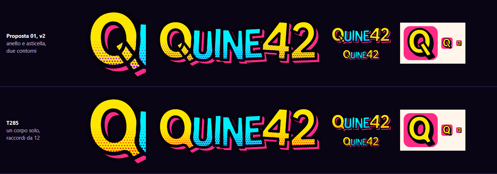
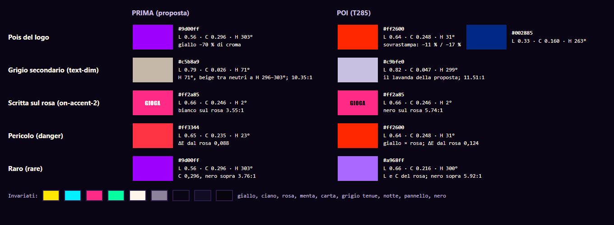
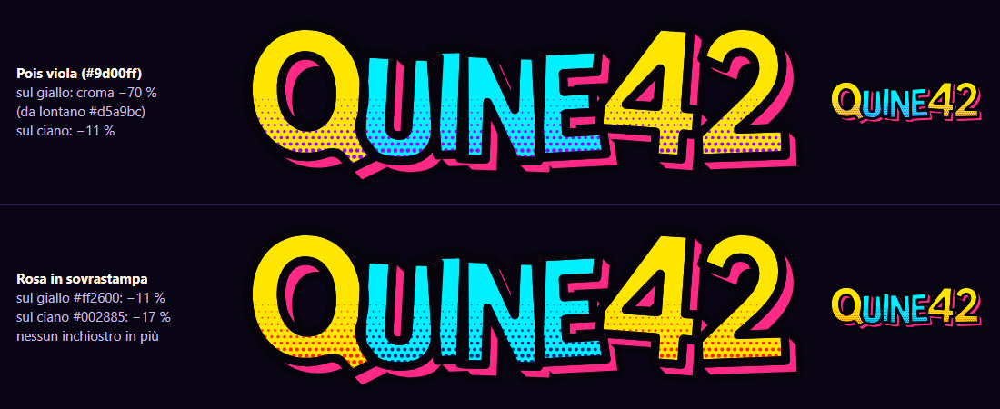
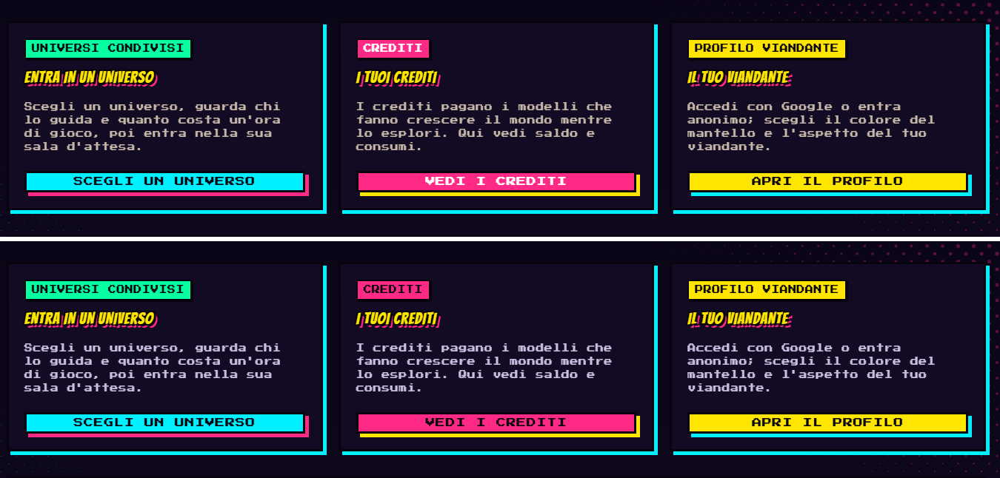
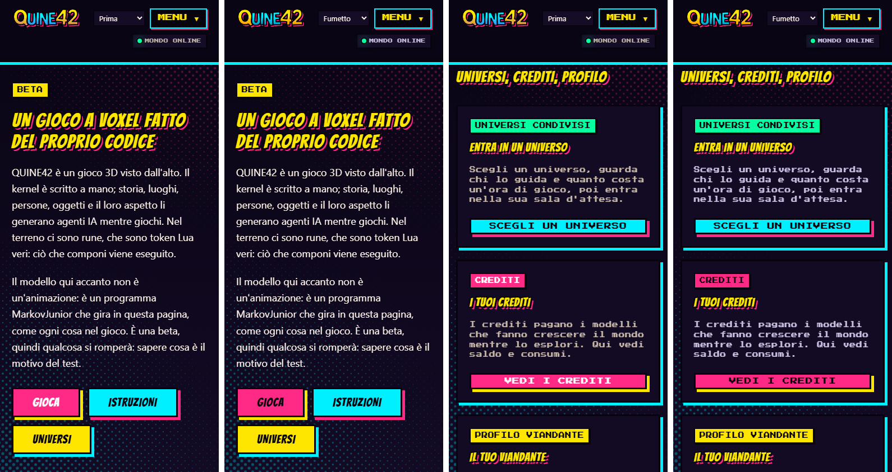

# La veste a fumetto — «Crea la tua quine-storia» (T285)

La veste `fumetto` del sito (`site/skins/fumetto/`, ADR-0145). Parte dalla proposta 01 «La scritta» di Claude, **v2 dopo le votazioni**
(`docs/design/logo/proposte/claude/QUINE42 Logo v2 standalone.html`, sezione `dir1`); la v1 e `landing-tests/1-claude-2.png` servono solo da confronto.
Le bozze di T283 sono buttate: di loro restano solo i nomi dei token, che sono il contratto della base.

| File | Che cos'è |
|---|---|
| `logo.svg` | la scritta della proposta, con la Q in un corpo solo e i pois in sovrastampa (4 KB) |
| `icona.svg` | l'icona della proposta (la Q gialla su rosa), con la stessa Q: è la favicon |
| `pois-rosa.svg`, `pois-ciano.svg` | le due raggiere del retino delle pagine |
| `skin.css` | i token e le regole della veste |
| `effects.ts` | il movimento dei pois |
| `genera.ts` | scrive i quattro SVG: `npx vite-node site/skins/fumetto/genera.ts -- --scrivi` (non si serve e non entra nella build) |

`tests/site-skin-fumetto.test.ts` controlla che gli SVG siano ciò che `genera.ts` scrive, che la Q sia un contorno solo, che la palette resti nella famiglia e che i
pois si muovano solo quando possono.

## La scritta e l'icona, così come sono

Lo standalone è un pacchetto (`__bundler/template`): la sezione `dir1` contiene quattro SVG (fondo scuro, fondo chiaro, un colore, icona). Fondo scuro e chiaro sono
lo stesso disegno. Ogni lettera è un tracciato; l'estrusione sono otto copie nere e otto rosa spostate di 1,3; poi le facce (Q e 42 gialle, UINE ciano) con il contorno
nero da 8, un retino ritagliato sulle lettere (righe ogni 6 da y 78, pois da 0,48 a 2,4) e di nuovo i contorni sopra il retino. Sono 105 KB perché ogni copia ripete i
tracciati: `genera.ts` disegna la stessa cosa con un `<use>` per copia e una riga tratteggiata per fila di pois. Confrontata pixel per pixel con l'originale a 1080 px
di larghezza, differisce in 0,17 % dei canali di più di 8/255, tutti sui bordi dei pois.

## La Q

**Perché sembrava staccata.** La Q della proposta sono due tracciati: l'anello e un'asticella (il quadrilatero 54,78 76,66 116,128 92,138) posata sopra, ognuno col suo
contorno. Il contorno dell'asticella attraversa la faccia gialla dell'anello, e il contorno dell'anello (ridisegnato sopra il retino) attraversa l'asticella; la testa
dell'asticella sta dentro l'occhiello. Si leggono due oggetti sovrapposti, un bastoncino appoggiato a una O. Nell'icona è lo stesso.

**Che cosa cambia.** La Q è l'unione dei due: un contorno esterno solo e l'occhiello della proposta, intero. La testa dell'asticella scende dentro lo spessore dell'anello
(non entra più nell'occhiello), e dove l'asticella esce dall'anello i due bordi si raccordano con un raggio di 12 (su una lettera alta 124). L'anello, l'occhiello e
l'asticella fuori dall'anello sono quelli della proposta. Vale per la scritta (provata a 34, 55 e 150 px di altezza) e per l'icona (16, 32 e 128 px): a nessuna misura un
contorno attraversa la lettera.

## La palette

L'autore sentiva «qualcosa di discrepante» senza saper dire cosa. Misure: tinte e cromie in OKLCH, contrasti WCAG, la mescolanza ottica dei pois (la media in luce
lineare, ciò che l'occhio vede da lontano), le distanze ΔE in OKLab e i pixel delle catture.

**La famiglia.** La scritta è stampata con tre inchiostri, giallo `#ffe600` (L 0,92 · C 0,19 · H 101°), ciano `#00f0ff` (0,87 · 0,15 · 203°) e rosa `#ff2a85`
(0,66 · 0,25 · 2°), più il nero; i neutri sono la notte del gioco, tutti viola (H 296–303°, C ≤ 0,07), più la carta `#fff5ea`. Ciò che stona è ciò che sta fuori da
queste due famiglie:

1. **I pois del logo sono viola** (`#9d00ff`, il quarto inchiostro, croma 0,296: il 20 % sopra il più forte dei tre). Sul ciano fanno un blu (croma −11 %), ma sul giallo
   della Q e del 42, cioè sul segno del marchio, il viola è complementare: dove i pois coprono metà della faccia l'occhio vede `#d5a9bc`, un rosa grigio, con il **70 %
   di croma in meno**. Le lettere gialle si spengono verso il basso mentre le ciano restano accese.
2. **Il grigio secondario è beige** (`--skin-text-dim` `#c5b8a9`, H 71°) in una scala di neutri tutti viola: il gradino dopo, `#8c829c`, è a H 303°, 129° più in là.
   Su un fondo viola un grigio caldo sembra sporco. È il colore dei testi delle schede, degli elenchi della vetrina, delle pillole di stato, del footer. La pagina della
   proposta usa per i testi secondari dei lavanda (`#c9bfe0`, `#d8cfe8`, H 299–302°): il beige viene dal vecchio sito, non dalla proposta.
3. **Il bianco sul rosa** (`--skin-on-accent-2`): 3,55:1, sotto la soglia AA di 4,5. È l'unica scritta chiara su un inchiostro: su giallo, ciano e menta si scrive in nero.
4. **Il rosso è il gemello del rosa** (`--skin-danger` `#ff3344`): ΔE 0,088 dal rosa, quando ogni altra coppia di inchiostri sta sopra 0,147. Stessa luminosità
   (0,651 e 0,659), stessa croma: due rossi quasi uguali con due significati.
5. **Il raro è lo stesso viola** (`--skin-rare` `#9d00ff`): L 0,565, l'unico inchiostro su cui il nero non si legge (3,76:1), e il palco dell'hero aveva un bagliore di
   quel viola.

Nelle catture il viola saturo è poco (lo 0,5 % dei pixel colorati della proposta, a croma ≥ 0,12): non è la quantità, è dove sta, sul giallo del logo e nel palco.

**Che cosa cambia.** Ogni colore che non era della famiglia diventa un inchiostro o la sovrastampa di due inchiostri (il prodotto canale per canale, come nella stampa):

| Token | Prima | Poi | Perché |
|---|---|---|---|
| pois del logo | `#9d00ff` | `#ff2600` sul giallo, `#002885` sul ciano | il rosa stampato sopra la faccia: croma −11 % sul giallo (arancio), −17 % sul ciano |
| `--skin-text-dim` | `#c5b8a9` | `#c9bfe0` | il lavanda della proposta, nella scala viola: 11,5:1 sul fondo (era 10,4) |
| `--skin-on-accent-2` | `#ffffff` | `#07040d` | nero sul rosa: 5,74:1 (era 3,55) |
| `--skin-danger` | `#ff3344` | `#ff2600` | giallo × rosa: ΔE 0,124 dal rosa (era 0,088) |
| `--skin-rare` | `#9d00ff` | `#a968ff` | luminosità e croma del rosa (0,66 · 0,22): nero sopra 5,92:1 (era 3,76) |
| `--skin-stage-background` | bagliore viola | bagliore rosa | |

Restano: giallo, ciano, rosa, menta (`#05ffa1`: L 0,88 · C 0,21, dentro la famiglia per luminosità e croma, ΔE 0,147 dal ciano), carta, grigio tenue, notte, pannelli, nero.

Le catture «prima» sono la stessa veste con la palette della proposta, per isolare i colori:

- 1920 px: [prima](fumetto/pagina-1920-prima.jpg), [poi](fumetto/pagina-1920-poi.jpg); le schede degli universi, prima sopra e poi sotto:
  
- 390 px, l'hero e le schede, prima e poi a coppie:
  

## I pois delle pagine

Un retino a mezzatinta vero, non un velo di puntini uguali: due raggiere su una griglia a 45° di passo 21, la rosa dall'angolo in alto a destra e la ciano da quello in
basso a sinistra, con i pois che passano da un raggio di 5 a niente in 843 px, prima del centro dove si legge. Ogni raggiera è un SVG di 9 KB (21 anelli, ognuno
riempito con un motivo di una misura sola, tutti sulla stessa griglia). Stanno agli angoli della finestra (`body::before`, fisso, sotto il contenuto) con lato
`min(843px, 61,8vmax)`: sul telefono la raggiera si stringe e resta negli angoli. Barra, pannelli, schede e footer sono pieni: i pois si vedono solo sul fondo.

**Il movimento** (`effects.ts`): una deriva di un passo del retino (21 px) e un respiro del 3 %, andata e ritorno in 34 secondi, con la Web Animations API sullo
pseudo-elemento (un `transform`, che il browser compone senza ridisegnare). A scheda nascosta si mette in pausa e riprende al ritorno; con `prefers-reduced-motion` non
parte, e se la preferenza arriva mentre si muove si annulla. Senza JavaScript, o in un browser che non anima gli pseudo-elementi, i pois restano fermi. Il CSS della
veste non può avere `@keyframes`: `tests/site-skins.test.ts` vuole ogni regola sotto `[data-skin='fumetto']`, ed è giusto che il movimento stia nel file che sa fermarlo.

**I contrasti sopra i pois.** L'opacità del livello è 0,32. Il pixel peggiore è il centro del pois ciano più grosso sul fondo del gradiente (`#130a24`): lì il testo è a
7,8:1, il grigio secondario a 4,8, il giallo a 6,7, il ciano a 6,0; sul pois rosa peggiore il grigio secondario è a 7,2 e gli altri sopra 8,9. Il test ricalcola questi valori da `skin.css` e fallisce
se un testo scende sotto 4,5 (a 0,36 fallisce). Nelle catture, il pois ciano più chiaro misurato in basso a sinistra è `#0c5a70` a 0,35, dove il grigio era a 4,43:
da lì lo 0,32.

## L'allusione

La storia nella storia: le didascalie sotto i titoli delle pagine sono le didascalie del narratore (riquadri gialli, inchiostro nero); chi parla parla in un fumetto
(il gerboa del footer, l'etichetta del palco). I fumetti degli NPC nel gioco non si toccano qui: sono di T287, se vince questa veste.
