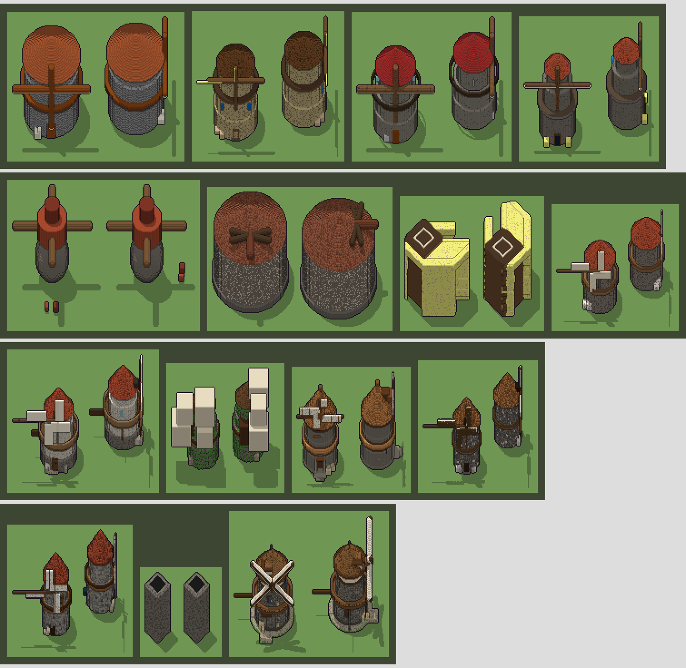

# Costi di Gemini: quanto abbiamo speso e quanto costa un modello (step 8.2B)

Data: 22 ottobre 2026. Richiesta in [`docs/userchats/step8.2B.md`](../userchats/step8.2B.md).
Tutti i conti sono scritti per esteso: i prezzi cambiano (due raddoppiano entro gennaio), e chi rilegge deve
poter rifare ogni cifra. Gli script che li producono: `lab/scripts/costs-history.ts` (spesa passata del
laboratorio), `lab/scripts/game-requests.ts` (misura delle richieste del gioco), `lab/scripts/mjx-trial.ts`
e `lab/scripts/trial-report.ts` (la prova su un modello complesso); i prezzi in `lab/mj3d/prices.ts`.

## In breve

- **Il laboratorio ha speso poco**: 614 chiamate registrate negli step 8A-8.2A, fra **$3,89 e $6,20**; la
  prova di oggi (21 sessioni sullo stesso modello, otto modelli Gemini) **$1,02-1,09**.
- **La spesa grossa è il gioco, e sono le immagini**: per l'universo `valmora` stimo **$11-26**, di cui
  **$10-21 in immagini** (262-602 immagini da $0,0336) e $1,3-5,4 in testo. Il kernel non ha mai registrato
  i consumi: è una stima dal contenuto dell'universo (sotto, con i conti). Se la fattura di Google è molto
  più alta, la differenza viene da cose che nessuno ha contato: sessioni nel browser (pagine del gioco e del
  laboratorio), altri progetti sulla stessa chiave, richieste ripetute dal kernel (vedi «Contatori»).
- **Un modello MarkovJunior costa meno di uno sprite**: un oggetto semplice $0,01-0,02, una struttura grande
  $0,05-0,16 per tentativo; un personaggio oggi costa $0,067 solo di immagini (sprite + camminata), e il suo
  programma MarkovJunior $0,02 con una revisione, con infinite varianti gratis.
- **3.8 Flash non è cara come sembra dal listino**: con il ragionamento `low` non ragiona (0 token), mentre
  3.1 Flash-Lite ragiona comunque. Per asset 3.8 costa circa **2 volte** 3.1, non 3-5 volte. Dal 1° gennaio
  2027 però raddoppia.
- **Su un modello complesso nessun modello è affidabile**: il giudice dà al più 6/10 a tutti; Argon ha
  fatto il mulino migliore (a mio giudizio), 3.1 Pro il peggiore fra i cari. Più giri di miglioramento a 3.1
  Flash-Lite non servono: spesso rompono un modello valido.

## 1. I prezzi (pagina https://aistudio.google.com/docs/pricing, letta il 22/10/2026)

Livello a pagamento, Standard, USD per milione di token. Il ragionamento («thinking») si paga come uscita.
La cache è implicita (Gemini riconosce l'inizio uguale di richieste vicine e lo fa pagare il 10%).

| modello | input | output (con ragionamento) | input in cache | note |
|---|---|---|---|---|
| gemini-3.1-flash-lite | 0,25 | 1,50 | 0,025 | |
| gemini-3.5-flash-lite | 0,30 | 2,50 | 0,03 | |
| gemini-3-flash-preview | 0,50 | 3,00 | 0,05 | «legacy» |
| gemini-3.6-flash | 0,75 | 3,75 | 0,075 | **dal 1/1/2027: 1,50 / 7,50 / 0,15** |
| gemini-3.8-flash | 0,75 | 3,75 | 0,075 | **dal 1/1/2027: 1,50 / 7,50 / 0,15** |
| gemini-3.1-pro-preview | 2,00 | 12,00 | 0,20 | fino a 200k token di prompt |
| gemini-4-argon | 2,00 | 10,00 | 0,10 | **dal 1/12/2026: 4,00 / 20,00 / 0,20** |
| gemini-3.5-flash, gemini-3.7-flash | — | — | — | **non sono sulla pagina**: sotto uso due ipotesi |
| gemini-3.1-flash-lite-image | 0,25 | 1,50 testo; 30,00 immagini | | **$0,0336 per immagine 1K** |
| gemini-2.5-flash-image | 0,30 | | | $0,039 per immagine (usato il 20/10) |

Ipotesi per i due modelli senza prezzo: **minimo** = prezzi di gemini-3-flash-preview (0,50 / 3,00 / 0,05),
**stima** = prezzi di gemini-3.6-flash (0,75 / 3,75 / 0,075).

Formula usata ovunque:

    costo = [ (input − cache) × prezzo input + cache × prezzo cache + (risposta + ragionamento) × prezzo output ] / 1.000.000

Esempio (sessione `trial-3.8-flash-1`): (28.295 × 0,75 + 0 × 0,075 + 6.336 × 3,75) / 10⁶ = 0,02122 + 0,02376 = **$0,0450**.

## 2. Spesa passata

### 2.1 Laboratorio (registrata)

Dai `summary.json` e dalle righe del contatore nei log di `lab/out` (copia principale per gli step 8A-8E,
il worktree per l'8.2A). Gli step 8A-8B non contavano il ragionamento: «min» lo pone a zero, «stima» a
2,96 volte la risposta (il rapporto misurato nello step 8C con il ragionamento predefinito: 45.369 / 15.347).
gemini-3.5-flash: «min» e «stima» con le due ipotesi di prezzo.

| run | step | modello | chiamate | input (di cui in cache) | risposta | ragionamento | costo min | costo stima |
|---|---|---|---|---|---|---|---|---|
| g1-prova | 8A | gemini-3.1-flash-lite | 8 | 20.744 (0) | 3.020 | non contato | $0,010 | $0,023 |
| g1-revisione | 8A | gemini-3.1-flash-lite | 21 | 69.845 (0) | 8.726 | non contato | $0,031 | $0,069 |
| s1-flash-lite | 8A | gemini-3.1-flash-lite | 71 | 238.720 (0) | 31.300 | non contato | $0,107 | $0,245 |
| s1-flash38 | 8A | gemini-3.8-flash | 60 | 187.073 (0) | 42.984 | non contato | $0,301 | $0,778 |
| s2-flash38 | 8A | gemini-3.8-flash | 25 | 82.223 (0) | 24.511 | non contato | $0,154 | $0,425 |
| s3-flash38 | 8A | gemini-3.8-flash | 21 | 71.974 (0) | 20.504 | non contato | $0,131 | $0,358 |
| b-semplici-flash38 | 8B | gemini-3.8-flash | 24 | 94.748 (0) | 15.208 | non contato | $0,128 | $0,297 |
| b-figure-flash38 | 8B | gemini-3.8-flash | 24 | 101.241 (0) | 24.467 | non contato | $0,168 | $0,439 |
| b-strutture-flash38 (3 run) | 8B | gemini-3.8-flash | ? | interrotte, non registrate | | | — | — |
| c-castello-flash35 | 8C | gemini-3.5-flash | 7 | 29.726 (0) | 15.347 | 45.369 | $0,197 | $0,250 |
| c-castello-flash35-2 | 8C | gemini-3.5-flash | 3 | 13.473 (0) | 11.622 | 13.274 | $0,081 | $0,103 |
| c-castello-flash35-3 | 8C | gemini-3.5-flash | ? | non registrata | | | — | — |
| g8e | 8E | gemini-3.5-flash | 20 | 156.258 (21.246) | 28.512 | 15.309 | $0,200 | $0,267 |
| g8e-2 | 8E | gemini-3.5-flash | 24 | 189.237 (33.259) | 38.179 | 17.005 | $0,245 | $0,326 |
| g8e-3 | 8E | gemini-3.5-flash | 15 | 119.462 (20.888) | 20.074 | 1.897 | $0,116 | $0,158 |
| g8e-4 | 8E | gemini-3.5-flash | 3 | 29.807 (13.927) | 5.799 | 1.836 | $0,032 | $0,042 |
| g8e-5 | 8E | gemini-3.5-flash | 13 | 112.757 (36.834) | 25.056 | 4.182 | $0,128 | $0,169 |
| g8e-tutte | 8E | gemini-3.5-flash | 23 | 197.675 (63.434) | 43.406 | 8.044 | $0,225 | $0,298 |
| g8e-tutte-2 | 8E | gemini-3.5-flash | 71 | 655.161 (172.879) | 162.457 | 32.385 | $0,834 | $1,105 |
| mjx-prova (scultore + Artista) | 8.2A | 3.1-flash-lite + 3.5-flash | 2 | 5.700 (0) | 619 | 131 | $0,003 | $0,004 |
| mjx-31-flash-lite (scultore) | 8.2A | gemini-3.1-flash-lite | 28 | 162.568 (50.918) | 19.652 | 33.134 | $0,108 | $0,108 |
| mjx-31-flash-lite (Artista) | 8.2A | gemini-3.5-flash | 12 | 19.988 (0) | 1.535 | 2.468 | $0,022 | $0,030 |
| mjx-31-flash-lite-2 (scultore) | 8.2A | gemini-3.1-flash-lite | 40 | 247.987 (105.906) | 28.716 | 42.187 | $0,145 | $0,145 |
| mjx-31-flash-lite-2 (Artista) | 8.2A | gemini-3.5-flash | 16 | 26.650 (0) | 2.673 | 3.985 | $0,033 | $0,045 |
| mjx-38-flash (scultore) | 8.2A | gemini-3.8-flash | 23 | 141.076 (2.011) | 30.582 | 0 | $0,219 | $0,219 |
| mjx-38-flash (Artista) | 8.2A | gemini-3.5-flash | 16 | 26.766 (0) | 2.112 | 3.773 | $0,031 | $0,042 |
| mjx-38-flash-2 (scultore) | 8.2A | gemini-3.8-flash | 25 | 152.170 (26.280) | 28.816 | 0 | $0,204 | $0,204 |
| mjx-38-flash-2 (Artista) | 8.2A | gemini-3.5-flash | 19 | 31.736 (0) | 2.614 | 4.253 | $0,036 | $0,050 |

Due righe per esteso:
- `s1-flash38`, min: (187.073 × 0,75 + 42.984 × 3,75) / 10⁶ = 0,14030 + 0,16119 = **$0,301**; stima, con
  ragionamento 42.984 × 2,956 = 127.065: (187.073 × 0,75 + (42.984 + 127.065) × 3,75) / 10⁶ = 0,14030 +
  0,63768 = **$0,778**.
- `g8e-tutte-2`, min (prezzi di 3-flash-preview): ((655.161 − 172.879) × 0,50 + 172.879 × 0,05 + (162.457 +
  32.385) × 3,00) / 10⁶ = 0,24114 + 0,00864 + 0,58453 = **$0,834**.

| step | chiamate | costo |
|---|---|---|
| 8A | 206 | $0,73 – 1,90 |
| 8B | 48 (+3 run non registrate) | $0,30 – 0,74 |
| 8C | 10 (+1 non registrata) | $0,28 – 0,35 |
| 8E | 169 | $1,78 – 2,37 |
| 8.2A | 181 | $0,80 – 0,85 |
| **totale registrato** | **614** | **$3,89 – 6,20** |

Non registrate: le tre sessioni delle strutture a blocchi dello step 8B e una dello step 8C (interrotte
prima del riepilogo), e ogni prova fatta dalla pagina del laboratorio nel browser.

### 2.2 Il gioco (stimato)

Il kernel (`GeminiModels`) conta chiamate e token in memoria, ma non li salva e non conta il ragionamento:
dei consumi del gioco non resta traccia. Stimo dall'universo `valmora` (le copie `valmora copy 2` e
`valmora new` hanno solo immagini già presenti in `valmora`: sono copie, non spesa in più).

**Testo** (modello `gemini-3.1-flash-lite`; il primo giorno `gemini-2.5-flash-lite`). Chiamate, dal
contenuto dell'universo e dai conteggi di `AGENTS.md`:

| voce | contenuto di valmora | chiamate per voce | chiamate |
|---|---|---|---|
| Genesi | 1 | ~60 | 60 |
| luoghi (`maps/`) | 301 | 1 | 301 |
| persone (`people.json`) | 57 | 1-2 | 57-114 |
| pacchetti di oggetti | 47 | ~4 | 188 |
| moduli forgiati (83 con `logic.lua` − 16 del seme) | 67 | ~4 (concetto, fisica, codice, Arbitro) | 268 |
| sessioni del Concilio (ogni 12 luoghi) | ~25 | ~2 | 50 |
| **totale** | | | **924 – 981** |

Esclusi perché non ricostruibili: chat, «Esamina», azioni libere, Referente, meccaniche, riparazioni.

Token per chiamata: l'input l'ho **misurato** (`lab/scripts/game-requests.ts`): una Genesi e i primi luoghi
eseguiti con i modelli finti, ogni richiesta registrata e contata con `countTokens` di Gemini (gratis).
Risultato: da 1.026 (stile) a 3.883 (ambienti) token; un luogo (`chunk.plan`) 3.309. Con una bibbia vera,
più lunga, uso **2.500-4.000**. L'uscita non si può misurare senza generare: uso **500-3.000** (risposta
JSON 500-1.000, più il ragionamento predefinito di 3.1, fino a ~1.200 per chiamata nelle prove 8.2A).

    minimo:  924 × (2.500 × 0,25 + 500 × 1,50) / 10⁶ = 924 × 0,001375 = $1,27
    massimo: 981 × (4.000 × 0,25 + 3.000 × 1,50) / 10⁶ = 981 × 0,0055   = $5,40

**Immagini** (`gemini-3.1-flash-lite-image`, $0,0336 l'una; il primo giorno `gemini-2.5-flash-image`,
$0,039). Ciò che valmora usa ancora, dai manifest:

| voce | in valmora | per chiamata | chiamate |
|---|---|---|---|
| sprite di entità | 70 | 1 | 70 |
| camminate (`animation: sheet`, 12 fotogrammi) | 51 (528 fotogrammi) | 1 | 51 |
| texture | 21 | 4 | 6 |
| ostacoli | 10 | 4 | 3 |
| fogli di icone (16 icone) | 1.371 icone; 132 fogli conservati in JPEG | 1 | 132 |
| **usate** | | | **262** |

Ma in `assets/` ci sono 2.501 immagini e quelle usate sono 2.132: le altre sono ridipinture e tentativi
scartati. 338 orfane da 128 px (sprite o fotogrammi: fra 338 / 12 = 28 e 338 chiamate) e 31 icone (2 fogli):

    chiamate di immagine: 262 + 30 = 292  …  262 + 340 = 602
    minimo:  292 × (0,0336 + ~0,0003 di input) = $9,90
    massimo: 602 × (0,0336 + ~0,0003) = $20,41

(l'input di una chiamata di immagine: ~1.000 token di testo e immagini di riferimento × 0,25 / 10⁶ = $0,00025).

**Totale gioco (valmora)**: testo $1,27-5,40 + immagini $9,90-20,41 = **$11,2-25,8**.

**Totale stimato finora**: laboratorio $3,89-6,20 + prova di oggi $1,02-1,09 + gioco $11,2-25,8 =
**$16-33**. La cifra vera è nella console di fatturazione di Google; se è molto diversa, vale la pena
cercare la parte non contata (sezione 5).

## 3. La prova: un solo modello complesso

**Bersaglio**: «Mulino a vento» di classe *struttura grande* (100 × 100 × 80 voxel, 5 × 5 × 4 caselle):
torre di pietra rastremata, tetto conico di assi, quattro pale con mozzo, porta ad arco con soglia, due
finestrelle, ballatoio con ringhiera, sacchi di farina; in cui si entra.

**Protocollo** (`lab/scripts/mjx-trial.ts`), uguale per tutti: istruzioni dello Scultore XML con due esempi
(la fattoria e il falò), ragionamento `low`; un programma (con fino a 2 correzioni se non è valido), il voto
di un giudice fisso (`gemini-3.8-flash`, lo stesso per tutti), un giro di miglioramento con le viste e il
voto; tiene il migliore. **Una richiesta per chiamata**, senza ripetizioni automatiche, e il consumo di ogni
risposta registrato. Due sessioni per ogni modello Flash (la stessa richiesta dà risultati molto diversi);
una per 3.1 Pro; **una sola per Argon**, eseguita per ultima. Per 3.1 Flash-Lite, il modello più economico,
anche la variante con più iterazioni: 3 programmi indipendenti, il migliore migliorato 4 volte.

Nel mosaico, a righe di quattro: 3.1 Flash-Lite (sessione 2, iterata 1, iterata 2, sessione 1); 3.5
Flash-Lite ×2, 3 Flash Preview, 3.5 Flash 1; 3.5 Flash 2, 3.6 Flash, 3.7 Flash ×2; 3.8 Flash, 3.1 Pro,
Argon. (Le sessioni senza un modello valido non ci sono.) I mulini sono anche nella sandbox 3D, gruppo
«Gemini: prove degli step 8.2A e 8.2B».

| sessione | campioni × giri | validi | voti (in ordine) | migliore | chiamate | input (cache) | risposta + ragionamento | costo scultore | costo giudice |
|---|---|---|---|---|---|---|---|---|---|
| 3.1-flash-lite (prima delle riparazioni) | 1 × 1 | 0/1 | ✗ | — | 3 | 23.364 (10.194) | 2.715 + 5.563 | (13.170 × 0,25 + 10.194 × 0,025 + 8.278 × 1,5) / 10⁶ = $0,0160 | — |
| 3.1-flash-lite 1 | 1 × 1 | 2/2 | 4 → 6 | 6 | 3 | 25.080 (16.311) | 3.336 + 4.004 | (8.769 × 0,25 + 16.311 × 0,025 + 7.340 × 1,5) / 10⁶ = $0,0136 | $0,0038 |
| 3.1-flash-lite 2 | 1 × 1 | 2/2 | 4 → 4 | 4 | 2 | 16.551 (10.193) | 1.942 + 3.741 | (6.358 × 0,25 + 10.193 × 0,025 + 5.683 × 1,5) / 10⁶ = $0,0104 | $0,0042 |
| 3.1-flash-lite iterata 1 | 3 × 4 | 4/7 | ✗ 5 3 ✗ ✗ 5 5 | 5 | 18 | 164.427 (114.214) | 18.660 + 26.400 | (50.213 × 0,25 + 114.214 × 0,025 + 45.060 × 1,5) / 10⁶ = $0,0830 | $0,0080 |
| 3.1-flash-lite iterata 2 | 3 × 4 | 6/7 | 4 3 3 5 4 4 ✗ | 5 | 12 | 109.539 (71.383) | 14.537 + 14.989 | (38.156 × 0,25 + 71.383 × 0,025 + 29.526 × 1,5) / 10⁶ = $0,0556 | $0,0121 |
| 3.5-flash-lite 1 | 1 × 1 | 2/2 | 3 → 3 | 3 | 2 | 16.352 (6.117) | 1.587 + 0 | (10.235 × 0,3 + 6.117 × 0,03 + 1.587 × 2,5) / 10⁶ = $0,0072 | $0,0040 |
| 3.5-flash-lite 2 | 1 × 1 | 2/2 | 3 → 3 | 3 | 3 | 25.780 (12.235) | 1.713 + 0 | (13.545 × 0,3 + 12.235 × 0,03 + 1.713 × 2,5) / 10⁶ = $0,0087 | $0,0041 |
| 3-flash-preview 1 | 1 × 1 | 0/1 | ✗ | — | 3 | 25.120 (4.079) | 5.210 + 0 | (21.041 × 0,5 + 4.079 × 0,05 + 5.210 × 3) / 10⁶ = $0,0264 | — |
| 3-flash-preview 2 | 1 × 1 | 2/2 | 3 → 3 | 3 | 2 | 17.398 (0) | 3.370 + 0 | (17.398 × 0,5 + 3.370 × 3) / 10⁶ = $0,0188 | $0,0037 |
| 3.5-flash 1 | 1 × 1 | 2/2 | 3 → 4 | 4 | 3 | 25.624 (0) | 3.708 + 1.692 | min (25.624 × 0,5 + 5.400 × 3) / 10⁶ = $0,0290; stima (25.624 × 0,75 + 5.400 × 3,75) / 10⁶ = $0,0395 | $0,0036 |
| 3.5-flash 2 | 1 × 1 | 2/2 | 5 → 6 | 6 | 4 | 35.855 (0) | 6.262 + 4.142 | min (35.855 × 0,5 + 10.404 × 3) / 10⁶ = $0,0491; stima (35.855 × 0,75 + 10.404 × 3,75) / 10⁶ = $0,0659 | $0,0042 |
| 3.6-flash 1 | 1 × 1 | 2/2 | 3 → 3 | 3 | 4 | 39.073 (15.379) | 5.311 + 4.972 | (23.694 × 0,75 + 15.379 × 0,075 + 10.283 × 3,75) / 10⁶ = $0,0575 | $0,0038 |
| 3.6-flash 2 | 1 × 1 | 0/1 | ✗ | — | 3 | 24.384 (0) | 3.842 + 1.695 | (24.384 × 0,75 + 5.537 × 3,75) / 10⁶ = $0,0391 | — |
| 3.7-flash 1 | 1 × 1 | 2/2 | 6 → 6 | 6 | 6 | 62.381 (0) | 14.109 + 0 | min (62.381 × 0,5 + 14.109 × 3) / 10⁶ = $0,0735; stima (62.381 × 0,75 + 14.109 × 3,75) / 10⁶ = $0,0997 | $0,0041 |
| 3.7-flash 2 | 1 × 1 | 2/2 | 3 → 4 | 4 | 3 | 30.652 (0) | 6.439 + 0 | min (30.652 × 0,5 + 6.439 × 3) / 10⁶ = $0,0346; stima (30.652 × 0,75 + 6.439 × 3,75) / 10⁶ = $0,0471 | $0,0039 |
| 3.8-flash 1 | 1 × 1 | 2/2 | 3 → 6 | 6 | 3 | 28.295 (0) | 6.336 + 0 | (28.295 × 0,75 + 6.336 × 3,75) / 10⁶ = $0,0450 | $0,0039 |
| 3.8-flash 2 | 1 × 1 | 0/1 | ✗ | — | 3 | 27.322 (0) | 8.990 + 0 | (27.322 × 0,75 + 8.990 × 3,75) / 10⁶ = $0,0542 | — |
| 3.1-pro-preview | 1 × 1 | 2/2 | 3 → 3 | 3 | 4 | 35.303 (0) | 7.229 + 1.023 | (35.303 × 2 + 8.252 × 12) / 10⁶ = $0,1696 | $0,0040 |
| **4-argon** | 1 × 1 | 2/2 | **6** → 4 | 6 | 3 | 28.533 (0) | 10.156 + 0 | (28.533 × 2 + 10.156 × 10) / 10⁶ = **$0,1586** | $0,0040 |

Giudice: (input × 0,75 + uscita × 3,75) / 10⁶, circa 1.750 token di input e 150-200 di uscita per voto
(l'immagine con le quattro viste conta come input): $0,0018-0,0021 a voto.

**Costo della prova**: scultori con prezzo $0,7637; 3.5 e 3.7 Flash $0,186 (min) – $0,252 (stima); giudice
$0,0714; totale **$1,02 – 1,09**.

### Che cosa dice la prova

Il giudice non dà più di 6 a nessuno. Il mio giudizio, guardando i modelli (anche nella sandbox):

| | mulino riconoscibile (torre, tetto, pale, porta) | difetti |
|---|---|---|
| **4 Argon** | sì, il migliore: pale a X con il graticcio, zoccolo di pietra, ballatoio, porta | il giro di miglioramento l'ha peggiorato (6 → 4) |
| 3.8 Flash | sì (sessione 1) | sessione 2 mai valida (pezzi staccati) |
| 3.7 Flash | sì (sessione 1), discreto (2) | 6 chiamate nella sessione 1 |
| 3.5 Flash | sì, entrambe (il giudice ne sottovaluta una) | |
| 3.1 Flash-Lite | sì (sessione 1), tozzo (2) | i giri in più rompono il modello (si stacca, galleggia) |
| 3.1 Pro | **no**: un camino cavo | il più caro dopo Argon |
| 3.6 Flash, 3 Flash Preview, 3.5 Flash-Lite | no (blocchi, un tamburo, un parallelepipedo giallo) | |

**Costo per mulino accettabile** (voto del giudice ≥ 6; costo di tutte le sessioni del modello diviso per
quelle riuscite; sessioni dopo le riparazioni del kernel):

| modello | sessioni riuscite | costo scultore delle sessioni | per mulino accettabile | + giudice |
|---|---|---|---|---|
| 3.1 Flash-Lite (1 × 1) | 1 su 2 | 0,0136 + 0,0104 = $0,0240 | **$0,024** | ~$0,008 |
| 3.1 Flash-Lite (3 × 4) | 0 su 2 (voto 5) | 0,0830 + 0,0556 = $0,1386 | — | |
| 3.5 Flash | 1 su 2 | $0,078 – 0,105 | $0,078 – 0,105 | ~$0,008 |
| 3.7 Flash | 1 su 2 | $0,108 – 0,147 | $0,108 – 0,147 | ~$0,008 |
| 3.8 Flash | 1 su 2 | 0,0450 + 0,0542 = $0,0992 | **$0,099** (dal 2027: $0,198) | ~$0,008 |
| 4 Argon | 1 su 1 | $0,1586 | **$0,159** (dal 1/12/2026: $0,317) | $0,004 |
| 3.1 Pro, 3.6 Flash, 3 Flash Preview, 3.5 Flash-Lite | 0 | | — | |

Con due sessioni per modello questi numeri sono indicativi: un'altra sessione può cambiare l'ordine dei Flash.

## 4. Quanto costerebbe un mondo con i modelli MarkovJunior

Per tipo di oggetto (un programma per tipo; ogni istanza è lo stesso programma con un altro seme, gratis):

| classe | modello consigliato | costo per tipo | da dove |
|---|---|---|---|
| alberi, rocce, cespugli, oggetti | 3.1 Flash-Lite, 2 programmi indipendenti, il migliore | 2 × $0,010 + 2 voti × $0,002 = **$0,024** | 8.2A: $0,108 / 12 e $0,145 / 12 bersagli = $0,009-0,012 a bersaglio |
| persone e animali | 3.8 Flash, una revisione | **$0,02** (2027: $0,04) | 8.2A: $0,219 / 12 e $0,204 / 12 = $0,017-0,018 a bersaglio |
| strutture grandi | 3.8 Flash, o Argon per quelle che contano | **$0,10** (3.8) – **$0,16** (Argon) a struttura riuscita | questa prova |

Un mondo come valmora con 30 tipi semplici, 20 figure e 10 strutture grandi:

    30 × 0,024 + 20 × 0,02 + 10 × 0,10 = 0,72 + 0,40 + 1,00 = $2,12   (3.8; dal 2027: 0,72 + 0,80 + 2,00 = $3,52)
    con Argon per le strutture: 0,72 + 0,40 + 10 × 0,16 = $2,72        (dal 1/12/2026: 0,72 + 0,40 + 3,17 = $4,29)

contro **$9,90-20,41** di immagini spese per valmora. Il testo del gioco (Concilio, luoghi, persone) resta
$1,3-5,4 per un mondo di quelle dimensioni.

## 5. Contatori: perché non si capisce subito quanto si spende

- **La pagina di Google** (uso e fatturazione) aggrega i consumi con ore di ritardo: non si può cambiare.
- **Il laboratorio ora mostra il costo subito**: le pagine `/lab/` e `/lab/3d/` e tutti gli script stampano
  il costo in dollari dopo ogni chiamata (`lab/mj3d/meter.ts` + `lab/mj3d/prices.ts`), contando anche il
  ragionamento e la cache.
- **Il gioco no**, e ha due difetti da correggere nel kernel (`src/kernel/ai/gemini.ts`), che propongo come
  prossimo passo:
  1. non conta il ragionamento (`thoughtsTokenCount`) né la cache, e non salva nulla: alla chiusura della
     pagina i consumi spariscono. Proposta: un registro dei consumi nell'universo (`world/consumi.json`,
     per giorno, modello, compito), e il costo in dollari nel pannello del Concilio;
  2. ripete una richiesta fino a 4 volte, anche dopo un errore di rete o un tempo scaduto: una richiesta
     scaduta dal nostro lato può essere stata generata, e pagata, comunque. Proposta: non ripetere dopo un
     tempo scaduto, e contare le ripetizioni.
- Il ragionamento conta: 3.1 Flash-Lite con `low` ragiona comunque (in 8.2A 33-42 mila token su 28-40
  chiamate, più della risposta), 3.8 Flash e Argon con `low` non ragionano affatto. Nel gioco non si imposta
  nulla, quindi vale il ragionamento predefinito, che può essere molto più alto (nello step 8C: 3 volte la
  risposta).

## 6. Proposte

1. **Le immagini sono il costo**: sostituire sprite e camminate con modelli MarkovJunior abbatte la voce più
   cara (un personaggio: $0,067 di immagini contro ~$0,02 di testo, e le varianti gratis).
2. **Scultore per classe**: 3.1 Flash-Lite per vegetazione, rocce e oggetti (2 programmi indipendenti
   invece di giri di miglioramento, che con questo modello peggiorano); 3.8 Flash per figure e strutture
   finché costa 0,75 / 3,75; Argon solo per le strutture che contano, e prima del 1/12/2026.
3. **Ragionamento `low` esplicito** in ogni chiamata del gioco, e misurare la differenza di qualità.
4. **Cache**: tenere uguale l'inizio delle istruzioni fra chiamate vicine (nella prova fino al 70% dell'input
   di 3.1 è stato servito dalla cache, al 10% del prezzo).
5. **Registro dei consumi nel kernel** e niente ripetizioni dopo un tempo scaduto (sezione 5).
6. Il giudice costa ~$0,002 a voto: si può tenere sempre; per le classi semplici basta il controllo del kernel.
