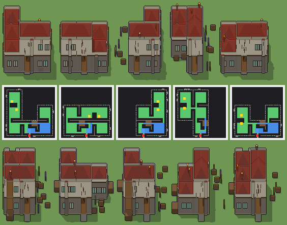

# Casa del borgomastro, a due piani

Programma: `casa-del-borgomastro.xml` · ambientazione **fantasy** · classe `grande` (struttura) · senza cantina · 85895 caratteri.



Esito: **passa** — regge a ogni seme e taglia, varia sì, tempo massimo a Enorme 1725 ms (tetto 4500 ms).

## grande — 100 × 100 × 80 voxel, 20 voxel per casella, gradino 4

| seme | ms | piani (quota: testa, stanze) | stanze | cantina | murato | porta | salti | finestre | dettagli | materiali | dominante | sagoma | rilievo | ingombro | fluttuanti | difetti |
|---|---|---|---|---|---|---|---|---|---|---|---|---|---|---|---|---|
| 1 | 907 | 0.1: 1.5, 4 · 1.7: 1.5, 1 | 5 | — | 0.00 | libera, scarto 0.03 | 9 | 54/4 lati | 228/0 vuoti | 11 | 0.37 | 24 | 0.39 | 0.58 | 0 | — |
| 2 | 876 | 0.1: 1.5, 5 · 1.7: 1.5, 1 | 6 | — | 0.00 | libera, scarto 0.03 | 7 | 41/4 lati | 204/0 vuoti | 11 | 0.39 | 24 | 0.36 | 0.57 | 0 | — |
| 3 | 864 | 0.1: 1.5, 3 · 1.7: 1.5, 1 | 4 | — | 0.00 | libera, scarto 0.03 | 7 | 44/4 lati | 198/0 vuoti | 11 | 0.37 | 25 | 0.40 | 0.48 | 0 | — |
| 4 | 824 | 0.1: 1.5, 4 · 1.7: 1.5, 1 | 5 | — | 0.00 | libera, scarto 0.03 | 10 | 48/4 lati | 217/0 vuoti | 11 | 0.37 | 26 | 0.44 | 0.48 | 0 | — |
| 5 | 776 | 0.1: 1.5, 4 · 1.7: 1.5, 1 | 5 | — | 0.00 | libera, scarto 0.03 | 9 | 45/4 lati | 203/0 vuoti | 11 | 0.36 | 26 | 0.40 | 0.49 | 0 | — |

Varianza su 5 semi (mediane delle coppie): voxel 0.62 (≥ 0.2), pianta 0.58 (≥ 0.15), perimetro 0.23 (≥ 0.15), interno 0.60 (≥ 0.35), colore 0.10 (non conta), liste di piani 1 e di stanze 3 (≥ 2), architetture 5/5 (≥ 3). Sopra ogni soglia.

## enorme — 120 × 120 × 96 voxel, 16 voxel per casella, gradino 3

| seme | ms | piani (quota: testa, stanze) | stanze | cantina | murato | porta | salti | finestre | dettagli | materiali | dominante | sagoma | rilievo | ingombro | fluttuanti | difetti |
|---|---|---|---|---|---|---|---|---|---|---|---|---|---|---|---|---|
| 1 | 1593 | 0.1: 1.9, 4 · 2.1: 1.9, 1 | 5 | — | 0.00 | libera, scarto 0.03 | 11 | 43/4 lati | 221/0 vuoti | 11 | 0.38 | 24 | 0.41 | 0.43 | 0 | — |
| 2 | 1656 | 0.1: 1.9, 5 · 2.1: 1.9, 1 | 6 | — | 0.00 | libera, scarto 0.03 | 12 | 44/4 lati | 233/0 vuoti | 11 | 0.37 | 24 | 0.51 | 0.43 | 0 | — |
| 3 | 1610 | 0.1: 1.9, 4 · 2.1: 1.9, 1 | 5 | — | 0.00 | libera, scarto 0.03 | 13 | 41/4 lati | 217/0 vuoti | 12 | 0.36 | 25 | 0.48 | 0.37 | 0 | — |
| 4 | 1725 | 0.1: 1.9, 4 · 2.1: 1.9, 1 | 5 | — | 0.00 | libera, scarto 0.03 | 11 | 46/4 lati | 216/0 vuoti | 12 | 0.35 | 25 | 0.36 | 0.37 | 0 | — |
| 5 | 1674 | 0.1: 1.9, 3 · 2.1: 1.9, 1 | 4 | — | 0.00 | libera, scarto 0.03 | 10 | 38/4 lati | 218/0 vuoti | 12 | 0.36 | 25 | 0.46 | 0.37 | 0 | — |

Varianza su 5 semi (mediane delle coppie): voxel 0.55 (≥ 0.2), pianta 0.26 (≥ 0.15), perimetro 0.18 (≥ 0.15), interno 0.50 (≥ 0.35), colore 0.11 (non conta), liste di piani 1 e di stanze 3 (≥ 2), architetture 5/5 (≥ 3). Sopra ogni soglia.

Misure: `lab/banco/misure.ts` (il corpo del gioco cammina dal davanti: piani raggiunti, murato = pavimento coperto non raggiunto, porta libera, salti; `valido` sono i controlli di `src/mj/check.ts`, fra cui i voxel staccati da terra) e `lab/banco/varianza.ts` (soglie di T180).

## Traccia del seme 1 (Grande, `src/mj/trace.ts`, forma «differenze»)

```text
Traccia, seme 1: griglia 100×100×80, 76 nodi, 663 passi, finito in 985 ms.
x sinistra→destra, y fondo→davanti, z basso→alto; «.» è la cella vuota; #n è il nodo nell'ordine dell'XML; ×n quante volte ha agito.
Lettere: N=browN, E=Emerald, x=botti, z=z, a=fondazione, P=Purple, p=purple, Q=aQua, b=black, O=Orange, H=Honey, t=teal, s=slate, g=green, c=comignolo, d=dead, dark, v=olive, e=emerald, f=travi del graticcio, w=white, X=X, i=indigo, I=Indigo, J=Jungle, h=honey, j=jungle, M=Magenta, S=pietra squadrata, F=assi di legno, C=pietra di cava, W=intonaco a calce, R=coppi scuri, V=vetro piombato, D=legno scuro, L=panca di castagno, U=blUe, u=blue, T=gradino di pietra, Y=Yellow, G=Green, K=scala di legno, A=acciottolato, k=portone di quercia, n=fuoco, r=red, y=yellow, q=aqua, l=light.
Alla fine: R 29746, C 13978, S 13413, F 6589, W 5830, K 3355, V 2220, D 1776, L 1035, f 910, k 330, c 81, A 44, T 22, n 9.
#2-62 prl×29, all×17, one×11: 71688 celle x1-98 y1-99 z0-68, passi 1-558
  .→C 10900: x5 y6-95 z1-9; x35 y77-95 z1-31; +48 scatole, 9501 celle
  .→S 8492: x5-26 y5-95 z32; x35-95 y65-95 z64; +34 scatole, 4599 celle
  .→F 6589: x6-34 y6-34 z1; x66-94 y36-64 z1; +18 scatole, 4907 celle
  E→S 5671: x5-26 y5-95 z0; x65-95 y35-95 z0; +8 scatole, 1778 celle
  .→U 5530: x6-34 y5 z10-23; x5 y6-34 z10-23; +13 scatole, 4718 celle
  .→R 5098: x6-34 y6-34 z33; x66-94 y36-64 z33; +12 scatole, 3416 celle
  .→W 4788: x36-94 y95 z34-41; x57-61 y96-97 z34-63; +29 scatole, 4016 celle
  E→z 2441: x36-64 y36-46 z0; x66-94 y6-15 z0; +27 scatole, 1832 celle
  .→u 2282: x36-64 y65 z42-55; x66-94 y65 z42-55; +5 scatole, 1470 celle
  .→K 352: x65 y66-76 z1-32
  .→k 330: x45-55 y95 z2-31
  .→w 290: x6-34 y5 z38; x5 y6-34 z38; +8 scatole, 232 celle
  .→X 105: x36-64 y65 z68; x95 y66-94 z68; +3 scatole, 47 celle
  E→G 90: x37 y10-18 z0; x65 y14-22 z0; +8 scatole, 72 celle
  .→i 76: x17-34 y65 z34; x27-31 y3-4 z34; +12 scatole, 48 celle
  E→A 44: x45-55 y96-99 z0
  .→J 36: x66-83 y65 z68; x35 y77-94 z68
  .→h 33: x22-34 y35 z34; x6-16 y65 z34; +1 scatole, 9 celle
  .→G 25: x73-81 y93-94 z1; x15-21 y35 z1
  .→j 22: x84-94 y65 z68; x35 y66-76 z68
  .→T 11: x48 y66-76 z1
  .→Y 11: x49 y66-76 z1
  .→M 11: x45-55 y95 z68
  N→z 1: x50 y50 z0
#63-76 all×6, prl×6, one×2: 43440 celle x0-99 y0-99 z0-79, passi 559-663
  .→R 24539: x37-64 y67-93 z66; x66-93 y67-93 z66; +222 scatole, 23027 celle
  .→K 2981: x49-64 y66-76 z2-3; x50-64 y66-76 z4-5; +14 scatole, 2299 celle
  U→C 2614: x36-44 y95 z10-23; x56-64 y95 z10-23; +72 scatole, 2362 celle
  z→. 2442: x36-64 y36-46 z0; x66-94 y6-15 z0; +24 scatole, 1833 celle
  E→. 1753: x0-99 y0-2 z0; x0-2 y15-99 z0; +18 scatole, 1198 celle
  U→V 1620: x12-14 y5 z12-21; x16-18 y5 z12-21; +52 scatole, 1560 celle
  U→D 1296: x5 y37-63 z11; x5 y22-23 z12-22; +152 scatole, 1247 celle
  u→W 1202: x36-44 y95 z42-55; x56-64 y95 z42-55; +30 scatole, 950 celle
  .→L 920: x73-81 y93-94 z2-9; x37 y10-18 z1-8; +10 scatole, 704 celle
  S→f 750: x95 y51-95 z32-33; x6-44 y95 z32-33; +20 scatole, 582 celle
  u→V 600: x40-42 y65 z44-53; x44-46 y65 z44-53; +18 scatole, 540 celle
  u→D 480: x39 y65 z44-54; x43 y65 z44-54; +58 scatole, 458 celle
  w→C 290: x6-34 y5 z38; x5 y6-34 z38; +8 scatole, 232 celle
  W→f 160: x35 y88-89 z34-41; x41 y65 z34-41; +17 scatole, 136 celle
  G→L 115: x73-81 y93-94 z1; x37 y10-18 z0; +10 scatole, 88 celle
  X→C 105: x36-64 y65 z68; x95 y66-94 z68; +3 scatole, 47 celle
  .→c 81: x34 y36-38 z34-42; x73-75 y62 z36-44; +1 scatole, 27 celle
  i→R 76: x17-34 y65 z34; x27-31 y3-4 z34; +12 scatole, 48 celle
  J→C 36: x66-83 y65 z68; x35 y77-94 z68
  h→R 33: x22-34 y35 z34; x6-16 y65 z34; +1 scatole, 9 celle
  .→T 22: x64-65 y66-76 z33
  j→C 22: x84-94 y65 z68; x35 y66-76 z68
  T→K 11: x48 y66-76 z1
  Y→K 11: x49 y66-76 z1
  M→C 11: x45-55 y95 z68
  .→n 9: x34 y36-38 z43; x73-75 y62 z45; +1 scatole, 3 celle
Senza effetto (non hanno mai cambiato una cella):
#40 prl */* */* */* */* */* */* */* */* */* */* */* */*… → */* */* */* */* */* */* */* */* */* */* */* */*… passi=1: in quel momento nella griglia non c'erano celle "r"
#47 prl * * * * * * * * * * * * * * * * * * * * * * * *… → * * * * * * * * * * * * * * * * * * * * * * * *… passi=1
#49 prl * * * * * * * * * * * * * * * * * * * * * * * *… → * * * * * * * * * * * * * * * * * * * * * * * *… passi=1: in quel momento nella griglia non c'erano celle "r"
#50 one ***************/***************/***************… → ***************/***************/***************… passi=2: le celle cercate c'erano, ma mai disposte come nel pattern
```
