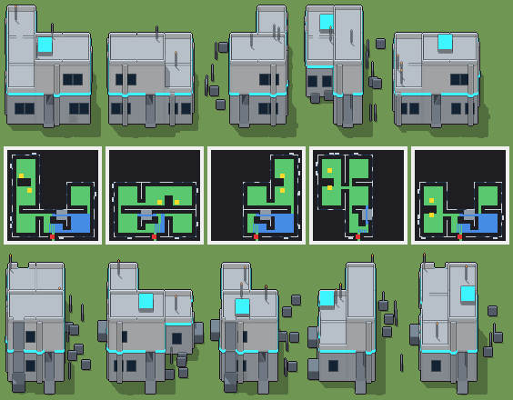

# Scalo delle navette, con la piattaforma

Programma: `scalo-navette.xml` · ambientazione **futuristico** · classe `grande` (struttura) · senza cantina · 86868 caratteri.



Esito: **passa** — regge a ogni seme e taglia, varia sì, tempo massimo a Enorme 1678 ms (tetto 4500 ms).

## grande — 100 × 100 × 80 voxel, 20 voxel per casella, gradino 4

| seme | ms | piani (quota: testa, stanze) | stanze | cantina | murato | porta | salti | finestre | dettagli | materiali | dominante | sagoma | rilievo | ingombro | fluttuanti | difetti |
|---|---|---|---|---|---|---|---|---|---|---|---|---|---|---|---|---|
| 1 | 844 | 0.1: 1.5, 4 · 1.7: 1.5, 1 | 5 | — | 0.00 | libera, scarto 0.03 | 9 | 40/4 lati | 177/0 vuoti | 13 | 0.25 | 6 | 0.34 | 0.62 | 0 | — |
| 2 | 707 | 0.1: 1.5, 5 · 1.7: 1.5, 1 | 6 | — | 0.00 | libera, scarto 0.03 | 7 | 32/4 lati | 164/0 vuoti | 13 | 0.26 | 5 | 0.31 | 0.60 | 0 | — |
| 3 | 760 | 0.1: 1.5, 3 · 1.7: 1.5, 1 | 4 | — | 0.00 | libera, scarto 0.03 | 7 | 38/4 lati | 154/0 vuoti | 13 | 0.25 | 6 | 0.35 | 0.51 | 0 | — |
| 4 | 701 | 0.1: 1.5, 4 · 1.7: 1.5, 1 | 5 | — | 0.00 | libera, scarto 0.03 | 10 | 31/4 lati | 163/0 vuoti | 13 | 0.25 | 6 | 0.38 | 0.51 | 0 | — |
| 5 | 698 | 0.1: 1.5, 4 · 1.7: 1.5, 1 | 5 | — | 0.00 | libera, scarto 0.03 | 9 | 33/4 lati | 162/0 vuoti | 13 | 0.24 | 6 | 0.35 | 0.52 | 0 | — |

Varianza su 5 semi (mediane delle coppie): voxel 0.59 (≥ 0.2), pianta 0.56 (≥ 0.15), perimetro 0.25 (≥ 0.15), interno 0.60 (≥ 0.35), colore 0.14 (non conta), liste di piani 1 e di stanze 3 (≥ 2), architetture 5/5 (≥ 3). Sopra ogni soglia.

## enorme — 120 × 120 × 96 voxel, 16 voxel per casella, gradino 3

| seme | ms | piani (quota: testa, stanze) | stanze | cantina | murato | porta | salti | finestre | dettagli | materiali | dominante | sagoma | rilievo | ingombro | fluttuanti | difetti |
|---|---|---|---|---|---|---|---|---|---|---|---|---|---|---|---|---|
| 1 | 1678 | 0.1: 1.9, 4 · 2.1: 1.9, 1 | 5 | — | 0.00 | libera, scarto 0.03 | 11 | 32/4 lati | 163/0 vuoti | 14 | 0.25 | 7 | 0.35 | 0.44 | 0 | — |
| 2 | 1634 | 0.1: 1.9, 5 · 2.1: 1.9, 1 | 6 | — | 0.00 | libera, scarto 0.03 | 12 | 29/4 lati | 197/0 vuoti | 14 | 0.24 | 8 | 0.47 | 0.45 | 0 | — |
| 3 | 1522 | 0.1: 1.9, 4 · 2.1: 1.9, 1 | 5 | — | 0.00 | libera, scarto 0.03 | 13 | 24/4 lati | 171/0 vuoti | 14 | 0.24 | 8 | 0.44 | 0.38 | 0 | — |
| 4 | 1581 | 0.1: 1.9, 4 · 2.1: 1.9, 1 | 5 | — | 0.00 | libera, scarto 0.03 | 11 | 32/4 lati | 172/0 vuoti | 14 | 0.24 | 7 | 0.29 | 0.38 | 0 | — |
| 5 | 1558 | 0.1: 1.9, 3 · 2.1: 1.9, 1 | 4 | — | 0.00 | libera, scarto 0.03 | 10 | 26/4 lati | 182/0 vuoti | 14 | 0.24 | 8 | 0.42 | 0.38 | 0 | — |

Varianza su 5 semi (mediane delle coppie): voxel 0.51 (≥ 0.2), pianta 0.24 (≥ 0.15), perimetro 0.18 (≥ 0.15), interno 0.49 (≥ 0.35), colore 0.15 (non conta), liste di piani 1 e di stanze 3 (≥ 2), architetture 5/5 (≥ 3). Sopra ogni soglia.

Misure: `lab/banco/misure.ts` (il corpo del gioco cammina dal davanti: piani raggiunti, murato = pavimento coperto non raggiunto, porta libera, salti; `valido` sono i controlli di `src/mj/check.ts`, fra cui i voxel staccati da terra) e `lab/banco/varianza.ts` (soglie di T180).

## Traccia del seme 1 (Grande, `src/mj/trace.ts`, forma «differenze»)

```text
Traccia, seme 1: griglia 100×100×80, 75 nodi, 639 passi, finito in 853 ms.
x sinistra→destra, y fondo→davanti, z basso→alto; «.» è la cella vuota; #n è il nodo nell'ordine dell'XML; ×n quante volte ha agito.
Lettere: N=browN, E=Emerald, x=serbatoi, z=z, a=fondazione, P=Purple, p=purple, Q=aQua, b=anello di neon, O=Orange, H=Honey, t=teal, s=slate, g=green, c=cyan, d=antenna, v=olive, e=luce di pista, f=fawn, w=white, X=X, i=indigo, I=piloni della piattaforma, J=Jungle, h=honey, j=jungle, M=Magenta, S=metallo bianco, F=pavimento composito, C=pannelli di lega, W=scocca bianca, R=copertura in lega, V=vetro scuro, D=profilo di titanio, L=seduta sospesa, U=blUe, u=blue, T=gradino, Y=Yellow, G=Green, K=rampa di lega, A=pavimento composito, k=portale scorrevole, n=bordo della piattaforma, r=red, y=yellow, q=aqua, l=light.
Alla fine: S 14163, C 13319, F 6589, W 6069, R 5207, K 3355, V 3168, D 1408, L 1035, I 900, b 780, k 330, n 225, A 44, d 43, T 22, e 1.
#2-61 prl×29, all×16, one×11: 21036 celle x1-98 y1-99 z0, passi 1-557
  E→b 3364: x6-34 y6-34 z0; x6-34 y36-64 z0; +2 scatole, 1682 celle
  E→z 2441: x36-64 y36-46 z0; x66-94 y6-15 z0; +27 scatole, 1832 celle
  E→t 1477: x66-94 y66-92 z0; x36-47 y66-94 z0; +3 scatole, 346 celle
  E→w 290: x6-34 y5 z0; x5 y6-34 z0; +8 scatole, 232 celle
  E→s 165: x50-64 y66-76 z0
  E→X 105: x36-64 y65 z0; x95 y66-94 z0; +3 scatole, 47 celle
  E→G 90: x37 y10-18 z0; x65 y14-22 z0; +8 scatole, 72 celle
  E→i 76: x17-34 y65 z0; x27-31 y3-4 z0; +12 scatole, 48 celle
  E→A 44: x45-55 y96-99 z0
  E→J 36: x66-83 y65 z0; x35 y77-94 z0
  E→h 33: x22-34 y35 z0; x6-16 y65 z0; +1 scatole, 9 celle
  E→I 23: x57-61 y96-97 z0; x65 y77-83 z0; +6 scatole, 6 celle
  E→j 22: x84-94 y65 z0; x35 y66-76 z0
  E→f 18: x73-81 y93-94 z0
  E→d 11: x48 y66-76 z0
  E→c 11: x49 y66-76 z0
  E→y 11: x65 y66-76 z0
  E→H 11: x65 y84-94 z0
  E→M 11: x45-55 y95 z0
  E→e 7: x15-21 y35 z0
  N→z 1: x50 y50 z0
#62-75 all×5, prl×7, one×2: 71627 celle x0-99 y0-99 z0-79, passi 558-639
  .→C 13319: x5 y6-95 z1-9; x35 y77-95 z1-31; +78 scatole, 11920 celle
  .→S 8492: x5-26 y5-95 z32; x35-95 y65-95 z64; +34 scatole, 4599 celle
  .→F 6589: x6-34 y6-34 z1; x66-94 y36-64 z1; +18 scatole, 4907 celle
  .→W 6069: x36-65 y95 z42-63; x36-94 y95 z34-41; +32 scatole, 4937 celle
  .→R 5207: x6-34 y6-34 z33; x66-94 y36-64 z33; +25 scatole, 3525 celle
  b→S 3364: x6-34 y6-34 z0; x6-34 y36-64 z0; +2 scatole, 1682 celle
  .→K 3355: x65 y66-76 z1-32; x49-64 y66-76 z2-3; +16 scatole, 2651 celle
  .→V 3168: x10-18 y5 z11-21; x25-33 y5 z11-21; +30 scatole, 2970 celle
  z→. 2442: x36-64 y36-46 z0; x66-94 y6-15 z0; +24 scatole, 1833 celle
  E→. 1753: x0-99 y0-2 z0; x0-2 y15-99 z0; +18 scatole, 1198 celle
  t→S 1477: x66-94 y66-92 z0; x36-47 y66-94 z0; +3 scatole, 346 celle
  .→D 1408: x35 y16-17 z11-22; x35 y47-48 z11-22; +110 scatole, 1360 celle
  .→L 945: x73-81 y93-94 z1-9; x37 y10-18 z1-8; +10 scatole, 711 celle
  .→I 900: x39-53 y72-86 z66-69
  .→b 780: x96 y51-95 z32-33; x6-44 y96 z32-33; +19 scatole, 612 celle
  .→k 330: x45-55 y95 z2-31
  w→S 290: x6-34 y5 z0; x5 y6-34 z0; +8 scatole, 232 celle
  .→n 225: x39-53 y72-86 z70
  s→S 165: x50-64 y66-76 z0
  X→S 105: x36-64 y65 z0; x95 y66-94 z0; +3 scatole, 47 celle
  G→L 90: x37 y10-18 z0; x65 y14-22 z0; +8 scatole, 72 celle
  i→S 76: x17-34 y65 z0; x27-31 y3-4 z0; +12 scatole, 48 celle
  .→d 43: x14 y16 z34-48; x54 y66 z66-79; +1 scatole, 14 celle
  J→S 36: x66-83 y65 z0; x35 y77-94 z0
  h→S 33: x22-34 y35 z0; x6-16 y65 z0; +1 scatole, 9 celle
  I→S 23: x57-61 y96-97 z0; x65 y77-83 z0; +6 scatole, 6 celle
  .→T 22: x64-65 y66-76 z33
  j→S 22: x84-94 y65 z0; x35 y66-76 z0
  f→S 18: x73-81 y93-94 z0
  d→S 11: x48 y66-76 z0
  c→S 11: x49 y66-76 z0
  y→S 11: x65 y66-76 z0
  H→S 11: x65 y84-94 z0
  M→S 11: x45-55 y95 z0
  e→S 7: x15-21 y35 z0
  .→e 1: x14 y16 z49
Senza effetto (non hanno mai cambiato una cella):
#40 prl */* */* */* */* */* */* */* */* */* */* */* */*… → */* */* */* */* */* */* */* */* */* */* */* */*… passi=1: in quel momento nella griglia non c'erano celle "r"
#47 prl * * * * * * * * * * * * * * * * * * * * * * * *… → * * * * * * * * * * * * * * * * * * * * * * * *… passi=1
#49 prl * * * * * * * * * * * * * * * * * * * * * * * *… → * * * * * * * * * * * * * * * * * * * * * * * *… passi=1: in quel momento nella griglia non c'erano celle "r"
#50 one ***************/***************/***************… → ***************/***************/***************… passi=2: le celle cercate c'erano, ma mai disposte come nel pattern
```
