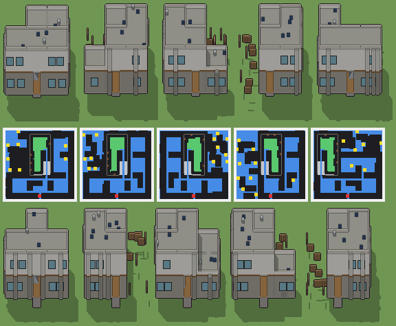

# Bistrot con l’enoteca interrata

Programma: `bistrot.xml` · ambientazione **moderno** · classe `grande` (struttura) · **con cantina** (`suolo="E"`, `ground="Z"`, `sotto: 1`) · 87572 caratteri.



Esito: **passa** — regge a ogni seme e taglia, varia sì, tempo massimo a Enorme 3198 ms (tetto 4500 ms).

## grande — 100 × 100 × 100 voxel, 20 voxel per casella, gradino 4

| seme | ms | piani (quota: testa, stanze) | stanze | cantina | murato | porta | salti | finestre | dettagli | materiali | dominante | sagoma | rilievo | ingombro | fluttuanti | difetti |
|---|---|---|---|---|---|---|---|---|---|---|---|---|---|---|---|---|
| 1 | 1751 | -0.9: 2.5, 0 · 0.1: 1.5, 3 · 1.7: 1.5, 2 | 5 | 1.76 | 0.00 | libera, scarto 0.03 | 8 | 40/4 lati | 165/0 vuoti | 15 | 0.21 | 5 | 0.31 | 0.67 | 0 | — |
| 2 | 1674 | -0.9: 2.5, 0 · 0.1: 1.5, 3 · 1.7: 1.5, 2 | 5 | 1.77 | 0.00 | libera, scarto 0.03 | 6 | 26/4 lati | 161/0 vuoti | 15 | 0.21 | 5 | 0.35 | 0.67 | 0 | — |
| 3 | 1772 | -0.9: 2.5, 0 · 0.1: 1.5, 3 · 1.7: 1.5, 2 | 5 | 1.77 | 0.00 | libera, scarto 0.03 | 7 | 29/4 lati | 147/0 vuoti | 15 | 0.21 | 5 | 0.36 | 0.67 | 0 | — |
| 4 | 1660 | -0.9: 2.5, 0 · 0.1: 1.5, 2 · 1.7: 1.5, 2 | 4 | 1.75 | 0.00 | libera, scarto 0.03 | 10 | 29/4 lati | 138/0 vuoti | 15 | 0.20 | 7 | 0.29 | 0.57 | 0 | — |
| 5 | 1596 | -0.9: 2.5, 0 · 0.1: 1.5, 3 · 1.7: 1.5, 2 | 5 | 1.74 | 0.00 | libera, scarto 0.03 | 7 | 32/4 lati | 141/0 vuoti | 15 | 0.21 | 5 | 0.33 | 0.67 | 0 | — |

Varianza su 5 semi (mediane delle coppie): voxel 0.61 (≥ 0.2), pianta 0.42 (≥ 0.15), perimetro 0.16 (≥ 0.15), interno 0.69 (≥ 0.35), colore 0.13 (non conta), liste di piani 1 e di stanze 2 (≥ 2), architetture 5/5 (≥ 3). Sopra ogni soglia.

## enorme — 120 × 120 × 112 voxel, 16 voxel per casella, gradino 3

| seme | ms | piani (quota: testa, stanze) | stanze | cantina | murato | porta | salti | finestre | dettagli | materiali | dominante | sagoma | rilievo | ingombro | fluttuanti | difetti |
|---|---|---|---|---|---|---|---|---|---|---|---|---|---|---|---|---|
| 1 | 2847 | -0.9: 2.9, 1 · 0.1: 1.9, 4 · 2.1: 1.9, 2 | 7 | 3.02 | 0.00 | libera, scarto 0.03 | 3 | 32/4 lati | 140/0 vuoti | 15 | 0.21 | 6 | 0.40 | 0.47 | 0 | — |
| 2 | 3175 | -0.9: 2.9, 1 · 0.1: 1.9, 3 · 2.1: 1.9, 2 | 6 | 2.99 | 0.00 | libera, scarto 0.03 | 7 | 25/4 lati | 141/0 vuoti | 15 | 0.21 | 7 | 0.30 | 0.41 | 0 | — |
| 3 | 2901 | -0.9: 2.9, 1 · 0.1: 1.9, 4 · 2.1: 1.9, 2 | 7 | 2.96 | 0.00 | libera, scarto 0.03 | 6 | 26/4 lati | 163/0 vuoti | 15 | 0.22 | 6 | 0.38 | 0.47 | 0 | — |
| 4 | 3198 | -0.9: 2.9, 1 · 0.1: 1.9, 4 · 2.1: 1.9, 2 | 7 | 2.98 | 0.00 | libera, scarto 0.03 | 11 | 32/4 lati | 154/0 vuoti | 15 | 0.21 | 6 | 0.36 | 0.47 | 0 | — |
| 5 | 2873 | -0.9: 2.9, 1 · 0.1: 1.9, 3 · 2.1: 1.9, 2 | 6 | 3.00 | 0.00 | libera, scarto 0.03 | 8 | 27/4 lati | 140/0 vuoti | 15 | 0.20 | 8 | 0.31 | 0.41 | 0 | — |

Varianza su 5 semi (mediane delle coppie): voxel 0.58 (≥ 0.2), pianta 0.37 (≥ 0.15), perimetro 0.23 (≥ 0.15), interno 0.67 (≥ 0.35), colore 0.13 (non conta), liste di piani 1 e di stanze 2 (≥ 2), architetture 5/5 (≥ 3). Sopra ogni soglia.

Misure: `lab/banco/misure.ts` (il corpo del gioco cammina dal davanti: piani raggiunti, murato = pavimento coperto non raggiunto, porta libera, salti; `valido` sono i controlli di `src/mj/check.ts`, fra cui i voxel staccati da terra) e `lab/banco/varianza.ts` (soglie di T180).

## Traccia del seme 1 (Grande, `src/mj/trace.ts`, forma «differenze»)

```text
Traccia, seme 1: griglia 100×100×100, 85 nodi, 763 passi, finito in 1629 ms.
x sinistra→destra, y fondo→davanti, z basso→alto; «.» è la cella vuota; #n è il nodo nell'ordine dell'XML; ×n quante volte ha agito.
Lettere: N=browN, E=Emerald, x=botti, z=z, a=fondazione, P=Purple, p=purple, Q=aQua, b=black, O=pannelli solari, H=Honey, t=teal, s=slate, g=green, c=canna fumaria, d=dead, dark, v=olive, e=emerald, f=listelli di larice, w=white, X=X, i=indigo, I=Indigo, J=Jungle, h=honey, j=jungle, M=Magenta, S=cemento chiaro, F=parquet di rovere, C=cemento a vista, W=intonaco bianco, R=ghiaia, V=vetro, D=telaio di alluminio, L=panca di rovere, U=blUe, u=blue, T=gradino, Y=Yellow, G=Green, K=acciaio, A=pavimento di pietra, k=porta di acciaio, n=brown, y=yellow, q=aqua, l=light, m=magenta, o=orange, Z=Z.
Alla fine: S 14430, C 13635, K 7816, W 7514, F 6622, R 6135, a 3402, V 3366, A 1732, D 1496, x 1224, L 1035, f 712, k 330, O 150, c 90, T 22.
#2-63 prl×31, all×21, one×10: 78457 celle x1-98 y1-99 z20-88, passi 1-588
  .→C 11371: x65 y6-65 z21-51; +44 scatole, 9511 celle
  .→S 10474: x5-95 y65-95 z84; +38 scatole, 7653 celle
  .→F 6622: x6-34 y66-94 z21; +22 scatole, 5781 celle
  .→W 6422: x6-94 y95 z54-61; +34 scatole, 5710 celle
  .→R 6029: x36-64 y6-64 z53; +17 scatole, 4318 celle
  E→S 4830: x77-95 y5-95 z20; +11 scatole, 3101 celle
  .→U 4718: x36-64 y5 z30-43; +12 scatole, 4312 celle
  .→u 3094: x6-34 y65 z62-75; +8 scatole, 2688 celle
  E→l 1687: x36-64 y6-49 z20; +5 scatole, 411 celle
  E→z 1601: x6-21 y8-26 z20; +25 scatole, 1297 celle
  .→K 352: x35 y66-76 z21-52
  .→k 330: x45-55 y95 z22-51
  .→w 174: x36-64 y5 z58; +5 scatole, 145 celle
  .→X 163: x6-34 y65 z88; +6 scatole, 134 celle
  E→G 90: x26-34 y5 z20; +9 scatole, 81 celle
  .→i 84: x65 y5-64 z54; +6 scatole, 24 celle
  E→A 44: x45-55 y96-99 z20
  .→J 36: x36-53 y65 z88; +1 scatole, 18 celle
  .→G 25: x74-82 y6-7 z21; +1 scatole, 7 celle
  E→K 23: x54-64 y63-64 z20; +1 scatole, 1 celle
  .→h 22: x66-82 y35 z54; +1 scatole, 5 celle
  .→j 22: x54-64 y65 z88; +1 scatole, 11 celle
  .→N 12: x54-64 y63 z21; +1 scatole, 1 celle
  .→m 11: x54-64 y64 z21
  .→Y 11: x51 y66-76 z21
  .→T 11: x52 y66-76 z21
  .→M 11: x45-55 y95 z88
  N→l 1: x50 y50 z20
#64-69 all×4, prl×2: 37658 celle x35-65 y5-65 z0-21, passi 589-636
  .→l 31700: x36-54 y27-62 z3-19; +19 scatole, 20072 celle
  .→a 3078: x35 y6-64 z1-19; +3 scatole, 1957 celle
  Z→A 1688: x36-64 y6-62 z0; +2 scatole, 35 celle
  .→K 350: x55-64 y33-38 z6; +7 scatole, 290 celle
  Z→a 162: x35 y6-64 z0; +3 scatole, 103 celle
  S→a 162: x35 y6-64 z20; +3 scatole, 103 celle
  m→K 11: x54-64 y64 z21
  .→N 11: x55-64 y27 z3; +1 scatole, 1 celle
  .→m 11: x55-64 y28 z3; +1 scatole, 1 celle
  N→K 11: x55-64 y63 z21; +1 scatole, 1 celle
#70-85 prl×7, all×6, one×3: 64750 celle x0-99 y0-99 z0-90, passi 637-763
  l→. 29302: x38-54 y34-62 z1-20; +17 scatole, 19442 celle
  Z→. 8150: x0-34 y6-99 z0; +8 scatole, 4860 celle
  l→K 3606: x55-64 y33-62 z3-5; +7 scatole, 2706 celle
  .→K 3418: x54-64 y63-64 z1-19; +17 scatole, 3000 celle
  U→V 1980: x40-48 y5 z31-41; +19 scatole, 1881 celle
  U→C 1858: x95 y6-14 z30-43; +41 scatole, 1732 celle
  E→. 1724: x0-5 y6-64 z20; +16 scatole, 1370 celle
  z→. 1601: x6-21 y8-26 z20; +25 scatole, 1297 celle
  u→V 1386: x8-16 y65 z63-73; +13 scatole, 1287 celle
  u→W 1092: x36-44 y95 z62-75; +30 scatole, 966 celle
  .→L 920: x74-82 y6-7 z22-29; +11 scatole, 776 celle
  U→D 880: x35 y16-17 z31-42; +73 scatole, 856 celle
  .→x 744: x63-64 y18-20 z21-51; +3 scatole, 558 celle
  S→f 712: x6-44 y95 z52-53; +28 scatole, 634 celle
  u→D 616: x95 y76-77 z63-74; +53 scatole, 592 celle
  l→x 480: x63-64 y18-20 z1-20; +3 scatole, 360 celle
  w→C 174: x36-64 y5 z58; +5 scatole, 145 celle
  X→C 163: x6-34 y65 z88; +6 scatole, 134 celle
  .→O 150: x75-79 y28-32 z54; +5 scatole, 125 celle
  G→L 115: x74-82 y6-7 z21; +11 scatole, 97 celle
  .→c 90: x81-83 y25-27 z54-58; +1 scatole, 45 celle
  i→R 84: x65 y5-64 z54; +6 scatole, 24 celle
  J→C 36: x36-53 y65 z88; +1 scatole, 18 celle
  .→T 22: x35-36 y66-76 z53
  h→R 22: x66-82 y35 z54; +1 scatole, 5 celle
  j→C 22: x54-64 y65 z88; +1 scatole, 11 celle
  N→K 12: x55-64 y27 z3; +2 scatole, 2 celle
  Y→K 11: x51 y66-76 z21
  T→K 11: x52 y66-76 z21
  M→C 11: x45-55 y95 z88
  m→K 11: x55-64 y28 z3; +1 scatole, 1 celle
```
