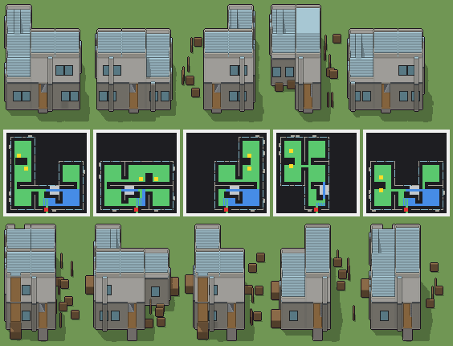

# Mercato coperto

Programma: `mercato-coperto.xml` · ambientazione **moderno** · classe `grande` (struttura) · senza cantina · 85389 caratteri.



Esito: **passa** — regge a ogni seme e taglia, varia sì, tempo massimo a Enorme 1675 ms (tetto 4500 ms).

## grande — 100 × 100 × 80 voxel, 20 voxel per casella, gradino 4

| seme | ms | piani (quota: testa, stanze) | stanze | cantina | murato | porta | salti | finestre | dettagli | materiali | dominante | sagoma | rilievo | ingombro | fluttuanti | difetti |
|---|---|---|---|---|---|---|---|---|---|---|---|---|---|---|---|---|
| 1 | 748 | 0.1: 1.5, 4 · 1.7: 1.5, 1 | 5 | — | 0.00 | libera, scarto 0.03 | 9 | 27/4 lati | 155/0 vuoti | 11 | 0.46 | 30 | 0.42 | 0.58 | 0 | — |
| 2 | 725 | 0.1: 1.5, 5 · 1.7: 1.5, 1 | 6 | — | 0.00 | libera, scarto 0.03 | 7 | 22/4 lati | 153/0 vuoti | 11 | 0.46 | 30 | 0.37 | 0.57 | 0 | — |
| 3 | 717 | 0.1: 1.5, 3 · 1.7: 1.5, 1 | 4 | — | 0.00 | libera, scarto 0.03 | 7 | 29/4 lati | 140/0 vuoti | 11 | 0.46 | 30 | 0.43 | 0.48 | 0 | — |
| 4 | 670 | 0.1: 1.5, 4 · 1.7: 1.5, 1 | 5 | — | 0.00 | libera, scarto 0.03 | 10 | 21/4 lati | 151/0 vuoti | 11 | 0.50 | 19 | 0.43 | 0.48 | 0 | — |
| 5 | 718 | 0.1: 1.5, 4 · 1.7: 1.5, 1 | 5 | — | 0.00 | libera, scarto 0.03 | 9 | 25/4 lati | 142/0 vuoti | 11 | 0.45 | 30 | 0.42 | 0.49 | 0 | — |

Varianza su 5 semi (mediane delle coppie): voxel 0.61 (≥ 0.2), pianta 0.58 (≥ 0.15), perimetro 0.23 (≥ 0.15), interno 0.60 (≥ 0.35), colore 0.09 (non conta), liste di piani 1 e di stanze 3 (≥ 2), architetture 5/5 (≥ 3). Sopra ogni soglia.

## enorme — 120 × 120 × 96 voxel, 16 voxel per casella, gradino 3

| seme | ms | piani (quota: testa, stanze) | stanze | cantina | murato | porta | salti | finestre | dettagli | materiali | dominante | sagoma | rilievo | ingombro | fluttuanti | difetti |
|---|---|---|---|---|---|---|---|---|---|---|---|---|---|---|---|---|
| 1 | 1406 | 0.1: 1.9, 4 · 2.1: 1.9, 1 | 5 | — | 0.00 | libera, scarto 0.03 | 11 | 23/4 lati | 150/0 vuoti | 11 | 0.45 | 31 | 0.39 | 0.43 | 0 | — |
| 2 | 1530 | 0.1: 1.9, 5 · 2.1: 1.9, 1 | 6 | — | 0.00 | libera, scarto 0.03 | 12 | 25/4 lati | 168/0 vuoti | 11 | 0.46 | 31 | 0.52 | 0.43 | 0 | — |
| 3 | 1483 | 0.1: 1.9, 4 · 2.1: 1.9, 1 | 5 | — | 0.00 | libera, scarto 0.03 | 13 | 23/4 lati | 148/0 vuoti | 11 | 0.42 | 31 | 0.48 | 0.37 | 0 | — |
| 4 | 1675 | 0.1: 1.9, 4 · 2.1: 1.9, 1 | 5 | — | 0.00 | libera, scarto 0.03 | 11 | 21/4 lati | 154/0 vuoti | 11 | 0.50 | 18 | 0.35 | 0.37 | 0 | — |
| 5 | 1424 | 0.1: 1.9, 3 · 2.1: 1.9, 1 | 4 | — | 0.00 | libera, scarto 0.03 | 10 | 21/4 lati | 154/0 vuoti | 11 | 0.52 | 18 | 0.48 | 0.37 | 0 | — |

Varianza su 5 semi (mediane delle coppie): voxel 0.60 (≥ 0.2), pianta 0.26 (≥ 0.15), perimetro 0.18 (≥ 0.15), interno 0.50 (≥ 0.35), colore 0.10 (non conta), liste di piani 1 e di stanze 3 (≥ 2), architetture 5/5 (≥ 3). Sopra ogni soglia.

Misure: `lab/banco/misure.ts` (il corpo del gioco cammina dal davanti: piani raggiunti, murato = pavimento coperto non raggiunto, porta libera, salti; `valido` sono i controlli di `src/mj/check.ts`, fra cui i voxel staccati da terra) e `lab/banco/varianza.ts` (soglie di T180).

## Traccia del seme 1 (Grande, `src/mj/trace.ts`, forma «differenze»)

```text
Traccia, seme 1: griglia 100×100×80, 70 nodi, 644 passi, finito in 707 ms.
x sinistra→destra, y fondo→davanti, z basso→alto; «.» è la cella vuota; #n è il nodo nell'ordine dell'XML; ×n quante volte ha agito.
Lettere: N=browN, E=Emerald, x=botti, z=z, a=fondazione, P=Purple, p=purple, Q=aQua, b=black, O=travi di acciaio, H=Honey, t=teal, s=slate, g=green, c=cyan, d=dead, dark, v=olive, e=emerald, f=fawn, w=white, X=X, i=indigo, I=Indigo, J=Jungle, h=honey, j=jungle, M=Magenta, S=cemento chiaro, F=parquet di rovere, C=cemento a vista, W=intonaco bianco, R=copertura di vetro, V=vetro, D=telaio di alluminio, L=panca di rovere, U=blUe, u=blue, T=gradino, Y=Yellow, G=Green, K=acciaio, A=pavimento di pietra, k=porta di acciaio, n=brown, r=red, y=yellow, q=aqua, l=light.
Alla fine: R 42678, S 13411, C 13319, F 6589, W 6069, K 3355, V 3168, D 1408, L 1035, O 752, k 330, A 44, T 22.
#2-62 prl×29, all×17, one×11: 71688 celle x1-98 y1-99 z0-68, passi 1-558
  .→C 10900: x5 y6-95 z1-9; x35 y77-95 z1-31; +48 scatole, 9501 celle
  .→S 8492: x5-26 y5-95 z32; x35-95 y65-95 z64; +34 scatole, 4599 celle
  .→F 6589: x6-34 y6-34 z1; x66-94 y36-64 z1; +18 scatole, 4907 celle
  E→S 5671: x5-26 y5-95 z0; x65-95 y35-95 z0; +8 scatole, 1778 celle
  .→U 5530: x6-34 y5 z10-23; x5 y6-34 z10-23; +13 scatole, 4718 celle
  .→R 5098: x6-34 y6-34 z33; x66-94 y36-64 z33; +12 scatole, 3416 celle
  .→W 4788: x36-94 y95 z34-41; x57-61 y96-97 z34-63; +29 scatole, 4016 celle
  E→z 2441: x36-64 y36-46 z0; x66-94 y6-15 z0; +27 scatole, 1832 celle
  .→u 2282: x36-64 y65 z42-55; x66-94 y65 z42-55; +5 scatole, 1470 celle
  .→K 352: x65 y66-76 z1-32
  .→k 330: x45-55 y95 z2-31
  .→w 290: x6-34 y5 z38; x5 y6-34 z38; +8 scatole, 232 celle
  .→X 105: x36-64 y65 z68; x95 y66-94 z68; +3 scatole, 47 celle
  E→G 90: x37 y10-18 z0; x65 y14-22 z0; +8 scatole, 72 celle
  .→i 76: x17-34 y65 z34; x27-31 y3-4 z34; +12 scatole, 48 celle
  E→A 44: x45-55 y96-99 z0
  .→J 36: x66-83 y65 z68; x35 y77-94 z68
  .→h 33: x22-34 y35 z34; x6-16 y65 z34; +1 scatole, 9 celle
  .→G 25: x73-81 y93-94 z1; x15-21 y35 z1
  .→j 22: x84-94 y65 z68; x35 y66-76 z68
  .→T 11: x48 y66-76 z1
  .→Y 11: x49 y66-76 z1
  .→M 11: x45-55 y95 z68
  N→z 1: x50 y50 z0
#63-70 all×4, prl×4: 56124 celle x0-99 y0-99 z0-79, passi 559-644
  .→R 37471: x6-34 y7-33 z34; x66-94 y37-63 z34; +139 scatole, 35905 celle
  .→K 2981: x49-64 y66-76 z2-3; x50-64 y66-76 z4-5; +14 scatole, 2299 celle
  U→V 2475: x10-18 y5 z11-21; x25-33 y5 z11-21; +23 scatole, 2277 celle
  z→. 2442: x36-64 y36-46 z0; x66-94 y6-15 z0; +24 scatole, 1833 celle
  U→C 1955: x95 y66-75 z10-23; x36-44 y95 z10-23; +44 scatole, 1689 celle
  E→. 1753: x0-99 y0-2 z0; x0-2 y15-99 z0; +18 scatole, 1198 celle
  u→W 1281: x85-94 y65 z42-55; x36-44 y65 z42-55; +15 scatole, 1015 celle
  U→D 1100: x35 y16-17 z11-22; x35 y47-48 z11-22; +84 scatole, 1052 celle
  .→L 920: x73-81 y93-94 z2-9; x37 y10-18 z1-8; +10 scatole, 704 celle
  S→O 752: x95 y51-95 z32-33; x6-44 y95 z32-33; +19 scatole, 584 celle
  u→V 693: x46-54 y65 z43-53; x75-83 y65 z43-53; +5 scatole, 495 celle
  u→D 308: x76-77 y95 z43-54; x66-87 y95 z42; +24 scatole, 262 celle
  w→C 290: x6-34 y5 z38; x5 y6-34 z38; +8 scatole, 232 celle
  G→L 115: x73-81 y93-94 z1; x37 y10-18 z0; +10 scatole, 88 celle
  X→C 105: x36-64 y65 z68; x95 y66-94 z68; +3 scatole, 47 celle
  i→R 76: x17-34 y65 z34; x27-31 y3-4 z34; +12 scatole, 48 celle
  J→C 36: x66-83 y65 z68; x35 y77-94 z68
  h→R 33: x22-34 y35 z34; x6-16 y65 z34; +1 scatole, 9 celle
  .→T 22: x64-65 y66-76 z33
  j→C 22: x84-94 y65 z68; x35 y66-76 z68
  T→K 11: x48 y66-76 z1
  Y→K 11: x49 y66-76 z1
  M→C 11: x45-55 y95 z68
Senza effetto (non hanno mai cambiato una cella):
#40 prl */* */* */* */* */* */* */* */* */* */* */* */*… → */* */* */* */* */* */* */* */* */* */* */* */*… passi=1: in quel momento nella griglia non c'erano celle "r"
#47 prl * * * * * * * * * * * * * * * * * * * * * * * *… → * * * * * * * * * * * * * * * * * * * * * * * *… passi=1
#49 prl * * * * * * * * * * * * * * * * * * * * * * * *… → * * * * * * * * * * * * * * * * * * * * * * * *… passi=1: in quel momento nella griglia non c'erano celle "r"
#50 one ***************/***************/***************… → ***************/***************/***************… passi=2: le celle cercate c'erano, ma mai disposte come nel pattern
```
