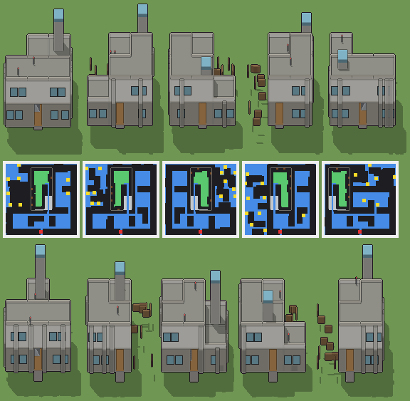

# Torre panoramica, con l’autorimessa interrata

Programma: `torre-panoramica.xml` · ambientazione **moderno** · classe `grande` (struttura) · **con cantina** (`suolo="E"`, `ground="Z"`, `sotto: 1`) · 88312 caratteri.



Esito: **passa** — regge a ogni seme e taglia, varia sì, tempo massimo a Enorme 3236 ms (tetto 4500 ms).

## grande — 100 × 100 × 100 voxel, 20 voxel per casella, gradino 4

| seme | ms | piani (quota: testa, stanze) | stanze | cantina | murato | porta | salti | finestre | dettagli | materiali | dominante | sagoma | rilievo | ingombro | fluttuanti | difetti |
|---|---|---|---|---|---|---|---|---|---|---|---|---|---|---|---|---|
| 1 | 1545 | -0.9: 2.5, 0 · 0.1: 1.5, 3 · 1.7: 1.5, 2 | 5 | 1.76 | 0.00 | libera, scarto 0.03 | 8 | 34/4 lati | 153/0 vuoti | 15 | 0.20 | 6 | 0.37 | 0.67 | 0 | — |
| 2 | 1684 | -0.9: 2.5, 0 · 0.1: 1.5, 3 · 1.7: 1.5, 2 | 5 | 1.77 | 0.00 | libera, scarto 0.03 | 6 | 26/4 lati | 136/0 vuoti | 15 | 0.20 | 5 | 0.37 | 0.67 | 0 | — |
| 3 | 1980 | -0.9: 2.5, 0 · 0.1: 1.5, 3 · 1.7: 1.5, 2 | 5 | 1.77 | 0.00 | libera, scarto 0.03 | 7 | 29/4 lati | 138/0 vuoti | 15 | 0.21 | 5 | 0.38 | 0.67 | 0 | — |
| 4 | 1765 | -0.9: 2.5, 0 · 0.1: 1.5, 2 · 1.7: 1.5, 2 | 4 | 1.75 | 0.00 | libera, scarto 0.03 | 10 | 22/4 lati | 127/0 vuoti | 15 | 0.18 | 6 | 0.31 | 0.57 | 0 | — |
| 5 | 1782 | -0.9: 2.5, 0 · 0.1: 1.5, 3 · 1.7: 1.5, 2 | 5 | 1.74 | 0.00 | libera, scarto 0.03 | 7 | 31/4 lati | 141/0 vuoti | 15 | 0.21 | 5 | 0.35 | 0.67 | 0 | — |

Varianza su 5 semi (mediane delle coppie): voxel 0.63 (≥ 0.2), pianta 0.42 (≥ 0.15), perimetro 0.16 (≥ 0.15), interno 0.69 (≥ 0.35), colore 0.12 (non conta), liste di piani 1 e di stanze 2 (≥ 2), architetture 5/5 (≥ 3). Sopra ogni soglia.

## enorme — 120 × 120 × 112 voxel, 16 voxel per casella, gradino 3

| seme | ms | piani (quota: testa, stanze) | stanze | cantina | murato | porta | salti | finestre | dettagli | materiali | dominante | sagoma | rilievo | ingombro | fluttuanti | difetti |
|---|---|---|---|---|---|---|---|---|---|---|---|---|---|---|---|---|
| 1 | 2859 | -0.9: 2.9, 1 · 0.1: 1.9, 4 · 2.1: 1.9, 2 | 7 | 3.02 | 0.00 | libera, scarto 0.03 | 3 | 31/4 lati | 145/0 vuoti | 15 | 0.19 | 6 | 0.47 | 0.47 | 0 | — |
| 2 | 2986 | -0.9: 2.9, 1 · 0.1: 1.9, 3 · 2.1: 1.9, 2 | 6 | 2.99 | 0.00 | libera, scarto 0.03 | 7 | 26/4 lati | 135/0 vuoti | 15 | 0.18 | 7 | 0.34 | 0.41 | 0 | — |
| 3 | 2618 | -0.9: 2.9, 1 · 0.1: 1.9, 4 · 2.1: 1.9, 2 | 7 | 2.96 | 0.00 | libera, scarto 0.03 | 6 | 23/4 lati | 140/0 vuoti | 15 | 0.20 | 6 | 0.43 | 0.47 | 0 | — |
| 4 | 3236 | -0.9: 2.9, 1 · 0.1: 1.9, 4 · 2.1: 1.9, 2 | 7 | 2.98 | 0.00 | libera, scarto 0.03 | 11 | 35/4 lati | 141/0 vuoti | 15 | 0.21 | 6 | 0.40 | 0.47 | 0 | — |
| 5 | 3032 | -0.9: 2.9, 1 · 0.1: 1.9, 3 · 2.1: 1.9, 2 | 6 | 3.00 | 0.00 | libera, scarto 0.03 | 8 | 26/4 lati | 130/0 vuoti | 15 | 0.18 | 7 | 0.37 | 0.41 | 0 | — |

Varianza su 5 semi (mediane delle coppie): voxel 0.65 (≥ 0.2), pianta 0.37 (≥ 0.15), perimetro 0.23 (≥ 0.15), interno 0.67 (≥ 0.35), colore 0.12 (non conta), liste di piani 1 e di stanze 2 (≥ 2), architetture 5/5 (≥ 3). Sopra ogni soglia.

Misure: `lab/banco/misure.ts` (il corpo del gioco cammina dal davanti: piani raggiunti, murato = pavimento coperto non raggiunto, porta libera, salti; `valido` sono i controlli di `src/mj/check.ts`, fra cui i voxel staccati da terra) e `lab/banco/varianza.ts` (soglie di T180).

## Traccia del seme 1 (Grande, `src/mj/trace.ts`, forma «differenze»)

```text
Traccia, seme 1: griglia 100×100×100, 86 nodi, 806 passi, finito in 1672 ms.
x sinistra→destra, y fondo→davanti, z basso→alto; «.» è la cella vuota; #n è il nodo nell'ordine dell'XML; ×n quante volte ha agito.
Lettere: N=browN, E=Emerald, x=botti, z=z, a=fondazione, P=Purple, p=purple, Q=aQua, b=black, O=belvedere di vetro, H=Honey, t=teal, s=slate, g=green, c=cyan, d=antenna, v=olive, e=emerald, w=white, X=X, i=indigo, I=cemento della torre, J=Jungle, h=honey, j=jungle, M=Magenta, S=cemento chiaro, F=parquet di rovere, C=cemento a vista, W=intonaco bianco, R=ghiaia, V=vetro, D=telaio di alluminio, L=panca di rovere, U=blUe, u=blue, T=gradino, Y=Yellow, G=Green, K=acciaio, A=pavimento di pietra, k=porta di acciaio, n=luce di segnalazione, y=yellow, q=aqua, l=light, m=magenta, o=orange, Z=Z.
Alla fine: S 15142, C 13635, K 7816, W 7657, I 6929, F 6622, R 6135, a 3402, V 3267, A 1732, D 1452, x 1224, L 1035, O 845, k 330, T 22, d 18, n 2.
#2-63 prl×31, all×21, one×10: 78457 celle x1-98 y1-99 z20-88, passi 1-588
  .→C 11371: x65 y6-65 z21-51; x95 y6-95 z21-29; +43 scatole, 8701 celle
  .→S 10474: x5-95 y65-95 z84; x35-71 y5-65 z52; +37 scatole, 5396 celle
  .→F 6622: x6-34 y66-94 z21; x6-34 y66-94 z53; +21 scatole, 4940 celle
  .→W 6422: x6-94 y95 z54-61; x36-94 y65 z54-61; +33 scatole, 5238 celle
  .→R 6029: x36-64 y6-64 z53; x66-94 y6-34 z53; +16 scatole, 3477 celle
  E→S 4830: x77-95 y5-95 z20; x5-34 y65-95 z20; +10 scatole, 2171 celle
  .→U 4718: x36-64 y5 z30-43; x66-94 y5 z30-43; +11 scatole, 3906 celle
  .→u 3094: x6-34 y65 z62-75; x36-64 y65 z62-75; +7 scatole, 2282 celle
  E→l 1687: x36-64 y6-49 z20; x36-49 y50-64 z20; +4 scatole, 201 celle
  E→z 1601: x6-21 y8-26 z20; x23-34 y43-64 z20; +24 scatole, 1033 celle
  .→K 352: x35 y66-76 z21-52
  .→k 330: x45-55 y95 z22-51
  .→w 174: x36-64 y5 z58; x66-94 y5 z58; +4 scatole, 116 celle
  .→X 163: x6-34 y65 z88; x5 y66-94 z88; +5 scatole, 105 celle
  E→G 90: x26-34 y5 z20; x22-30 y8 z20; +8 scatole, 72 celle
  .→i 84: x65 y5-64 z54; x72-76 y3-4 z54; +5 scatole, 14 celle
  E→A 44: x45-55 y96-99 z20
  .→J 36: x36-53 y65 z88; x66-83 y65 z88
  .→G 25: x74-82 y6-7 z21; x83-89 y35 z21
  E→K 23: x54-64 y63-64 z20; x53 y64 z20
  .→h 22: x66-82 y35 z54; x90-94 y35 z54
  .→j 22: x54-64 y65 z88; x84-94 y65 z88
  .→N 12: x54-64 y63 z21; x53 y64 z21
  .→m 11: x54-64 y64 z21
  .→Y 11: x51 y66-76 z21
  .→T 11: x52 y66-76 z21
  .→M 11: x45-55 y95 z88
  N→l 1: x50 y50 z20
#64-70 all×4, prl×3: 71046 celle x35-65 y5-65 z0-21, passi 589-637
  .→a 3078: x35 y6-64 z1-19; x65 y6-62 z1-19; +2 scatole, 874 celle
  Z→A 1688: x36-64 y6-62 z0; x36-53 y63 z0; +1 scatole, 17 celle
  l→. 1688: x36-64 y6-62 z20; x36-53 y63 z20; +1 scatole, 17 celle
  .→K 350: x55-64 y33-38 z6; x55-64 y39-44 z9; +6 scatole, 230 celle
  Z→a 162: x35 y6-64 z0; x65 y6-62 z0; +2 scatole, 46 celle
  S→a 162: x35 y6-64 z20; x65 y6-62 z20; +2 scatole, 46 celle
  m→K 11: x54-64 y64 z21
  .→N 11: x55-64 y27 z3; x41 y64 z15
  .→m 11: x55-64 y28 z3; x42 y64 z15
  N→K 11: x55-64 y63 z21; x53 y64 z21
#71-86 prl×7, all×5, one×3: 46654 celle x0-99 y0-99 z0-99, passi 638-806
  Z→. 8150: x0-34 y6-99 z0; x66-99 y6-99 z0; +7 scatole, 1664 celle
  .→K 7024: x55-64 y33-64 z3-5; x55-64 y39-64 z6-8; +25 scatole, 5284 celle
  .→I 6929: x73-85 y11-23 z54-94
  U→V 1980: x38-46 y5 z31-41; x50-58 y5 z31-41; +18 scatole, 1782 celle
  U→C 1858: x95 y85-94 z30-43; x35 y36-44 z30-43; +43 scatole, 1592 celle
  E→. 1724: x0-5 y6-64 z20; x0-99 y0-2 z20; +15 scatole, 1070 celle
  z→. 1601: x6-21 y8-26 z20; x23-34 y43-64 z20; +24 scatole, 1033 celle
  u→V 1287: x8-16 y65 z63-73; x20-28 y65 z63-73; +11 scatole, 1089 celle
  u→W 1235: x95 y66-74 z62-75; x95 y86-94 z62-75; +30 scatole, 983 celle
  .→x 1224: x63-64 y18-20 z1-51; x36-37 y34-36 z1-51; +2 scatole, 612 celle
  .→L 920: x74-82 y6-7 z22-29; x26-34 y5 z21-28; +10 scatole, 704 celle
  U→D 880: x81-82 y5 z31-42; x95 y17-18 z31-42; +72 scatole, 832 celle
  .→O 845: x73-85 y11-23 z95-99
  u→D 572: x77-78 y95 z63-74; x67-88 y95 z62; +48 scatole, 526 celle
  w→C 174: x36-64 y5 z58; x66-94 y5 z58; +4 scatole, 116 celle
  X→C 163: x6-34 y65 z88; x5 y66-94 z88; +5 scatole, 105 celle
  G→L 115: x74-82 y6-7 z21; x26-34 y5 z20; +10 scatole, 88 celle
  i→R 84: x65 y5-64 z54; x72-76 y3-4 z54; +5 scatole, 14 celle
  J→C 36: x36-53 y65 z88; x66-83 y65 z88
  .→T 22: x35-36 y66-76 z53
  h→R 22: x66-82 y35 z54; x90-94 y35 z54
  j→C 22: x54-64 y65 z88; x84-94 y65 z88
  .→d 18: x44 y74 z86-94; x22 y89 z86-94
  N→K 12: x55-64 y27 z3; x41 y64 z15; +1 scatole, 1 celle
  Y→K 11: x51 y66-76 z21
  T→K 11: x52 y66-76 z21
  M→C 11: x45-55 y95 z88
  m→K 11: x55-64 y28 z3; x42 y64 z15
  .→n 2: x44 y74 z95; x22 y89 z95
Senza effetto (non hanno mai cambiato una cella):
#82 prl g → O: in quel momento nella griglia non c'erano celle "g"
```
