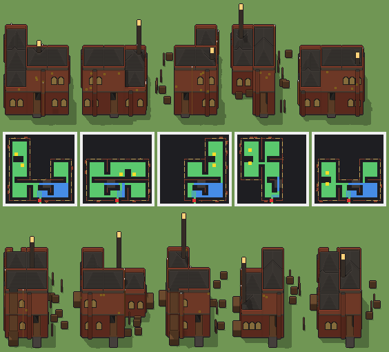

# Cattedrale degli Ingranaggi

Programma: `cattedrale.xml` · ambientazione **steampunk** · classe `grande` (struttura) · senza cantina · 86085 caratteri.



Esito: **passa** — regge a ogni seme e taglia, varia sì, tempo massimo a Enorme 1808 ms (tetto 4500 ms).

## grande — 100 × 100 × 80 voxel, 20 voxel per casella, gradino 4

| seme | ms | piani (quota: testa, stanze) | stanze | cantina | murato | porta | salti | finestre | dettagli | materiali | dominante | sagoma | rilievo | ingombro | fluttuanti | difetti |
|---|---|---|---|---|---|---|---|---|---|---|---|---|---|---|---|---|
| 1 | 906 | 0.1: 1.5, 4 · 1.7: 1.5, 1 | 5 | — | 0.00 | libera, scarto 0.03 | 9 | 31/4 lati | 176/0 vuoti | 11 | 0.37 | 24 | 0.39 | 0.58 | 0 | — |
| 2 | 865 | 0.1: 1.5, 5 · 1.7: 1.5, 1 | 6 | — | 0.00 | libera, scarto 0.03 | 7 | 23/4 lati | 169/0 vuoti | 11 | 0.38 | 24 | 0.39 | 0.57 | 0 | — |
| 3 | 830 | 0.1: 1.5, 3 · 1.7: 1.5, 1 | 4 | — | 0.00 | libera, scarto 0.03 | 7 | 27/4 lati | 158/0 vuoti | 12 | 0.36 | 23 | 0.40 | 0.48 | 0 | — |
| 4 | 805 | 0.1: 1.5, 4 · 1.7: 1.5, 1 | 5 | — | 0.00 | libera, scarto 0.03 | 10 | 25/4 lati | 167/0 vuoti | 12 | 0.35 | 24 | 0.46 | 0.48 | 0 | — |
| 5 | 774 | 0.1: 1.5, 4 · 1.7: 1.5, 1 | 5 | — | 0.00 | libera, scarto 0.03 | 9 | 28/4 lati | 166/0 vuoti | 11 | 0.36 | 25 | 0.40 | 0.49 | 0 | — |

Varianza su 5 semi (mediane delle coppie): voxel 0.62 (≥ 0.2), pianta 0.58 (≥ 0.15), perimetro 0.23 (≥ 0.15), interno 0.60 (≥ 0.35), colore 0.10 (non conta), liste di piani 1 e di stanze 3 (≥ 2), architetture 5/5 (≥ 3). Sopra ogni soglia.

## enorme — 120 × 120 × 96 voxel, 16 voxel per casella, gradino 3

| seme | ms | piani (quota: testa, stanze) | stanze | cantina | murato | porta | salti | finestre | dettagli | materiali | dominante | sagoma | rilievo | ingombro | fluttuanti | difetti |
|---|---|---|---|---|---|---|---|---|---|---|---|---|---|---|---|---|
| 1 | 1548 | 0.1: 1.9, 4 · 2.1: 1.9, 1 | 5 | — | 0.00 | libera, scarto 0.03 | 11 | 25/4 lati | 181/0 vuoti | 12 | 0.36 | 23 | 0.42 | 0.43 | 0 | — |
| 2 | 1682 | 0.1: 1.9, 5 · 2.1: 1.9, 1 | 6 | — | 0.00 | libera, scarto 0.03 | 12 | 23/4 lati | 186/0 vuoti | 12 | 0.36 | 23 | 0.53 | 0.43 | 0 | — |
| 3 | 1765 | 0.1: 1.9, 4 · 2.1: 1.9, 1 | 5 | — | 0.00 | libera, scarto 0.03 | 13 | 26/4 lati | 173/0 vuoti | 12 | 0.34 | 25 | 0.51 | 0.37 | 0 | — |
| 4 | 1730 | 0.1: 1.9, 4 · 2.1: 1.9, 1 | 5 | — | 0.00 | libera, scarto 0.03 | 11 | 26/4 lati | 171/0 vuoti | 12 | 0.34 | 25 | 0.38 | 0.37 | 0 | — |
| 5 | 1808 | 0.1: 1.9, 3 · 2.1: 1.9, 1 | 4 | — | 0.00 | libera, scarto 0.03 | 10 | 25/4 lati | 170/0 vuoti | 12 | 0.35 | 24 | 0.47 | 0.37 | 0 | — |

Varianza su 5 semi (mediane delle coppie): voxel 0.56 (≥ 0.2), pianta 0.26 (≥ 0.15), perimetro 0.18 (≥ 0.15), interno 0.50 (≥ 0.35), colore 0.12 (non conta), liste di piani 1 e di stanze 3 (≥ 2), architetture 5/5 (≥ 3). Sopra ogni soglia.

Misure: `lab/banco/misure.ts` (il corpo del gioco cammina dal davanti: piani raggiunti, murato = pavimento coperto non raggiunto, porta libera, salti; `valido` sono i controlli di `src/mj/check.ts`, fra cui i voxel staccati da terra) e `lab/banco/varianza.ts` (soglie di T180).

## Traccia del seme 1 (Grande, `src/mj/trace.ts`, forma «differenze»)

```text
Traccia, seme 1: griglia 100×100×80, 77 nodi, 724 passi, finito in 856 ms.
x sinistra→destra, y fondo→davanti, z basso→alto; «.» è la cella vuota; #n è il nodo nell'ordine dell'XML; ×n quante volte ha agito.
Lettere: N=browN, E=Emerald, x=botti cerchiate, z=z, a=fondazione, P=Purple, p=purple, Q=aQua, b=tubi di rame, O=ottone, H=Honey, t=teal, s=vapore, g=green, c=cyan, d=dead, dark, v=olive, e=emerald, f=fawn, w=white, X=X, i=indigo, I=ferro brunito, J=Jungle, h=honey, j=jungle, M=Magenta, S=cornice di ghisa, F=tavolato oliato, C=mattoni rossi, W=mattoni a vista, R=tegole di ghisa, V=vetro ambrato, D=ghisa, L=panca di noce, U=blUe, u=blue, T=gradino di ferro, Y=Yellow, G=Green, K=scala di ferro, A=lastre di basalto, k=portone ferrato, n=lanterna, r=red, y=yellow, q=aqua, l=light.
Alla fine: R 28920, S 14163, C 14038, F 6589, W 5970, K 3355, V 2432, D 1444, L 1035, k 330, I 275, b 153, O 80, n 75, A 44, T 22, s 3.
#2-62 prl×29, all×17, one×11: 71688 celle x1-98 y1-99 z0-68, passi 1-558
  .→C 10900: x5 y6-95 z1-9; x35 y77-95 z1-31; +48 scatole, 9501 celle
  .→S 8492: x5-26 y5-95 z32; x35-95 y65-95 z64; +34 scatole, 4599 celle
  .→F 6589: x6-34 y6-34 z1; x66-94 y36-64 z1; +18 scatole, 4907 celle
  E→S 5671: x5-26 y5-95 z0; x65-95 y35-95 z0; +8 scatole, 1778 celle
  .→U 5530: x6-34 y5 z10-23; x5 y6-34 z10-23; +13 scatole, 4718 celle
  .→R 5098: x6-34 y6-34 z33; x66-94 y36-64 z33; +12 scatole, 3416 celle
  .→W 4788: x36-94 y95 z34-41; x57-61 y96-97 z34-63; +29 scatole, 4016 celle
  E→z 2441: x36-64 y36-46 z0; x66-94 y6-15 z0; +27 scatole, 1832 celle
  .→u 2282: x36-64 y65 z42-55; x66-94 y65 z42-55; +5 scatole, 1470 celle
  .→K 352: x65 y66-76 z1-32
  .→k 330: x45-55 y95 z2-31
  .→w 290: x6-34 y5 z38; x5 y6-34 z38; +8 scatole, 232 celle
  .→X 105: x36-64 y65 z68; x95 y66-94 z68; +3 scatole, 47 celle
  E→G 90: x37 y10-18 z0; x65 y14-22 z0; +8 scatole, 72 celle
  .→i 76: x17-34 y65 z34; x27-31 y3-4 z34; +12 scatole, 48 celle
  E→A 44: x45-55 y96-99 z0
  .→J 36: x66-83 y65 z68; x35 y77-94 z68
  .→h 33: x22-34 y35 z34; x6-16 y65 z34; +1 scatole, 9 celle
  .→G 25: x73-81 y93-94 z1; x15-21 y35 z1
  .→j 22: x84-94 y65 z68; x35 y66-76 z68
  .→T 11: x48 y66-76 z1
  .→Y 11: x49 y66-76 z1
  .→M 11: x45-55 y95 z68
  N→z 1: x50 y50 z0
#63-77 all×5, prl×6, one×3: 42600 celle x0-99 y0-99 z0-79, passi 559-724
  .→R 23713: x66-93 y67-93 z66; x7-33 y7-33 z34; +337 scatole, 22228 celle
  .→K 2981: x49-64 y66-76 z2-3; x50-64 y66-76 z4-5; +14 scatole, 2299 celle
  U→C 2674: x36-44 y95 z10-23; x56-64 y95 z10-23; +184 scatole, 2422 celle
  z→. 2442: x36-64 y36-46 z0; x66-94 y6-15 z0; +24 scatole, 1833 celle
  U→V 1792: x8-14 y5 z12-19; x22-28 y5 z12-19; +82 scatole, 1680 celle
  E→. 1753: x0-99 y0-2 z0; x0-2 y15-99 z0; +18 scatole, 1198 celle
  u→W 1262: x36-44 y95 z42-55; x56-64 y95 z42-55; +66 scatole, 1010 celle
  U→D 1064: x5 y7-33 z11; x65 y37-63 z11; +212 scatole, 1010 celle
  .→L 920: x73-81 y93-94 z2-9; x37 y10-18 z1-8; +10 scatole, 704 celle
  u→V 640: x44-50 y65 z44-51; x54-60 y65 z44-51; +28 scatole, 528 celle
  u→D 380: x95 y74-91 z43; x35 y75-92 z43; +74 scatole, 344 celle
  w→C 290: x6-34 y5 z38; x5 y6-34 z38; +8 scatole, 232 celle
  .→I 275: x51-55 y69-73 z66-76
  .→b 153: x58 y64 z1-68; x59 y98 z1-47; +1 scatole, 38 celle
  G→L 115: x73-81 y93-94 z1; x37 y10-18 z0; +10 scatole, 88 celle
  X→C 105: x36-64 y65 z68; x95 y66-94 z68; +3 scatole, 47 celle
  W→O 80: x50 y95 z51-54; x45-47 y65 z35; +36 scatole, 73 celle
  i→R 76: x17-34 y65 z34; x27-31 y3-4 z34; +12 scatole, 48 celle
  .→n 75: x51-55 y69-73 z77-79
  J→C 36: x66-83 y65 z68; x35 y77-94 z68
  h→R 33: x22-34 y35 z34; x6-16 y65 z34; +1 scatole, 9 celle
  .→T 22: x64-65 y66-76 z33
  j→C 22: x84-94 y65 z68; x35 y66-76 z68
  T→K 11: x48 y66-76 z1
  Y→K 11: x49 y66-76 z1
  M→C 11: x45-55 y95 z68
  .→s 3: x13 y4 z39; x59 y98 z48; +1 scatole, 1 celle
Senza effetto (non hanno mai cambiato una cella):
#40 prl */* */* */* */* */* */* */* */* */* */* */* */*… → */* */* */* */* */* */* */* */* */* */* */* */*… passi=1: in quel momento nella griglia non c'erano celle "r"
#47 prl * * * * * * * * * * * * * * * * * * * * * * * *… → * * * * * * * * * * * * * * * * * * * * * * * *… passi=1
#49 prl * * * * * * * * * * * * * * * * * * * * * * * *… → * * * * * * * * * * * * * * * * * * * * * * * *… passi=1: in quel momento nella griglia non c'erano celle "r"
#50 one ***************/***************/***************… → ***************/***************/***************… passi=2: le celle cercate c'erano, ma mai disposte come nel pattern
#75 prl g → n: in quel momento nella griglia non c'erano celle "g"
```
