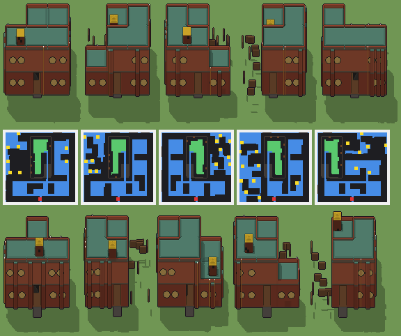

# Osservatorio a vapore, con la sala delle caldaie

Programma: `osservatorio.xml` · ambientazione **steampunk** · classe `grande` (struttura) · **con cantina** (`suolo="E"`, `ground="Z"`, `sotto: 1`) · 88356 caratteri.



Esito: **passa** — regge a ogni seme e taglia, varia sì, tempo massimo a Enorme 2578 ms (tetto 4500 ms).

## grande — 100 × 100 × 100 voxel, 20 voxel per casella, gradino 4

| seme | ms | piani (quota: testa, stanze) | stanze | cantina | murato | porta | salti | finestre | dettagli | materiali | dominante | sagoma | rilievo | ingombro | fluttuanti | difetti |
|---|---|---|---|---|---|---|---|---|---|---|---|---|---|---|---|---|
| 1 | 1503 | -0.9: 2.5, 0 · 0.1: 1.5, 3 · 1.7: 1.5, 2 | 5 | 1.76 | 0.00 | libera, scarto 0.03 | 8 | 38/4 lati | 521/0 vuoti | 15 | 0.23 | 10 | 0.33 | 0.67 | 0 | — |
| 2 | 1560 | -0.9: 2.5, 0 · 0.1: 1.5, 3 · 1.7: 1.5, 2 | 5 | 1.77 | 0.00 | libera, scarto 0.03 | 6 | 31/4 lati | 518/0 vuoti | 16 | 0.23 | 9 | 0.36 | 0.67 | 0 | — |
| 3 | 1529 | -0.9: 2.5, 0 · 0.1: 1.5, 3 · 1.7: 1.5, 2 | 5 | 1.77 | 0.00 | libera, scarto 0.03 | 7 | 28/4 lati | 489/0 vuoti | 15 | 0.23 | 10 | 0.38 | 0.67 | 0 | — |
| 4 | 1641 | -0.9: 2.5, 0 · 0.1: 1.5, 2 · 1.7: 1.5, 2 | 4 | 1.75 | 0.00 | libera, scarto 0.03 | 10 | 30/4 lati | 446/0 vuoti | 16 | 0.22 | 10 | 0.29 | 0.57 | 0 | — |
| 5 | 1439 | -0.9: 2.5, 0 · 0.1: 1.5, 3 · 1.7: 1.5, 2 | 5 | 1.74 | 0.00 | libera, scarto 0.03 | 7 | 36/4 lati | 495/0 vuoti | 16 | 0.23 | 9 | 0.35 | 0.67 | 0 | — |

Varianza su 5 semi (mediane delle coppie): voxel 0.61 (≥ 0.2), pianta 0.42 (≥ 0.15), perimetro 0.16 (≥ 0.15), interno 0.69 (≥ 0.35), colore 0.10 (non conta), liste di piani 1 e di stanze 2 (≥ 2), architetture 5/5 (≥ 3). Sopra ogni soglia.

## enorme — 120 × 120 × 112 voxel, 16 voxel per casella, gradino 3

| seme | ms | piani (quota: testa, stanze) | stanze | cantina | murato | porta | salti | finestre | dettagli | materiali | dominante | sagoma | rilievo | ingombro | fluttuanti | difetti |
|---|---|---|---|---|---|---|---|---|---|---|---|---|---|---|---|---|
| 1 | 2546 | -0.9: 2.9, 1 · 0.1: 1.9, 4 · 2.1: 1.9, 2 | 7 | 3.02 | 0.00 | libera, scarto 0.03 | 3 | 33/4 lati | 513/0 vuoti | 16 | 0.23 | 10 | 0.42 | 0.47 | 0 | — |
| 2 | 2499 | -0.9: 2.9, 1 · 0.1: 1.9, 3 · 2.1: 1.9, 2 | 6 | 2.99 | 0.00 | libera, scarto 0.03 | 7 | 30/4 lati | 472/0 vuoti | 16 | 0.23 | 11 | 0.31 | 0.41 | 0 | — |
| 3 | 2448 | -0.9: 2.9, 1 · 0.1: 1.9, 4 · 2.1: 1.9, 2 | 7 | 2.96 | 0.00 | libera, scarto 0.03 | 6 | 22/4 lati | 468/0 vuoti | 16 | 0.24 | 10 | 0.39 | 0.47 | 0 | — |
| 4 | 2369 | -0.9: 2.9, 1 · 0.1: 1.9, 4 · 2.1: 1.9, 2 | 7 | 2.98 | 0.00 | libera, scarto 0.03 | 11 | 33/4 lati | 502/0 vuoti | 16 | 0.24 | 10 | 0.38 | 0.47 | 0 | — |
| 5 | 2578 | -0.9: 2.9, 1 · 0.1: 1.9, 3 · 2.1: 1.9, 2 | 6 | 3.00 | 0.00 | libera, scarto 0.03 | 8 | 27/4 lati | 411/0 vuoti | 16 | 0.23 | 11 | 0.32 | 0.41 | 0 | — |

Varianza su 5 semi (mediane delle coppie): voxel 0.60 (≥ 0.2), pianta 0.37 (≥ 0.15), perimetro 0.23 (≥ 0.15), interno 0.67 (≥ 0.35), colore 0.10 (non conta), liste di piani 1 e di stanze 2 (≥ 2), architetture 5/5 (≥ 3). Sopra ogni soglia.

Misure: `lab/banco/misure.ts` (il corpo del gioco cammina dal davanti: piani raggiunti, murato = pavimento coperto non raggiunto, porta libera, salti; `valido` sono i controlli di `src/mj/check.ts`, fra cui i voxel staccati da terra) e `lab/banco/varianza.ts` (soglie di T180).

## Traccia del seme 1 (Grande, `src/mj/trace.ts`, forma «differenze»)

```text
Traccia, seme 1: griglia 100×100×100, 88 nodi, 844 passi, finito in 1449 ms.
x sinistra→destra, y fondo→davanti, z basso→alto; «.» è la cella vuota; #n è il nodo nell'ordine dell'XML; ×n quante volte ha agito.
Lettere: N=browN, E=Emerald, x=botti cerchiate, z=z, a=fondazione, P=Purple, p=purple, Q=aQua, b=tubi di rame, O=cupola di ottone, H=Honey, t=teal, s=vapore, g=green, c=cyan, d=dead, dark, v=finestra a oblò, e=emerald, w=white, X=X, i=indigo, I=mattoni della torre, J=Jungle, h=honey, j=jungle, M=Magenta, S=cornice di ghisa, F=tavolato oliato, C=mattoni rossi, W=mattoni a vista, R=lamiera di rame verderame, V=vetro ambrato, D=ghisa, L=panca di noce, U=blUe, u=blue, T=gradino di ferro, Y=Yellow, G=Green, K=scala di ferro, A=lastre di basalto, k=portone ferrato, n=brown, y=yellow, q=aqua, l=light, m=magenta, o=orange, Z=Z.
Alla fine: R 20031, S 15142, C 14537, W 8359, K 7816, F 6622, a 3402, V 2135, A 1732, I 1501, x 1224, L 1035, D 980, k 330, b 237, O 121, v 72, T 22, s 4.
#2-63 prl×31, all×21, one×10: 78457 celle x1-98 y1-99 z20-88, passi 1-588
  .→C 11371: x65 y6-65 z21-51; +44 scatole, 9511 celle
  .→S 10474: x5-95 y65-95 z84; +38 scatole, 7653 celle
  .→F 6622: x6-34 y66-94 z21; +22 scatole, 5781 celle
  .→W 6422: x6-94 y95 z54-61; +34 scatole, 5710 celle
  .→R 6029: x36-64 y6-64 z53; +17 scatole, 4318 celle
  E→S 4830: x77-95 y5-95 z20; +11 scatole, 3101 celle
  .→U 4718: x36-64 y5 z30-43; +12 scatole, 4312 celle
  .→u 3094: x6-34 y65 z62-75; +8 scatole, 2688 celle
  E→l 1687: x36-64 y6-49 z20; +5 scatole, 411 celle
  E→z 1601: x6-21 y8-26 z20; +25 scatole, 1297 celle
  .→K 352: x35 y66-76 z21-52
  .→k 330: x45-55 y95 z22-51
  .→w 174: x36-64 y5 z58; +5 scatole, 145 celle
  .→X 163: x6-34 y65 z88; +6 scatole, 134 celle
  E→G 90: x26-34 y5 z20; +9 scatole, 81 celle
  .→i 84: x65 y5-64 z54; +6 scatole, 24 celle
  E→A 44: x45-55 y96-99 z20
  .→J 36: x36-53 y65 z88; +1 scatole, 18 celle
  .→G 25: x74-82 y6-7 z21; +1 scatole, 7 celle
  E→K 23: x54-64 y63-64 z20; +1 scatole, 1 celle
  .→h 22: x66-82 y35 z54; +1 scatole, 5 celle
  .→j 22: x54-64 y65 z88; +1 scatole, 11 celle
  .→N 12: x54-64 y63 z21; +1 scatole, 1 celle
  .→m 11: x54-64 y64 z21
  .→Y 11: x51 y66-76 z21
  .→T 11: x52 y66-76 z21
  .→M 11: x45-55 y95 z88
  N→l 1: x50 y50 z20
#64-70 all×4, prl×3: 71046 celle x35-65 y5-65 z0-21, passi 589-637
  .→a 3078: x35 y6-64 z1-19; +3 scatole, 1957 celle
  Z→A 1688: x36-64 y6-62 z0; +2 scatole, 35 celle
  l→. 1688: x36-64 y6-62 z20; +2 scatole, 35 celle
  .→K 350: x55-64 y33-38 z6; +7 scatole, 290 celle
  Z→a 162: x35 y6-64 z0; +3 scatole, 103 celle
  S→a 162: x35 y6-64 z20; +3 scatole, 103 celle
  m→K 11: x54-64 y64 z21
  .→N 11: x55-64 y27 z3; +1 scatole, 1 celle
  .→m 11: x55-64 y28 z3; +1 scatole, 1 celle
  N→K 11: x55-64 y63 z21; +1 scatole, 1 celle
#71-88 prl×9, all×4, one×4: 48007 celle x0-99 y0-99 z0-99, passi 638-844
  .→R 13896: x37-63 y7-63 z54; +62 scatole, 12357 celle
  Z→. 8150: x0-34 y6-99 z0; +8 scatole, 4860 celle
  .→K 7024: x55-64 y33-64 z3-5; +26 scatole, 6064 celle
  U→C 2760: x36-44 y95 z30-43; +283 scatole, 2634 celle
  u→W 1937: x36-44 y95 z62-75; +172 scatole, 1811 celle
  E→. 1724: x0-5 y6-64 z20; +16 scatole, 1370 celle
  z→. 1601: x6-21 y8-26 z20; +25 scatole, 1297 celle
  .→I 1501: x22-30 y85-90 z91-98; +17 scatole, 1069 celle
  U→V 1342: x44-46 y5 z33-41; +109 scatole, 1315 celle
  .→x 1224: x63-64 y18-20 z1-51; +3 scatole, 918 celle
  .→L 920: x74-82 y6-7 z22-29; +11 scatole, 776 celle
  u→V 793: x13-15 y65 z65-73; +64 scatole, 766 celle
  U→D 616: x78-79 y5 z36-38; +258 scatole, 610 celle
  u→D 364: x19-20 y65 z68-70; +152 scatole, 358 celle
  .→b 237: x8 y64 z21-88; +3 scatole, 169 celle
  w→C 174: x36-64 y5 z58; +5 scatole, 145 celle
  X→C 163: x6-34 y65 z88; +6 scatole, 134 celle
  .→O 121: x21-31 y81-91 z99
  G→L 115: x74-82 y6-7 z21; +11 scatole, 97 celle
  i→R 84: x65 y5-64 z54; +6 scatole, 24 celle
  .→v 72: x31 y84-86 z86-89; +5 scatole, 60 celle
  J→C 36: x36-53 y65 z88; +1 scatole, 18 celle
  .→T 22: x35-36 y66-76 z53
  h→R 22: x66-82 y35 z54; +1 scatole, 5 celle
  j→C 22: x54-64 y65 z88; +1 scatole, 11 celle
  N→K 12: x55-64 y27 z3; +2 scatole, 2 celle
  Y→K 11: x51 y66-76 z21
  T→K 11: x52 y66-76 z21
  M→C 11: x45-55 y95 z88
  m→K 11: x55-64 y28 z3; +1 scatole, 1 celle
  .→s 4: x73 y2 z54; +3 scatole, 3 celle
Senza effetto (non hanno mai cambiato una cella):
#85 prl ***/*.*/*** *O*/OOO/*O* → ***/*O*/*** ***/***/***: le celle cercate c'erano, ma mai disposte come nel pattern
```
