# Vestiti e armature addosso: il banco che decide come (T289)

L'autore (05/11, `docs/userchats/to-do-2026-11-05.md`): per gli attrezzi la stessa mesh di quando sono a terra (fatto da T288, ADR-0167);
«per i vestiti e l'armatura va deciso», forse due mesh, una a terra e una indossata, che «eventualmente potrebbe essere solo una modifica
alla mesh dell'NPC». E da `docs/pipeline/domande/T232.md`: non rigenerare tutti i modelli, costa caro.

Il banco prova tre vie sugli stessi tre oggetti (un **elmo**, una **corazza**, un **mantello**) e sugli stessi due corpi (il **viandante**
e il **lupo** del seme, una creatura a quattro zampe), poi lo stesso abito su **27 corpi** del seme e generati (Cantiere 8). Niente
chiamate ai modelli: gli oggetti li ho scritti a mano come li scriverebbe lo Scultore. Il gioco non cambia.

## In breve

| | A · due programmi | B · un programma con `<worn>` | C · colori del kernel |
|---|---|---|---|
| cosa è | un secondo programma per oggetto, la sua mesh stirata sulla zona del corpo | il programma a terra ha una sezione `<worn>`: regole che riscrivono il corpo di chi lo indossa | il kernel ricolora la zona coi due colori dell'oggetto e aggiunge poche celle (la caduta del mantello) |
| sul viandante | si legge, ma è un guscio rigido più grande del corpo | aderisce, con forma propria (cresta, gorgiera, falda) | aderisce, forma del corpo, solo colori |
| sul lupo e sui corpi generati | **una scatola** su ogni quadrupede, un casco gigante sui gerboa | gualdrappe, piastre, chanfrein: si leggono | coperte dipinte: si leggono, la corazza grigia su un lupo grigio quasi non si vede |
| tempo per vestizione (viandante / lupo) | 0 dopo le zone (3 / 7 ms una volta per forma) | 14 / 34 ms nel worker (zone, regole, mesh del corpo) | 9 / 23 ms nel worker (zone, ricolore, mesh) |
| memoria | una mesh per oggetto (150-165 KB) per tutti | una mesh del corpo per forma × abito (413 / 954 KB) | come B, quasi senza voxel in più (373 / 786 KB) |
| chiamate di disegno | +1 mesh per pezzo indossato (×3 passate) | nessuna in più | nessuna in più |
| modelli da scrivere per universo | **+1 per ogni oggetto da indossare** | nessuno (≈ 263 token in più nella stessa richiesta) | nessuno |
| costo stimato con lo Scultore | +0,0195 $ per oggetto (30 oggetti: +0,58 $) | +0,001 $ per oggetto (30: +0,03 $) | 0 |
| oggetti che esistono già | non si vedono finché non si scolpisce il secondo programma | senza `<worn>`: si ricade su C | si vedono subito |

**Raccomandazione: C come pavimento, B dove lo Scultore lo scrive.** Ogni cosa da indossare si vede subito con C, anche quelle che
esistono (zero modelli, zero costo, nessuna rigenerazione: la regola di T232); lo Scultore, quando scolpisce un oggetto da indossare
nuovo, scrive anche la sua sezione `<worn>` nella stessa richiesta (B), e il kernel usa C se manca, se non passa il validatore o se non
fa niente. A no: raddoppia i modelli di ciò che si indossa, e un guscio rigido scritto per una persona non veste nessun altro corpo.
Il prezzo di B e C è la mesh del corpo rifatta per ogni forma × abito (sotto, «Le misure»): si paga nel worker, non nel thread
della pagina, e solo quando qualcuno si cambia.

## Le foto

Tutte a cartone, come il gioco disegna il mondo (`cartoonRender` di `src/mj/photo.ts`); in 3D nella pagina del laboratorio, sotto.

### Una accanto all'altra

Righe: **A, B, C**. Colonne: l'elmo di fronte, la corazza di fronte, il mantello da dietro, l'abito intero di fronte, di fianco (destra),
da dietro.

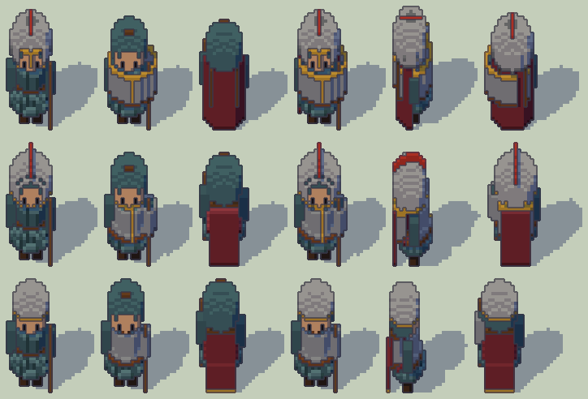

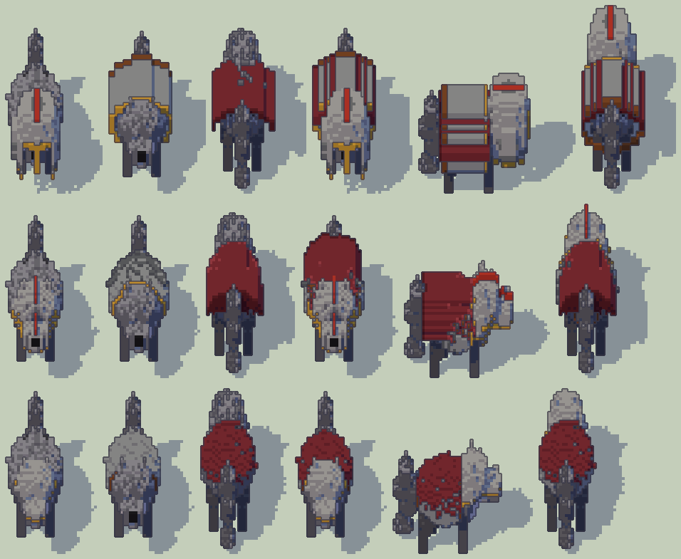

### Da quattro lati

Ogni foglio: righe **nudo, A, B, C**; colonne **fronte, destra, retro, sinistra**.

| | viandante (seme 2) | lupo (seme 1) |
|---|---|---|
| elmo | [viandante-elmo.png](indossati/foto/viandante-elmo.png) | [lupo-elmo.png](indossati/foto/lupo-elmo.png) |
| corazza | [viandante-corazza.png](indossati/foto/viandante-corazza.png) | [lupo-corazza.png](indossati/foto/lupo-corazza.png) |
| mantello | [viandante-mantello.png](indossati/foto/viandante-mantello.png) | [lupo-mantello.png](indossati/foto/lupo-mantello.png) |
| tutto | 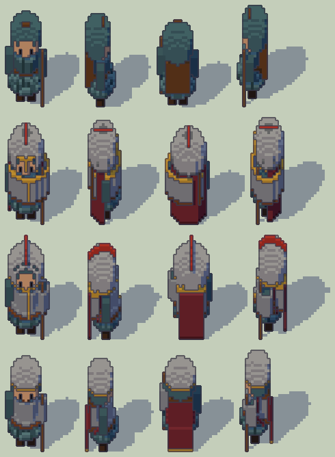 | 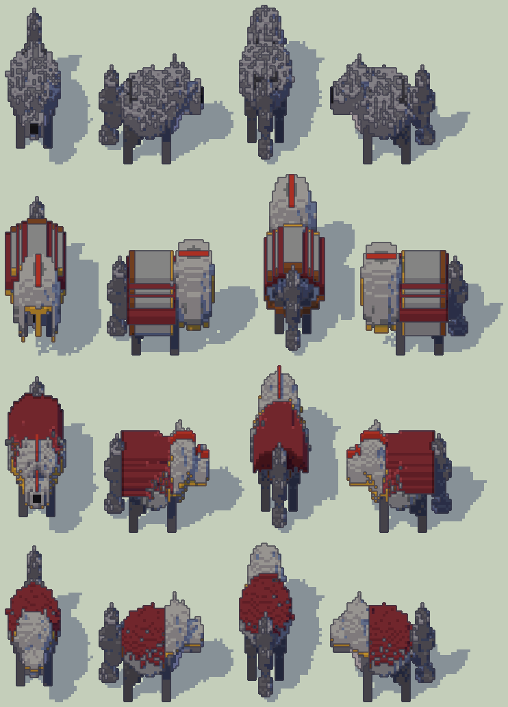 |

Le zone di ogni corpo (testa rossa, busto blu, schiena verde, arti grigi): [viandante](indossati/foto/viandante-zone.png),
[lupo](indossati/foto/lupo-zone.png). Gli oggetti a terra da quattro lati, e a destra i programmi indossati di A da davanti e da
dietro: [oggetti.png](indossati/foto/oggetti.png).

### Tutti i semi, i corpi generati

Righe: **nudo (o le zone), A, B, C**, l'abito intero. Le persone di fronte, le bestie di fianco.

- [viandante-semi.png](indossati/foto/viandante-semi.png): gli otto semi. Con il cappello a tesa larga (semi 1, 3, 5) A mette un elmo
  più largo, sopra il cappello; B e C fanno del cappello un cappello di ferro (un *kettle hat*): seguono il corpo, anche dove non
  dovrebbero.
- [lupo-semi.png](indossati/foto/lupo-semi.png): i quattro semi del lupo (testa alta, testa bassa, coda alzata).
- 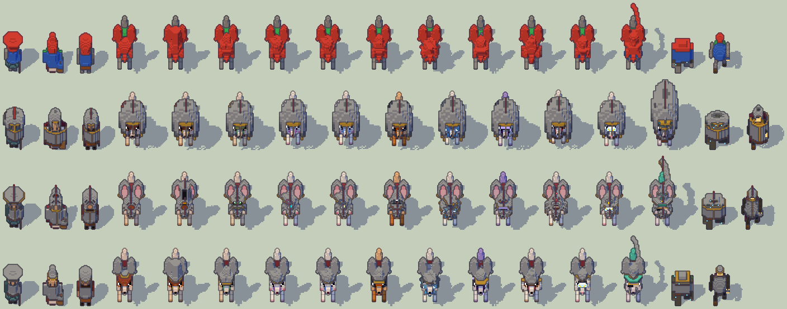
  viandante, contadina, fabbro, gli undici gerboa della corona, il golem runico e l'automa sentinella del Cantiere 8.
- 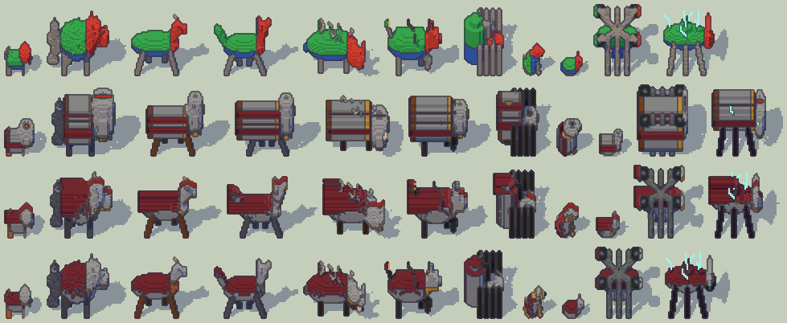
  gatto, lupo, cervo reale, lupo dei boschi, cinghiale corazzato, segugio d'ottone, ragno meccanico, cane randagio, gatto urbano,
  drone esapode, xenofauna cristallina.

### Nel browser

La pagina `/lab/indossati/` mette le tre vie una accanto all'altra in 3D, con la luce a cartone del gioco, ferme o in cammino, girate
di un quarto alla volta. Lì **A è com'è nel gioco**: la figura nuda e una mesh a parte per pezzo, stirata sulla zona (i voxel non sono più
cubi dove la zona non è quella del viandante); B e C sono la figura nuova, con il suo rig. Catture (Chrome, build e `vite preview`):

| | |
|---|---|
| 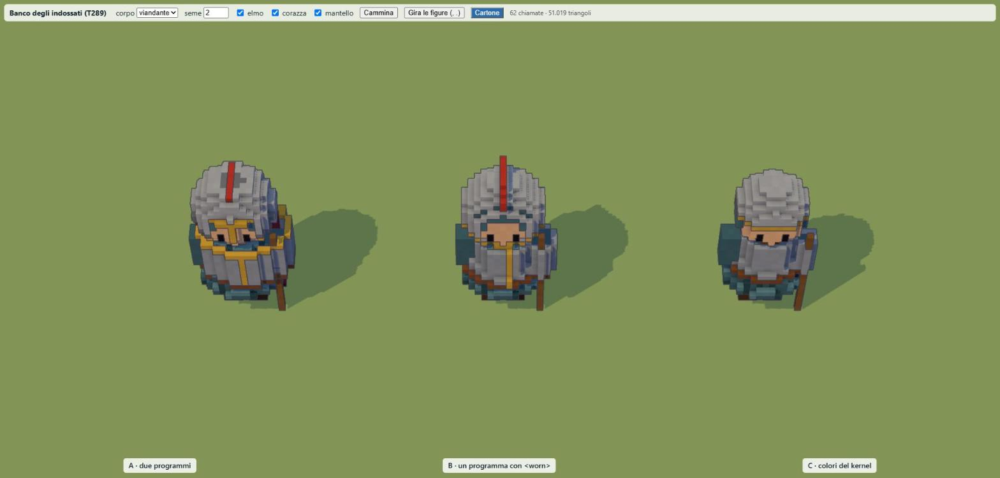 | 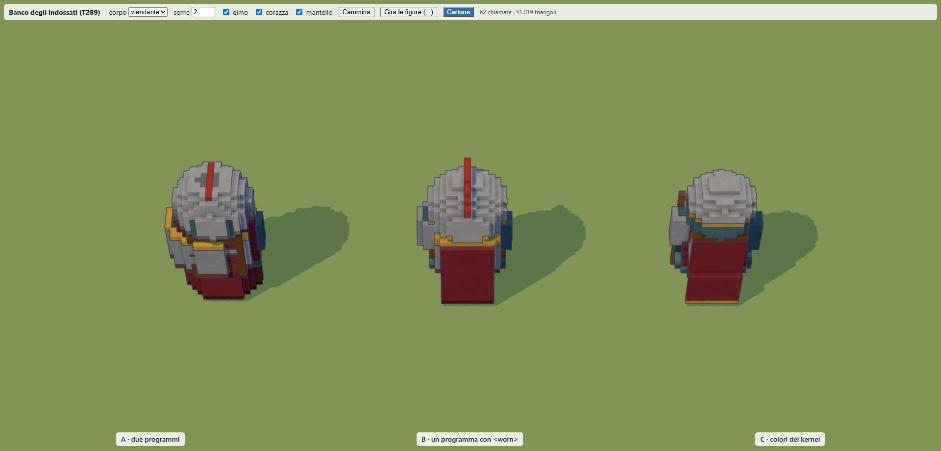 |
| 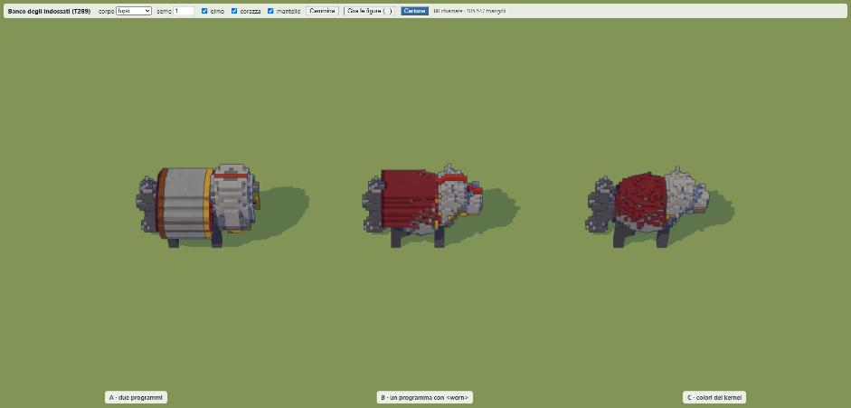 | 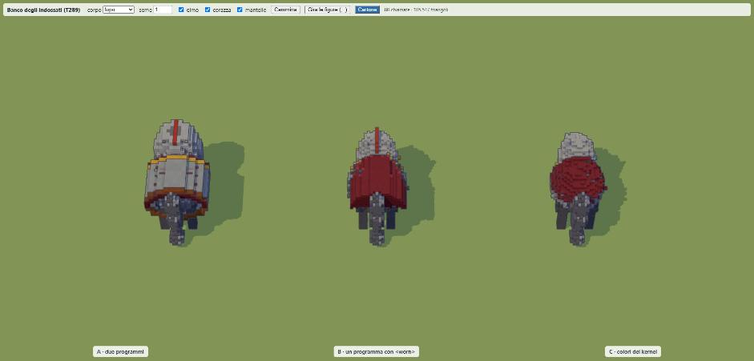 |
| 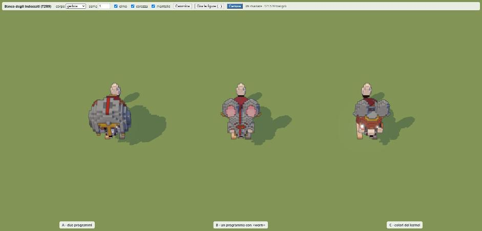 | 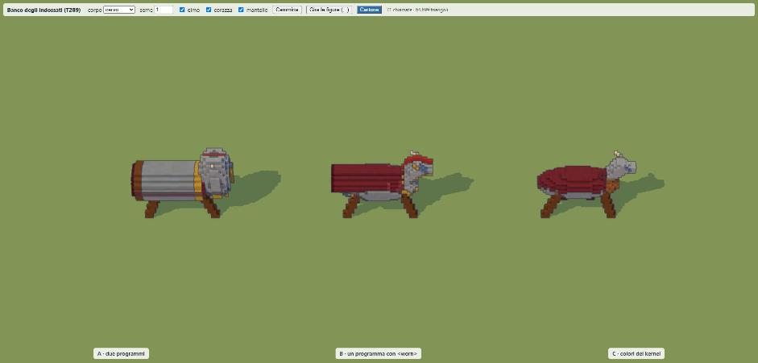 |

Le altre in [`indossati/browser/`](indossati/browser/): i quattro lati del viandante, il passo del viandante e del lupo, il golem.

## Come funzionano, nel banco

Tutte e tre partono dalle **zone del corpo** (`indossati/body.ts`), trovate dai voxel e dal rig come la mano di T288, senza una tabella
per corpo:

- **il piano del corpo**: con tre zampe o più sta a quattro zampe (asse lungo y), con due o nessuna in piedi (asse lungo z);
- **il nucleo**: i voxel visibili che non sono un arto del rig; la pelle di un arto dipinta con una lettera senza `part` (la luce sulla
  coda del lupo) torna all'arto;
- **il collo**: lungo l'asse lungo, la fetta del nucleo più stretta rispetto alla più larga da ciascun lato; la **testa** è oltre (o la
  parte `head` della palette, se c'è: gatto, gerboa); senza restringimento, una quota del corpo. Per fetta contano solo i pezzi
  principali: il bastone accanto al cappuccio non è la testa;
- **il busto**: dai fianchi al collo; la **schiena**: la sua metà dietro (in piedi) o di sopra (a quattro zampe);
- **il sistema della zona**: un busto a quattro zampe si gira di un quarto attorno a x, così sta in piedi con la schiena verso −y come
  il viandante. Un programma o una regola si scrivono una volta, in quel sistema, per ogni corpo.

Su 27 corpi le tre zone si trovano sempre (`riepilogo.md`); i fogli mostrano dove sono (la prima riga dei corpi generati). I gerboa
hanno nella testa le orecchie (la loro palette le chiama testa): elmo e mantello le coprono.

**A** (`items/<oggetto>-worn.xml`): il secondo programma è scritto per la scatola della zona del viandante (la testa con un voxel attorno
e uno sopra; il busto con un voxel attorno; dietro la schiena, dal suolo alle spalle). Gira una volta; il kernel lo stira asse per
asse sulla scatola della zona di chi lo indossa (`fitBox`). Sul viandante è in scala 1; altrove si deforma.

**B** (`<worn zone="…">` in `items/<oggetto>.xml`): prima delle regole il kernel scrive su una copia del corpo quattro lettere: `z` i
voxel della zona, `o` il resto del corpo, `r` l'aria dove l'oggetto può stare (attorno alla testa, al busto, dietro la schiena fino al
suolo), `m` la stessa aria sulla linea di mezzo; le lettere del corpo le regole non le vedono. Dopo, `z` e `o` tornano come erano, `r` e
`m` aria: resta ciò che le regole hanno scritto con le lettere dell'oggetto. L'elmo, per esempio:

```xml
<worn zone="head">
  <all>
    <rule in="[rm] z" out="I z"/>   <!-- sopra la testa -->
    <rule in="[rm]/z" out="I/z"/>   <!-- dietro -->
    <rule in="[rm]z" out="Iz"/>     <!-- ai lati; davanti no: il viso resta libero -->
    <rule in="z[rm]" out="zI"/>
  </all>
  <all steps="2" in="*/I z/[rm]" out="*/* */I"/>   <!-- la fronte scende di due voxel -->
  <all in="m I" out="R I"/>                         <!-- la cresta sulla linea di mezzo -->
  <all steps="1" in="m R" out="R R"/>
  <all in="I [rmoB]" out="G *"/>                    <!-- l'orlo d'ottone dove il guscio finisce -->
</worn>
```

**C** (nel kernel, `wearC`): i voxel esterni della zona prendono i due colori più usati del programma a terra dell'oggetto (il secondo
non una sfumatura del primo: ferro e ottone, non ferro e ferro in ombra). Elmo: la parte alta della testa, l'anello più basso nel
secondo colore; corazza: i lati del busto, la prima e l'ultima fila nel secondo; mantello: la schiena, più un voxel di caduta fino al
suolo per chi sta in piedi (le uniche celle aggiunte).

Più pezzi si indossano dal più esterno (mantello, corazza, elmo): uno dopo non scrive mai sopra uno prima.

## Le misure

Da `npx vite-node lab/scripts/indossati.ts` ([`indossati/riepilogo.md`](indossati/riepilogo.md), [`misure.json`](indossati/misure.json)),
in Node su questa macchina con altri agenti al lavoro: le mediane sui semi, tre esecuzioni ciascuna.

**Tempo per viandante.** A ogni cambio d'abito: A non rifà niente (crea gli oggetti three.js, come T288 per ciò che si impugna); le
zone si leggono una volta per forma del corpo, 3 ms il viandante, 7 ms il lupo. B: le regole (5 ms, 11 il lupo) e le mesh del corpo
vestito (6,5 ms, 17 il lupo), con le zone 14 ms e 34 ms. C: 0,6 ms di ricolore e le mesh, 9 e 23 ms. Variano di qualche punto da
un'esecuzione all'altra: i numeri dell'ultima sono in `riepilogo.md`. Tutto nel worker delle forme, come
oggi un'azione che cambia un modello (`changedBody`): sessanta viandanti che si cambiano insieme sono circa 0,8 s di worker con B,
0,5 s con C, niente con A. Il programma indossato di A costa 2-3 ms una volta per oggetto, la sua mesh 4-5 ms.

**Memoria.** A: una mesh per oggetto, 150-165 KB, condivisa da chi lo indossa. B e C: ogni forma del corpo con ogni abito è una figura
nuova con le sue mesh (corpo e arti): il viandante nudo 365 KB, vestito B 413 KB, C 373 KB; il lupo 786, 954, 786 KB. Trenta individui
con abiti diversi sono trenta figure: circa 12 MB con B, 11 MB con C, contro 3 MB di otto forme nude e 0,5 MB dei tre pezzi di A; il
tetto delle geometrie che nulla disegna è 128 MB (`GEOMETRY_BYTES`). Un abito uguale sulla stessa forma si condivide.

**Chiamate di disegno.** A aggiunge una mesh per pezzo indossato, che il cartone disegna tre volte (scena, ombre, inchiostro, come
misurato da T288): l'abito intero sono 9 chiamate in più per figura. B e C nessuna.

**Aderenza** (distanza media dei voxel dell'oggetto dal corpo nudo; 0 è un voxel del corpo ricolorato, 1 un voxel appoggiato):

| corpi | A | B | C |
|---|---|---|---|
| viandante, contadina, fabbro, golem, automa | 1,0-2,3 | 1,1-2,2 | 0,1-0,4 |
| gli undici gerboa | 2,8-4,7 | 1,4-1,5 | 0,0-0,2 |
| bestie e animali (11) | 1,3-3,8 | 1,1-2,1 | 0 |

Sul lupo B ha il 23 % dei voxel a 3 o più dal corpo: il mantello, che su un dorso curvo «cade» verso la coda e riempie l'aria sopra la
groppa (una gualdrappa spessa). A ne ha il 44 %.

**Lo Scultore.** Una cosa semplice costa due programmi su `gemini-3.1-flash-lite` e due giudizi dell'Artista su `gemini-3.5-flash`, con
i pesi della stima oraria (`src/kernel/coefficients.ts`): 0,0193 $. A raddoppia questo costo per ogni oggetto da indossare e consuma
due posti del tetto dei modelli (`ai.maxModels`, 40) invece di uno; B aggiunge in media 263 token in uscita a ciascuno dei due
programmi e un paragrafo del prompt (≈ 300 token), 0,0009 $; C niente. Quanti oggetti da indossare ha un universo dipende dai pacchetti
del Narratore (il seme ne ha 2 su 31: mantello e stivali; il prompt chiede di variare fra dieci categorie): per 10, 30, 100 oggetti A
costa 0,19, 0,58, 1,95 $, B 0,01, 0,03, 0,09 $.

**I corpi generati.** Le zone si trovano su tutti e 27; le regole di B finiscono sempre entro il tempo. A dà una scatola su ogni
quadrupede e un elmo gigante sui gerboa (lo stira sulle orecchie): con A ogni classe di corpo vorrebbe il suo programma indossato,
cioè un modello per oggetto per classe. B e C seguono il corpo così com'è: il cappello del viandante diventa di ferro, le orecchie del
gerboa si corazzano.

**Gli oggetti che esistono già.** Oggi i pacchetti hanno `slot` («testa, corpo, gambe, piedi, mani, arma, scudo, anello…»,
`src/kernel/types.ts`) e un colore; molti non hanno un modello (si disegnano col generico `object` nel loro colore). Con A nessuno ha
il secondo programma: non si vedrebbero finché lo Scultore non li scolpisce, uno per uno, cioè la rigenerazione che l'autore non vuole.
Con B nessuno ha `<worn>`: si ricade su C. Con C si vedono tutti subito; senza modello i colori vengono dal generico `object` tinto
col colore del pacchetto, quindi il primo è quello.

## La domanda per l'autore

È anche in [`docs/pipeline/domande/T289.md`](../../docs/pipeline/domande/T289.md).

**Come si vede addosso un vestito o un'armatura?**

- **A. Due programmi per oggetto**, a terra e indossato, una mesh a parte agganciata al corpo. Nessuna mesh del corpo rifatta, ma un
  modello in più per ogni oggetto da indossare, nessuno degli oggetti di oggi si vede, e sui corpi non umani è una scatola.
- **B. Un programma con `<worn>`**: le regole dell'oggetto riscrivono il corpo di chi lo indossa. Aderisce e ha la sua forma; costa
  ≈ 0,001 $ per oggetto; gli oggetti di oggi non l'hanno.
- **C. Solo il kernel**: i colori dell'oggetto sulla zona e poche celle. Gratis e subito per tutto; un elmo è un berretto del colore
  dell'elmo, una corazza grigia su un corpo grigio quasi non si vede.
- **C + B (consigliata)**: C per tutto da subito, B per ciò che lo Scultore scolpisce da qui in avanti, C quando B manca o fallisce.

Con B e C, sotto-domande (consiglio tra parentesi):

1. Va bene che indossare cambi la **mesh del corpo** (una figura per forma × abito, 9-36 ms nel worker a ogni cambio, ≈ 400-950 KB a
   figura vestita) invece di una mesh a parte? (sì: è il prezzo dell'aderenza, ed è ciò che il gioco fa già per le azioni)
2. Gli **oggetti di oggi** con C, senza rigenerarli? (sì, come da T232)
3. I **posti** (`slot`) che vanno su una zona: testa → testa, corpo → busto, mantello/spalle → schiena; gambe, piedi e mani sono altre
   zone (gli arti del rig), da aggiungere con T290 o dopo? (le tre di oggi in T290, le altre dopo)
4. Gli **individui** oggi non hanno equipaggiamento (T288: nessuna funzione glielo dà): vestirli vuole una fonte (la scheda del
   Narratore, il mestiere). Insieme a T290 o dopo? (dopo: T290 per il viandante e gli altri viandanti, a elenco sul filo come
   `OtherView.held`)

## Il prompt dello Scultore (bozza, per B)

In inglese come i prompt del Concilio (ADR-0165); 1151 caratteri, circa 290 token (lo script ne conta 300):

> **Worn things.** If the thing is worn (its slot is head, body or back), after the program write a `<worn zone="head|torso|back">`
> section: rules that model it on whoever wears it, on any body, standing or on all fours. They run on a copy of the wearer, in the
> frame of the zone (the wearer looks toward +y, its back toward −y; a body on all fours is turned to stand like this). Before your rules
> the kernel writes four letters you may read and write: `z` the voxels of the zone, `o` the rest of the body, `r` the air where the
> thing may be (round the head, round the torso, behind the back down to the ground), `m` the same air on the middle line. Write only
> your own letters over `r`, `m` and `z`; never write over `o`. Afterwards `z` and `o` go back to what they were, `r` and `m` to air.
> Use `<all>` with directional rules (`symmetry` is "()" by default): `[rm] z` is the air over the zone, `[rm]/z` the air behind it,
> `z/[rm]` the air in front of it, `[rm]z` and `z[rm]` the air at its sides. Keep the face free. Shapes and coordinates do not work here: the
> body is not known. Use your colours: the worn thing is the same thing as on the ground.

## Limiti

- Gli oggetti sono miei, scritti come lo Scultore: **nessun modello è stato provato a scrivere una sezione `<worn>`**. Con B la qualità
  dipende da quanto lo Scultore impara le quattro lettere: la prima cosa da misurare in T290, sul banco di T154 con Gemini (poche
  chiamate) prima di cambiare il prompt del gioco.
- Le zone sono euristiche, provate su 27 corpi, e dipendono dal rig: le orecchie dei gerboa sono nella testa (la loro palette le chiama
  testa); il cane randagio ha le quattro zampe in una lettera che il rig vede come due, quindi passa per uno in piedi e il mantello gli va
  sul retro invece che sul dorso; il busto del ragno meccanico scende lungo le zampe dove i pistoni non sono la lettera della gamba.
  Un rig che sbaglia sbaglia anche le zone, in tutte e tre le vie (A di più: si stira sulla scatola).
- Con A i programmi indossati sono scritti per il viandante e stirati altrove: un programma per classe di corpo andrebbe meglio, e
  costerebbe un modello per oggetto per classe.
- Con B e C i voxel dell'oggetto non hanno `part`: restano col corpo e non seguono gli arti (giusto per un mantello; gambali e bracciali
  dovrebbero unirsi all'arto che toccano: dettaglio di T290). Nella pagina, in cammino, gambe e braccia oscillano sotto i pezzi, che
  restano col corpo.
- I tempi sono di Node; nel worker del browser sono dello stesso ordine. Nella scheda di Claude in Chrome non si misurano i fotogrammi
  (`#convalida-browser`): le catture servono a vedere, non a misurare.
- In multigiocatore (regola 8f) qualunque via manderebbe solo gli id di ciò che si indossa, come `OtherView.held`: le regole e i colori
  il client li ha già nei file dell'universo.

## Come si rifà

```bash
npx vite-node lab/scripts/indossati.ts            # foto, misure.json, riepilogo.md (≈ 20 s)
npx vite-node lab/scripts/indossati.ts -- --rapido  # solo viandante e lupo
npx vitest run lab/tests/indossati.test.ts         # zone, sistema della zona, le tre vie, corpi generati
npm run dev → http://localhost:5173/lab/indossati/?corpo=lupo&seme=1&vista=1&passo
```

| file | cosa |
|---|---|
| `indossati/body.ts` | le zone di un corpo (`bodyOf`), il sistema della zona (`turnUp`, `turnBack`), la mappa delle zone |
| `indossati/ways.ts` | le tre vie (`wearA`, `wearB`, `wearC`), `fitBox`, `reachOf`, `dress` |
| `indossati/bench.ts` | le mesh come le fa il worker, i byte, l'aderenza, `measure` |
| `indossati/items/` | elmo, corazza, mantello: il programma a terra con `<worn>` e il programma indossato di A |
| `indossati/foto/`, `indossati/browser/` | le foto (Node, a cartone) e le catture della pagina |
| `../indossati/` | la pagina 3D del laboratorio |
| `../scripts/indossati.ts`, `../tests/indossati.test.ts` | lo script e i test |
