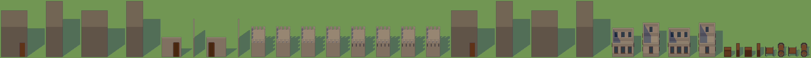
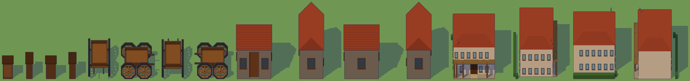

# Il banco delle parti dei mestieri (T471)

Le parti del seme che i mestieri dello Scultore includono con `<import file="part-…"/>` invece di riscriverle (S5 dello studio
[`docs/design/scultori-specializzati.md`](../../../docs/design/scultori-specializzati.md) § 4, [ADR-0241](../../../docs/adr/0241-le-parti-dei-mestieri.md)):
accanto alle cinque parti abitabili dell'Architetto (la scala, la porta, i merli, le feritoie, la cantina, [`../taglie/README.md`](../taglie/README.md)),
**la ruota**, **le finestre**, **le ante e i coperchi**. Le scrive a mano `lab/banco/taglie/parti.mjs` in `universe/models/part-*.xml`, come le
altre: il primo paragrafo del commento in testa è il contratto, che la richiesta dello Scultore porta così com'è (`partResources`); il secondo
dice che cosa la parte costruisce da sola. Niente modelli chiamati: il costo in dollari è zero.

```bash
node lab/banco/taglie/parti.mjs                         # riscrive universe/models/part-*.xml (le cinque di prima restano uguali byte per byte)
npx vite-node lab/scripts/banco-parti.ts                 # le parti da sole e nei modelli: misure, validatore, controlli, parti per specialità
npx vite-node lab/scripts/banco-parti.ts -- --foto       # e le foto da quattro lati, parti.png e modelli.png
npx vitest run tests/seed-parts.test.ts                  # lo stesso, fissato
```

## Le parti

| parte | a chi (`specialty`) | chi include… | la parte… | da sola |
|---|---|---|---|---|
| `part-wheel` | Mobiliere, Carrozziere | segna il mozzo `H` sull'asse o appena oltre la sua fine, con aria ai due lati attraverso l'asse e sotto (due `H` lungo l'asse: una ruota spessa due) | fa crescere la ruota nel piano attraverso l'asse (lungo x o lungo y), grande quanto il mozzo è alto su ciò che ha sotto (terra, un pavimento, un ponte), e la ferma quando lo tocca: cerchione e mozzo di ferro `I`, quarti e otto razze `J` | un carro con un asse e due ruote di raggio 6 |
| `part-window` | Architetto, Capomastro | segna `U`, una fascia dei muri per tutto il loro spessore, col muro sopra e sotto; dopo, rende al muro il resto della fascia | su ogni tratto dritto di una faccia con l'aria oltre i due capi (un angolo, una porta) centra una finestra (8 su un tratto pari, 9 su uno dispari), poi verso fuori pilastri di 6 e finestre di 8 finché 3 di muro restano al capo; un tratto libero da un capo solo (l'altro sul bordo della scatola) le ha da quel capo; nessuna sulle facce di un angolo interno (le stanze); telaio `N` col davanzale che sporge di uno, vetro `G`, il muro aperto dietro il vetro fino a 6 | una casa di 45 × 34: tre finestre su ogni lato lungo, una su ogni lato corto |
| `part-leaf` | Mobiliere, Capomastro | scrive l'anta chiusa `L`, uno spessore su una faccia con l'aria davanti, e il cardine `#80` nell'aria davanti al capo su cui gira, a ogni strato (un coperchio: sopra il suo bordo di dietro); le azioni `open` (`L` → `#82`, `#81` → `#83`) e `close` | scrive `#81`, nascosta, dove l'anta va aperta: girata sul cardine fuori nell'aria quanto è larga; due cardini ai capi di una fila di `L` se la dividono; i coperchi si alzano | una madia con due ante davanti e il coperchio sopra |

**Come lavorano.** Tutte guardano solo le lettere del loro contratto, così fanno lo stesso a ogni densità e in ogni scatola, e da sole
costruiscono la scena dalla lettera `S`, che un'inclusione non ha. I marcatori privati sono `#90`-`#97`, gli stessi delle altre parti e puliti
alla fine di ognuna. **La ruota** scende con una verticale dal mozzo a ciò che ha sotto (il suo piede), poi cresce un anello a giro (otto vicini
e quattro, alternati: un ottagono) in un `<markov>` che ferma tutta la ruota appena un anello tocca il piede: l'anello che tocca è il cerchione,
quello dentro i quarti; le razze crescono dritte dal mozzo, ognuna solo dalla cella prima della sua linea. **Le finestre** segnano la riga
d'aria davanti alla riga più bassa della fascia, tolgono i tratti che girano (un angolo interno, e con lui tutto il tratto), trovano il mezzo
di ogni tratto mangiandolo dai due capi insieme, e da lì le finestre; il vetro sulla faccia, il muro dietro aperto. **Le ante**: la cella dietro
il cardine è la prima presa e il cardine la sua cella aperta; la presa corre lungo l'anta, lascia un segno davanti a ogni cella che prende e
fa partire un marcatore un passo fuori sulla diagonale verso il cardine, che la percorre (un passo a giro, solo dove ha la scia del marcatore
prima di lui) finché non sta nella riga del cardine: l'anta aperta è lunga quanto l'anta. Al punto d'incontro di due ante il marcatore nasce già
dalla parte del suo cardine (un primo schema lo faceva nascere davanti alla cella e la `prl` lo sdoppiava: 14 celle aperte per 13), e la
presa si decide sulla griglia com'era (`prl`): su una fila dispari la cella di mezzo va a tutte e due le ante, uguale a ogni strato (con
`all` andava all'una o all'altra a caso strato per strato, e le ante aperte avevano il bordo a dente di sega, visto nel laboratorio).

**Ciò che i pattern non vedono.** Una faccia sul bordo della scatola non ha l'aria davanti e non ha finestre; un tratto chiuso da un palo
davanti alla facciata le ha solo dal capo libero; le ruote stanno su assi lungo x o lungo y; due ruote nello stesso piano non devono toccarsi
(la prima che si ferma fermerebbe l'altra).

## I modelli che le includono

Scritti come li scriverebbe lo Scultore del loro mestiere, coi contratti delle parti:

- [`armadio.xml`](armadio.xml) (Mobiliere, Media, 20 × 20 × 20): il corpo cavo con due ripiani, le ante sul fronte coi cardini ai due capi, la
  cornice; `open` mostra i ripiani.
- [`carretto.xml`](carretto.xml) (Mobiliere, Grande, 40 × 40 × 40): due assali sotto il cassone, i mozzi spessi due oltre i capi; quattro ruote
  di raggio 8, quanto i mozzi sono alti.
- [`casetta.xml`](casetta.xml) (Capomastro, Media, 50 × 50 × 50): muri di pietra con la fascia, la porta nello strato interno del vano col cardine
  nella stanza (si apre dentro), il tetto a capanna; la porta taglia la fascia e ogni tratto ai suoi lati ha la sua finestra.
- [`villetta.ts`](villetta.ts) (Architetto, Grande): la villetta con cui lo Scultore risponde offline (`MOCK_STRUCTURE_PROGRAM`) riscritta con
  `<import file="part-window"/>` al posto delle sue quattordici finestre a caso; la sua siepe era `G`, che `part-window` scrive per il vetro, e
  qui è `Z`. La villetta del seme non cambia.

## Le misure (seme 1, `banco-parti.ts`, 22/11)

| | tempo | voxel | ciò che le parti hanno fatto |
|---|---|---|---|
| `part-window` da sola | 29 ms | 9 096 | 8 vetri: 7 × 12 al centro dei lati lunghi, 6 × 12 ai loro fianchi e sui lati corti |
| `part-leaf` da sola | 16 ms | 1 470 | 2 ante aperte di 7 alte 10 (13 celle: la cella di mezzo a tutte e due, a ogni strato), il coperchio 13 × 5 |
| `part-wheel` da sola | 14 ms | 555 | 2 ruote 13 × 13, a terra |
| armadio | 5 ms | 963 | 2 ante aperte di 5 alte 14 (9 celle, quella di mezzo a tutte e due); dopo `open` visibili, le chiuse nascoste; `close` torna voxel per voxel |
| carretto | 19 ms | 2 544 | 4 ruote 17 × 17 spesse due, a terra |
| casetta | 43 ms | 17 845 | 5 vetri (uno per tratto: due ai lati della porta, uno sul retro, uno per fianco); la porta aperta 11 × 30 nella stanza |
| villetta con `part-window` | 699 ms (454 la villetta di prima) | 176 801 | 31 vetri sui due piani; i controlli dello Scultore a Grande passano in 4,5 s (3,7 la villetta di prima) |

**Le parti per specialità** (`partResources`, ciò che la richiesta porta): Architetto le cinque abitabili e `part-window`, Capomastro
`part-leaf` e `part-window`, Mobiliere `part-leaf` e `part-wheel`, Carrozziere `part-wheel`; Paesaggista, Sarto, Figurinista e le azioni
nessuna. Con `countTokens` ([`misure-s5.md`](../../../docs/design/scultori-specializzati/misure-s5.md)): 416 token in più a richiesta del
Mobiliere, 491 del Capomastro, 216 del Carrozziere, 178 dell'Architetto (41 in meno nel suo prompt, che nomina la parte al posto della ricetta
delle finestre a caso); 320 in media pesata sul lavoro degli universi veri, 0,016 $ l'ora oggi e 0,030 $ dall'1/12 sulla via di Google.





Nel laboratorio 3D (`npm run dev`, `/lab/3d/`, solo per gli sviluppatori) il gruppo «Banco: le parti del seme, da sole e nei modelli»: le otto
parti da sole e i quattro modelli; vicino all'armadio e alla casetta, `E` apre e chiude.
