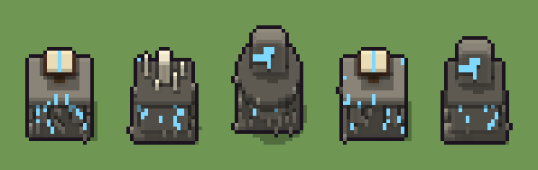

# Altare runico (`fantasy-altare-runico.xml`)

Classe `mobile`, scatola 20 × 20 × 20 voxel, ambientazione `fantasy (aurora)`.

Un altare di pietra con rune luminose sui fianchi. Il seme sceglie la forma del corpo (blocco, tavola su pilastri, ara rotonda) e ciò che sta sopra (cristallo, libro sul leggio, candele, stele).

## Esito

- validatore (`modelErrors`, `checkProgram`, `analyse` a ogni seme): nessun errore, nessun frammento staccato
- varianza su 5 semi (voxel pieni in un seme e vuoti nell'altro, sui pieni in almeno uno; il colore non conta): **media 0.390**, minima 0.038, massima 0.571 (soglia 0.15) → passa
- voxel per seme: 1021, 1407, 1565, 1017, 1585; tempo per seme: 39, 35, 37, 40, 35 ms
- avvisi: colori mai usati: C K W F; colori mai usati: C K P p F L; colori mai usati: C K P p W F L; tocca i bordi laterali della griglia: forse è tagliato

| coppia | 1-2 | 1-3 | 1-4 | 1-5 | 2-3 | 2-4 | 2-5 | 3-4 | 3-5 | 4-5 |
|---|---|---|---|---|---|---|---|---|---|---|
| distanza | 0.463 | 0.571 | 0.038 | 0.489 | 0.390 | 0.463 | 0.147 | 0.570 | 0.281 | 0.490 |



## Traccia di tre semi a confronto

La traccia di `src/mj/trace.ts` (forma `nodi`): per ogni nodo quante volte gira, quante celle scrive e la scatola di ciò che scrive. Le
righe che cambiano fra i semi sono le scelte del programma.

### Seme 1

```text
Traccia, seme 1: griglia 20×20×20, 43 nodi, 54 passi, finito in 43 ms.
x sinistra→destra, y fondo→davanti, z basso→alto; «.» è la cella vuota; #n è il nodo nell'ordine dell'XML; ×n quante volte ha agito.
Lettere: S=pietra, d=pietra scura, R=runa luminosa, P=pergamena, p=legno del leggio, L=copertina di cuoio, V=spazio del corpo (marcatore), U=spazio sopra (marcatore), a=corpo a blocco (marcatore), b=corpo a tavola (marcatore), f=sopra: libro (marcatore).
Alla fine: S 645, d 221, R 53, L 45, P 30, p 27.
#2-3 box×1, all×1: 7220 celle x1-19 y1-19 z0-9, passi 1-2
#4-7 box×1, one×2, all×1: 10830 celle x1-19 y1-19 z0-19, passi 3-40
#8-43 box×9, prl×3, all×2: 7268 celle x1-19 y1-19 z0-19, passi 41-54
Senza effetto (non hanno mai cambiato una cella):
#9 box at 10 10 1 size 13 9 8 S su a
#10 box at 10 10 9 size 15 11 1 d su a
#14 box at 10 10 9 size 17 11 1 d su b
#15 cylinder at 10 10 1 size 9 9 5 S su o
#16 cylinder at 10 10 6 size 13 13 2 S su o
#17 cylinder at 10 10 8 size 17 17 2 d su o
#20 prl S. → R. passi=1: le celle cercate c'erano, ma mai disposte come nel pattern
#23 box at 10 10 10 size 3 3 6 C su e
#24 cone at 10 10 16 size 3 3 3 C su e
#25 line 9 10 10 → 6 9 13 K
#26 line 11 11 10 → 13 12 12 K
#32 box at 5 8 10 size 2 2 5 W su g
… e altri 10
```

### Seme 2

```text
Traccia, seme 2: griglia 20×20×20, 43 nodi, 60 passi, finito in 38 ms.
x sinistra→destra, y fondo→davanti, z basso→alto; «.» è la cella vuota; #n è il nodo nell'ordine dell'XML; ×n quante volte ha agito.
Lettere: S=pietra, d=pietra scura, R=runa luminosa, W=cera, V=spazio del corpo (marcatore), U=spazio sopra (marcatore), a=corpo a blocco (marcatore), g=sopra: candele (marcatore).
Alla fine: S 913, d 386, W 68, R 40.
#2-3 box×1, all×1: 7220 celle x1-19 y1-19 z0-9, passi 1-2
#4-6 box×1, one×2: 3612 celle x1-19 y1-19 z0-19, passi 3-5
 #7 all aV → aa (+6): ×42, 7218 celle x1-19 y1-19 z0-19, passi 6-47, U→g 3609, V→a 3609
   r1 aV → aa ×3609; r2 bV → bb ×0; r3 oV → oo ×0; r4 eU → ee ×0; r5 fU → ff ×0; r6 gU → gg ×3609; r7 hU → hh ×0
#8-36 box×8, prl×3, all×1: 1447 celle x1-18 y3-16 z0-15, passi 48-59
 #43 all [VUaboefgh] → .: ×1, 5813 celle x1-19 y1-19 z0-19, passi 60, g→. 3542, a→. 2271
Senza effetto (non hanno mai cambiato una cella):
#11 box at 5 10 1 size 3 7 7 S su b
#12 box at 15 10 1 size 3 7 7 S su b
#13 box at 10 10 8 size 17 11 2 S su b
#14 box at 10 10 9 size 17 11 1 d su b
#15 cylinder at 10 10 1 size 9 9 5 S su o
#16 cylinder at 10 10 6 size 13 13 2 S su o
#17 cylinder at 10 10 8 size 17 17 2 d su o
#20 prl S. → R. passi=1
#23 box at 10 10 10 size 3 3 6 C su e
#24 cone at 10 10 16 size 3 3 3 C su e
#25 line 9 10 10 → 6 9 13 K
#26 line 11 11 10 → 13 12 12 K
… e altri 11
```

### Seme 3

```text
Traccia, seme 3: griglia 20×20×20, 43 nodi, 55 passi, finito in 46 ms.
x sinistra→destra, y fondo→davanti, z basso→alto; «.» è la cella vuota; #n è il nodo nell'ordine dell'XML; ×n quante volte ha agito.
Lettere: S=pietra, d=pietra scura, R=runa luminosa, V=spazio del corpo (marcatore), U=spazio sopra (marcatore), a=corpo a blocco (marcatore), o=corpo rotondo (marcatore), h=sopra: stele (marcatore).
Alla fine: S 859, d 671, R 35.
#2-3 box×1, all×1: 7220 celle x1-19 y1-19 z0-9, passi 1-2
#4-6 box×1, one×2: 3612 celle x1-19 y1-19 z6-19, passi 3-5
 #7 all aV → aa (+6): ×36, 7218 celle x1-19 y1-19 z0-19, passi 6-41, U→h 3609, V→o 3609
   r1 aV → aa ×0; r2 bV → bb ×0; r3 oV → oo ×3609; r4 eU → ee ×0; r5 fU → ff ×0; r6 gU → gg ×0; r7 hU → hh ×3609
#8-43 box×6, cylinder×3, prl×3, all×2: 7244 celle x1-19 y1-19 z0-19, passi 42-55
Senza effetto (non hanno mai cambiato una cella):
#9 box at 10 10 1 size 13 9 8 S su a
#10 box at 10 10 9 size 15 11 1 d su a
#11 box at 5 10 1 size 3 7 7 S su b
#12 box at 15 10 1 size 3 7 7 S su b
#13 box at 10 10 8 size 17 11 2 S su b
#14 box at 10 10 9 size 17 11 1 d su b
#20 prl S. → R. passi=1
#23 box at 10 10 10 size 3 3 6 C su e
#24 cone at 10 10 16 size 3 3 3 C su e
#25 line 9 10 10 → 6 9 13 K
#26 line 11 11 10 → 13 12 12 K
#27 box at 10 10 10 size 3 3 3 p su f
… e altri 10
```
