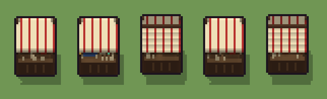

# Bancarella del mercato (`fantasy-bancarella-mercato.xml`)

Classe `mobile`, scatola 20 × 20 × 20 voxel, ambientazione `fantasy (aurora)`.

Un banco di legno su quattro pali sotto una tenda a strisce, con la merce in mostra. Il seme sceglie la tenda (spiovente, tettoia piatta, a capanna), la merce (frutta, orci, stoffe e ampolle) e le piccole cose sparse sul banco.

## Esito

- validatore (`modelErrors`, `checkProgram`, `analyse` a ogni seme): nessun errore, nessun frammento staccato
- varianza su 5 semi (voxel pieni in un seme e vuoti nell'altro, sui pieni in almeno uno; il colore non conta): **media 0.280**, minima 0.017, massima 0.437 (soglia 0.15) → passa
- voxel per seme: 1382, 1182, 1920, 1380, 1792; tempo per seme: 24, 24, 24, 26, 23 ms
- avvisi: tocca i bordi laterali della griglia: forse è tagliato; colori mai usati: Y y P c G L; colori mai usati: O o Y y; colori mai usati: O o P c G L

| coppia | 1-2 | 1-3 | 1-4 | 1-5 | 2-3 | 2-4 | 2-5 | 3-4 | 3-5 | 4-5 |
|---|---|---|---|---|---|---|---|---|---|---|
| distanza | 0.179 | 0.325 | 0.017 | 0.419 | 0.437 | 0.175 | 0.402 | 0.324 | 0.106 | 0.416 |



## Traccia di tre semi a confronto

La traccia di `src/mj/trace.ts` (forma `nodi`): per ogni nodo quante volte gira, quante celle scrive e la scatola di ciò che scrive. Le
righe che cambiano fra i semi sono le scelte del programma.

### Seme 1

```text
Traccia, seme 1: griglia 20×20×20, 51 nodi, 67 passi, finito in 27 ms.
x sinistra→destra, y fondo→davanti, z basso→alto; «.» è la cella vuota; #n è il nodo nell'ordine dell'XML; ×n quante volte ha agito.
Lettere: W=legno, w=piano del banco, T=stoffa rossa, Q=stoffa chiara, q=legno scuro, O=arance, o=mele, X=sacchetti, U=spazio della tenda (marcatore), Z=spazio della merce (marcatore), v=per mescolare il caso (marcatore), b=tettoia piatta (marcatore), e=cassette di frutta (marcatore).
Alla fine: W 667, Q 223, q 152, w 131, T 79, o 65, O 51, X 14.
 #2 box at 10 10 0 size 20 20 20 v: ×1, 7220 celle x1-19 y1-19 z0-19, passi 1, .→v 7220
 #3 all v → .: ×1, 7220 celle x1-19 y1-19 z0-19, passi 2, v→. 7220
#4-5 box×2: 4693 celle x1-19 y1-19 z7-19, passi 3-4
#6-8 one×2, all×1: 4693 celle x1-19 y1-19 z7-19, passi 5-43
#9-51 box×19, ellipsoid×2, all×1, prl×2: 5571 celle x1-19 y1-19 z0-19, passi 44-67
Senza effetto (non hanno mai cambiato una cella):
#19 box at 10 5 16 size 19 3 1 Q su a
#20 box at 10 8 15 size 19 3 1 Q su a
#21 box at 10 11 14 size 19 3 1 Q su a
#22 box at 10 14 13 size 19 3 1 Q su a
#25 box at 10 10 13 size 19 17 1 Q su n
#26 box at 10 10 14 size 19 13 1 Q su n
#27 box at 10 10 15 size 19 9 1 Q su n
#28 box at 10 10 16 size 19 5 1 Q su n
#29 box at 10 10 17 size 19 1 1 q su n
#39 cylinder at 4 12 7 size 4 4 5 Y su f
#40 cylinder at 9 12 7 size 4 4 3 y su f
#41 cylinder at 14 11 7 size 3 3 5 Y su f
… e altri 7
```

### Seme 2

```text
Traccia, seme 2: griglia 20×20×20, 51 nodi, 69 passi, finito in 29 ms.
x sinistra→destra, y fondo→davanti, z basso→alto; «.» è la cella vuota; #n è il nodo nell'ordine dell'XML; ×n quante volte ha agito.
Lettere: W=legno, w=piano del banco, T=stoffa rossa, Q=stoffa chiara, q=legno scuro, P=pezza blu, c=pezza verde, G=ampolla luminosa, L=lanterna, X=sacchetti, U=spazio della tenda (marcatore), Z=spazio della merce (marcatore), v=per mescolare il caso (marcatore), b=tettoia piatta (marcatore), g=stoffe e ampolle (marcatore).
Alla fine: W 522, Q 223, q 152, w 131, T 79, P 42, X 17, G 7, c 7, L 2.
 #2 box at 10 10 0 size 20 20 20 v: ×1, 7220 celle x1-19 y1-19 z0-19, passi 1, .→v 7220
 #3 all v → .: ×1, 7220 celle x1-19 y1-19 z0-19, passi 2, v→. 7220
#4-8 box×2, one×2, all×1: 9386 celle x1-19 y1-19 z7-19, passi 3-43
#9-51 box×23, all×1, prl×2: 5574 celle x1-19 y1-19 z0-19, passi 44-69
Senza effetto (non hanno mai cambiato una cella):
#19 box at 10 5 16 size 19 3 1 Q su a
#20 box at 10 8 15 size 19 3 1 Q su a
#21 box at 10 11 14 size 19 3 1 Q su a
#22 box at 10 14 13 size 19 3 1 Q su a
#25 box at 10 10 13 size 19 17 1 Q su n
#26 box at 10 10 14 size 19 13 1 Q su n
#27 box at 10 10 15 size 19 9 1 Q su n
#28 box at 10 10 16 size 19 5 1 Q su n
#29 box at 10 10 17 size 19 1 1 q su n
#35 box at 5 12 7 size 5 5 3 W su e
#36 box at 14 12 7 size 7 5 2 W su e
#37 ellipsoid at 5 12 9 size 5 5 4 O su e
… e altri 5
```

### Seme 3

```text
Traccia, seme 3: griglia 20×20×20, 51 nodi, 66 passi, finito in 27 ms.
x sinistra→destra, y fondo→davanti, z basso→alto; «.» è la cella vuota; #n è il nodo nell'ordine dell'XML; ×n quante volte ha agito.
Lettere: W=legno, w=piano del banco, T=stoffa rossa, Q=stoffa chiara, q=legno scuro, O=arance, o=mele, X=sacchetti, U=spazio della tenda (marcatore), Z=spazio della merce (marcatore), v=per mescolare il caso (marcatore), n=tetto a capanna (marcatore), e=cassette di frutta (marcatore).
Alla fine: W 667, Q 613, T 217, q 171, w 131, o 65, O 51, X 5.
 #2 box at 10 10 0 size 20 20 20 v: ×1, 7220 celle x1-19 y1-19 z0-19, passi 1, .→v 7220
 #3 all v → .: ×1, 7220 celle x1-19 y1-19 z0-19, passi 2, v→. 7220
#4-5 box×2: 4693 celle x1-19 y1-19 z7-19, passi 3-4
#6-8 one×2, all×1: 4693 celle x1-19 y1-19 z7-19, passi 5-39
#9-51 box×22, ellipsoid×2, all×1, prl×2: 5700 celle x1-19 y1-19 z0-19, passi 40-66
Senza effetto (non hanno mai cambiato una cella):
#19 box at 10 5 16 size 19 3 1 Q su a
#20 box at 10 8 15 size 19 3 1 Q su a
#21 box at 10 11 14 size 19 3 1 Q su a
#22 box at 10 14 13 size 19 3 1 Q su a
#23 box at 10 10 14 size 19 15 1 Q su b
#24 box at 10 17 12 size 19 1 3 Q su b
#39 cylinder at 4 12 7 size 4 4 5 Y su f
#40 cylinder at 9 12 7 size 4 4 3 y su f
#41 cylinder at 14 11 7 size 3 3 5 Y su f
#42 cylinder at 17 13 7 size 2 2 2 y su f
#43 box at 6 12 7 size 7 3 2 P su g
#44 box at 6 12 9 size 7 2 1 c su g
… e altri 4
```
