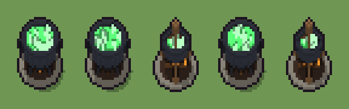

# Calderone bollente (`fantasy-calderone-bollente.xml`)

Classe `mobile`, scatola 20 × 20 × 20 voxel, ambientazione `fantasy (aurora)`.

Un calderone di ferro battuto su un fuoco di ciocchi, colmo di un intruglio verde luminoso. Il seme sceglie il calderone (pancia tonda sui piedi, pentola alta sulle pietre, appeso al treppiede), le fiamme e le bolle che traboccano.

## Esito

- validatore (`modelErrors`, `checkProgram`, `analyse` a ogni seme): nessun errore, nessun frammento staccato
- varianza su 5 semi (voxel pieni in un seme e vuoti nell'altro, sui pieni in almeno uno; il colore non conta): **media 0.351**, minima 0.048, massima 0.557 (soglia 0.15) → passa
- voxel per seme: 1444, 1433, 888, 1438, 896; tempo per seme: 26, 27, 23, 24, 26 ms
- avvisi: colori mai usati: R w; tocca il soffitto della griglia: forse è tagliato in alto; colori mai usati: R

| coppia | 1-2 | 1-3 | 1-4 | 1-5 | 2-3 | 2-4 | 2-5 | 3-4 | 3-5 | 4-5 |
|---|---|---|---|---|---|---|---|---|---|---|
| distanza | 0.055 | 0.550 | 0.055 | 0.547 | 0.557 | 0.048 | 0.552 | 0.549 | 0.048 | 0.545 |



## Traccia di tre semi a confronto

La traccia di `src/mj/trace.ts` (forma `nodi`): per ogni nodo quante volte gira, quante celle scrive e la scatola di ciò che scrive. Le
righe che cambiano fra i semi sono le scelte del programma.

### Seme 1

```text
Traccia, seme 1: griglia 20×20×20, 51 nodi, 93 passi, finito in 29 ms.
x sinistra→destra, y fondo→davanti, z basso→alto; «.» è la cella vuota; #n è il nodo nell'ordine dell'XML; ×n quante volte ha agito.
Lettere: I=ferro battuto, i=ferro scuro, S=pietra, A=cenere, n=corteccia, N=ciocco, F=fiamma, G=intruglio, M=bolle, J=ferro in lavorazione (marcatore), V=lo spazio (marcatore), Q=dove salgono le bolle (marcatore), a=pancia tonda sui piedi (marcatore).
Alla fine: I 939, A 137, G 109, i 94, S 88, M 49, N 11, F 11, n 6.
 #2 box at 10 10 0 size 20 20 20 a: ×1, 7220 celle x1-19 y1-19 z0-19, passi 1, .→a 7220
 #3 all a → V: ×1, 7220 celle x1-19 y1-19 z0-19, passi 2, a→V 7220
#4-5 one×1, all×1: 7220 celle x1-19 y1-19 z0-19, passi 3-38
#6-51 cylinder×6, box×9, ellipsoid×1, all×2, prl×3, one×2: 9834 celle x1-19 y1-19 z0-19, passi 39-93
Senza effetto (non hanno mai cambiato una cella):
#23 box at 5 10 1 size 2 2 2 S su b
#24 box at 15 10 1 size 2 2 2 S su b
#25 box at 10 15 1 size 2 2 2 S su b
#26 cylinder at 10 10 3 size 11 11 11 J su b
#27 cylinder at 10 10 6 size 12 12 1 i su b
#28 cylinder at 10 10 13 size 9 9 1 G su J
#29 all J → I: in quel momento nella griglia non c'erano celle "J"
#30 cylinder at 10 10 13 size 13 13 1 i su b
#31 line 10 10 13 → 14 12 18 w
#32 cylinder at 10 10 14 size 9 9 4 Q su b
#33 line 5 5 1 → 10 10 18 w
#34 line 15 5 1 → 10 10 18 w
… e altri 11
```

### Seme 2

```text
Traccia, seme 2: griglia 20×20×20, 51 nodi, 107 passi, finito in 27 ms.
x sinistra→destra, y fondo→davanti, z basso→alto; «.» è la cella vuota; #n è il nodo nell'ordine dell'XML; ×n quante volte ha agito.
Lettere: I=ferro battuto, i=ferro scuro, S=pietra, A=cenere, n=corteccia, N=ciocco, F=fiamma, G=intruglio, M=bolle, J=ferro in lavorazione (marcatore), V=lo spazio (marcatore), Q=dove salgono le bolle (marcatore), a=pancia tonda sui piedi (marcatore).
Alla fine: I 939, A 137, G 109, i 94, S 88, M 40, N 13, F 9, n 4.
 #2 box at 10 10 0 size 20 20 20 a: ×1, 7220 celle x1-19 y1-19 z0-19, passi 1, .→a 7220
 #3 all a → V: ×1, 7220 celle x1-19 y1-19 z0-19, passi 2, a→V 7220
#4-5 one×1, all×1: 7220 celle x1-19 y1-19 z0-19, passi 3-54
#6-51 cylinder×6, box×9, ellipsoid×1, all×2, prl×3, one×2: 9832 celle x1-19 y1-19 z0-19, passi 55-107
Senza effetto (non hanno mai cambiato una cella):
#23 box at 5 10 1 size 2 2 2 S su b
#24 box at 15 10 1 size 2 2 2 S su b
#25 box at 10 15 1 size 2 2 2 S su b
#26 cylinder at 10 10 3 size 11 11 11 J su b
#27 cylinder at 10 10 6 size 12 12 1 i su b
#28 cylinder at 10 10 13 size 9 9 1 G su J
#29 all J → I: in quel momento nella griglia non c'erano celle "J"
#30 cylinder at 10 10 13 size 13 13 1 i su b
#31 line 10 10 13 → 14 12 18 w
#32 cylinder at 10 10 14 size 9 9 4 Q su b
#33 line 5 5 1 → 10 10 18 w
#34 line 15 5 1 → 10 10 18 w
… e altri 11
```

### Seme 3

```text
Traccia, seme 3: griglia 20×20×20, 51 nodi, 111 passi, finito in 29 ms.
x sinistra→destra, y fondo→davanti, z basso→alto; «.» è la cella vuota; #n è il nodo nell'ordine dell'XML; ×n quante volte ha agito.
Lettere: I=ferro battuto, i=ferro scuro, S=pietra, A=cenere, n=corteccia, N=ciocco, F=fiamma, G=intruglio, M=bolle, w=legno, J=ferro in lavorazione (marcatore), V=lo spazio (marcatore), Q=dove salgono le bolle (marcatore), a=pancia tonda sui piedi (marcatore), o=appeso al treppiede (marcatore).
Alla fine: I 344, w 158, A 137, S 88, i 60, G 37, M 37, N 14, F 10, n 3.
 #2 box at 10 10 0 size 20 20 20 a: ×1, 7220 celle x1-19 y1-19 z0-19, passi 1, .→a 7220
 #3 all a → V: ×1, 7220 celle x1-19 y1-19 z0-19, passi 2, a→V 7220
#4-5 one×1, all×1: 7220 celle x1-19 y1-19 z0-19, passi 3-54
#6-51 cylinder×6, box×3, line×5, ellipsoid×1, all×2, prl×3, one×2: 8161 celle x1-19 y1-19 z0-19, passi 55-111
Senza effetto (non hanno mai cambiato una cella):
#10 box at 6 6 1 size 1 1 5 i su a
#11 box at 14 6 1 size 1 1 5 i su a
#12 box at 6 14 1 size 1 1 5 i su a
#13 box at 14 14 1 size 1 1 5 i su a
#14 ellipsoid at 10 10 3 size 15 15 12 J su a
#15 box at 10 10 11 size 20 20 9 a su J
#16 cylinder at 10 10 10 size 12 12 1 G su J
#17 all J → I: in quel momento nella griglia non c'erano celle "J"
#18 cylinder at 10 10 11 size 15 15 1 i su a
#19 cylinder at 10 10 11 size 12 12 1 a su i
#20 box at 2 10 8 size 1 1 3 i su a
#21 box at 18 10 8 size 1 1 3 i su a
… e altri 12
```
