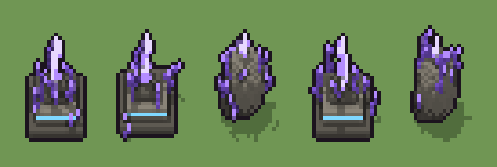

# Cristallo arcano (`fantasy-cristallo-arcano.xml`)

Classe `mobile`, scatola 20 × 20 × 20 voxel, ambientazione `fantasy (aurora)`.

Un grande cristallo viola luminoso piantato nella pietra, con schegge storte attorno. Il seme sceglie la base (cumulo, piedistallo con rune, masso alto), quanto sale il cristallo maggiore e dove nascono e piegano le schegge.

## Esito

- validatore (`modelErrors`, `checkProgram`, `analyse` a ogni seme): nessun errore, nessun frammento staccato
- varianza su 5 semi (voxel pieni in un seme e vuoti nell'altro, sui pieni in almeno uno; il colore non conta): **media 0.483**, minima 0.107, massima 0.734 (soglia 0.15) → passa
- voxel per seme: 1004, 1001, 1096, 1000, 1092; tempo per seme: 40, 35, 37, 32, 31 ms
- avvisi: tocca il soffitto della griglia: forse è tagliato in alto; tocca i bordi laterali della griglia: forse è tagliato; colori mai usati: R

| coppia | 1-2 | 1-3 | 1-4 | 1-5 | 2-3 | 2-4 | 2-5 | 3-4 | 3-5 | 4-5 |
|---|---|---|---|---|---|---|---|---|---|---|
| distanza | 0.123 | 0.714 | 0.125 | 0.718 | 0.727 | 0.121 | 0.731 | 0.730 | 0.107 | 0.734 |



## Traccia di tre semi a confronto

La traccia di `src/mj/trace.ts` (forma `nodi`): per ogni nodo quante volte gira, quante celle scrive e la scatola di ciò che scrive. Le
righe che cambiano fra i semi sono le scelte del programma.

### Seme 1

```text
Traccia, seme 1: griglia 20×20×20, 30 nodi, 101 passi, finito in 39 ms.
x sinistra→destra, y fondo→davanti, z basso→alto; «.» è la cella vuota; #n è il nodo nell'ordine dell'XML; ×n quante volte ha agito.
Lettere: S=pietra, d=pietra scura, R=runa luminosa, C=cristallo arcano, K=cristallo in ombra, W=cuore del cristallo, x=l'asse del cristallo (marcatore), k=la quota scelta (marcatore), h=quote possibili (marcatore), s=punta di una scheggia (marcatore), V=lo spazio (marcatore), v=per mescolare il caso (marcatore), b=piedistallo a gradini (marcatore).
Alla fine: d 548, S 323, K 45, R 40, W 25, C 23.
 #2 box at 10 10 0 size 20 20 20 v: ×1, 7220 celle x1-19 y1-19 z0-19, passi 1, .→v 7220
 #3 all v → V: ×1, 7220 celle x1-19 y1-19 z0-19, passi 2, v→V 7220
#4-5 one×1, all×1: 7220 celle x1-19 y1-19 z0-19, passi 3-38
#8-29 box×7, one×2, all×7, prl×2: 1319 celle x0-17 y0-17 z0-19, passi 39-100
 #30 all [Vabo] → .: ×1, 6216 celle x1-19 y1-19 z0-19, passi 101, b→. 6216
Senza effetto (non hanno mai cambiato una cella):
#6 ellipsoid at 10 10 0 size 17 17 9 S su a
#7 box at 10 10 0 size 20 20 1 d su S
#13 ellipsoid at 10 10 0 size 11 11 15 S su o
#14 ellipsoid at 7 11 0 size 7 7 7 d su o
#18 all k[abo] → kk: le celle cercate c'erano, ma mai disposte come nel pattern
#20 all x k → k k: le celle cercate c'erano, ma mai disposte come nel pattern
```

### Seme 2

```text
Traccia, seme 2: griglia 20×20×20, 30 nodi, 117 passi, finito in 40 ms.
x sinistra→destra, y fondo→davanti, z basso→alto; «.» è la cella vuota; #n è il nodo nell'ordine dell'XML; ×n quante volte ha agito.
Lettere: S=pietra, d=pietra scura, R=runa luminosa, C=cristallo arcano, K=cristallo in ombra, W=cuore del cristallo, x=l'asse del cristallo (marcatore), k=la quota scelta (marcatore), h=quote possibili (marcatore), s=punta di una scheggia (marcatore), V=lo spazio (marcatore), v=per mescolare il caso (marcatore), b=piedistallo a gradini (marcatore).
Alla fine: d 548, S 323, K 45, R 40, C 25, W 20.
 #2 box at 10 10 0 size 20 20 20 v: ×1, 7220 celle x1-19 y1-19 z0-19, passi 1, .→v 7220
 #3 all v → V: ×1, 7220 celle x1-19 y1-19 z0-19, passi 2, v→V 7220
#4-5 one×1, all×1: 7220 celle x1-19 y1-19 z0-19, passi 3-54
#8-29 box×7, one×2, all×7, prl×2: 1308 celle x0-19 y0-18 z0-19, passi 55-116
 #30 all [Vabo] → .: ×1, 6219 celle x1-19 y1-19 z0-19, passi 117, b→. 6219
Senza effetto (non hanno mai cambiato una cella):
#6 ellipsoid at 10 10 0 size 17 17 9 S su a
#7 box at 10 10 0 size 20 20 1 d su S
#13 ellipsoid at 10 10 0 size 11 11 15 S su o
#14 ellipsoid at 7 11 0 size 7 7 7 d su o
#18 all k[abo] → kk: le celle cercate c'erano, ma mai disposte come nel pattern
#20 all x k → k k: le celle cercate c'erano, ma mai disposte come nel pattern
```

### Seme 3

```text
Traccia, seme 3: griglia 20×20×20, 30 nodi, 114 passi, finito in 34 ms.
x sinistra→destra, y fondo→davanti, z basso→alto; «.» è la cella vuota; #n è il nodo nell'ordine dell'XML; ×n quante volte ha agito.
Lettere: S=pietra, d=pietra scura, C=cristallo arcano, K=cristallo in ombra, W=cuore del cristallo, x=l'asse del cristallo (marcatore), k=la quota scelta (marcatore), h=quote possibili (marcatore), s=punta di una scheggia (marcatore), V=lo spazio (marcatore), v=per mescolare il caso (marcatore), o=masso alto (marcatore).
Alla fine: S 959, d 60, K 45, C 26, W 6.
 #2 box at 10 10 0 size 20 20 20 v: ×1, 7220 celle x1-19 y1-19 z0-19, passi 1, .→v 7220
 #3 all v → V: ×1, 7220 celle x1-19 y1-19 z0-19, passi 2, v→V 7220
#4-5 one×1, all×1: 7220 celle x1-19 y1-19 z0-19, passi 3-54
#13-29 ellipsoid×2, box×2, one×2, all×7, prl×2: 1190 celle x0-17 y0-17 z0-19, passi 55-113
 #30 all [Vabo] → .: ×1, 6124 celle x1-19 y1-19 z0-19, passi 114, o→. 6124
Senza effetto (non hanno mai cambiato una cella):
#6 ellipsoid at 10 10 0 size 17 17 9 S su a
#7 box at 10 10 0 size 20 20 1 d su S
#8 box at 10 10 0 size 15 15 2 d su b
#9 box at 10 10 2 size 11 11 3 S su b
#10 box at 10 10 5 size 7 7 2 d su b
#11 box at 10 10 3 size 11 11 1 R su S
#12 box at 10 10 3 size 9 9 1 S su R
#18 all k[abo] → kk: le celle cercate c'erano, ma mai disposte come nel pattern
#20 all x k → k k: le celle cercate c'erano, ma mai disposte come nel pattern
```
