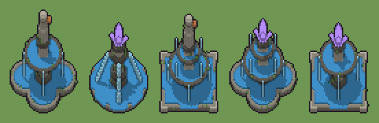

# Fontana antica (`fantasy-fontana-antica.xml`)

Classe `edificio`, scatola 50 × 50 × 50 voxel, ambientazione `fantasy (aurora)`.

Una vasca di pietra colma d'acqua con una colonna al centro da cui l'acqua ricade. Il seme sceglie la vasca (tonda, quadrata, a quadrifoglio), la colonna (una coppa, due coppe, quattro bocche con i getti), la cima (cristallo luminoso o fanciulla con l'anfora) e il muschio.

## Esito

- validatore (`modelErrors`, `checkProgram`, `analyse` a ogni seme): nessun errore, nessun frammento staccato
- varianza su 5 semi (voxel pieni in un seme e vuoti nell'altro, sui pieni in almeno uno; il colore non conta): **media 0.407**, minima 0.233, massima 0.541 (soglia 0.15) → passa
- voxel per seme: 6238, 4926, 7156, 6772, 6272; tempo per seme: 911, 1028, 956, 987, 999 ms
- avvisi: tocca i bordi laterali della griglia: forse è tagliato; colori mai usati: C; colori mai usati: L

| coppia | 1-2 | 1-3 | 1-4 | 1-5 | 2-3 | 2-4 | 2-5 | 3-4 | 3-5 | 4-5 |
|---|---|---|---|---|---|---|---|---|---|---|
| distanza | 0.410 | 0.531 | 0.436 | 0.256 | 0.438 | 0.415 | 0.383 | 0.233 | 0.424 | 0.541 |



## Traccia di tre semi a confronto

La traccia di `src/mj/trace.ts` (forma `nodi`): per ogni nodo quante volte gira, quante celle scrive e la scatola di ciò che scrive. Le
righe che cambiano fra i semi sono le scelte del programma.

### Seme 1

```text
Traccia, seme 1: griglia 50×50×50, 79 nodi, 132 passi, finito in 1020 ms.
x sinistra→destra, y fondo→davanti, z basso→alto; «.» è la cella vuota; #n è il nodo nell'ordine dell'XML; ×n quante volte ha agito.
Lettere: S=pietra, d=pietra scura, G=marmo antico, A=acqua, a=rivolo, M=muschio, L=anfora di rame, v=per mescolare il caso (marcatore), V=spazio della vasca (marcatore), U=spazio della colonna (marcatore), T=spazio della cima (marcatore), e=vasca a quadrifoglio (marcatore), f=una grande coppa (marcatore), r=cima: fanciulla (marcatore).
Alla fine: G 2042, S 1880, A 1412, d 779, a 68, M 37, L 20.
#2-3 box×1, all×1: 250000 celle x0-49 y0-49 z0-49, passi 1-2
#4-6 box×3: 125000 celle x0-49 y0-49 z0-49, passi 3-5
#7-10 one×3, all×1: 125000 celle x0-49 y0-49 z0-49, passi 6-101
#17-79 cylinder×18, box×8, ellipsoid×2, all×1, prl×2: 130249 celle x0-49 y0-49 z0-49, passi 102-132
Senza effetto (non hanno mai cambiato una cella):
#11 cylinder at 25 25 0 size 41 41 3 S su b
#12 cylinder at 25 25 2 size 41 41 1 d su b
#13 cylinder at 25 25 1 size 37 37 2 A su [Sd]
#14 box at 25 25 0 size 39 39 3 S su c
#15 box at 25 25 2 size 39 39 1 d su c
#16 box at 25 25 1 size 35 35 2 A su [Sd]
#28 box at 7 7 0 size 5 5 3 G su c
#29 box at 43 7 0 size 5 5 3 G su c
#30 box at 7 43 0 size 5 5 3 G su c
#31 box at 43 43 0 size 5 5 3 G su c
#44 cylinder at 25 25 11 size 25 25 2 G su g
#45 cylinder at 25 25 13 size 29 29 1 d su g
… e altri 26
```

### Seme 2

```text
Traccia, seme 2: griglia 50×50×50, 79 nodi, 139 passi, finito in 1039 ms.
x sinistra→destra, y fondo→davanti, z basso→alto; «.» è la cella vuota; #n è il nodo nell'ordine dell'XML; ×n quante volte ha agito.
Lettere: S=pietra, d=pietra scura, G=marmo antico, A=acqua, a=rivolo, M=muschio, C=cristallo arcano, v=per mescolare il caso (marcatore), V=spazio della vasca (marcatore), U=spazio della colonna (marcatore), T=spazio della cima (marcatore), b=vasca tonda (marcatore), e=vasca a quadrifoglio (marcatore), p=quattro bocche (marcatore), q=cima: cristallo (marcatore).
Alla fine: S 1264, A 1192, d 947, G 851, C 335, a 316, M 21.
#2-3 box×1, all×1: 250000 celle x0-49 y0-49 z0-49, passi 1-2
#4-6 box×3: 125000 celle x0-49 y0-49 z0-49, passi 3-5
#7-10 one×3, all×1: 125000 celle x0-49 y0-49 z0-49, passi 6-112
#11-79 cylinder×11, box×5, line×7, cone×1, all×1, prl×2: 130445 celle x0-49 y0-49 z0-49, passi 113-139
Senza effetto (non hanno mai cambiato una cella):
#12 cylinder at 25 25 2 size 41 41 1 d su b
#14 box at 25 25 0 size 39 39 3 S su c
#15 box at 25 25 2 size 39 39 1 d su c
#17 cylinder at 25 13 0 size 23 23 3 S su e
#18 cylinder at 25 37 0 size 23 23 3 S su e
#19 cylinder at 13 25 0 size 23 23 3 S su e
#20 cylinder at 37 25 0 size 23 23 3 S su e
#21 cylinder at 25 25 0 size 25 25 3 S su e
#26 cylinder at 25 25 1 size 23 23 2 A su S
#28 box at 7 7 0 size 5 5 3 G su c
#29 box at 43 7 0 size 5 5 3 G su c
#30 box at 7 43 0 size 5 5 3 G su c
… e altri 30
```

### Seme 3

```text
Traccia, seme 3: griglia 50×50×50, 79 nodi, 144 passi, finito in 1047 ms.
x sinistra→destra, y fondo→davanti, z basso→alto; «.» è la cella vuota; #n è il nodo nell'ordine dell'XML; ×n quante volte ha agito.
Lettere: S=pietra, d=pietra scura, G=marmo antico, A=acqua, a=rivolo, M=muschio, L=anfora di rame, v=per mescolare il caso (marcatore), V=spazio della vasca (marcatore), U=spazio della colonna (marcatore), T=spazio della cima (marcatore), c=vasca quadrata (marcatore), e=vasca a quadrifoglio (marcatore), g=due coppe (marcatore), r=cima: fanciulla (marcatore).
Alla fine: G 2578, S 1792, A 1768, d 887, a 84, M 27, L 20.
#2-3 box×1, all×1: 250000 celle x0-49 y0-49 z0-49, passi 1-2
#4-6 box×3: 125000 celle x0-49 y0-49 z0-49, passi 3-5
#7-10 one×3, all×1: 125000 celle x0-49 y0-49 z0-49, passi 6-107
#14-79 box×18, cylinder×14, ellipsoid×2, all×1, prl×2: 131219 celle x0-49 y0-49 z0-49, passi 108-144
Senza effetto (non hanno mai cambiato una cella):
#11 cylinder at 25 25 0 size 41 41 3 S su b
#12 cylinder at 25 25 2 size 41 41 1 d su b
#13 cylinder at 25 25 1 size 37 37 2 A su [Sd]
#15 box at 25 25 2 size 39 39 1 d su c
#17 cylinder at 25 13 0 size 23 23 3 S su e
#18 cylinder at 25 37 0 size 23 23 3 S su e
#19 cylinder at 13 25 0 size 23 23 3 S su e
#20 cylinder at 37 25 0 size 23 23 3 S su e
#21 cylinder at 25 25 0 size 25 25 3 S su e
#26 cylinder at 25 25 1 size 23 23 2 A su S
#35 cylinder at 25 25 15 size 9 9 2 G su f
#36 cylinder at 25 25 17 size 21 21 2 G su f
… e altri 20
```
