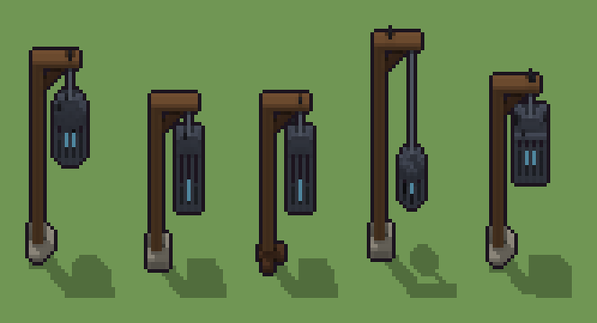

# Gabbia sospesa (`fantasy-gabbia-sospesa.xml`)

Classe `monumento`, scatola 20 × 20 × 60 voxel, ambientazione `fantasy (aurora)`.

Una forca di legno da cui pende, a una catena, una gabbia di ferro con una fiammella prigioniera. Il seme sceglie l'altezza del braccio, la catena e la forma della gabbia, la base e dove si posano i corvi.

## Esito

- validatore (`modelErrors`, `checkProgram`, `analyse` a ogni seme): nessun errore, nessun frammento staccato
- varianza su 5 semi (voxel pieni in un seme e vuoti nell'altro, sui pieni in almeno uno; il colore non conta): **media 0.566**, minima 0.085, massima 0.696 (soglia 0.15) → passa
- voxel per seme: 1150, 906, 869, 999, 1020; tempo per seme: 148, 128, 128, 129, 133 ms
- avvisi: colori mai usati: d; colori mai usati: S d; tocca il soffitto della griglia: forse è tagliato in alto

| coppia | 1-2 | 1-3 | 1-4 | 1-5 | 2-3 | 2-4 | 2-5 | 3-4 | 3-5 | 4-5 |
|---|---|---|---|---|---|---|---|---|---|---|
| distanza | 0.670 | 0.696 | 0.615 | 0.507 | 0.085 | 0.555 | 0.645 | 0.604 | 0.673 | 0.611 |



## Traccia di tre semi a confronto

La traccia di `src/mj/trace.ts` (forma `nodi`): per ogni nodo quante volte gira, quante celle scrive e la scatola di ciò che scrive. Le
righe che cambiano fra i semi sono le scelte del programma.

### Seme 1

```text
Traccia, seme 1: griglia 20×20×60, 82 nodi, 108 passi, finito in 147 ms.
x sinistra→destra, y fondo→davanti, z basso→alto; «.» è la cella vuota; #n è il nodo nell'ordine dell'XML; ×n quante volte ha agito.
Lettere: W=legno, w=legno scuro, I=ferro battuto, i=catena, S=pietra, d=pietra scura, K=corvo, F=fiammella prigioniera, J=ferro della gabbia in lavorazione (marcatore), v=per mescolare il caso (marcatore), V=spazio della forca (marcatore), U=spazio della base (marcatore), a=braccio a 52, gabbia tonda (marcatore), q=mucchio di sassi (marcatore).
Alla fine: W 519, I 436, S 127, w 20, F 19, i 13, d 11, K 5.
#2-3 box×1, all×1: 43320 celle x1-19 y1-19 z0-59, passi 1-2
#4-5 box×2: 21660 celle x1-19 y1-19 z0-59, passi 3-4
#6-8 one×2, all×1: 21660 celle x1-19 y1-19 z0-59, passi 5-86
#14-82 ellipsoid×4, box×11, line×1, cylinder×2, all×2, prl×2: 22937 celle x1-19 y1-19 z0-59, passi 87-108
Senza effetto (non hanno mai cambiato una cella):
#9 box at 3 10 0 size 7 7 3 S su e
#10 box at 3 10 2 size 7 7 1 d su e
#11 box at 3 10 0 size 9 3 2 w su p
#12 box at 3 10 0 size 3 9 2 w su p
#13 box at 3 10 2 size 3 3 1 w su p
#33 box at 3 10 3 size 3 3 45 W su b
#34 box at 8 10 46 size 13 3 2 W su b
#35 line 4 10 39 → 10 10 45 w
#36 box at 12 10 37 size 1 1 9 i su b
#37 box at 12 10 24 size 9 9 13 J su b
#38 box at 12 10 25 size 7 7 11 b su J
#39 box at 9 10 25 size 1 20 11 b su J
… e altri 40
```

### Seme 2

```text
Traccia, seme 2: griglia 20×20×60, 82 nodi, 94 passi, finito in 147 ms.
x sinistra→destra, y fondo→davanti, z basso→alto; «.» è la cella vuota; #n è il nodo nell'ordine dell'XML; ×n quante volte ha agito.
Lettere: W=legno, w=legno scuro, I=ferro battuto, i=catena, S=pietra, K=corvo, F=fiammella prigioniera, J=ferro della gabbia in lavorazione (marcatore), v=per mescolare il caso (marcatore), V=spazio della forca (marcatore), U=spazio della base (marcatore), g=braccio a 42, gabbia alta e stretta (marcatore), e=base di pietra (marcatore).
Alla fine: W 429, I 302, S 126, w 20, F 19, i 9, K 1.
#2-3 box×1, all×1: 43320 celle x1-19 y1-19 z0-59, passi 1-2
#4-5 box×2: 21660 celle x1-19 y1-19 z0-59, passi 3-4
#6-8 one×2, all×1: 21660 celle x1-19 y1-19 z0-59, passi 5-76
#9-81 box×13, line×1, ellipsoid×1, all×2, prl×1: 23073 celle x1-19 y1-19 z0-59, passi 77-94
Senza effetto (non hanno mai cambiato una cella):
#10 box at 3 10 2 size 7 7 1 d su e
#11 box at 3 10 0 size 9 3 2 w su p
#12 box at 3 10 0 size 3 9 2 w su p
#13 box at 3 10 2 size 3 3 1 w su p
#14 ellipsoid at 3 10 0 size 9 9 5 S su q
#15 ellipsoid at 5 8 0 size 5 5 3 d su q
#16 box at 3 10 3 size 3 3 51 W su a
#17 box at 8 10 52 size 13 3 2 W su a
#18 line 4 10 45 → 10 10 51 w
#19 box at 12 10 39 size 1 1 13 i su a
#20 cylinder at 12 10 28 size 9 9 11 J su a
#21 cylinder at 12 10 29 size 7 7 9 a su J
… e altri 44
```

### Seme 3

```text
Traccia, seme 3: griglia 20×20×60, 82 nodi, 115 passi, finito in 144 ms.
x sinistra→destra, y fondo→davanti, z basso→alto; «.» è la cella vuota; #n è il nodo nell'ordine dell'XML; ×n quante volte ha agito.
Lettere: W=legno, w=legno scuro, I=ferro battuto, i=catena, K=corvo, F=fiammella prigioniera, J=ferro della gabbia in lavorazione (marcatore), v=per mescolare il caso (marcatore), V=spazio della forca (marcatore), U=spazio della base (marcatore), g=braccio a 42, gabbia alta e stretta (marcatore), p=travi incrociate (marcatore).
Alla fine: W 429, I 302, w 107, F 19, i 9, K 3.
 #2 box at 10 10 0 size 20 20 60 v: ×1, 21660 celle x1-19 y1-19 z0-59, passi 1, .→v 21660
 #3 all v → .: ×1, 21660 celle x1-19 y1-19 z0-59, passi 2, v→. 21660
#4-5 box×2: 21660 celle x1-19 y1-19 z0-59, passi 3-4
#6-8 one×2, all×1: 21660 celle x1-19 y1-19 z0-59, passi 5-94
#11-82 box×15, line×1, ellipsoid×1, all×2, prl×2: 23075 celle x1-19 y1-19 z0-59, passi 95-115
Senza effetto (non hanno mai cambiato una cella):
#9 box at 3 10 0 size 7 7 3 S su e
#10 box at 3 10 2 size 7 7 1 d su e
#14 ellipsoid at 3 10 0 size 9 9 5 S su q
#15 ellipsoid at 5 8 0 size 5 5 3 d su q
#16 box at 3 10 3 size 3 3 51 W su a
#17 box at 8 10 52 size 13 3 2 W su a
#18 line 4 10 45 → 10 10 51 w
#19 box at 12 10 39 size 1 1 13 i su a
#20 cylinder at 12 10 28 size 9 9 11 J su a
#21 cylinder at 12 10 29 size 7 7 9 a su J
#22 box at 9 10 29 size 1 20 9 a su J
#23 box at 11 10 29 size 1 20 9 a su J
… e altri 41
```
