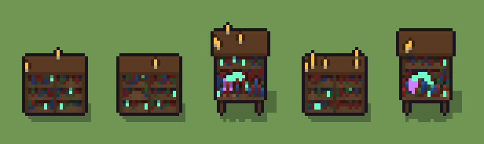

# Libreria alchemica (`fantasy-libreria-alchemica.xml`)

Classe `mobile`, scatola 20 × 20 × 20 voxel, ambientazione `fantasy (aurora)`.

Uno scaffale di legno con tomi e ampolle luminose. Il seme sceglie la forma (alta, larga con divisorio, media con banco e alambicco), quali ripiani hanno libri e quanto è alto ogni tomo.

## Esito

- validatore (`modelErrors`, `checkProgram`, `analyse` a ogni seme): nessun errore, nessun frammento staccato
- varianza su 5 semi (voxel pieni in un seme e vuoti nell'altro, sui pieni in almeno uno; il colore non conta): **media 0.496**, minima 0.251, massima 0.666 (soglia 0.15) → passa
- voxel per seme: 957, 913, 1092, 952, 1151; tempo per seme: 29, 25, 27, 29, 33 ms
- avvisi: tocca i bordi laterali della griglia: forse è tagliato; colori mai usati: g

| coppia | 1-2 | 1-3 | 1-4 | 1-5 | 2-3 | 2-4 | 2-5 | 3-4 | 3-5 | 4-5 |
|---|---|---|---|---|---|---|---|---|---|---|
| distanza | 0.251 | 0.646 | 0.252 | 0.637 | 0.666 | 0.278 | 0.650 | 0.652 | 0.296 | 0.634 |



## Traccia di tre semi a confronto

La traccia di `src/mj/trace.ts` (forma `nodi`): per ogni nodo quante volte gira, quante celle scrive e la scatola di ciò che scrive. Le
righe che cambiano fra i semi sono le scelte del programma.

### Seme 1

```text
Traccia, seme 1: griglia 20×20×20, 45 nodi, 55 passi, finito in 31 ms.
x sinistra→destra, y fondo→davanti, z basso→alto; «.» è la cella vuota; #n è il nodo nell'ordine dell'XML; ×n quante volte ha agito.
Lettere: D=legno scuro, W=legno, p=ripiano, K=cornice intagliata, Y=tomo rosso, y=tomo blu, Q=tomo verde, G=ampolla luminosa, C=candela, F=fiamma, V=lo spazio (marcatore), a=alta e stretta (marcatore), b=larga e bassa (marcatore).
Alla fine: D 228, p 192, W 144, Y 144, K 95, y 70, Q 69, G 11, C 2, F 2.
 #2 box at 10 10 0 size 20 20 20 a: ×1, 7220 celle x1-19 y1-19 z0-19, passi 1, .→a 7220
 #3 all a → V: ×1, 7220 celle x1-19 y1-19 z0-19, passi 2, a→V 7220
#4-5 one×1, all×1: 7220 celle x1-19 y1-19 z0-19, passi 3-38
#15-44 box×8, prl×5, all×2: 1096 celle x1-19 y5-9 z0-14, passi 39-54
 #45 all [Vabo] → .: ×1, 6263 celle x1-19 y1-19 z0-19, passi 55, b→. 6263
Senza effetto (non hanno mai cambiato una cella):
#6 box at 10 5 0 size 13 1 17 D su a
#7 box at 4 7 0 size 1 5 17 W su a
#8 box at 16 7 0 size 1 5 17 W su a
#9 box at 10 7 0 size 11 5 1 p su a
#10 box at 10 7 5 size 11 5 1 p su a
#11 box at 10 7 10 size 11 5 1 p su a
#12 box at 10 7 14 size 11 5 1 p su a
#13 box at 10 7 17 size 15 7 1 K su a
#14 box at 10 6 18 size 7 3 1 K su a
#23 box at 10 5 0 size 15 1 15 D su o
#24 box at 3 7 0 size 1 5 15 W su o
#25 box at 17 7 0 size 1 5 15 W su o
… e altri 12
```

### Seme 2

```text
Traccia, seme 2: griglia 20×20×20, 45 nodi, 71 passi, finito in 28 ms.
x sinistra→destra, y fondo→davanti, z basso→alto; «.» è la cella vuota; #n è il nodo nell'ordine dell'XML; ×n quante volte ha agito.
Lettere: D=legno scuro, W=legno, p=ripiano, K=cornice intagliata, Y=tomo rosso, y=tomo blu, Q=tomo verde, G=ampolla luminosa, C=candela, F=fiamma, V=lo spazio (marcatore), a=alta e stretta (marcatore), b=larga e bassa (marcatore).
Alla fine: D 228, p 192, Y 146, W 144, K 95, y 49, Q 41, G 16, C 1, F 1.
 #2 box at 10 10 0 size 20 20 20 a: ×1, 7220 celle x1-19 y1-19 z0-19, passi 1, .→a 7220
 #3 all a → V: ×1, 7220 celle x1-19 y1-19 z0-19, passi 2, a→V 7220
#4-5 one×1, all×1: 7220 celle x1-19 y1-19 z0-19, passi 3-54
#15-44 box×8, prl×5, all×2: 1003 celle x1-19 y5-9 z0-14, passi 55-70
 #45 all [Vabo] → .: ×1, 6307 celle x1-19 y1-19 z0-19, passi 71, b→. 6307
Senza effetto (non hanno mai cambiato una cella):
#6 box at 10 5 0 size 13 1 17 D su a
#7 box at 4 7 0 size 1 5 17 W su a
#8 box at 16 7 0 size 1 5 17 W su a
#9 box at 10 7 0 size 11 5 1 p su a
#10 box at 10 7 5 size 11 5 1 p su a
#11 box at 10 7 10 size 11 5 1 p su a
#12 box at 10 7 14 size 11 5 1 p su a
#13 box at 10 7 17 size 15 7 1 K su a
#14 box at 10 6 18 size 7 3 1 K su a
#23 box at 10 5 0 size 15 1 15 D su o
#24 box at 3 7 0 size 1 5 15 W su o
#25 box at 17 7 0 size 1 5 15 W su o
… e altri 12
```

### Seme 3

```text
Traccia, seme 3: griglia 20×20×20, 45 nodi, 78 passi, finito in 30 ms.
x sinistra→destra, y fondo→davanti, z basso→alto; «.» è la cella vuota; #n è il nodo nell'ordine dell'XML; ×n quante volte ha agito.
Lettere: D=legno scuro, W=legno, p=ripiano, K=cornice intagliata, Y=tomo rosso, y=tomo blu, Q=tomo verde, G=ampolla luminosa, g=elisir viola, C=candela, F=fiamma, V=lo spazio (marcatore), a=alta e stretta (marcatore), o=media con il banco (marcatore).
Alla fine: p 231, D 225, Y 188, W 140, K 119, y 83, Q 50, G 29, g 19, C 4, F 4.
 #2 box at 10 10 0 size 20 20 20 a: ×1, 7220 celle x1-19 y1-19 z0-19, passi 1, .→a 7220
 #3 all a → V: ×1, 7220 celle x1-19 y1-19 z0-19, passi 2, a→V 7220
#4-5 one×1, all×1: 7220 celle x1-19 y1-19 z0-19, passi 3-54
#23-44 box×12, ellipsoid×1, line×2, prl×5, all×2: 1225 celle x2-18 y4-14 z0-17, passi 55-77
 #45 all [Vabo] → .: ×1, 6128 celle x1-19 y1-19 z0-19, passi 78, o→. 6128
Senza effetto (non hanno mai cambiato una cella):
#6 box at 10 5 0 size 13 1 17 D su a
#7 box at 4 7 0 size 1 5 17 W su a
#8 box at 16 7 0 size 1 5 17 W su a
#9 box at 10 7 0 size 11 5 1 p su a
#10 box at 10 7 5 size 11 5 1 p su a
#11 box at 10 7 10 size 11 5 1 p su a
#12 box at 10 7 14 size 11 5 1 p su a
#13 box at 10 7 17 size 15 7 1 K su a
#14 box at 10 6 18 size 7 3 1 K su a
#15 box at 10 5 0 size 19 1 12 D su b
#16 box at 1 7 0 size 1 5 12 W su b
#17 box at 19 7 0 size 1 5 12 W su b
… e altri 5
```
