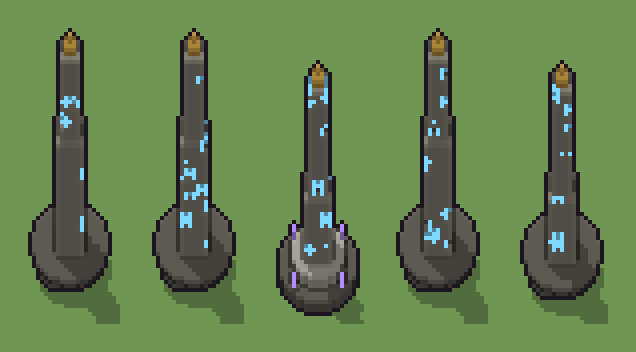

# Obelisco inciso (`fantasy-obelisco-inciso.xml`)

Classe `monumento`, scatola 20 × 20 × 60 voxel, ambientazione `fantasy (aurora)`.

Un obelisco di pietra con la punta di bronzo e rune che brillano dal fondo dei solchi. Il seme sceglie l'altezza, la base (gradoni, tamburo con cristalli, cumulo di macerie) e dove sono incisi i segni e quanto sono lunghi.

## Esito

- validatore (`modelErrors`, `checkProgram`, `analyse` a ogni seme): nessun errore, nessun frammento staccato
- varianza su 5 semi (voxel pieni in un seme e vuoti nell'altro, sui pieni in almeno uno; il colore non conta): **media 0.210**, minima 0.040, massima 0.391 (soglia 0.15) → passa
- voxel per seme: 3006, 2998, 2672, 3008, 2586; tempo per seme: 141, 150, 125, 132, 127 ms
- avvisi: tocca i bordi laterali della griglia: forse è tagliato; colori mai usati: C

| coppia | 1-2 | 1-3 | 1-4 | 1-5 | 2-3 | 2-4 | 2-5 | 3-4 | 3-5 | 4-5 |
|---|---|---|---|---|---|---|---|---|---|---|
| distanza | 0.041 | 0.391 | 0.043 | 0.169 | 0.389 | 0.040 | 0.162 | 0.390 | 0.311 | 0.162 |



## Traccia di tre semi a confronto

La traccia di `src/mj/trace.ts` (forma `nodi`): per ogni nodo quante volte gira, quante celle scrive e la scatola di ciò che scrive. Le
righe che cambiano fra i semi sono le scelte del programma.

### Seme 1

```text
Traccia, seme 1: griglia 20×20×60, 42 nodi, 106 passi, finito in 148 ms.
x sinistra→destra, y fondo→davanti, z basso→alto; «.» è la cella vuota; #n è il nodo nell'ordine dell'XML; ×n quante volte ha agito.
Lettere: S=pietra, d=pietra scura, G=pietra chiara, P=bronzo, R=runa luminosa, x=solco inciso (marcatore), v=per mescolare il caso (marcatore), V=spazio della base (marcatore), U=spazio del fusto (marcatore), n=alto 58 (marcatore), o=cumulo di macerie (marcatore).
Alla fine: S 1673, d 1138, R 148, G 27, P 20.
 #2 box at 10 10 0 size 21 21 60 v: ×1, 24000 celle x0-19 y0-19 z0-59, passi 1, .→v 24000
 #3 all v → .: ×1, 24000 celle x0-19 y0-19 z0-59, passi 2, v→. 24000
#4-5 box×2: 24000 celle x0-19 y0-19 z0-59, passi 3-4
#6-8 one×2, all×1: 24000 celle x0-19 y0-19 z0-59, passi 5-89
#18-36 ellipsoid×3, box×4: 3075 celle x1-19 y1-19 z0-57, passi 90-96
#37-42 all×3, prl×3: 21211 celle x0-19 y0-19 z0-59, passi 97-106
Senza effetto (non hanno mai cambiato una cella):
#9 box at 10 10 0 size 17 17 2 d su a
#10 box at 10 10 2 size 13 13 2 G su a
#11 box at 10 10 4 size 9 9 2 d su a
#12 cylinder at 10 10 0 size 19 19 3 d su b
#13 cylinder at 10 10 3 size 13 13 3 G su b
#14 box at 4 4 3 size 1 1 3 C su b
#15 box at 16 4 3 size 1 1 3 C su b
#16 box at 4 16 3 size 1 1 3 C su b
#17 box at 16 16 3 size 1 1 3 C su b
#21 box at 10 10 6 size 7 7 10 S su k
#22 box at 10 10 6 size 5 5 27 S su k
#23 box at 10 10 33 size 3 3 2 P su k
… e altri 9
```

### Seme 2

```text
Traccia, seme 2: griglia 20×20×60, 42 nodi, 98 passi, finito in 160 ms.
x sinistra→destra, y fondo→davanti, z basso→alto; «.» è la cella vuota; #n è il nodo nell'ordine dell'XML; ×n quante volte ha agito.
Lettere: S=pietra, d=pietra scura, G=pietra chiara, P=bronzo, R=runa luminosa, x=solco inciso (marcatore), v=per mescolare il caso (marcatore), V=spazio della base (marcatore), U=spazio del fusto (marcatore), n=alto 58 (marcatore), o=cumulo di macerie (marcatore).
Alla fine: S 1648, d 1138, R 165, G 27, P 20.
 #2 box at 10 10 0 size 21 21 60 v: ×1, 24000 celle x0-19 y0-19 z0-59, passi 1, .→v 24000
 #3 all v → .: ×1, 24000 celle x0-19 y0-19 z0-59, passi 2, v→. 24000
#4-5 box×2: 24000 celle x0-19 y0-19 z0-59, passi 3-4
#6-8 one×2, all×1: 24000 celle x0-19 y0-19 z0-59, passi 5-81
#18-36 ellipsoid×3, box×4: 3075 celle x1-19 y1-19 z0-57, passi 82-88
#37-42 all×3, prl×3: 21244 celle x0-19 y0-19 z0-59, passi 89-98
Senza effetto (non hanno mai cambiato una cella):
#9 box at 10 10 0 size 17 17 2 d su a
#10 box at 10 10 2 size 13 13 2 G su a
#11 box at 10 10 4 size 9 9 2 d su a
#12 cylinder at 10 10 0 size 19 19 3 d su b
#13 cylinder at 10 10 3 size 13 13 3 G su b
#14 box at 4 4 3 size 1 1 3 C su b
#15 box at 16 4 3 size 1 1 3 C su b
#16 box at 4 16 3 size 1 1 3 C su b
#17 box at 16 16 3 size 1 1 3 C su b
#21 box at 10 10 6 size 7 7 10 S su k
#22 box at 10 10 6 size 5 5 27 S su k
#23 box at 10 10 33 size 3 3 2 P su k
… e altri 9
```

### Seme 3

```text
Traccia, seme 3: griglia 20×20×60, 42 nodi, 105 passi, finito in 160 ms.
x sinistra→destra, y fondo→davanti, z basso→alto; «.» è la cella vuota; #n è il nodo nell'ordine dell'XML; ×n quante volte ha agito.
Lettere: S=pietra, d=pietra scura, G=pietra chiara, P=bronzo, R=runa luminosa, C=cristallo arcano, x=solco inciso (marcatore), v=per mescolare il caso (marcatore), V=spazio della base (marcatore), U=spazio del fusto (marcatore), m=alto 52 (marcatore), b=tamburo con i cristalli (marcatore).
Alla fine: S 1183, d 879, G 411, R 167, P 20, C 12.
 #2 box at 10 10 0 size 21 21 60 v: ×1, 24000 celle x0-19 y0-19 z0-59, passi 1, .→v 24000
 #3 all v → .: ×1, 24000 celle x0-19 y0-19 z0-59, passi 2, v→. 24000
#4-5 box×2: 24000 celle x0-19 y0-19 z0-59, passi 3-4
#6-8 one×2, all×1: 24000 celle x0-19 y0-19 z0-59, passi 5-85
#12-42 cylinder×2, box×8, all×3, prl×3: 24335 celle x0-19 y0-19 z0-59, passi 86-105
Senza effetto (non hanno mai cambiato una cella):
#9 box at 10 10 0 size 17 17 2 d su a
#10 box at 10 10 2 size 13 13 2 G su a
#11 box at 10 10 4 size 9 9 2 d su a
#18 ellipsoid at 10 10 0 size 19 19 12 d su o
#19 ellipsoid at 6 13 0 size 7 7 5 G su o
#20 ellipsoid at 14 6 0 size 5 5 3 S su o
#21 box at 10 10 6 size 7 7 10 S su k
#22 box at 10 10 6 size 5 5 27 S su k
#23 box at 10 10 33 size 3 3 2 P su k
#24 box at 10 10 35 size 1 1 2 P su k
#25 box at 10 10 6 size 7 7 21 S su l
#26 box at 10 10 6 size 5 5 35 S su l
… e altri 6
```
