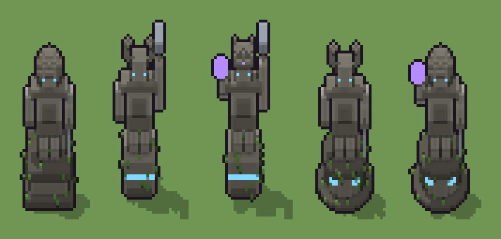

# Statua del guardiano (`fantasy-statua-guardiano.xml`)

Classe `monumento`, scatola 20 × 20 × 60 voxel, ambientazione `fantasy (aurora)`.

Un guerriero di pietra in armatura su un piedistallo, con occhi e rune luminose. Il seme sceglie il piedistallo, l'elmo (cornuto, corona, cappuccio), l'arma della destra (lancia, spada piantata, martello) e la sinistra (scudo, sfera di cristallo, braccio al fianco).

## Esito

- validatore (`modelErrors`, `checkProgram`, `analyse` a ogni seme): nessun errore, nessun frammento staccato
- varianza su 5 semi (voxel pieni in un seme e vuoti nell'altro, sui pieni in almeno uno; il colore non conta): **media 0.261**, minima 0.111, massima 0.394 (soglia 0.15) → passa
- voxel per seme: 4239, 3018, 3102, 3541, 3792; tempo per seme: 158, 155, 155, 155, 154 ms
- avvisi: tocca i bordi laterali della griglia: forse è tagliato; colori mai usati: C

| coppia | 1-2 | 1-3 | 1-4 | 1-5 | 2-3 | 2-4 | 2-5 | 3-4 | 3-5 | 4-5 |
|---|---|---|---|---|---|---|---|---|---|---|
| distanza | 0.368 | 0.394 | 0.209 | 0.183 | 0.111 | 0.250 | 0.343 | 0.318 | 0.294 | 0.138 |



## Traccia di tre semi a confronto

La traccia di `src/mj/trace.ts` (forma `nodi`): per ogni nodo quante volte gira, quante celle scrive e la scatola di ciò che scrive. Le
righe che cambiano fra i semi sono le scelte del programma.

### Seme 1

```text
Traccia, seme 1: griglia 20×20×60, 72 nodi, 100 passi, finito in 169 ms.
x sinistra→destra, y fondo→davanti, z basso→alto; «.» è la cella vuota; #n è il nodo nell'ordine dell'XML; ×n quante volte ha agito.
Lettere: S=pietra, d=pietra scura, G=pietra della statua, g=pietra in ombra, R=runa luminosa, M=ferro, m=muschio, V=spazio del piedistallo (marcatore), H=spazio della testa (marcatore), L=spazio della sinistra (marcatore), P=spazio della destra (marcatore), a=piedistallo a gradoni (marcatore), h=cappuccio (marcatore), j=spada piantata (marcatore), u=braccio lungo il fianco (marcatore), v=per mescolare il caso (marcatore).
Alla fine: d 1542, S 934, G 824, g 818, R 82, m 29, M 10.
 #2 box at 10 10 0 size 20 20 60 v: ×1, 21660 celle x1-19 y1-19 z0-59, passi 1, .→v 21660
 #3 all v → .: ×1, 21660 celle x1-19 y1-19 z0-59, passi 2, v→. 21660
#4-12 box×4, one×4, all×1: 35112 celle x0-19 y1-19 z0-59, passi 3-70
#13-72 box×26, ellipsoid×1, all×1, prl×2: 18986 celle x0-19 y1-19 z0-59, passi 71-100
Senza effetto (non hanno mai cambiato una cella):
#16 cylinder at 10 10 0 size 19 19 2 d su b
#17 cylinder at 10 10 2 size 13 13 8 S su b
#18 cylinder at 10 10 10 size 16 16 2 d su b
#19 box at 10 10 0 size 11 11 12 S su o
#20 box at 10 15 0 size 9 3 2 d su o
#33 box at 10 10 43 size 5 5 1 g su c
#34 line 8 10 40 → 5 10 44 g
#35 line 12 10 40 → 15 10 44 g
#36 line 5 10 44 → 6 10 48 g
#37 line 15 10 44 → 14 10 48 g
#38 box at 10 10 43 size 7 7 2 g su e
#39 box at 7 7 45 size 1 1 2 g su e
… e altri 18
```

### Seme 2

```text
Traccia, seme 2: griglia 20×20×60, 72 nodi, 102 passi, finito in 169 ms.
x sinistra→destra, y fondo→davanti, z basso→alto; «.» è la cella vuota; #n è il nodo nell'ordine dell'XML; ×n quante volte ha agito.
Lettere: S=pietra, d=pietra scura, G=pietra della statua, g=pietra in ombra, R=runa luminosa, M=ferro, m=muschio, V=spazio del piedistallo (marcatore), H=spazio della testa (marcatore), L=spazio della sinistra (marcatore), P=spazio della destra (marcatore), o=plinto con le rune (marcatore), c=elmo cornuto (marcatore), k=martello levato (marcatore), u=braccio lungo il fianco (marcatore), v=per mescolare il caso (marcatore).
Alla fine: S 1372, G 841, g 598, M 84, R 82, m 23, d 18.
#2-3 box×1, all×1: 43320 celle x1-19 y1-19 z0-59, passi 1-2
#4-12 box×4, one×4, all×1: 35112 celle x0-19 y1-19 z0-59, passi 3-73
#19-72 box×22, line×4, all×1, prl×2: 18952 celle x0-19 y1-19 z0-59, passi 74-102
Senza effetto (non hanno mai cambiato una cella):
#13 box at 10 10 0 size 17 17 3 d su a
#14 box at 10 10 3 size 13 13 6 S su a
#15 box at 10 10 9 size 15 15 3 d su a
#16 cylinder at 10 10 0 size 19 19 2 d su b
#17 cylinder at 10 10 2 size 13 13 8 S su b
#18 cylinder at 10 10 10 size 16 16 2 d su b
#38 box at 10 10 43 size 7 7 2 g su e
#39 box at 7 7 45 size 1 1 2 g su e
#40 box at 13 7 45 size 1 1 2 g su e
#41 box at 7 13 45 size 1 1 2 g su e
#42 box at 13 13 45 size 1 1 2 g su e
#43 box at 10 13 45 size 1 1 3 g su e
… e altri 19
```

### Seme 3

```text
Traccia, seme 3: griglia 20×20×60, 72 nodi, 111 passi, finito in 157 ms.
x sinistra→destra, y fondo→davanti, z basso→alto; «.» è la cella vuota; #n è il nodo nell'ordine dell'XML; ×n quante volte ha agito.
Lettere: S=pietra, d=pietra scura, G=pietra della statua, g=pietra in ombra, R=runa luminosa, C=cristallo arcano, M=ferro, m=muschio, V=spazio del piedistallo (marcatore), H=spazio della testa (marcatore), L=spazio della sinistra (marcatore), P=spazio della destra (marcatore), o=plinto con le rune (marcatore), e=corona (marcatore), k=martello levato (marcatore), t=sfera alzata (marcatore), v=per mescolare il caso (marcatore).
Alla fine: S 1372, G 823, g 619, M 84, R 82, C 82, m 22, d 18.
#2-3 box×1, all×1: 43320 celle x1-19 y1-19 z0-59, passi 1-2
#4-12 box×4, one×4, all×1: 35112 celle x0-19 y1-19 z0-59, passi 3-79
#19-72 box×28, ellipsoid×1, all×1, prl×2: 18952 celle x0-19 y1-19 z0-59, passi 80-111
Senza effetto (non hanno mai cambiato una cella):
#13 box at 10 10 0 size 17 17 3 d su a
#14 box at 10 10 3 size 13 13 6 S su a
#15 box at 10 10 9 size 15 15 3 d su a
#16 cylinder at 10 10 0 size 19 19 2 d su b
#17 cylinder at 10 10 2 size 13 13 8 S su b
#18 cylinder at 10 10 10 size 16 16 2 d su b
#33 box at 10 10 43 size 5 5 1 g su c
#34 line 8 10 40 → 5 10 44 g
#35 line 12 10 40 → 15 10 44 g
#36 line 5 10 44 → 6 10 48 g
#37 line 15 10 44 → 14 10 48 g
#45 ellipsoid at 10 9 35 size 9 9 11 g su h
… e altri 16
```
