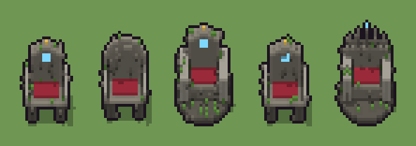

# Trono di pietra (`fantasy-trono-di-pietra.xml`)

Classe `mobile`, scatola 20 × 20 × 20 voxel, ambientazione `fantasy (aurora)`.

Un seggio di pietra con il cuscino di velluto, i braccioli e uno schienale con una gemma runica. Il seme sceglie la parte bassa (pedana a gradini, quattro gambe, podio tondo), lo schienale (a punta, a ventaglio, ad arco) e dove crescono schegge e muschio.

## Esito

- validatore (`modelErrors`, `checkProgram`, `analyse` a ogni seme): nessun errore, nessun frammento staccato
- varianza su 5 semi (voxel pieni in un seme e vuoti nell'altro, sui pieni in almeno uno; il colore non conta): **media 0.424**, minima 0.078, massima 0.654 (soglia 0.15) → passa
- voxel per seme: 854, 864, 1985, 853, 1926; tempo per seme: 40, 39, 42, 41, 40 ms
- avvisi: tocca il soffitto della griglia: forse è tagliato in alto; colori mai usati: C r; tocca i bordi laterali della griglia: forse è tagliato; colori mai usati: r

| coppia | 1-2 | 1-3 | 1-4 | 1-5 | 2-3 | 2-4 | 2-5 | 3-4 | 3-5 | 4-5 |
|---|---|---|---|---|---|---|---|---|---|---|
| distanza | 0.133 | 0.603 | 0.078 | 0.652 | 0.621 | 0.132 | 0.651 | 0.603 | 0.117 | 0.654 |



## Traccia di tre semi a confronto

La traccia di `src/mj/trace.ts` (forma `nodi`): per ogni nodo quante volte gira, quante celle scrive e la scatola di ciò che scrive. Le
righe che cambiano fra i semi sono le scelte del programma.

### Seme 1

```text
Traccia, seme 1: griglia 20×20×20, 49 nodi, 69 passi, finito in 45 ms.
x sinistra→destra, y fondo→davanti, z basso→alto; «.» è la cella vuota; #n è il nodo nell'ordine dell'XML; ×n quante volte ha agito.
Lettere: S=pietra, d=pietra scura, G=pietra chiara, R=velluto rosso, C=gemma runica, r=oro, M=muschio, X=scheggia, V=spazio basso (marcatore), U=spazio dello schienale (marcatore), v=per mescolare il caso (marcatore), b=quattro gambe (marcatore), f=schienale a punta (marcatore).
Alla fine: S 516, d 180, G 66, R 45, X 27, M 10, C 9, r 1.
 #2 box at 10 10 0 size 20 20 20 v: ×1, 7220 celle x1-19 y1-19 z0-19, passi 1, .→v 7220
 #3 all v → .: ×1, 7220 celle x1-19 y1-19 z0-19, passi 2, v→. 7220
#4-5 box×2: 8000 celle x0-19 y0-19 z0-19, passi 3-4
#6-8 one×2, all×1: 8000 celle x0-19 y0-19 z0-19, passi 5-50
#14-49 box×14, ellipsoid×2, all×1, prl×2: 8320 celle x0-19 y0-19 z0-19, passi 51-69
Senza effetto (non hanno mai cambiato una cella):
#9 box at 10 10 0 size 19 17 1 d su a
#10 box at 10 9 1 size 15 13 1 S su a
#11 box at 10 8 2 size 11 9 4 S su a
#12 box at 4 8 2 size 3 9 7 G su a
#13 box at 16 8 2 size 3 9 7 G su a
#21 box at 3 13 6 size 1 1 3 r su b
#22 box at 17 13 6 size 1 1 3 r su b
#23 cylinder at 10 10 0 size 19 19 2 d su o
#24 box at 10 8 2 size 11 9 4 S su o
#25 box at 3 8 2 size 3 11 8 G su o
#26 box at 17 8 2 size 3 11 8 G su o
#27 box at 3 13 9 size 3 1 1 r su o
… e altri 10
```

### Seme 2

```text
Traccia, seme 2: griglia 20×20×20, 49 nodi, 62 passi, finito in 45 ms.
x sinistra→destra, y fondo→davanti, z basso→alto; «.» è la cella vuota; #n è il nodo nell'ordine dell'XML; ×n quante volte ha agito.
Lettere: S=pietra, d=pietra scura, G=pietra chiara, R=velluto rosso, M=muschio, X=scheggia, V=spazio basso (marcatore), U=spazio dello schienale (marcatore), v=per mescolare il caso (marcatore), b=quattro gambe (marcatore), h=schienale ad arco (marcatore).
Alla fine: S 538, d 180, G 66, R 45, X 31, M 4.
 #2 box at 10 10 0 size 20 20 20 v: ×1, 7220 celle x1-19 y1-19 z0-19, passi 1, .→v 7220
 #3 all v → .: ×1, 7220 celle x1-19 y1-19 z0-19, passi 2, v→. 7220
#4-5 box×2: 8000 celle x0-19 y0-19 z0-19, passi 3-4
#6-8 one×2, all×1: 8000 celle x0-19 y0-19 z0-19, passi 5-47
#14-45 box×9, ellipsoid×3: 1115 celle x3-17 y3-13 z0-18, passi 48-59
#47-49 all×1, prl×2: 7206 celle x0-19 y0-19 z0-19, passi 60-62
Senza effetto (non hanno mai cambiato una cella):
#9 box at 10 10 0 size 19 17 1 d su a
#10 box at 10 9 1 size 15 13 1 S su a
#11 box at 10 8 2 size 11 9 4 S su a
#12 box at 4 8 2 size 3 9 7 G su a
#13 box at 16 8 2 size 3 9 7 G su a
#21 box at 3 13 6 size 1 1 3 r su b
#22 box at 17 13 6 size 1 1 3 r su b
#23 cylinder at 10 10 0 size 19 19 2 d su o
#24 box at 10 8 2 size 11 9 4 S su o
#25 box at 3 8 2 size 3 11 8 G su o
#26 box at 17 8 2 size 3 11 8 G su o
#27 box at 3 13 9 size 3 1 1 r su o
… e altri 14
```

### Seme 3

```text
Traccia, seme 3: griglia 20×20×20, 49 nodi, 63 passi, finito in 44 ms.
x sinistra→destra, y fondo→davanti, z basso→alto; «.» è la cella vuota; #n è il nodo nell'ordine dell'XML; ×n quante volte ha agito.
Lettere: S=pietra, d=pietra scura, G=pietra chiara, R=velluto rosso, C=gemma runica, r=oro, M=muschio, X=scheggia, V=spazio basso (marcatore), U=spazio dello schienale (marcatore), v=per mescolare il caso (marcatore), o=podio tondo (marcatore), f=schienale a punta (marcatore).
Alla fine: S 747, d 586, G 528, X 45, R 45, M 24, C 9, r 1.
 #2 box at 10 10 0 size 20 20 20 v: ×1, 7220 celle x1-19 y1-19 z0-19, passi 1, .→v 7220
 #3 all v → .: ×1, 7220 celle x1-19 y1-19 z0-19, passi 2, v→. 7220
#4-5 box×2: 8000 celle x0-19 y0-19 z0-19, passi 3-4
#6-8 one×2, all×1: 8000 celle x0-19 y0-19 z0-19, passi 5-47
#23-49 cylinder×1, box×10, ellipsoid×2, all×1, prl×2: 8352 celle x0-19 y0-19 z0-19, passi 48-63
Senza effetto (non hanno mai cambiato una cella):
#9 box at 10 10 0 size 19 17 1 d su a
#10 box at 10 9 1 size 15 13 1 S su a
#11 box at 10 8 2 size 11 9 4 S su a
#12 box at 4 8 2 size 3 9 7 G su a
#13 box at 16 8 2 size 3 9 7 G su a
#14 box at 5 5 0 size 3 3 5 d su b
#15 box at 15 5 0 size 3 3 5 d su b
#16 box at 5 12 0 size 3 3 5 d su b
#17 box at 15 12 0 size 3 3 5 d su b
#18 box at 10 8 5 size 15 11 1 S su b
#19 box at 3 8 6 size 1 11 3 G su b
#20 box at 17 8 6 size 1 11 3 G su b
… e altri 13
```
