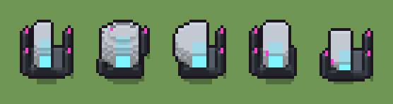

# Capsula criogenica (`futuristico-capsula-criogenica.xml`)

Classe `mobile`, scatola 20 × 20 × 20 voxel, ambientazione `futuristico (sidera)`.

Un guscio di ceramica bianca con la finestra di ghiaccio ciano acceso, su uno zoccolo di grafite. Il seme sceglie se sta in piedi o distesa, quanto è alta o lunga e quali bombole di raffreddamento ha accanto.

## Esito

- validatore (`modelErrors`, `checkProgram`, `analyse` a ogni seme): nessun errore, nessun frammento staccato
- varianza su 5 semi (voxel pieni in un seme e vuoti nell'altro, sui pieni in almeno uno; il colore non conta): **media 0.369**, minima 0.304, massima 0.543 (soglia 0.15) → passa
- voxel per seme: 710, 1144, 858, 825, 549; tempo per seme: 17, 13, 14, 15, 17 ms

| coppia | 1-2 | 1-3 | 1-4 | 1-5 | 2-3 | 2-4 | 2-5 | 3-4 | 3-5 | 4-5 |
|---|---|---|---|---|---|---|---|---|---|---|
| distanza | 0.423 | 0.321 | 0.308 | 0.312 | 0.306 | 0.304 | 0.543 | 0.334 | 0.379 | 0.458 |



## Traccia di tre semi a confronto

La traccia di `src/mj/trace.ts` (forma `nodi`): per ogni nodo quante volte gira, quante celle scrive e la scatola di ciò che scrive. Le
righe che cambiano fra i semi sono le scelte del programma.

### Seme 1

```text
Traccia, seme 1: griglia 20×20×20, 53 nodi, 259 passi, finito in 18 ms.
x sinistra→destra, y fondo→davanti, z basso→alto; «.» è la cella vuota; #n è il nodo nell'ordine dell'XML; ×n quante volte ha agito.
Lettere: W=ceramica bianca, w=ceramica in ombra, G=grafite, g=grafite chiara, C=ghiaccio ciano, M=spia magenta, V=vetro, a=la capsula in piedi (marcatore), b=la capsula distesa (marcatore), c=dove le due si sovrappongono (marcatore), x=segno della capsula in piedi (marcatore), y=segno della capsula distesa (marcatore), Y=la capsula distesa scelta (marcatore), h=quote possibili (marcatore), k=la quota scelta (marcatore), p=dove può stare una bombola (marcatore), q=una bombola (marcatore).
Alla fine: W 314, G 145, g 105, C 76, w 50, V 16, M 4.
#2-19 box×6, cylinder×1, ellipsoid×3, one×2, all×6: 5182 celle x0-19 y0-19 z0-19, passi 1-82
#20-21 all×2: 6897 celle x0-19 y0-19 z10-19, passi 83-92
#22-26 box×1, one×1, all×3: 6169 celle x12-19 y0-19 z0-19, passi 93-142
#27-35 box×2, one×2, all×5: 5136 celle x0-19 y0-19 z0-19, passi 143-231
 #36 all [.Y] k → k k: ×9, 3600 celle x0-19 y0-19 z11-19, passi 232-240, .→k 3600
#37-53 all×8, box×5, prl×1: 4706 celle x0-19 y0-19 z0-19, passi 241-259
Senza effetto (non hanno mai cambiato una cella):
#41 all .C → .V: le celle cercate c'erano, ma mai disposte come nel pattern
#43 prl .w → .M passi=1
#49 all p → .: in quel momento nella griglia non c'erano celle "p"
```

### Seme 2

```text
Traccia, seme 2: griglia 20×20×20, 53 nodi, 242 passi, finito in 12 ms.
x sinistra→destra, y fondo→davanti, z basso→alto; «.» è la cella vuota; #n è il nodo nell'ordine dell'XML; ×n quante volte ha agito.
Lettere: W=ceramica bianca, w=ceramica in ombra, G=grafite, g=grafite chiara, C=ghiaccio ciano, M=spia magenta, V=vetro, a=la capsula in piedi (marcatore), b=la capsula distesa (marcatore), c=dove le due si sovrappongono (marcatore), x=segno della capsula in piedi (marcatore), y=segno della capsula distesa (marcatore), Y=la capsula distesa scelta (marcatore), h=quote possibili (marcatore), k=la quota scelta (marcatore), p=dove può stare una bombola (marcatore), q=una bombola (marcatore).
Alla fine: W 688, G 128, w 118, C 100, g 88, V 20, M 2.
#2-10 box×5, cylinder×1, ellipsoid×3: 2864 celle x1-19 y5-15 z0-19, passi 1-9
#11-25 one×3, all×9, box×2: 4354 celle x0-19 y0-19 z0-19, passi 10-126
#26-35 all×6, box×2, one×2: 4404 celle x0-19 y0-19 z0-19, passi 127-213
 #36 all [.Y] k → k k: ×8, 3200 celle x0-19 y0-19 z12-19, passi 214-221, .→k 3200
 #37 all k → .: ×1, 3600 celle x0-19 y0-19 z11-19, passi 222, k→. 3600
#38-53 all×8, box×5, prl×2: 1227 celle x2-18 y5-15 z0-10, passi 223-242
Senza effetto (non hanno mai cambiato una cella):
#20 all [.X] k → k k: le celle cercate c'erano, ma mai disposte come nel pattern
#41 all .C → .V: le celle cercate c'erano, ma mai disposte come nel pattern
```

### Seme 3

```text
Traccia, seme 3: griglia 20×20×20, 53 nodi, 249 passi, finito in 15 ms.
x sinistra→destra, y fondo→davanti, z basso→alto; «.» è la cella vuota; #n è il nodo nell'ordine dell'XML; ×n quante volte ha agito.
Lettere: W=ceramica bianca, w=ceramica in ombra, G=grafite, g=grafite chiara, C=ghiaccio ciano, M=spia magenta, V=vetro, a=la capsula in piedi (marcatore), b=la capsula distesa (marcatore), c=dove le due si sovrappongono (marcatore), x=segno della capsula in piedi (marcatore), y=segno della capsula distesa (marcatore), Y=la capsula distesa scelta (marcatore), h=quote possibili (marcatore), k=la quota scelta (marcatore), p=dove può stare una bombola (marcatore), q=una bombola (marcatore).
Alla fine: W 441, G 131, g 91, w 91, C 80, V 20, M 4.
#2-10 box×5, cylinder×1, ellipsoid×3: 2864 celle x1-19 y5-15 z0-19, passi 1-9
#11-24 one×3, all×9, box×2: 5169 celle x0-19 y0-19 z0-19, passi 10-87
#25-35 all×7, box×2, one×2: 7427 celle x0-19 y0-19 z0-19, passi 88-218
 #36 all [.Y] k → k k: ×10, 4000 celle x0-19 y0-19 z10-19, passi 219-228, .→k 3969, Y→k 31
#37-53 all×9, box×5, prl×2: 5299 celle x0-19 y0-19 z0-19, passi 229-249
Senza effetto (non hanno mai cambiato una cella):
#41 all .C → .V: le celle cercate c'erano, ma mai disposte come nel pattern
```
