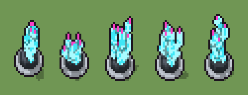

# Cristallo energetico (`futuristico-cristallo-energetico.xml`)

Classe `mobile`, scatola 20 × 20 × 20 voxel, ambientazione `futuristico (sidera)`.

Un grappolo di cristalli ciano accesi con le punte magenta, incastonato in una presa di grafite cerchiata di ceramica bianca. Il seme sceglie quanti cristalli nascono, dove, quanto sale ciascuno e da che parte si piega.

## Esito

- validatore (`modelErrors`, `checkProgram`, `analyse` a ogni seme): nessun errore, nessun frammento staccato
- varianza su 5 semi (voxel pieni in un seme e vuoti nell'altro, sui pieni in almeno uno; il colore non conta): **media 0.476**, minima 0.447, massima 0.508 (soglia 0.15) → passa
- voxel per seme: 558, 591, 654, 638, 649; tempo per seme: 2, 2, 3, 2, 3 ms
- avvisi: tocca il soffitto della griglia: forse è tagliato in alto

| coppia | 1-2 | 1-3 | 1-4 | 1-5 | 2-3 | 2-4 | 2-5 | 3-4 | 3-5 | 4-5 |
|---|---|---|---|---|---|---|---|---|---|---|
| distanza | 0.447 | 0.493 | 0.455 | 0.508 | 0.457 | 0.469 | 0.463 | 0.478 | 0.497 | 0.496 |



## Traccia di tre semi a confronto

La traccia di `src/mj/trace.ts` (forma `nodi`): per ogni nodo quante volte gira, quante celle scrive e la scatola di ciò che scrive. Le
righe che cambiano fra i semi sono le scelte del programma.

### Seme 1

```text
Traccia, seme 1: griglia 20×20×20, 17 nodi, 80 passi, finito in 3 ms.
x sinistra→destra, y fondo→davanti, z basso→alto; «.» è la cella vuota; #n è il nodo nell'ordine dell'XML; ×n quante volte ha agito.
Lettere: W=ceramica bianca, w=ceramica in ombra, G=grafite, g=grafite chiara, C=cristallo ciano, D=cristallo chiaro, M=punta magenta, V=dove può nascere un cristallo (marcatore), k=lanci a vuoto (marcatore), r=la punta che cresce (marcatore).
Alla fine: G 138, C 124, D 109, W 69, w 68, g 45, M 5.
 #2 box at 19 19 17 size 1 1 3 k: ×1, 3 celle x19 y19 z17-19, passi 1, .→k 3
 #3 one k → . passi=3: ×3, 3 celle x19 y19 z17-19, passi 2-4, k→. 3
#4-8 cylinder×4, box×1: 358 celle x4-16 y4-16 z0-4, passi 5-9
#9-10 one×1, prl×1: 3 celle x11-12 y9-13 z4, passi 10-11
 #11 all V → .: ×1, 33 celle x7-13 y7-13 z4, passi 12, V→. 33
 #12 one . r → r C (+1) passi=75: ×60, 120 celle x9-13 y9-14 z4-19, passi 13-72, r→C 60, .→r 60
   r1 . r → r C ×26; r2 .* *r → r* *C ×34
#13-14 all×2: 5 celle x11-13 y10-14 z18-19, passi 73-74
 #15 all .C → DC: ×4, 174 celle x8-14 y8-15 z4-18, passi 75-78, .→D 174
 #16 prl D → C passi=1: ×1, 65 celle x8-14 y9-14 z4-18, passi 79, D→C 65
 #17 all . W → * w passi=1: ×1, 68 celle x4-16 y4-16 z0, passi 80, W→w 68
```

### Seme 2

```text
Traccia, seme 2: griglia 20×20×20, 17 nodi, 95 passi, finito in 3 ms.
x sinistra→destra, y fondo→davanti, z basso→alto; «.» è la cella vuota; #n è il nodo nell'ordine dell'XML; ×n quante volte ha agito.
Lettere: W=ceramica bianca, w=ceramica in ombra, G=grafite, g=grafite chiara, C=cristallo ciano, D=cristallo chiaro, M=punta magenta, V=dove può nascere un cristallo (marcatore), k=lanci a vuoto (marcatore), r=la punta che cresce (marcatore).
Alla fine: G 138, D 132, C 121, W 69, w 68, g 45, M 18.
#2-3 box×1, one×1: 6 celle x19 y19 z17-19, passi 1-4
#4-8 cylinder×4, box×1: 358 celle x4-16 y4-16 z0-4, passi 5-9
#9-10 one×1, prl×1: 9 celle x7-12 y8-13 z4, passi 10-11
 #11 all V → .: ×1, 27 celle x7-13 y7-13 z4, passi 12, V→. 27
 #12 one . r → r C (+1) passi=75: ×75, 150 celle x5-13 y8-14 z4-14, passi 13-87, r→C 75, .→r 75
   r1 . r → r C ×39; r2 .* *r → r* *C ×36
 #13 all r → M: ×1, 10 celle x5-13 y8-14 z8-14, passi 88, r→M 10
 #14 all M C → * M passi=1: ×1, 8 celle x5-13 y8-13 z7-12, passi 89, C→M 8
 #15 all .C → DC: ×4, 186 celle x4-14 y7-15 z4-13, passi 90-93, .→D 186
 #16 prl D → C passi=1: ×1, 54 celle x4-13 y7-15 z4-13, passi 94, D→C 54
 #17 all . W → * w passi=1: ×1, 68 celle x4-16 y4-16 z0, passi 95, W→w 68
```

### Seme 3

```text
Traccia, seme 3: griglia 20×20×20, 17 nodi, 95 passi, finito in 2 ms.
x sinistra→destra, y fondo→davanti, z basso→alto; «.» è la cella vuota; #n è il nodo nell'ordine dell'XML; ×n quante volte ha agito.
Lettere: W=ceramica bianca, w=ceramica in ombra, G=grafite, g=grafite chiara, C=cristallo ciano, D=cristallo chiaro, M=punta magenta, V=dove può nascere un cristallo (marcatore), k=lanci a vuoto (marcatore), r=la punta che cresce (marcatore).
Alla fine: D 162, C 162, G 138, W 69, w 68, g 45, M 10.
#2-3 box×1, one×1: 6 celle x19 y19 z17-19, passi 1-4
#4-8 cylinder×4, box×1: 358 celle x4-16 y4-16 z0-4, passi 5-9
#9-10 one×1, prl×1: 5 celle x7-13 y7-12 z4, passi 10-11
 #11 all V → .: ×1, 31 celle x7-13 y7-13 z4, passi 12, V→. 31
 #12 one . r → r C (+1) passi=75: ×75, 150 celle x7-15 y6-13 z4-19, passi 13-87, r→C 75, .→r 75
   r1 . r → r C ×41; r2 .* *r → r* *C ×34
 #13 all r → M: ×1, 6 celle x7-15 y6-11 z11-19, passi 88, r→M 6
 #14 all M C → * M passi=1: ×1, 4 celle x7-15 y6-11 z16-18, passi 89, C→M 4
 #15 all .C → DC: ×4, 253 celle x6-15 y5-14 z4-17, passi 90-93, .→D 253
 #16 prl D → C passi=1: ×1, 91 celle x6-15 y6-14 z4-17, passi 94, D→C 91
 #17 all . W → * w passi=1: ×1, 68 celle x4-16 y4-16 z0, passi 95, W→w 68
```
