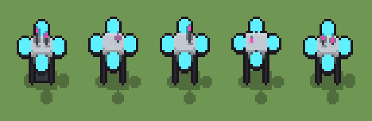

# Drone cargo (`futuristico-drone-cargo.xml`)

Classe `mobile`, scatola 20 × 20 × 20 voxel, ambientazione `futuristico (sidera)`.

Un drone con il corpo di ceramica bianca, quattro bracci di grafite con i rotori ciano accesi e le zampe di atterraggio, a volte con la cassa del carico appesa al cavo. Il seme sceglie quanto sta alto sulle zampe e se porta la cassa.

## Esito

- validatore (`modelErrors`, `checkProgram`, `analyse` a ogni seme): nessun errore, nessun frammento staccato
- varianza su 5 semi (voxel pieni in un seme e vuoti nell'altro, sui pieni in almeno uno; il colore non conta): **media 0.362**, minima 0.007, massima 0.638 (soglia 0.15) → passa
- voxel per seme: 711, 603, 607, 463, 602; tempo per seme: 13, 11, 18, 14, 11 ms
- avvisi: tocca i bordi laterali della griglia: forse è tagliato; colori mai usati: q; tocca il soffitto della griglia: forse è tagliato in alto; colori mai usati: g q

| coppia | 1-2 | 1-3 | 1-4 | 1-5 | 2-3 | 2-4 | 2-5 | 3-4 | 3-5 | 4-5 |
|---|---|---|---|---|---|---|---|---|---|---|
| distanza | 0.469 | 0.469 | 0.638 | 0.153 | 0.007 | 0.252 | 0.393 | 0.257 | 0.397 | 0.586 |



## Traccia di tre semi a confronto

La traccia di `src/mj/trace.ts` (forma `nodi`): per ogni nodo quante volte gira, quante celle scrive e la scatola di ciò che scrive. Le
righe che cambiano fra i semi sono le scelte del programma.

### Seme 1

```text
Traccia, seme 1: griglia 20×20×20, 54 nodi, 114 passi, finito in 18 ms.
x sinistra→destra, y fondo→davanti, z basso→alto; «.» è la cella vuota; #n è il nodo nell'ordine dell'XML; ×n quante volte ha agito.
Lettere: W=ceramica bianca, w=ceramica in ombra, G=grafite, g=grafite chiara, C=rotore ciano, M=luce magenta, V=vetro del sensore, a=dove può stare il corpo (marcatore), b=dove possono stare i bracci (marcatore), o=dove possono stare i rotori (marcatore), l=dove possono stare le zampe (marcatore), h=quote possibili (marcatore), k=la quota scelta (marcatore), K=il corpo (marcatore), L=i bracci (marcatore), O=i rotori (marcatore), P=zampa, r=il cavo che sale (marcatore), c=dove può stare la cassa (marcatore), q=cassa, x=la faccia del dado senza cassa (marcatore), R=la faccia del dado con la cassa (marcatore).
Alla fine: W 170, C 168, q 96, G 86, V 67, w 61, P 44, M 11, g 8.
#2-13 box×8, cylinder×4: 1633 celle x0-19 y0-19 z0-13, passi 1-12
#14-19 one×1, all×5: 834 celle x0-19 y0-19 z7-13, passi 13-56
#20-23 all×4: 1128 celle x1-19 y1-19 z4-13, passi 57-60
#24-54 all×19, box×5, one×2, prl×1: 957 celle x0-19 y1-19 z0-19, passi 61-114
Senza effetto (non hanno mai cambiato una cella):
#27 all .P → *P passi=1: le celle cercate c'erano, ma mai disposte come nel pattern
#32 all r → c: in quel momento nella griglia non c'erano celle "r"
#39 all c → .: in quel momento nella griglia non c'erano celle "c"
#46 prl r → . passi=1
```

### Seme 2

```text
Traccia, seme 2: griglia 20×20×20, 54 nodi, 92 passi, finito in 12 ms.
x sinistra→destra, y fondo→davanti, z basso→alto; «.» è la cella vuota; #n è il nodo nell'ordine dell'XML; ×n quante volte ha agito.
Lettere: W=ceramica bianca, w=ceramica in ombra, G=grafite, g=grafite chiara, C=rotore ciano, M=luce magenta, V=vetro del sensore, a=dove può stare il corpo (marcatore), b=dove possono stare i bracci (marcatore), o=dove possono stare i rotori (marcatore), l=dove possono stare le zampe (marcatore), h=quote possibili (marcatore), k=la quota scelta (marcatore), K=il corpo (marcatore), L=i bracci (marcatore), O=i rotori (marcatore), P=zampa, r=il cavo che sale (marcatore), c=dove può stare la cassa (marcatore), x=la faccia del dado senza cassa (marcatore).
Alla fine: W 169, C 168, G 86, w 62, V 59, P 48, M 10, g 1.
#2-54 box×13, cylinder×4, one×2, all×23, prl×2: 4493 celle x0-19 y0-19 z0-19, passi 1-92
Senza effetto (non hanno mai cambiato una cella):
#27 all .P → *P passi=1: le celle cercate c'erano, ma mai disposte come nel pattern
#33 all x → .: in quel momento nella griglia non c'erano celle "x"
#34 all R → r: in quel momento nella griglia non c'erano celle "R"
#35 one [.c] r → r V passi=20: in quel momento nella griglia non c'erano celle "r"
#36 all r → V: in quel momento nella griglia non c'erano celle "r"
#37 all Vc → Vq: in quel momento nella griglia non c'erano celle "V"
#38 all qc → qq: in quel momento nella griglia non c'erano celle "q"
#40 all . q → M *: in quel momento nella griglia non c'erano celle "q"
… tagliato: oltre il tetto di token.
```

### Seme 3

```text
Traccia, seme 3: griglia 20×20×20, 54 nodi, 96 passi, finito in 18 ms.
x sinistra→destra, y fondo→davanti, z basso→alto; «.» è la cella vuota; #n è il nodo nell'ordine dell'XML; ×n quante volte ha agito.
Lettere: W=ceramica bianca, w=ceramica in ombra, G=grafite, g=grafite chiara, C=rotore ciano, M=luce magenta, V=vetro del sensore, a=dove può stare il corpo (marcatore), b=dove possono stare i bracci (marcatore), o=dove possono stare i rotori (marcatore), l=dove possono stare le zampe (marcatore), h=quote possibili (marcatore), k=la quota scelta (marcatore), K=il corpo (marcatore), L=i bracci (marcatore), O=i rotori (marcatore), P=zampa, r=il cavo che sale (marcatore), c=dove può stare la cassa (marcatore), x=la faccia del dado senza cassa (marcatore).
Alla fine: W 169, C 168, G 86, w 62, V 59, P 48, M 10, g 5.
#2-54 box×13, cylinder×4, one×2, all×23, prl×2: 4501 celle x0-19 y0-19 z0-19, passi 1-96
Senza effetto (non hanno mai cambiato una cella):
#27 all .P → *P passi=1: le celle cercate c'erano, ma mai disposte come nel pattern
#33 all x → .: in quel momento nella griglia non c'erano celle "x"
#34 all R → r: in quel momento nella griglia non c'erano celle "R"
#35 one [.c] r → r V passi=20: in quel momento nella griglia non c'erano celle "r"
#36 all r → V: in quel momento nella griglia non c'erano celle "r"
#37 all Vc → Vq: in quel momento nella griglia non c'erano celle "V"
#38 all qc → qq: in quel momento nella griglia non c'erano celle "q"
#40 all . q → M *: in quel momento nella griglia non c'erano celle "q"
… tagliato: oltre il tetto di token.
```
