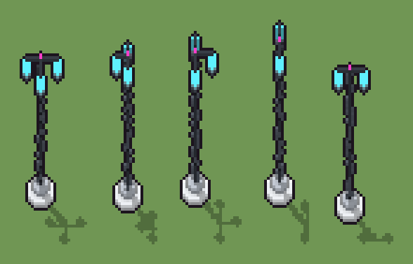

# Lampione al plasma (`futuristico-lampione-plasma.xml`)

Classe `monumento`, scatola 20 × 20 × 60 voxel, ambientazione `futuristico (sidera)`.

Un fusto di grafite su uno zoccolo di ceramica bianca, con i bracci che reggono sfere di plasma ciano chiuse nel vetro e una punta magenta. Il seme sceglie l'altezza del fusto, quanti bracci ha (da uno a quattro) e quanto è lungo ciascuno.

## Esito

- validatore (`modelErrors`, `checkProgram`, `analyse` a ogni seme): nessun errore, nessun frammento staccato
- varianza su 5 semi (voxel pieni in un seme e vuoti nell'altro, sui pieni in almeno uno; il colore non conta): **media 0.454**, minima 0.364, massima 0.503 (soglia 0.15) → passa
- voxel per seme: 378, 377, 381, 352, 342; tempo per seme: 11, 11, 12, 12, 11 ms
- avvisi: colori mai usati: P

| coppia | 1-2 | 1-3 | 1-4 | 1-5 | 2-3 | 2-4 | 2-5 | 3-4 | 3-5 | 4-5 |
|---|---|---|---|---|---|---|---|---|---|---|
| distanza | 0.484 | 0.364 | 0.489 | 0.425 | 0.502 | 0.503 | 0.395 | 0.454 | 0.448 | 0.478 |



## Traccia di tre semi a confronto

La traccia di `src/mj/trace.ts` (forma `nodi`): per ogni nodo quante volte gira, quante celle scrive e la scatola di ciò che scrive. Le
righe che cambiano fra i semi sono le scelte del programma.

### Seme 1

```text
Traccia, seme 1: griglia 20×20×60, 28 nodi, 118 passi, finito in 13 ms.
x sinistra→destra, y fondo→davanti, z basso→alto; «.» è la cella vuota; #n è il nodo nell'ordine dell'XML; ×n quante volte ha agito.
Lettere: W=ceramica bianca, w=ceramica in ombra, G=grafite, g=grafite chiara, C=plasma ciano, M=punta magenta, V=vetro, h=quote possibili (marcatore), k=la quota scelta (marcatore), r=il fusto che sale (marcatore), P=fusto, a=dove può nascere un braccio (marcatore), A=un braccio che si allunga (marcatore), L=una sfera di plasma (marcatore).
Alla fine: W 138, G 62, g 60, C 60, w 42, V 15, M 1.
#2-4 cylinder×2, box×1: 198 celle x0-14 y0-14 z0-55, passi 1-3
#5-6 one×1, all×1: 18 celle x0 y0 z38-55, passi 4-5
 #7 all k. → kk: ×38, 399 celle x0-19 y0-19 z49, passi 6-43, .→k 399
 #8 box at 10 10 4 size 1 1 1 r: ×1, 1 celle x10 y10 z4, passi 44, .→r 1
 #9 one . r → r P passi=60: ×44, 88 celle x10 y10 z4-48, passi 45-88, r→P 44, .→r 44
 #10 all k → .: ×1, 400 celle x0-19 y0-19 z49, passi 89, k→. 400
#11-22 all×9, one×1, prl×2: 53 celle x5-16 y9-16 z44-49, passi 90-109
 #23 all .L → CL: ×4, 48 celle x4-17 y9-17 z44-47, passi 110-113, .→C 48
#24-27 all×4: 87 celle x4-17 y9-17 z4-48, passi 114-117
 #28 all P → G: ×1, 45 celle x10 y10 z4-48, passi 118, P→G 45
```

### Seme 2

```text
Traccia, seme 2: griglia 20×20×60, 28 nodi, 117 passi, finito in 13 ms.
x sinistra→destra, y fondo→davanti, z basso→alto; «.» è la cella vuota; #n è il nodo nell'ordine dell'XML; ×n quante volte ha agito.
Lettere: W=ceramica bianca, w=ceramica in ombra, G=grafite, g=grafite chiara, C=plasma ciano, M=punta magenta, V=vetro, h=quote possibili (marcatore), k=la quota scelta (marcatore), r=il fusto che sale (marcatore), P=fusto, a=dove può nascere un braccio (marcatore), A=un braccio che si allunga (marcatore), L=una sfera di plasma (marcatore).
Alla fine: W 138, g 62, C 60, G 59, w 42, V 15, M 1.
#2-4 cylinder×2, box×1: 198 celle x0-14 y0-14 z0-55, passi 1-3
#5-6 one×1, all×1: 18 celle x0 y0 z38-55, passi 4-5
 #7 all k. → kk: ×38, 399 celle x0-19 y0-19 z51, passi 6-43, .→k 399
 #8 box at 10 10 4 size 1 1 1 r: ×1, 1 celle x10 y10 z4, passi 44, .→r 1
 #9 one . r → r P passi=60: ×46, 92 celle x10 y10 z4-50, passi 45-90, r→P 46, .→r 46
 #10 all k → .: ×1, 400 celle x0-19 y0-19 z51, passi 91, k→. 400
#11-22 all×9, one×1, prl×1: 43 celle x6-11 y6-14 z46-51, passi 92-108
 #23 all .L → CL: ×4, 48 celle x5-11 y5-15 z46-49, passi 109-112, .→C 48
#24-27 all×4: 89 celle x5-11 y5-15 z4-50, passi 113-116
 #28 all P → G: ×1, 47 celle x10 y10 z4-50, passi 117, P→G 47
Senza effetto (non hanno mai cambiato una cella):
#19 prl GA. → *GA passi=3
```

### Seme 3

```text
Traccia, seme 3: griglia 20×20×60, 28 nodi, 119 passi, finito in 14 ms.
x sinistra→destra, y fondo→davanti, z basso→alto; «.» è la cella vuota; #n è il nodo nell'ordine dell'XML; ×n quante volte ha agito.
Lettere: W=ceramica bianca, w=ceramica in ombra, G=grafite, g=grafite chiara, C=plasma ciano, M=punta magenta, V=vetro, h=quote possibili (marcatore), k=la quota scelta (marcatore), r=il fusto che sale (marcatore), P=fusto, a=dove può nascere un braccio (marcatore), A=un braccio che si allunga (marcatore), L=una sfera di plasma (marcatore).
Alla fine: W 138, G 64, g 61, C 60, w 42, V 15, M 1.
#2-4 cylinder×2, box×1: 198 celle x0-14 y0-14 z0-55, passi 1-3
#5-6 one×1, all×1: 18 celle x0 y0 z38-55, passi 4-5
 #7 all k. → kk: ×38, 399 celle x0-19 y0-19 z50, passi 6-43, .→k 399
 #8 box at 10 10 4 size 1 1 1 r: ×1, 1 celle x10 y10 z4, passi 44, .→r 1
 #9 one . r → r P passi=60: ×45, 90 celle x10 y10 z4-49, passi 45-89, r→P 45, .→r 45
 #10 all k → .: ×1, 400 celle x0-19 y0-19 z50, passi 90, k→. 400
#11-22 all×9, one×1, prl×2: 55 celle x9-16 y4-16 z45-50, passi 91-110
 #23 all .L → CL: ×4, 48 celle x9-17 y3-17 z45-48, passi 111-114, .→C 48
#24-27 all×4: 88 celle x9-17 y3-17 z4-49, passi 115-118
 #28 all P → G: ×1, 46 celle x10 y10 z4-49, passi 119, P→G 46
```
