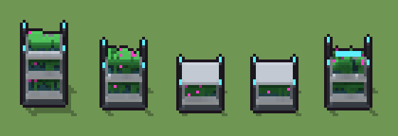

# Modulo botanico idroponico (`futuristico-modulo-idroponico.xml`)

Classe `mobile`, scatola 20 × 20 × 20 voxel, ambientazione `futuristico (sidera)`.

Uno scaffale di ceramica bianca e grafite con le vasche di coltura, le barre di luce ciano sotto i ripiani e le piante che crescono, con qualche fiore magenta. Il seme sceglie quanti ripiani ha e come crescono le piante in ogni vasca.

## Esito

- validatore (`modelErrors`, `checkProgram`, `analyse` a ogni seme): nessun errore, nessun frammento staccato
- varianza su 5 semi (voxel pieni in un seme e vuoti nell'altro, sui pieni in almeno uno; il colore non conta): **media 0.360**, minima 0.052, massima 0.532 (soglia 0.15) → passa
- voxel per seme: 1030, 806, 642, 630, 795; tempo per seme: 4, 5, 6, 5, 5 ms
- avvisi: tocca il soffitto della griglia: forse è tagliato in alto; colori mai usati: V

| coppia | 1-2 | 1-3 | 1-4 | 1-5 | 2-3 | 2-4 | 2-5 | 3-4 | 3-5 | 4-5 |
|---|---|---|---|---|---|---|---|---|---|---|
| distanza | 0.410 | 0.532 | 0.528 | 0.402 | 0.358 | 0.349 | 0.237 | 0.052 | 0.367 | 0.362 |



## Traccia di tre semi a confronto

La traccia di `src/mj/trace.ts` (forma `nodi`): per ogni nodo quante volte gira, quante celle scrive e la scatola di ciò che scrive. Le
righe che cambiano fra i semi sono le scelte del programma.

### Seme 1

```text
Traccia, seme 1: griglia 20×20×20, 36 nodi, 234 passi, finito in 5 ms.
x sinistra→destra, y fondo→davanti, z basso→alto; «.» è la cella vuota; #n è il nodo nell'ordine dell'XML; ×n quante volte ha agito.
Lettere: W=ceramica bianca, w=ceramica in ombra, G=grafite, g=grafite chiara, C=luce di coltura ciano, M=fiore magenta, V=acqua di coltura, T=vasca, L=foglie, l=foglie in ombra, F=stelo, h=quote possibili (marcatore), k=la quota scelta, o lanci a vuoto (marcatore), s=un germoglio (marcatore), v=dove possono crescere le piante (marcatore).
Alla fine: W 273, T 165, g 139, L 120, w 108, G 68, l 63, F 59, C 22, M 13.
#2-3 box×1, one×1: 6 celle x19 y19 z17-19, passi 1-4
#4-20 box×17: 1556 celle x0-17 y0-14 z0-19, passi 5-21
#21-22 one×1, all×1: 11 celle x0 y0 z9-19, passi 22-23
 #23 all k[.WwGCVv] → *k: ×38, 399 celle x0-19 y0-19 z19, passi 24-61, .→k 340, v→k 55, G→k 4
 #25 all k → .: ×1, 400 celle x0-19 y0-19 z19, passi 62, k→. 400
#26-29 all×2, prl×2: 162 celle x3-17 y6-14 z3-19, passi 63-68
#30-31 one×1, all×1: 196 celle x5-15 y8-12 z3-18, passi 69-229
 #32 all v → .: ×1, 295 celle x5-15 y8-12 z3-18, passi 230, v→. 295
#33-36 prl×1, all×3: 349 celle x4-16 y7-13 z2-18, passi 231-234
Senza effetto (non hanno mai cambiato una cella):
#24 all [.WwGCVv] k → k *: le celle cercate c'erano, ma mai disposte come nel pattern
```

### Seme 2

```text
Traccia, seme 2: griglia 20×20×20, 36 nodi, 239 passi, finito in 6 ms.
x sinistra→destra, y fondo→davanti, z basso→alto; «.» è la cella vuota; #n è il nodo nell'ordine dell'XML; ×n quante volte ha agito.
Lettere: W=ceramica bianca, w=ceramica in ombra, G=grafite, g=grafite chiara, C=luce di coltura ciano, M=fiore magenta, V=acqua di coltura, T=vasca, L=foglie, l=foglie in ombra, F=stelo, h=quote possibili (marcatore), k=la quota scelta, o lanci a vuoto (marcatore), s=un germoglio (marcatore), v=dove possono crescere le piante (marcatore).
Alla fine: W 182, g 139, L 118, T 110, w 72, l 62, F 54, G 48, C 13, M 8.
#2-3 box×1, one×1: 6 celle x19 y19 z17-19, passi 1-4
#4-20 box×17: 1556 celle x0-17 y0-14 z0-19, passi 5-21
#21-22 one×1, all×1: 11 celle x0 y0 z9-19, passi 22-23
 #23 all k[.WwGCVv] → *k: ×38, 399 celle x0-19 y0-19 z14, passi 24-61, .→k 386, C→k 9, G→k 4
 #24 all [.WwGCVv] k → k *: ×5, 2000 celle x0-19 y0-19 z15-19, passi 62-66, .→k 1633, v→k 165, W→k 127, V→k 55, +1
 #25 all k → .: ×1, 2400 celle x0-19 y0-19 z14-19, passi 67, k→. 2400
#26-29 all×2, prl×2: 144 celle x3-17 y6-14 z3-14, passi 68-73
#30-31 one×1, all×1: 188 celle x5-15 y8-12 z3-13, passi 74-234
 #32 all v → .: ×1, 198 celle x5-15 y8-12 z3-13, passi 235, v→. 198
#33-36 prl×1, all×3: 252 celle x4-16 y7-13 z2-13, passi 236-239
```

### Seme 3

```text
Traccia, seme 3: griglia 20×20×20, 36 nodi, 244 passi, finito in 8 ms.
x sinistra→destra, y fondo→davanti, z basso→alto; «.» è la cella vuota; #n è il nodo nell'ordine dell'XML; ×n quante volte ha agito.
Lettere: W=ceramica bianca, w=ceramica in ombra, G=grafite, g=grafite chiara, C=luce di coltura ciano, M=fiore magenta, V=acqua di coltura, T=vasca, L=foglie, l=foglie in ombra, F=stelo, h=quote possibili (marcatore), k=la quota scelta, o lanci a vuoto (marcatore), s=un germoglio (marcatore), v=dove possono crescere le piante (marcatore).
Alla fine: g 139, L 135, w 127, W 91, T 55, l 30, G 28, F 18, C 13, M 6.
#2-3 box×1, one×1: 6 celle x19 y19 z17-19, passi 1-4
#4-20 box×17: 1556 celle x0-17 y0-14 z0-19, passi 5-21
#21-22 one×1, all×1: 11 celle x0 y0 z9-19, passi 22-23
 #23 all k[.WwGCVv] → *k: ×38, 399 celle x0-19 y0-19 z9, passi 24-61, .→k 304, V→k 55, W→k 36, G→k 4
 #24 all [.WwGCVv] k → k *: ×10, 4000 celle x0-19 y0-19 z10-19, passi 62-71, .→k 3384, v→k 385, W→k 127, V→k 55, +2
 #25 all k → .: ×1, 4400 celle x0-19 y0-19 z9-19, passi 72, k→. 4400
#26-30 all×2, prl×2, one×1: 215 celle x3-17 y6-14 z3-9, passi 73-238
#31-36 all×5, prl×1: 260 celle x4-16 y7-13 z2-8, passi 239-244
```
