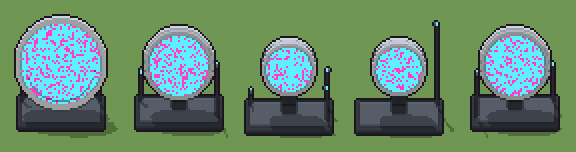

# Portale di teletrasporto (`futuristico-portale-teletrasporto.xml`)

Classe `edificio`, scatola 50 × 50 × 50 voxel, ambientazione `futuristico (sidera)`.

Un anello di ceramica bianca in piedi su una piattaforma di grafite, con la membrana di energia ciano e magenta tesa all'interno e i piloni accesi ai lati. Il seme sceglie la misura dell'anello (tre, i più piccoli su un piedistallo) e quanti piloni ci sono e quanto sono alti.

## Esito

- validatore (`modelErrors`, `checkProgram`, `analyse` a ogni seme): nessun errore, nessun frammento staccato
- varianza su 5 semi (voxel pieni in un seme e vuoti nell'altro, sui pieni in almeno uno; il colore non conta): **media 0.195**, minima 0.015, massima 0.333 (soglia 0.15) → passa
- voxel per seme: 5261, 4654, 3541, 3537, 4654; tempo per seme: 83, 89, 71, 64, 72 ms
- avvisi: colori mai usati: P

| coppia | 1-2 | 1-3 | 1-4 | 1-5 | 2-3 | 2-4 | 2-5 | 3-4 | 3-5 | 4-5 |
|---|---|---|---|---|---|---|---|---|---|---|
| distanza | 0.126 | 0.333 | 0.332 | 0.124 | 0.247 | 0.256 | 0.019 | 0.015 | 0.250 | 0.249 |



## Traccia di tre semi a confronto

La traccia di `src/mj/trace.ts` (forma `nodi`): per ogni nodo quante volte gira, quante celle scrive e la scatola di ciò che scrive. Le
righe che cambiano fra i semi sono le scelte del programma.

### Seme 1

```text
Traccia, seme 1: griglia 50×50×50, 42 nodi, 190 passi, finito in 83 ms.
x sinistra→destra, y fondo→davanti, z basso→alto; «.» è la cella vuota; #n è il nodo nell'ordine dell'XML; ×n quante volte ha agito.
Lettere: W=ceramica bianca, w=ceramica in ombra, G=grafite, g=grafite chiara, C=energia ciano, M=energia magenta, V=vetro, x=l'anello grande (marcatore), y=l'anello medio (marcatore), z=l'anello piccolo (marcatore), m=fra un anello e l'altro (marcatore), X=l'anello grande, nel piedistallo (marcatore), Y=l'anello medio, nel piedistallo (marcatore), Z=l'anello piccolo, nel piedistallo (marcatore), N=fra un anello e l'altro, nel piedistallo (marcatore), u=segno dell'anello grande (marcatore), v=segno dell'anello medio (marcatore), t=segno dell'anello piccolo (marcatore), R=l'anello scelto (marcatore), Q=la membrana (marcatore), k=lanci a vuoto (marcatore), p=dove può stare un pilone (marcatore), q=un pilone che sale (marcatore).
Alla fine: C 2331, G 1330, M 767, g 431, W 301, V 56, w 45.
#2-3 box×1, one×1: 6 celle x49 y49 z47-49, passi 1-4
#4-18 box×9, ellipsoid×6: 13673 celle x3-47 y18-32 z0-48, passi 5-19
#19-42 one×2, all×12, box×5, prl×2: 7964 celle x3-47 y21-29 z3-48, passi 20-190
Senza effetto (non hanno mai cambiato una cella):
#26 all R [XYZN] → * P: in quel momento nella griglia non c'erano celle "XYZN"
#27 all P [XYZN] → * P: in quel momento nella griglia non c'erano celle "XYZN", "P"
#28 all [xyzmXYZN] → .: in quel momento nella griglia non c'erano celle "xyzmXYZN"
```

### Seme 2

```text
Traccia, seme 2: griglia 50×50×50, 42 nodi, 169 passi, finito in 73 ms.
x sinistra→destra, y fondo→davanti, z basso→alto; «.» è la cella vuota; #n è il nodo nell'ordine dell'XML; ×n quante volte ha agito.
Lettere: W=ceramica bianca, w=ceramica in ombra, G=grafite, g=grafite chiara, C=energia ciano, M=energia magenta, V=vetro, x=l'anello grande (marcatore), y=l'anello medio (marcatore), z=l'anello piccolo (marcatore), m=fra un anello e l'altro (marcatore), X=l'anello grande, nel piedistallo (marcatore), Y=l'anello medio, nel piedistallo (marcatore), Z=l'anello piccolo, nel piedistallo (marcatore), N=fra un anello e l'altro, nel piedistallo (marcatore), u=segno dell'anello grande (marcatore), v=segno dell'anello medio (marcatore), t=segno dell'anello piccolo (marcatore), R=l'anello scelto (marcatore), Q=la membrana (marcatore), P=piedistallo, k=lanci a vuoto (marcatore), p=dove può stare un pilone (marcatore), q=un pilone che sale (marcatore).
Alla fine: C 1555, G 1330, M 541, W 521, g 431, V 136, w 105, P 35.
#2-3 box×1, one×1: 6 celle x49 y49 z47-49, passi 1-4
#4-18 box×9, ellipsoid×6: 13673 celle x3-47 y18-32 z0-48, passi 5-19
#19-25 one×1, all×5, box×1: 2864 celle x8-42 y24-26 z8-48, passi 20-110
#26-29 all×4: 1404 celle x3-47 y24-26 z3-48, passi 111-117
 #30 all Q → C: ×1, 2094 celle x11-39 y24-26 z11-40, passi 118, Q→C 2094
#31-42 prl×2, all×5, box×4, one×1: 874 celle x6-44 y20-30 z3-43, passi 119-169
```

### Seme 3

```text
Traccia, seme 3: griglia 50×50×50, 42 nodi, 149 passi, finito in 75 ms.
x sinistra→destra, y fondo→davanti, z basso→alto; «.» è la cella vuota; #n è il nodo nell'ordine dell'XML; ×n quante volte ha agito.
Lettere: W=ceramica bianca, w=ceramica in ombra, G=grafite, g=grafite chiara, C=energia ciano, M=energia magenta, V=vetro, x=l'anello grande (marcatore), y=l'anello medio (marcatore), z=l'anello piccolo (marcatore), m=fra un anello e l'altro (marcatore), X=l'anello grande, nel piedistallo (marcatore), Y=l'anello medio, nel piedistallo (marcatore), Z=l'anello piccolo, nel piedistallo (marcatore), N=fra un anello e l'altro, nel piedistallo (marcatore), u=segno dell'anello grande (marcatore), v=segno dell'anello medio (marcatore), t=segno dell'anello piccolo (marcatore), R=l'anello scelto (marcatore), Q=la membrana (marcatore), P=piedistallo, k=lanci a vuoto (marcatore), p=dove può stare un pilone (marcatore), q=un pilone che sale (marcatore).
Alla fine: G 1330, C 841, g 432, W 325, M 262, V 146, P 126, w 79.
#2-3 box×1, one×1: 6 celle x49 y49 z47-49, passi 1-4
#4-18 box×9, ellipsoid×6: 13673 celle x3-47 y18-32 z0-48, passi 5-19
#19-27 one×1, all×7, box×1: 1784 celle x12-38 y24-26 z3-48, passi 20-95
 #28 all [xyzmXYZN] → .: ×1, 1722 celle x3-47 y24-26 z3-48, passi 96, x→. 801, m→. 628, y→. 293
#29-42 all×7, prl×2, box×4, one×1: 2231 celle x6-45 y21-29 z3-38, passi 97-149
```
