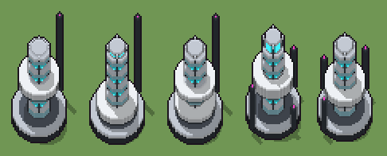

# Reattore a fusione (`futuristico-reattore-fusione.xml`)

Classe `edificio`, scatola 50 × 50 × 50 voxel, ambientazione `futuristico (sidera)`.

Una colonna di vetro con il plasma ciano su uno zoccolo di grafite, cinta da anelli di ceramica bianca e da pilastri di raffreddamento magenta. Il seme sceglie l'altezza della colonna, la quota dei due anelli e quali pilastri ci sono e quanto sono alti.

## Esito

- validatore (`modelErrors`, `checkProgram`, `analyse` a ogni seme): nessun errore, nessun frammento staccato
- varianza su 5 semi (voxel pieni in un seme e vuoti nell'altro, sui pieni in almeno uno; il colore non conta): **media 0.246**, minima 0.121, massima 0.330 (soglia 0.15) → passa
- voxel per seme: 10452, 10742, 11412, 11644, 10824; tempo per seme: 117, 121, 140, 103, 111 ms
- avvisi: tocca il soffitto della griglia: forse è tagliato in alto

| coppia | 1-2 | 1-3 | 1-4 | 1-5 | 2-3 | 2-4 | 2-5 | 3-4 | 3-5 | 4-5 |
|---|---|---|---|---|---|---|---|---|---|---|
| distanza | 0.267 | 0.145 | 0.121 | 0.287 | 0.132 | 0.328 | 0.294 | 0.229 | 0.329 | 0.330 |



## Traccia di tre semi a confronto

La traccia di `src/mj/trace.ts` (forma `nodi`): per ogni nodo quante volte gira, quante celle scrive e la scatola di ciò che scrive. Le
righe che cambiano fra i semi sono le scelte del programma.

### Seme 1

```text
Traccia, seme 1: griglia 50×50×50, 50 nodi, 394 passi, finito in 124 ms.
x sinistra→destra, y fondo→davanti, z basso→alto; «.» è la cella vuota; #n è il nodo nell'ordine dell'XML; ×n quante volte ha agito.
Lettere: W=ceramica bianca, w=ceramica in ombra, G=grafite, g=grafite chiara, C=plasma ciano, M=luce magenta, V=vetro, h=altezze possibili (marcatore), k=la quota scelta (marcatore), K=l'anello scelto (marcatore), a=dove può stare un anello (marcatore), P=tubo di raffreddamento, p=dove può stare un pilastro (marcatore), q=quanto sale un pilastro (marcatore).
Alla fine: G 2767, C 2484, W 2263, g 1034, V 836, w 831, P 188, M 49.
#2-14 cylinder×8, box×5: 7723 celle x0-41 y0-41 z0-48, passi 1-13
#15-17 one×1, all×2: 2517 celle x0-49 y0-49 z30-47, passi 14-113
 #18 all [.VCG] k → k k: ×8, 20000 celle x0-49 y0-49 z42-49, passi 114-121, .→k 19489, C→k 483, G→k 28
 #19 all k → .: ×1, 22500 celle x0-49 y0-49 z41-49, passi 122, k→. 22500
#20-23 all×2, cylinder×1, box×1: 9788 celle x0-41 y0-41 z3-42, passi 123-126
#24-31 one×2, all×5, box×1: 8728 celle x0-49 y0-49 z9-26, passi 127-328
#32-33 all×2: 4710 celle x0-49 y0-49 z22-25, passi 329-330
#34-50 all×6, box×8, prl×1, one×1: 8485 celle x10-40 y10-40 z3-49, passi 331-394
Senza effetto (non hanno mai cambiato una cella):
#48 all . q → M *: le celle cercate c'erano, ma mai disposte come nel pattern
```

### Seme 2

```text
Traccia, seme 2: griglia 50×50×50, 50 nodi, 391 passi, finito in 134 ms.
x sinistra→destra, y fondo→davanti, z basso→alto; «.» è la cella vuota; #n è il nodo nell'ordine dell'XML; ×n quante volte ha agito.
Lettere: W=ceramica bianca, w=ceramica in ombra, G=grafite, g=grafite chiara, C=plasma ciano, M=luce magenta, V=vetro, h=altezze possibili (marcatore), k=la quota scelta (marcatore), K=l'anello scelto (marcatore), a=dove può stare un anello (marcatore), P=tubo di raffreddamento, p=dove può stare un pilastro (marcatore), q=quanto sale un pilastro (marcatore).
Alla fine: G 2775, C 2622, W 2433, g 1034, V 836, w 805, P 188, M 49.
#2-17 cylinder×8, box×5, one×1, all×2: 10240 celle x0-49 y0-49 z0-48, passi 1-113
 #18 all [.VCG] k → k k: ×6, 15000 celle x0-49 y0-49 z44-49, passi 114-119, .→k 14635, C→k 345, G→k 20
 #19 all k → .: ×1, 17500 celle x0-49 y0-49 z43-49, passi 120, k→. 17500
#20-23 all×2, cylinder×1, box×1: 9788 celle x0-41 y0-41 z3-44, passi 121-124
#24-31 one×2, all×5, box×1: 8800 celle x0-49 y0-49 z9-26, passi 125-326
#32-33 all×2: 4782 celle x0-49 y0-49 z8-11, passi 327-328
#34-50 all×5, box×8, prl×1, one×1: 8459 celle x10-40 y10-40 z3-49, passi 329-391
Senza effetto (non hanno mai cambiato una cella):
#36 all W/V → w/* passi=1: le celle cercate c'erano, ma mai disposte come nel pattern
#48 all . q → M *: le celle cercate c'erano, ma mai disposte come nel pattern
```

### Seme 3

```text
Traccia, seme 3: griglia 50×50×50, 50 nodi, 394 passi, finito in 119 ms.
x sinistra→destra, y fondo→davanti, z basso→alto; «.» è la cella vuota; #n è il nodo nell'ordine dell'XML; ×n quante volte ha agito.
Lettere: W=ceramica bianca, w=ceramica in ombra, G=grafite, g=grafite chiara, C=plasma ciano, M=luce magenta, V=vetro, h=altezze possibili (marcatore), k=la quota scelta (marcatore), K=l'anello scelto (marcatore), a=dove può stare un anello (marcatore), P=tubo di raffreddamento, p=dove può stare un pilastro (marcatore), q=quanto sale un pilastro (marcatore).
Alla fine: W 3151, G 2771, C 2553, g 1034, V 836, w 831, P 188, M 48.
#2-14 cylinder×8, box×5: 7723 celle x0-41 y0-41 z0-48, passi 1-13
#15-17 one×1, all×2: 2517 celle x0-49 y0-49 z30-47, passi 14-113
 #18 all [.VCG] k → k k: ×7, 17500 celle x0-49 y0-49 z43-49, passi 114-120, .→k 17062, C→k 414, G→k 24
 #19 all k → .: ×1, 20000 celle x0-49 y0-49 z42-49, passi 121, k→. 20000
#20-23 all×2, cylinder×1, box×1: 9788 celle x0-41 y0-41 z3-43, passi 122-125
#24-31 one×2, all×5, box×1: 8800 celle x0-49 y0-49 z9-26, passi 126-328
#32-33 all×2: 5526 celle x0-49 y0-49 z9-24, passi 329-330
#34-50 all×6, box×8, prl×1, one×1: 8484 celle x10-40 y10-40 z3-49, passi 331-394
Senza effetto (non hanno mai cambiato una cella):
#48 all . q → M *: le celle cercate c'erano, ma mai disposte come nel pattern
```
