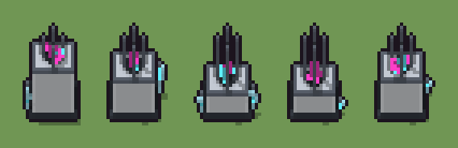

# Sintetizzatore di materia (`futuristico-sintetizzatore-materia.xml`)

Classe `mobile`, scatola 20 × 20 × 20 voxel, ambientazione `futuristico (sidera)`.

Un banco di ceramica bianca con la piastra di sintesi, quattro colonnine dalle punte ciano e, sopra, l'oggetto che prende forma in cristallo magenta e ciano. Il seme sceglie l'altezza del banco e delle colonnine, la forma dell'oggetto e quali serbatoi ha ai lati.

## Esito

- validatore (`modelErrors`, `checkProgram`, `analyse` a ogni seme): nessun errore, nessun frammento staccato
- varianza su 5 semi (voxel pieni in un seme e vuoti nell'altro, sui pieni in almeno uno; il colore non conta): **media 0.273**, minima 0.028, massima 0.458 (soglia 0.15) → passa
- voxel per seme: 1769, 1430, 985, 968, 1420; tempo per seme: 6, 7, 7, 10, 7 ms
- avvisi: tocca il soffitto della griglia: forse è tagliato in alto; tocca i bordi laterali della griglia: forse è tagliato

| coppia | 1-2 | 1-3 | 1-4 | 1-5 | 2-3 | 2-4 | 2-5 | 3-4 | 3-5 | 4-5 |
|---|---|---|---|---|---|---|---|---|---|---|
| distanza | 0.207 | 0.458 | 0.457 | 0.202 | 0.337 | 0.329 | 0.028 | 0.055 | 0.332 | 0.327 |



## Traccia di tre semi a confronto

La traccia di `src/mj/trace.ts` (forma `nodi`): per ogni nodo quante volte gira, quante celle scrive e la scatola di ciò che scrive. Le
righe che cambiano fra i semi sono le scelte del programma.

### Seme 1

```text
Traccia, seme 1: griglia 20×20×20, 38 nodi, 109 passi, finito in 7 ms.
x sinistra→destra, y fondo→davanti, z basso→alto; «.» è la cella vuota; #n è il nodo nell'ordine dell'XML; ×n quante volte ha agito.
Lettere: W=ceramica bianca, w=ceramica in ombra, G=grafite, g=grafite chiara, C=luce ciano, M=materia magenta, V=vetro, h=quote possibili (marcatore), k=la quota scelta (marcatore), c=il centro del banco (marcatore), e=l'emettitore (marcatore), x=piastra di sintesi, X=la piastra che si allarga (marcatore), p=una colonnina che sale (marcatore), o=l'oggetto che prende forma (marcatore), q=dove può stare un serbatoio (marcatore), t=un serbatoio (marcatore).
Alla fine: W 1429, G 165, g 65, w 52, x 21, M 18, C 12, V 7.
#2-3 box×1, one×1: 6 celle x19 y19 z17-19, passi 1-4
#4-7 box×4: 1931 celle x0-17 y0-15 z0-18, passi 5-8
#8-10 one×1, all×2: 407 celle x0-19 y0-19 z7-14, passi 9-48
 #11 all [.Wc] k → k k: ×5, 2000 celle x0-19 y0-19 z15-19, passi 49-53, .→k 1880, W→k 116, c→k 4
 #12 all k → .: ×1, 2400 celle x0-19 y0-19 z14-19, passi 54, k→. 2400
#13-38 all×15, one×1, prl×3, box×4: 315 celle x2-18 y6-14 z1-19, passi 55-109
Senza effetto (non hanno mai cambiato una cella):
#16 all e → W: in quel momento nella griglia non c'erano celle "e"
#21 prl . p → p * passi=3: le celle cercate c'erano, ma mai disposte come nel pattern
#22 all . p → C *: le celle cercate c'erano, ma mai disposte come nel pattern
```

### Seme 2

```text
Traccia, seme 2: griglia 20×20×20, 38 nodi, 115 passi, finito in 10 ms.
x sinistra→destra, y fondo→davanti, z basso→alto; «.» è la cella vuota; #n è il nodo nell'ordine dell'XML; ×n quante volte ha agito.
Lettere: W=ceramica bianca, w=ceramica in ombra, G=grafite, g=grafite chiara, C=luce ciano, M=materia magenta, V=vetro, h=quote possibili (marcatore), k=la quota scelta (marcatore), c=il centro del banco (marcatore), e=l'emettitore (marcatore), x=piastra di sintesi, X=la piastra che si allarga (marcatore), p=una colonnina che sale (marcatore), o=l'oggetto che prende forma (marcatore), q=dove può stare un serbatoio (marcatore), t=un serbatoio (marcatore).
Alla fine: W 1078, G 165, g 77, w 52, x 21, M 17, C 13, V 7.
#2-3 box×1, one×1: 6 celle x19 y19 z17-19, passi 1-4
#4-7 box×4: 1931 celle x0-17 y0-15 z0-18, passi 5-8
#8-10 one×1, all×2: 407 celle x0-19 y0-19 z7-14, passi 9-48
 #11 all [.Wc] k → k k: ×8, 3200 celle x0-19 y0-19 z12-19, passi 49-56, .→k 2729, W→k 464, c→k 7
 #12 all k → .: ×1, 3600 celle x0-19 y0-19 z11-19, passi 57, k→. 3600
#13-38 all×15, one×1, prl×3, box×4: 336 celle x2-19 y6-14 z1-19, passi 58-115
Senza effetto (non hanno mai cambiato una cella):
#16 all e → W: in quel momento nella griglia non c'erano celle "e"
#21 prl . p → p * passi=3: le celle cercate c'erano, ma mai disposte come nel pattern
#22 all . p → C *: le celle cercate c'erano, ma mai disposte come nel pattern
```

### Seme 3

```text
Traccia, seme 3: griglia 20×20×20, 38 nodi, 123 passi, finito in 9 ms.
x sinistra→destra, y fondo→davanti, z basso→alto; «.» è la cella vuota; #n è il nodo nell'ordine dell'XML; ×n quante volte ha agito.
Lettere: W=ceramica bianca, w=ceramica in ombra, G=grafite, g=grafite chiara, C=luce ciano, M=materia magenta, V=vetro, h=quote possibili (marcatore), k=la quota scelta (marcatore), c=il centro del banco (marcatore), e=l'emettitore (marcatore), x=piastra di sintesi, X=la piastra che si allarga (marcatore), p=una colonnina che sale (marcatore), o=l'oggetto che prende forma (marcatore), q=dove può stare un serbatoio (marcatore), t=un serbatoio (marcatore).
Alla fine: W 610, G 165, g 94, w 52, C 24, x 21, V 10, M 9.
#2-3 box×1, one×1: 6 celle x19 y19 z17-19, passi 1-4
#4-7 box×4: 1931 celle x0-17 y0-15 z0-18, passi 5-8
#8-10 one×1, all×2: 407 celle x0-19 y0-19 z7-14, passi 9-48
 #11 all [.Wc] k → k k: ×12, 4800 celle x0-19 y0-19 z8-19, passi 49-60, .→k 3861, W→k 928, c→k 11
 #12 all k → .: ×1, 5200 celle x0-19 y0-19 z7-19, passi 61, k→. 5200
#13-38 all×15, one×1, prl×3, box×4: 373 celle x1-19 y6-14 z1-19, passi 62-123
Senza effetto (non hanno mai cambiato una cella):
#16 all e → W: in quel momento nella griglia non c'erano celle "e"
#21 prl . p → p * passi=3: le celle cercate c'erano, ma mai disposte come nel pattern
#22 all . p → C *: le celle cercate c'erano, ma mai disposte come nel pattern
```
