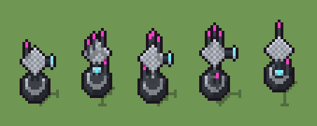

# Torretta sensoriale (`futuristico-torretta-sensoriale.xml`)

Classe `mobile`, scatola 20 × 20 × 20 voxel, ambientazione `futuristico (sidera)`.

Una base di grafite, un collo di ceramica bianca e una testa a cupola con la canna del sensore che finisce in un occhio ciano, con antenne magenta. Il seme sceglie l'altezza del collo, la direzione e la lunghezza della canna e dove spuntano le antenne.

## Esito

- validatore (`modelErrors`, `checkProgram`, `analyse` a ogni seme): nessun errore, nessun frammento staccato
- varianza su 5 semi (voxel pieni in un seme e vuoti nell'altro, sui pieni in almeno uno; il colore non conta): **media 0.395**, minima 0.163, massima 0.538 (soglia 0.15) → passa
- voxel per seme: 233, 255, 255, 253, 250; tempo per seme: 6, 6, 6, 6, 6 ms
- avvisi: colori mai usati: W

| coppia | 1-2 | 1-3 | 1-4 | 1-5 | 2-3 | 2-4 | 2-5 | 3-4 | 3-5 | 4-5 |
|---|---|---|---|---|---|---|---|---|---|---|
| distanza | 0.405 | 0.410 | 0.523 | 0.163 | 0.204 | 0.432 | 0.422 | 0.403 | 0.446 | 0.538 |



## Traccia di tre semi a confronto

La traccia di `src/mj/trace.ts` (forma `nodi`): per ogni nodo quante volte gira, quante celle scrive e la scatola di ciò che scrive. Le
righe che cambiano fra i semi sono le scelte del programma.

### Seme 1

```text
Traccia, seme 1: griglia 20×20×20, 28 nodi, 78 passi, finito in 6 ms.
x sinistra→destra, y fondo→davanti, z basso→alto; «.» è la cella vuota; #n è il nodo nell'ordine dell'XML; ×n quante volte ha agito.
Lettere: w=ceramica in ombra, G=grafite, g=grafite chiara, C=occhio ciano, M=luce magenta, V=vetro, h=quote possibili (marcatore), k=la quota scelta (marcatore), r=il collo che sale (marcatore), P=collo, a=dove può guardare la canna (marcatore), A=la canna che si allunga (marcatore), H=cupola, n=dove può stare un'antenna (marcatore).
Alla fine: w 77, G 74, H 41, g 31, P 6, V 2, C 1, M 1.
#2-5 cylinder×3, box×1: 134 celle x0-14 y0-14 z0-12, passi 1-4
#6-7 one×1, all×1: 7 celle x0 y0 z6-12, passi 5-6
 #8 all k. → kk: ×38, 399 celle x0-19 y0-19 z10, passi 7-44, .→k 399
#9-10 box×1, one×1: 13 celle x10 y10 z3-9, passi 45-51
 #11 all k → .: ×1, 400 celle x0-19 y0-19 z10, passi 52, k→. 400
#12-22 all×8, one×1: 102 celle x6-16 y6-14 z9-13, passi 53-70
#23-28 all×5, prl×1: 55 celle x6-13 y6-14 z3-14, passi 71-78
Senza effetto (non hanno mai cambiato una cella):
#17 prl GA. → *GA passi=3
#19 all A → C: in quel momento nella griglia non c'erano celle "A"
```

### Seme 2

```text
Traccia, seme 2: griglia 20×20×20, 28 nodi, 79 passi, finito in 7 ms.
x sinistra→destra, y fondo→davanti, z basso→alto; «.» è la cella vuota; #n è il nodo nell'ordine dell'XML; ×n quante volte ha agito.
Lettere: w=ceramica in ombra, G=grafite, g=grafite chiara, C=occhio ciano, M=luce magenta, V=vetro, h=quote possibili (marcatore), k=la quota scelta (marcatore), r=il collo che sale (marcatore), P=collo, a=dove può guardare la canna (marcatore), A=la canna che si allunga (marcatore), H=cupola, n=dove può stare un'antenna (marcatore).
Alla fine: w 77, G 74, g 48, H 41, P 7, M 5, V 2, C 1.
#2-5 cylinder×3, box×1: 134 celle x0-14 y0-14 z0-12, passi 1-4
#6-7 one×1, all×1: 7 celle x0 y0 z6-12, passi 5-6
 #8 all k. → kk: ×38, 399 celle x0-19 y0-19 z11, passi 7-44, .→k 399
#9-10 box×1, one×1: 15 celle x10 y10 z3-10, passi 45-52
 #11 all k → .: ×1, 400 celle x0-19 y0-19 z11, passi 53, k→. 400
#12-22 all×8, one×1: 102 celle x6-14 y6-16 z10-14, passi 54-71
#23-28 all×5, prl×1: 92 celle x6-14 y6-13 z2-17, passi 72-79
Senza effetto (non hanno mai cambiato una cella):
#17 prl GA. → *GA passi=3
#19 all A → C: in quel momento nella griglia non c'erano celle "A"
```

### Seme 3

```text
Traccia, seme 3: griglia 20×20×20, 28 nodi, 79 passi, finito in 6 ms.
x sinistra→destra, y fondo→davanti, z basso→alto; «.» è la cella vuota; #n è il nodo nell'ordine dell'XML; ×n quante volte ha agito.
Lettere: w=ceramica in ombra, G=grafite, g=grafite chiara, C=occhio ciano, M=luce magenta, V=vetro, h=quote possibili (marcatore), k=la quota scelta (marcatore), r=il collo che sale (marcatore), P=collo, a=dove può guardare la canna (marcatore), A=la canna che si allunga (marcatore), H=cupola, n=dove può stare un'antenna (marcatore).
Alla fine: w 77, G 74, g 48, H 41, P 7, M 5, V 2, C 1.
#2-5 cylinder×3, box×1: 134 celle x0-14 y0-14 z0-12, passi 1-4
#6-7 one×1, all×1: 7 celle x0 y0 z6-12, passi 5-6
 #8 all k. → kk: ×38, 399 celle x0-19 y0-19 z11, passi 7-44, .→k 399
#9-10 box×1, one×1: 15 celle x10 y10 z3-10, passi 45-52
 #11 all k → .: ×1, 400 celle x0-19 y0-19 z11, passi 53, k→. 400
#12-22 all×8, one×1: 102 celle x6-16 y6-14 z10-14, passi 54-71
#23-28 all×5, prl×1: 92 celle x6-13 y6-14 z2-17, passi 72-79
Senza effetto (non hanno mai cambiato una cella):
#17 prl GA. → *GA passi=3
#19 all A → C: in quel momento nella griglia non c'erano celle "A"
```
