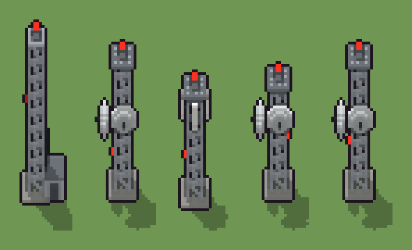

# Antenna ripetitore (`moderno-antenna.xml`)

Classe `monumento`, scatola 20 × 20 × 60 voxel, ambientazione `moderno (neapolis)`.

Il traliccio d'acciaio dei ripetitori con anelli, diagonali, ballatoio, parafulmine e luce rossa. Il seme sceglie a che quota finisce (tre altezze), che cosa porta (due parabole, tre pannelli o la cabina degli apparati ai piedi) e dove sta la luce di metà torre.

## Esito

- validatore (`modelErrors`, `checkProgram`, `analyse` a ogni seme): nessun errore, nessun frammento staccato
- varianza su 5 semi (voxel pieni in un seme e vuoti nell'altro, sui pieni in almeno uno; il colore non conta): **media 0.447**, minima 0.004, massima 0.678 (soglia 0.15) → passa
- voxel per seme: 1162, 942, 626, 858, 942; tempo per seme: 74, 76, 79, 77, 93 ms
- avvisi: tocca i bordi laterali della griglia: forse è tagliato; colori mai usati: W V; colori mai usati: W r G; colori mai usati: V r G

| coppia | 1-2 | 1-3 | 1-4 | 1-5 | 2-3 | 2-4 | 2-5 | 3-4 | 3-5 | 4-5 |
|---|---|---|---|---|---|---|---|---|---|---|
| distanza | 0.623 | 0.620 | 0.678 | 0.623 | 0.540 | 0.228 | 0.004 | 0.383 | 0.540 | 0.228 |



## Traccia di tre semi a confronto

La traccia di `src/mj/trace.ts` (forma `nodi`): per ogni nodo quante volte gira, quante celle scrive e la scatola di ciò che scrive. Le
righe che cambiano fra i semi sono le scelte del programma.

### Seme 1

```text
Traccia, seme 1: griglia 20×20×60, 126 nodi, 235 passi, finito in 108 ms.
x sinistra→destra, y fondo→davanti, z basso→alto; «.» è la cella vuota; #n è il nodo nell'ordine dell'XML; ×n quante volte ha agito.
Lettere: P=acciaio zincato, C=cemento, Z=ballatoio, K=staffe, R=luce rossa, r=cabina degli apparati, G=porta della cabina, m=il dado (marcatore), q=le cime possibili (marcatore), Q=la cima scelta (marcatore), k=ciò che sta sopra la cima (marcatore), n=la cabina (marcatore), a=dove può stare la luce di metà torre (marcatore), b=la luce scelta (marcatore).
Alla fine: P 580, r 376, C 100, Z 72, G 15, K 13, R 6.
#2-98 box×49, line×36, prl×1, one×2, all×8: 5096 celle x0-19 y0-19 z0-59, passi 1-123
 #99 all L. → LL (+2): ×99, 23299 celle x0-19 y0-19 z0-59, passi 124-222, .→n 23299
   r1 L. → LL ×0; r2 D. → DD ×0; r3 n. → nn ×23299
#112-126 box×7, line×1, all×4, one×1: 23463 celle x0-19 y0-19 z0-59, passi 223-235
Senza effetto (non hanno mai cambiato una cella):
#96 all R P → * K: le celle cercate c'erano, ma mai disposte come nel pattern
#100 line 6 10 24 → 4 10 24 K
#101 ellipsoid at 3 10 20 size 3 9 9 V su L
#102 box at 1 10 24 size 1 1 1 K su L
#103 line 10 13 30 → 10 15 30 K
#104 ellipsoid at 10 16 26 size 9 3 9 V su L
#105 box at 10 18 30 size 1 1 1 K su L
#106 box at 6 9.5 30 size 1 2 1 K su D
#107 box at 5 9.5 28 size 1 2 9 W su D
#108 box at 13 9.5 30 size 1 2 1 K su D
#109 box at 14 9.5 28 size 1 2 9 W su D
#110 box at 9.5 13 30 size 2 1 1 K su D
… e altri 3
```

### Seme 2

```text
Traccia, seme 2: griglia 20×20×60, 126 nodi, 246 passi, finito in 82 ms.
x sinistra→destra, y fondo→davanti, z basso→alto; «.» è la cella vuota; #n è il nodo nell'ordine dell'XML; ×n quante volte ha agito.
Lettere: P=acciaio zincato, C=cemento, Z=ballatoio, K=staffe, V=parabola, R=luce rossa, m=il dado (marcatore), q=le cime possibili (marcatore), Q=la cima scelta (marcatore), k=ciò che sta sopra la cima (marcatore), L=due parabole (marcatore), a=dove può stare la luce di metà torre (marcatore), b=la luce scelta (marcatore).
Alla fine: P 488, V 284, C 100, Z 56, K 8, R 6.
#2-98 box×49, line×36, prl×1, one×2, all×8: 11476 celle x0-19 y0-19 z0-59, passi 1-133
 #99 all L. → LL (+2): ×98, 23351 celle x0-19 y0-19 z0-59, passi 134-231, .→L 23351
   r1 L. → LL ×23351; r2 D. → DD ×0; r3 n. → nn ×0
#100-126 line×2, ellipsoid×2, box×6, all×4, one×1: 23515 celle x0-19 y0-19 z0-59, passi 232-246
Senza effetto (non hanno mai cambiato una cella):
#96 all R P → * K: le celle cercate c'erano, ma mai disposte come nel pattern
#106 box at 6 9.5 30 size 1 2 1 K su D
#107 box at 5 9.5 28 size 1 2 9 W su D
#108 box at 13 9.5 30 size 1 2 1 K su D
#109 box at 14 9.5 28 size 1 2 9 W su D
#110 box at 9.5 13 30 size 2 1 1 K su D
#111 box at 9.5 14 28 size 2 1 9 W su D
#112 box at 16 9.5 0 size 7 8 7 r su n
#113 box at 16 14 1 size 3 1 5 G su n
#114 box at 16 9.5 7 size 7 8 1 Z su n
#115 line 13 9 8 → 13 9 20 K
#116 box at 19 9.5 3 size 1 4 3 K su n
… e altri 1
```

### Seme 3

```text
Traccia, seme 3: griglia 20×20×60, 126 nodi, 254 passi, finito in 87 ms.
x sinistra→destra, y fondo→davanti, z basso→alto; «.» è la cella vuota; #n è il nodo nell'ordine dell'XML; ×n quante volte ha agito.
Lettere: P=acciaio zincato, C=cemento, Z=ballatoio, W=pannelli bianchi, K=staffe, R=luce rossa, m=il dado (marcatore), q=le cime possibili (marcatore), Q=la cima scelta (marcatore), k=ciò che sta sopra la cima (marcatore), D=tre pannelli (marcatore), a=dove può stare la luce di metà torre (marcatore), b=la luce scelta (marcatore).
Alla fine: P 404, C 100, Z 56, W 54, R 6, K 6.
#2-98 box×49, line×36, prl×1, one×2, all×8: 17804 celle x0-19 y0-19 z0-59, passi 1-140
 #99 all L. → LL (+2): ×99, 23435 celle x0-19 y0-19 z0-59, passi 141-239, .→D 23435
   r1 L. → LL ×0; r2 D. → DD ×23435; r3 n. → nn ×0
#106-126 box×10, all×4, one×1: 23599 celle x0-19 y0-19 z0-59, passi 240-254
Senza effetto (non hanno mai cambiato una cella):
#96 all R P → * K: le celle cercate c'erano, ma mai disposte come nel pattern
#100 line 6 10 24 → 4 10 24 K
#101 ellipsoid at 3 10 20 size 3 9 9 V su L
#102 box at 1 10 24 size 1 1 1 K su L
#103 line 10 13 30 → 10 15 30 K
#104 ellipsoid at 10 16 26 size 9 3 9 V su L
#105 box at 10 18 30 size 1 1 1 K su L
#112 box at 16 9.5 0 size 7 8 7 r su n
#113 box at 16 14 1 size 3 1 5 G su n
#114 box at 16 9.5 7 size 7 8 1 Z su n
#115 line 13 9 8 → 13 9 20 K
#116 box at 19 9.5 3 size 1 4 3 K su n
… e altri 1
```
