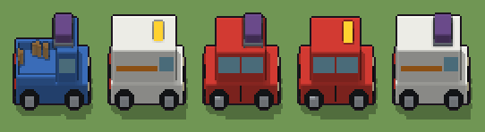

# Automobile compatta (`moderno-automobile.xml`)

Classe `edificio`, scatola 50 × 50 × 50 voxel, ambientazione `moderno (neapolis)`.

Una macchina di città con ruote, fari, paraurti e vetri. Il seme sceglie se è l'utilitaria, il furgoncino o il pickup con le casse nel cassone, e che cosa porta sul tetto (portapacchi con la valigia, insegna del taxi o baule).

## Esito

- validatore (`modelErrors`, `checkProgram`, `analyse` a ogni seme): nessun errore, nessun frammento staccato
- varianza su 5 semi (voxel pieni in un seme e vuoti nell'altro, sui pieni in almeno uno; il colore non conta): **media 0.207**, minima 0.020, massima 0.396 (soglia 0.15) → passa
- voxel per seme: 14421, 21985, 19193, 18781, 22438; tempo per seme: 823, 779, 810, 804, 790 ms
- avvisi: colori mai usati: W w a H; colori mai usati: W A h O E e; colori mai usati: w A a H E e; colori mai usati: w A a h O E e; colori mai usati: W A H E e

| coppia | 1-2 | 1-3 | 1-4 | 1-5 | 2-3 | 2-4 | 2-5 | 3-4 | 3-5 | 4-5 |
|---|---|---|---|---|---|---|---|---|---|---|
| distanza | 0.396 | 0.304 | 0.328 | 0.376 | 0.165 | 0.146 | 0.020 | 0.026 | 0.145 | 0.163 |



## Traccia di tre semi a confronto

La traccia di `src/mj/trace.ts` (forma `nodi`): per ogni nodo quante volte gira, quante celle scrive e la scatola di ciò che scrive. Le
righe che cambiano fra i semi sono le scelte del programma.

### Seme 1

```text
Traccia, seme 1: griglia 50×50×50, 72 nodi, 354 passi, finito in 792 ms.
x sinistra→destra, y fondo→davanti, z basso→alto; «.» è la cella vuota; #n è il nodo nell'ordine dell'XML; ×n quante volte ha agito.
Lettere: K=gomma e plastica nera, S=cerchi d'acciaio, V=vetri, T=fari, R=fanali, A=carrozzeria blu, h=portapacchi, O=valigia, E=cassa di legno, e=cassa in ombra, m=il dado (marcatore), J=pickup (marcatore), L=portapacchi (marcatore), c=dove può stare una cassa (marcatore).
Alla fine: A 10873, V 1640, K 1087, O 495, E 120, S 100, h 52, e 24, R 18, T 12.
#2-21 box×13, ellipsoid×4, prl×1, one×1, all×1: 125007 celle x0-49 y0-49 z0-49, passi 1-168
#39-58 box×12, all×4, one×3, prl×1: 124311 celle x0-49 y0-49 z0-49, passi 169-195
#59-71 all×2, box×9: 222251 celle x0-49 y0-49 z0-49, passi 196-354
Senza effetto (non hanno mai cambiato una cella):
#22 box at 24 15 4 size 1 1 9 K su X
#23 box at 24 35 4 size 1 1 9 K su X
#24 box at 24.5 25 3 size 40 21 11 W su X
#25 box at 37 16 19 size 1 1 9 W su X
#26 box at 37 34 19 size 1 1 9 W su X
#27 box at 24 16 19 size 2 1 9 W su X
#28 box at 24 34 19 size 2 1 9 W su X
#29 box at 11 16 19 size 1 1 9 W su X
#30 box at 11 34 19 size 1 1 9 W su X
#31 box at 24 25 19 size 27 19 9 V su X
#32 box at 24 25 14 size 27 19 17 W su X
#33 box at 24.5 25 3 size 40 21 11 w su U
… e altri 8
```

### Seme 2

```text
Traccia, seme 2: griglia 50×50×50, 72 nodi, 330 passi, finito in 865 ms.
x sinistra→destra, y fondo→davanti, z basso→alto; «.» è la cella vuota; #n è il nodo nell'ordine dell'XML; ×n quante volte ha agito.
Lettere: K=gomma e plastica nera, S=cerchi d'acciaio, V=vetri, T=fari, R=fanali, w=carrozzeria bianca, a=fascia arancio, H=insegna del taxi, m=il dado (marcatore), U=furgoncino (marcatore), D=taxi (marcatore).
Alla fine: w 18015, V 1352, a 1311, K 1087, S 100, H 90, R 18, T 12.
#2-20 box×13, ellipsoid×4, prl×1, one×1: 1225 celle x0-45 y0-37 z0-11, passi 1-19
 #21 all X. → XX (+2): ×150, 123782 celle x0-49 y0-49 z0-49, passi 20-169, .→U 123782
   r1 X. → XX ×0; r2 U. → UU ×123782; r3 J. → JJ ×0
#33-50 box×6, all×1: 123783 celle x0-49 y0-49 z0-49, passi 170-176
#57-59 box×1, one×1, all×1: 103106 celle x0-49 y0-49 z0-49, passi 177-328
#69-71 box×1, all×1: 103105 celle x0-49 y0-49 z0-49, passi 329-330
Senza effetto (non hanno mai cambiato una cella):
#22 box at 24 15 4 size 1 1 9 K su X
#23 box at 24 35 4 size 1 1 9 K su X
#24 box at 24.5 25 3 size 40 21 11 W su X
#25 box at 37 16 19 size 1 1 9 W su X
#26 box at 37 34 19 size 1 1 9 W su X
#27 box at 24 16 19 size 2 1 9 W su X
#28 box at 24 34 19 size 2 1 9 W su X
#29 box at 11 16 19 size 1 1 9 W su X
#30 box at 11 34 19 size 1 1 9 W su X
#31 box at 24 25 19 size 27 19 9 V su X
#32 box at 24 25 14 size 27 19 17 W su X
#39 box at 24.5 25 3 size 40 21 11 A su J
… e altri 27
```

### Seme 3

```text
Traccia, seme 3: griglia 50×50×50, 72 nodi, 341 passi, finito in 885 ms.
x sinistra→destra, y fondo→davanti, z basso→alto; «.» è la cella vuota; #n è il nodo nell'ordine dell'XML; ×n quante volte ha agito.
Lettere: K=gomma e plastica nera, S=cerchi d'acciaio, V=vetri, T=fari, R=fanali, W=carrozzeria rossa, h=portapacchi, O=valigia, m=il dado (marcatore), X=utilitaria (marcatore), L=portapacchi (marcatore).
Alla fine: W 12848, V 4563, K 1105, O 495, S 100, h 52, R 18, T 12.
#2-20 box×13, ellipsoid×4, prl×1, one×1: 1225 celle x0-45 y0-37 z0-11, passi 1-19
 #21 all X. → XX (+2): ×149, 123782 celle x0-49 y0-49 z0-49, passi 20-168, .→X 123782
   r1 X. → XX ×123782; r2 U. → UU ×0; r3 J. → JJ ×0
#22-50 box×11, all×1: 123783 celle x0-49 y0-49 z0-49, passi 169-180
#57-59 box×1, one×1, all×1: 106355 celle x0-49 y0-49 z0-49, passi 181-331
#60-71 box×9, all×1: 106354 celle x0-49 y0-49 z0-49, passi 332-341
Senza effetto (non hanno mai cambiato una cella):
#33 box at 24.5 25 3 size 40 21 11 w su U
#34 box at 40 16 20 size 1 1 8 w su U
#35 box at 40 34 20 size 1 1 8 w su U
#36 box at 36 25 20 size 9 19 8 V su U
#37 box at 19 25 20 size 23 19 3 a su U
#38 box at 23 25 14 size 35 19 18 w su U
#39 box at 24.5 25 3 size 40 21 11 A su J
#40 box at 38 16 19 size 1 1 8 A su J
#41 box at 38 34 19 size 1 1 8 A su J
#42 box at 28 16 19 size 1 1 8 A su J
#43 box at 28 34 19 size 1 1 8 A su J
#44 box at 33 25 19 size 11 19 8 V su J
… e altri 14
```
