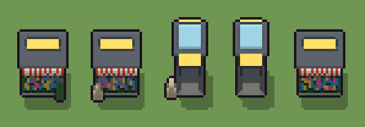

# Cabina telefonica o chiosco (`moderno-cabina.xml`)

Classe `mobile`, scatola 20 × 20 × 20 voxel, ambientazione `moderno (neapolis)`.

La cabina di vetro col telefono o il chiosco dei giornali con la tettoia a righe. Il seme sceglie quale dei due, che cosa le sta accanto (cestino, pacchi di giornali o niente), se la cornetta è appesa o penzola e quante riviste sono in vetrina.

## Esito

- validatore (`modelErrors`, `checkProgram`, `analyse` a ogni seme): nessun errore, nessun frammento staccato
- varianza su 5 semi (voxel pieni in un seme e vuoti nell'altro, sui pieni in almeno uno; il colore non conta): **media 0.500**, minima 0.030, massima 0.812 (soglia 0.15) → passa
- voxel per seme: 2913, 2907, 1128, 1079, 2866; tempo per seme: 33, 36, 37, 39, 33 ms
- avvisi: tocca i bordi laterali della griglia: forse è tagliato; colori mai usati: V K S E; colori mai usati: V K S N; colori mai usati: Q q O o R Y G N; colori mai usati: Q q O o R Y G E N; colori mai usati: V K S E N

| coppia | 1-2 | 1-3 | 1-4 | 1-5 | 2-3 | 2-4 | 2-5 | 3-4 | 3-5 | 4-5 |
|---|---|---|---|---|---|---|---|---|---|---|
| distanza | 0.042 | 0.808 | 0.811 | 0.030 | 0.798 | 0.812 | 0.030 | 0.049 | 0.806 | 0.809 |



## Traccia di tre semi a confronto

La traccia di `src/mj/trace.ts` (forma `nodi`): per ogni nodo quante volte gira, quante celle scrive e la scatola di ciò che scrive. Le
righe che cambiano fra i semi sono le scelte del programma.

### Seme 1

```text
Traccia, seme 1: griglia 20×20×20, 49 nodi, 139 passi, finito in 37 ms.
x sinistra→destra, y fondo→davanti, z basso→alto; «.» è la cella vuota; #n è il nodo nell'ordine dell'XML; ×n quante volte ha agito.
Lettere: C=cemento, P=acciaio, T=insegna, Q=lamiera verde, q=lamiera in ombra, O=tenda a righe rosse, o=tenda a righe bianche, R=copertina rosa, Y=copertina gialla, G=copertina blu, m=il dado (marcatore), U=il chiosco (marcatore), I=dove stanno le riviste (marcatore), L=accanto: il cestino (marcatore), N=cestino.
Alla fine: Q 2057, P 271, C 187, q 187, T 39, N 37, o 37, O 31, Y 27, G 25, R 15.
#2-6 box×2, prl×1, one×1, all×1: 8007 celle x0-19 y0-19 z0-19, passi 1-62
#29-41 box×8, prl×1, all×3, one×1: 8346 celle x0-19 y0-19 z0-19, passi 63-76
#42-48 all×2, cylinder×1, box×1: 10257 celle x0-19 y0-19 z0-19, passi 77-139
Senza effetto (non hanno mai cambiato una cella):
#7 box at 10 10 0 size 11 11 1 C su X
#8 box at 5 5 1 size 1 1 17 P su X
#9 box at 15 5 1 size 1 1 17 P su X
#10 box at 5 15 1 size 1 1 17 P su X
#11 box at 15 15 1 size 1 1 17 P su X
#12 box at 10 5 1 size 9 1 16 V su X
#13 box at 5 10 1 size 1 9 16 V su X
#14 box at 15 10 1 size 1 9 16 V su X
#15 box at 10 10 6 size 11 11 1 P su X
#16 box at 10 6 8 size 5 1 7 K su X
#17 box at 10 7 12 size 3 1 2 S su X
#18 box at 10 7 9 size 3 1 2 P su X
… e altri 14
```

### Seme 2

```text
Traccia, seme 2: griglia 20×20×20, 49 nodi, 140 passi, finito in 38 ms.
x sinistra→destra, y fondo→davanti, z basso→alto; «.» è la cella vuota; #n è il nodo nell'ordine dell'XML; ×n quante volte ha agito.
Lettere: C=cemento, P=acciaio, T=insegna, Q=lamiera verde, q=lamiera in ombra, O=tenda a righe rosse, o=tenda a righe bianche, R=copertina rosa, Y=copertina gialla, G=copertina blu, m=il dado (marcatore), U=il chiosco (marcatore), I=dove stanno le riviste (marcatore), D=accanto: i pacchi (marcatore), E=pacco di giornali.
Alla fine: Q 2057, P 266, C 187, q 187, o 39, T 39, E 34, G 30, O 29, R 20, Y 19.
#2-6 box×2, prl×1, one×1, all×1: 8007 celle x0-19 y0-19 z0-19, passi 1-63
#29-41 box×8, prl×1, all×3, one×1: 8348 celle x0-19 y0-19 z0-19, passi 64-77
#42-48 all×2, box×2: 10253 celle x0-19 y0-19 z0-19, passi 78-140
Senza effetto (non hanno mai cambiato una cella):
#7 box at 10 10 0 size 11 11 1 C su X
#8 box at 5 5 1 size 1 1 17 P su X
#9 box at 15 5 1 size 1 1 17 P su X
#10 box at 5 15 1 size 1 1 17 P su X
#11 box at 15 15 1 size 1 1 17 P su X
#12 box at 10 5 1 size 9 1 16 V su X
#13 box at 5 10 1 size 1 9 16 V su X
#14 box at 15 10 1 size 1 9 16 V su X
#15 box at 10 10 6 size 11 11 1 P su X
#16 box at 10 6 8 size 5 1 7 K su X
#17 box at 10 7 12 size 3 1 2 S su X
#18 box at 10 7 9 size 3 1 2 P su X
… e altri 14
```

### Seme 3

```text
Traccia, seme 3: griglia 20×20×20, 49 nodi, 151 passi, finito in 48 ms.
x sinistra→destra, y fondo→davanti, z basso→alto; «.» è la cella vuota; #n è il nodo nell'ordine dell'XML; ×n quante volte ha agito.
Lettere: C=cemento, P=acciaio, V=vetro, K=telefono, S=schermo, T=insegna, m=il dado (marcatore), X=la cabina (marcatore), h=dove può stare la cornetta (marcatore), H=la cornetta scelta (marcatore), D=accanto: i pacchi (marcatore), E=pacco di giornali.
Alla fine: V 513, P 329, C 121, T 72, E 48, K 39, S 6.
#2-6 box×2, prl×1, one×1, all×1: 8007 celle x0-19 y0-19 z0-19, passi 1-62
#7-41 box×19, one×2, all×4: 8014 celle x0-19 y0-19 z0-19, passi 63-89
#42-48 all×2, box×2: 13839 celle x0-19 y0-19 z0-19, passi 90-151
Senza effetto (non hanno mai cambiato una cella):
#29 box at 10 9 0 size 17 11 1 C su U
#30 box at 10 9 1 size 17 11 12 Q su U
#31 box at 10 9 1 size 17 11 1 q su [UQ]
#32 box at 10 15 3 size 15 1 8 I su U
#33 box at 10 9.5 13 size 19 14 1 P su U
#34 box at 10 16.5 11 size 17 2 2 O su U
#35 box at 10 9 14 size 13 2 3 T su U
#36 prl I → R (+2) passi=1: in quel momento nella griglia non c'erano celle "I"
#37 all I → .: in quel momento nella griglia non c'erano celle "I"
#38 all OO → Oo: in quel momento nella griglia non c'erano celle "O"
#43 cylinder at 17 15 0 size 4 4 7 N su L
#44 box at 17 15 7 size 3 3 1 P su L
… e altri 2
```
