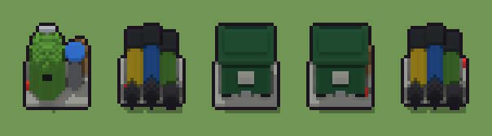

# Cassonetto e differenziata (`moderno-cassonetto.xml`)

Classe `mobile`, scatola 20 × 20 × 20 voxel, ambientazione `moderno (neapolis)`.

L'isola dei rifiuti su una platea di cemento. Il seme sceglie se c'è il cassonetto verde con le ruote, i tre bidoni colorati della differenziata o la campana del vetro con un bidoncino, che cosa è stato lasciato lì (sacchi neri, scatoloni o niente) e dove è rimasta una lattina.

## Esito

- validatore (`modelErrors`, `checkProgram`, `analyse` a ogni seme): nessun errore, nessun frammento staccato
- varianza su 5 semi (voxel pieni in un seme e vuoti nell'altro, sui pieni in almeno uno; il colore non conta): **media 0.406**, minima 0.003, massima 0.562 (soglia 0.15) → passa
- voxel per seme: 1750, 1237, 1941, 2023, 1237; tempo per seme: 47, 43, 52, 42, 44 ms
- avvisi: tocca i bordi laterali della griglia: forse è tagliato; colori mai usati: Q q Y N O; colori mai usati: Q q g S E e O; colori mai usati: Y A G g E e N; colori mai usati: Y A G g N

| coppia | 1-2 | 1-3 | 1-4 | 1-5 | 2-3 | 2-4 | 2-5 | 3-4 | 3-5 | 4-5 |
|---|---|---|---|---|---|---|---|---|---|---|
| distanza | 0.527 | 0.392 | 0.357 | 0.526 | 0.546 | 0.562 | 0.003 | 0.042 | 0.546 | 0.561 |



## Traccia di tre semi a confronto

La traccia di `src/mj/trace.ts` (forma `nodi`): per ogni nodo quante volte gira, quante celle scrive e la scatola di ciò che scrive. Le
righe che cambiano fra i semi sono le scelte del programma.

### Seme 1

```text
Traccia, seme 1: griglia 20×20×20, 51 nodi, 138 passi, finito in 48 ms.
x sinistra→destra, y fondo→davanti, z basso→alto; «.» è la cella vuota; #n è il nodo nell'ordine dell'XML; ×n quante volte ha agito.
Lettere: C=cemento, K=gomma nera, A=plastica blu, G=plastica verde chiaro, g=plastica grigia, S=acciaio, E=cartone, e=cartone in ombra, m=il dado (marcatore), V=la campana del vetro (marcatore), D=scatoloni (marcatore), w=lattina.
Alla fine: G 1195, C 247, g 144, E 100, A 26, e 18, K 12, S 6, w 2.
#2-7 box×3, prl×1, one×1, all×1: 8007 celle x0-19 y0-19 z0-19, passi 1-63
#25-33 box×4, cylinder×3, ellipsoid×1, all×1: 7753 celle x0-19 y0-19 z0-19, passi 64-72
#34-36 box×1, one×1, all×1: 6371 celle x0-19 y0-19 z0-19, passi 73-133
#45-51 box×2, all×2, one×1: 6372 celle x0-19 y0-19 z0-19, passi 134-138
Senza effetto (non hanno mai cambiato una cella):
#8 box at 4 7 1 size 3 3 1 K su X
#9 box at 16 7 1 size 3 3 1 K su X
#10 box at 4 13 1 size 3 3 1 K su X
#11 box at 16 13 1 size 3 3 1 K su X
#12 box at 10 15 6 size 5 1 3 O su X
#13 box at 10 10 2 size 15 9 10 Q su X
#14 box at 10 10 12 size 17 11 1 q su X
#15 box at 10 10 13 size 13 7 1 q su X
#16 box at 10 15 2 size 3 1 1 S su X
#17 box at 2 10 9 size 1 5 1 S su X
#18 box at 18 10 9 size 1 5 1 S su X
#19 cylinder at 5 10 1 size 5 5 12 Y su U
… e altri 15
```

### Seme 2

```text
Traccia, seme 2: griglia 20×20×20, 51 nodi, 149 passi, finito in 50 ms.
x sinistra→destra, y fondo→davanti, z basso→alto; «.» è la cella vuota; #n è il nodo nell'ordine dell'XML; ×n quante volte ha agito.
Lettere: C=cemento, K=gomma nera, Y=plastica gialla, A=plastica blu, G=plastica verde chiaro, N=sacco nero, m=il dado (marcatore), U=tre bidoni (marcatore), L=sacchi (marcatore), s=dove può stare un sacco (marcatore), z=un sacco (marcatore), w=lattina.
Alla fine: A 273, Y 252, C 247, G 231, N 157, K 75, w 2.
#2-7 box×3, prl×1, one×1, all×1: 8007 celle x0-19 y0-19 z0-19, passi 1-64
#19-33 cylinder×6, all×1: 7753 celle x0-19 y0-19 z0-19, passi 65-71
#34-36 box×1, one×1, all×1: 6923 celle x0-19 y0-19 z0-19, passi 72-132
#37-51 ellipsoid×3, prl×1, one×2, all×4: 7238 celle x0-19 y0-19 z0-19, passi 133-149
Senza effetto (non hanno mai cambiato una cella):
#8 box at 4 7 1 size 3 3 1 K su X
#9 box at 16 7 1 size 3 3 1 K su X
#10 box at 4 13 1 size 3 3 1 K su X
#11 box at 16 13 1 size 3 3 1 K su X
#12 box at 10 15 6 size 5 1 3 O su X
#13 box at 10 10 2 size 15 9 10 Q su X
#14 box at 10 10 12 size 17 11 1 q su X
#15 box at 10 10 13 size 13 7 1 q su X
#16 box at 10 15 2 size 3 1 1 S su X
#17 box at 2 10 9 size 1 5 1 S su X
#18 box at 18 10 9 size 1 5 1 S su X
#25 box at 7 15 7 size 3 1 2 K su V
… e altri 12
```

### Seme 3

```text
Traccia, seme 3: griglia 20×20×20, 51 nodi, 140 passi, finito in 60 ms.
x sinistra→destra, y fondo→davanti, z basso→alto; «.» è la cella vuota; #n è il nodo nell'ordine dell'XML; ×n quante volte ha agito.
Lettere: C=cemento, K=gomma nera, Q=plastica verde, q=coperchio verde, S=acciaio, O=adesivo, m=il dado (marcatore), X=il cassonetto (marcatore), n=niente (marcatore), w=lattina.
Alla fine: Q 1350, q 278, C 247, K 36, O 15, S 13, w 2.
#2-6 box×3, prl×1, one×1: 255 celle x0-19 y0-16 z0, passi 1-5
 #7 all X. → XX (+2): ×59, 7752 celle x0-19 y0-19 z0-19, passi 6-64, .→X 7752
   r1 X. → XX ×7752; r2 U. → UU ×0; r3 V. → VV ×0
#8-33 box×11, all×1: 7753 celle x0-19 y0-19 z0-19, passi 65-76
#34-36 box×1, one×1, all×1: 6062 celle x0-19 y0-19 z0-19, passi 77-137
#48-51 all×2, one×1: 6063 celle x0-19 y0-19 z0-19, passi 138-140
Senza effetto (non hanno mai cambiato una cella):
#19 cylinder at 5 10 1 size 5 5 12 Y su U
#20 cylinder at 10 10 1 size 5 5 13 A su U
#21 cylinder at 15 10 1 size 5 5 11 G su U
#22 cylinder at 5 10 13 size 6 6 1 K su U
#23 cylinder at 10 10 14 size 6 6 1 K su U
#24 cylinder at 15 10 12 size 6 6 1 K su U
#25 box at 7 15 7 size 3 1 2 K su V
#26 box at 2 10 7 size 1 3 2 K su V
#27 cylinder at 7 10 1 size 11 11 6 G su V
#28 ellipsoid at 7 10 1 size 11 11 15 G su V
#29 box at 7 10 15 size 1 1 2 S su V
#30 box at 7 10 17 size 5 1 1 S su V
… e altri 14
```
