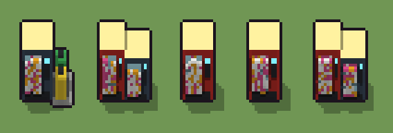

# Distributore automatico (`moderno-distributore.xml`)

Classe `mobile`, scatola 20 × 20 × 20 voxel, ambientazione `moderno (neapolis)`.

I distributori di bibite e snack con la vetrina, la pulsantiera e lo schermo. Il seme sceglie come sono messi (uno al centro, due affiancati di altezze diverse, uno con i bidoni accanto), se in cima c'è l'insegna luminosa e quali scomparti sono pieni.

## Esito

- validatore (`modelErrors`, `checkProgram`, `analyse` a ogni seme): nessun errore, nessun frammento staccato
- varianza su 5 semi (voxel pieni in un seme e vuoti nell'altro, sui pieni in almeno uno; il colore non conta): **media 0.346**, minima 0.012, massima 0.497 (soglia 0.15) → passa
- voxel per seme: 2273, 2883, 1910, 1911, 2893; tempo per seme: 50, 35, 36, 36, 35 ms
- avvisi: tocca il soffitto della griglia: forse è tagliato in alto; colori mai usati: R; colori mai usati: C G Y; colori mai usati: N C G Y

| coppia | 1-2 | 1-3 | 1-4 | 1-5 | 2-3 | 2-4 | 2-5 | 3-4 | 3-5 | 4-5 |
|---|---|---|---|---|---|---|---|---|---|---|
| distanza | 0.289 | 0.497 | 0.495 | 0.285 | 0.466 | 0.467 | 0.012 | 0.016 | 0.467 | 0.468 |



## Traccia di tre semi a confronto

La traccia di `src/mj/trace.ts` (forma `nodi`): per ogni nodo quante volte gira, quante celle scrive e la scatola di ciò che scrive. Le
righe che cambiano fra i semi sono le scelte del programma.

### Seme 1

```text
Traccia, seme 1: griglia 20×20×20, 45 nodi, 143 passi, finito in 41 ms.
x sinistra→destra, y fondo→davanti, z basso→alto; «.» è la cella vuota; #n è il nodo nell'ordine dell'XML; ×n quante volte ha agito.
Lettere: N=lamiera blu notte, V=vetrina, K=pulsantiera, S=schermo, T=insegna, C=cemento, W=lattina bianca, A=snack arancio, G=bidone verde, Y=bidone giallo, O=confezione rosa, m=il dado (marcatore), J=uno con i bidoni (marcatore), L=con l'insegna (marcatore), I=scomparti della vetrina (marcatore), i=uno scomparto pieno (marcatore).
Alla fine: N 1584, T 176, G 144, Y 128, C 77, W 52, K 34, O 32, A 28, V 16, S 2.
#2-6 box×2, prl×1, one×1, all×1: 8007 celle x0-19 y0-19 z0-19, passi 1-62
#22-32 box×8, cylinder×2, all×1: 8000 celle x0-19 y0-19 z0-19, passi 63-73
#33-41 prl×2, all×5, box×1, one×1: 6144 celle x0-19 y0-19 z0-19, passi 74-140
#42-44 all×3: 5903 celle x0-19 y0-19 z0-19, passi 141-143
Senza effetto (non hanno mai cambiato una cella):
#7 box at 10 8.5 0 size 11 8 18 R su X
#8 box at 8.5 13 4 size 7 1 12 I su X
#9 box at 13.5 13 9 size 2 1 4 K su X
#10 box at 13.5 13 14 size 2 1 1 S su X
#11 box at 10 13 1 size 9 1 2 K su X
#12 box at 5 8.5 0 size 9 8 18 R su U
#13 box at 4 13 4 size 5 1 12 I su U
#14 box at 8 13 9 size 1 1 4 K su U
#15 box at 8 13 14 size 1 1 1 S su U
#16 box at 5 13 1 size 7 1 2 K su U
#17 box at 14 8.5 0 size 9 8 15 N su U
#18 box at 13 13 3 size 5 1 10 I su U
… e altri 4
```

### Seme 2

```text
Traccia, seme 2: griglia 20×20×20, 45 nodi, 143 passi, finito in 38 ms.
x sinistra→destra, y fondo→davanti, z basso→alto; «.» è la cella vuota; #n è il nodo nell'ordine dell'XML; ×n quante volte ha agito.
Lettere: R=lamiera rossa, N=lamiera blu notte, V=vetrina, K=pulsantiera, S=schermo, T=insegna, W=lattina bianca, A=snack arancio, O=confezione rosa, m=il dado (marcatore), U=due affiancati (marcatore), L=con l'insegna (marcatore), I=scomparti della vetrina (marcatore), i=uno scomparto pieno (marcatore).
Alla fine: R 1296, N 1080, T 288, W 67, O 53, A 36, V 32, K 29, S 2.
#2-6 box×2, prl×1, one×1, all×1: 8007 celle x0-19 y0-19 z0-19, passi 1-63
#12-32 box×10, all×1: 8000 celle x0-19 y0-19 z0-19, passi 64-74
#33-41 prl×2, all×5, box×1, one×1: 5750 celle x0-19 y0-19 z0-19, passi 75-140
#42-44 all×3: 5405 celle x0-19 y0-19 z0-19, passi 141-143
Senza effetto (non hanno mai cambiato una cella):
#7 box at 10 8.5 0 size 11 8 18 R su X
#8 box at 8.5 13 4 size 7 1 12 I su X
#9 box at 13.5 13 9 size 2 1 4 K su X
#10 box at 13.5 13 14 size 2 1 1 S su X
#11 box at 10 13 1 size 9 1 2 K su X
#22 box at 6 8.5 0 size 11 8 18 N su J
#23 box at 4.5 13 4 size 7 1 12 I su J
#24 box at 9.5 13 9 size 2 1 4 K su J
#25 box at 9.5 13 14 size 2 1 1 S su J
#26 box at 6 13 1 size 9 1 2 K su J
#27 box at 15 9 0 size 7 11 1 C su J
#28 cylinder at 14.5 6.5 1 size 5 5 9 G su J
… e altri 4
```

### Seme 3

```text
Traccia, seme 3: griglia 20×20×20, 45 nodi, 138 passi, finito in 39 ms.
x sinistra→destra, y fondo→davanti, z basso→alto; «.» è la cella vuota; #n è il nodo nell'ordine dell'XML; ×n quante volte ha agito.
Lettere: R=lamiera rossa, V=vetrina, K=pulsantiera, S=schermo, T=insegna, W=lattina bianca, A=snack arancio, O=confezione rosa, m=il dado (marcatore), X=uno al centro (marcatore), L=con l'insegna (marcatore), I=scomparti della vetrina (marcatore), i=uno scomparto pieno (marcatore).
Alla fine: R 1584, T 176, W 45, O 28, A 27, K 26, V 22, S 2.
#2-6 box×2, prl×1, one×1, all×1: 8007 celle x0-19 y0-19 z0-19, passi 1-62
#7-32 box×5, all×1: 8000 celle x0-19 y0-19 z0-19, passi 63-68
#33-41 prl×2, all×5, box×1, one×1: 6489 celle x0-19 y0-19 z0-19, passi 69-135
#42-44 all×3: 6266 celle x0-19 y0-19 z0-19, passi 136-138
Senza effetto (non hanno mai cambiato una cella):
#12 box at 5 8.5 0 size 9 8 18 R su U
#13 box at 4 13 4 size 5 1 12 I su U
#14 box at 8 13 9 size 1 1 4 K su U
#15 box at 8 13 14 size 1 1 1 S su U
#16 box at 5 13 1 size 7 1 2 K su U
#17 box at 14 8.5 0 size 9 8 15 N su U
#18 box at 13 13 3 size 5 1 10 I su U
#19 box at 17 13 7 size 1 1 4 K su U
#20 box at 17 13 12 size 1 1 1 S su U
#21 box at 14 13 1 size 7 1 1 K su U
#22 box at 6 8.5 0 size 11 8 18 N su J
#23 box at 4.5 13 4 size 7 1 12 I su J
… e altri 9
```
