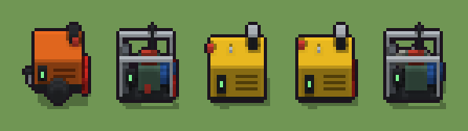

# Generatore diesel (`moderno-generatore.xml`)

Classe `mobile`, scatola 20 × 20 × 20 voxel, ambientazione `moderno (neapolis)`.

Il gruppo elettrogeno dei cantieri con il quadro comandi e lo scarico. Il seme sceglie se è cofanato giallo, a telaio aperto col motore in vista o arancio su un carrello con le ruote, che cosa gli sta accanto (serbatoio, due taniche o niente) e dove è appoggiata la cassetta degli attrezzi.

## Esito

- validatore (`modelErrors`, `checkProgram`, `analyse` a ogni seme): nessun errore, nessun frammento staccato
- varianza su 5 semi (voxel pieni in un seme e vuoti nell'altro, sui pieni in almeno uno; il colore non conta): **media 0.508**, minima 0.075, massima 0.768 (soglia 0.15) → passa
- voxel per seme: 1503, 788, 1853, 1779, 850; tempo per seme: 39, 41, 38, 39, 41 ms
- avvisi: tocca i bordi laterali della griglia: forse è tagliato; colori mai usati: Y y E e D N T; colori mai usati: Y y O o T R; colori mai usati: O o E e D N J R; colori mai usati: O o E e D N T R; colori mai usati: Y y O o J R

| coppia | 1-2 | 1-3 | 1-4 | 1-5 | 2-3 | 2-4 | 2-5 | 3-4 | 3-5 | 4-5 |
|---|---|---|---|---|---|---|---|---|---|---|
| distanza | 0.768 | 0.431 | 0.433 | 0.762 | 0.632 | 0.595 | 0.168 | 0.075 | 0.581 | 0.639 |



## Traccia di tre semi a confronto

La traccia di `src/mj/trace.ts` (forma `nodi`): per ogni nodo quante volte gira, quante celle scrive e la scatola di ciò che scrive. Le
righe che cambiano fra i semi sono le scelte del programma.

### Seme 1

```text
Traccia, seme 1: griglia 20×20×20, 56 nodi, 141 passi, finito in 43 ms.
x sinistra→destra, y fondo→davanti, z basso→alto; «.» è la cella vuota; #n è il nodo nell'ordine dell'XML; ×n quante volte ha agito.
Lettere: K=ferro nero, O=cofano arancio, o=feritoie arancio, S=acciaio, H=display, J=tanica rossa, R=pneumatico, t=cassetta degli attrezzi, m=il dado (marcatore), V=su carrello (marcatore), n=le taniche (marcatore).
Alla fine: O 1066, K 197, R 158, J 60, o 14, t 4, S 3, H 1.
#2-5 box×2, prl×1, one×1: 8 celle x0-2 y0 z0, passi 1-4
 #6 all X. → XX (+2): ×58, 7999 celle x0-19 y0-19 z0-19, passi 5-62, .→V 7999
   r1 X. → XX ×0; r2 U. → UU ×0; r3 V. → VV ×7999
#31-42 ellipsoid×2, box×7, line×1, cylinder×1, all×1: 8000 celle x0-19 y0-19 z0-19, passi 63-74
#43-45 box×1, one×1, all×1: 6562 celle x0-19 y0-19 z0-19, passi 75-135
#48-56 box×2, all×3, one×1: 6565 celle x0-19 y0-19 z0-19, passi 136-141
Senza effetto (non hanno mai cambiato una cella):
#7 box at 10 10 0 size 17 9 1 K su X
#8 box at 13 14 3 size 7 1 1 y su X
#9 box at 13 14 5 size 7 1 1 y su X
#10 box at 13 14 7 size 7 1 1 y su X
#11 box at 10 10 1 size 17 9 10 Y su X
#12 box at 5 15 3 size 3 1 5 K su X
#13 box at 5 16 6 size 1 1 1 H su X
#14 cylinder at 15 8 11 size 3 3 4 K su X
#15 box at 15 8 15 size 3 3 1 S su X
#16 box at 8 10 11 size 1 1 1 S su X
#17 box at 10 10 0 size 17 9 1 K su U
#18 box at 11 10 1 size 8 5 7 E su U
… e altri 17
```

### Seme 2

```text
Traccia, seme 2: griglia 20×20×20, 56 nodi, 144 passi, finito in 45 ms.
x sinistra→destra, y fondo→davanti, z basso→alto; «.» è la cella vuota; #n è il nodo nell'ordine dell'XML; ×n quante volte ha agito.
Lettere: K=ferro nero, E=motore, e=testata, D=radiatore, S=acciaio, N=alternatore, H=display, J=tanica rossa, t=cassetta degli attrezzi, m=il dado (marcatore), U=a telaio aperto (marcatore), n=le taniche (marcatore).
Alla fine: E 245, K 171, D 126, N 93, S 78, J 40, e 30, t 4, H 1.
#2-5 box×2, prl×1, one×1: 8 celle x0-2 y0 z0, passi 1-4
 #6 all X. → XX (+2): ×59, 7999 celle x0-19 y0-19 z0-19, passi 5-63, .→U 7999
   r1 X. → XX ×0; r2 U. → UU ×7999; r3 V. → VV ×0
#17-42 box×12, line×2, all×1: 8000 celle x0-19 y0-19 z0-19, passi 64-78
#43-45 box×1, one×1, all×1: 7257 celle x0-19 y0-19 z0-19, passi 79-138
#48-56 box×2, all×3, one×1: 7260 celle x0-19 y0-19 z0-19, passi 139-144
Senza effetto (non hanno mai cambiato una cella):
#7 box at 10 10 0 size 17 9 1 K su X
#8 box at 13 14 3 size 7 1 1 y su X
#9 box at 13 14 5 size 7 1 1 y su X
#10 box at 13 14 7 size 7 1 1 y su X
#11 box at 10 10 1 size 17 9 10 Y su X
#12 box at 5 15 3 size 3 1 5 K su X
#13 box at 5 16 6 size 1 1 1 H su X
#14 cylinder at 15 8 11 size 3 3 4 K su X
#15 box at 15 8 15 size 3 3 1 S su X
#16 box at 8 10 11 size 1 1 1 S su X
#31 ellipsoid at 10 4 0 size 7 3 7 R su V
#32 ellipsoid at 10 16 0 size 7 3 7 R su V
… e altri 14
```

### Seme 3

```text
Traccia, seme 3: griglia 20×20×20, 56 nodi, 140 passi, finito in 42 ms.
x sinistra→destra, y fondo→davanti, z basso→alto; «.» è la cella vuota; #n è il nodo nell'ordine dell'XML; ×n quante volte ha agito.
Lettere: K=ferro nero, Y=cofano giallo, y=feritoie, S=acciaio, H=display, T=serbatoio, t=cassetta degli attrezzi, m=il dado (marcatore), X=cofanato (marcatore), L=il serbatoio (marcatore).
Alla fine: Y 1509, K 204, T 103, y 21, S 11, t 4, H 1.
#2-5 box×2, prl×1, one×1: 8 celle x0-2 y0 z0, passi 1-4
 #6 all X. → XX (+2): ×58, 7999 celle x0-19 y0-19 z0-19, passi 5-62, .→X 7999
   r1 X. → XX ×7999; r2 U. → UU ×0; r3 V. → VV ×0
#7-42 box×9, cylinder×1, all×1: 8000 celle x0-19 y0-19 z0-19, passi 63-73
#43-45 box×1, one×1, all×1: 6256 celle x0-19 y0-19 z0-19, passi 74-134
#46-56 ellipsoid×1, box×1, all×3, one×1: 6259 celle x0-19 y0-19 z0-19, passi 135-140
Senza effetto (non hanno mai cambiato una cella):
#17 box at 10 10 0 size 17 9 1 K su U
#18 box at 11 10 1 size 8 5 7 E su U
#19 box at 11 10 8 size 6 3 2 e su U
#20 box at 3.5 10 1 size 2 7 9 D su U
#21 line 15 10 4 → 17 10 4 N
#22 box at 2 6 1 size 1 1 11 S su U
#23 box at 18 6 1 size 1 1 11 S su U
#24 box at 2 14 1 size 1 1 11 S su U
#25 box at 18 14 1 size 1 1 11 S su U
#26 box at 10 6 12 size 17 1 1 S su U
#27 box at 10 14 12 size 17 1 1 S su U
#28 box at 5 14 5 size 3 1 4 K su U
… e altri 18
```
