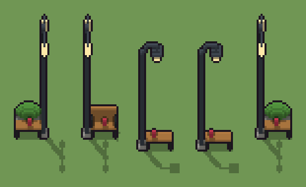

# Panchina con lampione (`moderno-panchina.xml`)

Classe `monumento`, scatola 20 × 20 × 60 voxel, ambientazione `moderno (neapolis)`.

Una panchina a doghe sui piedi di ghisa con il lampione d'acciaio a un capo. Il seme sceglie a quale capo sta il lampione, se è a pastorale con la lanterna o a doppio braccio con due globi, e se la panchina ha lo schienale, la fioriera dietro o è semplice. Una borsa dimenticata sta sulla seduta in un punto scelto.

## Esito

- validatore (`modelErrors`, `checkProgram`, `analyse` a ogni seme): nessun errore, nessun frammento staccato
- varianza su 5 semi (voxel pieni in un seme e vuoti nell'altro, sui pieni in almeno uno; il colore non conta): **media 0.630**, minima 0.017, massima 0.930 (soglia 0.15) → passa
- voxel per seme: 923, 524, 359, 359, 927; tempo per seme: 153, 147, 156, 150, 176 ms
- avvisi: tocca i bordi laterali della griglia: forse è tagliato; colori mai usati: w; colori mai usati: w G g

| coppia | 1-2 | 1-3 | 1-4 | 1-5 | 2-3 | 2-4 | 2-5 | 3-4 | 3-5 | 4-5 |
|---|---|---|---|---|---|---|---|---|---|---|
| distanza | 0.904 | 0.930 | 0.930 | 0.514 | 0.513 | 0.513 | 0.561 | 0.017 | 0.710 | 0.710 |



## Traccia di tre semi a confronto

La traccia di `src/mj/trace.ts` (forma `nodi`): per ogni nodo quante volte gira, quante celle scrive e la scatola di ciò che scrive. Le
righe che cambiano fra i semi sono le scelte del programma.

### Seme 1

```text
Traccia, seme 1: griglia 20×20×60, 60 nodi, 225 passi, finito in 180 ms.
x sinistra→destra, y fondo→davanti, z basso→alto; «.» è la cella vuota; #n è il nodo nell'ordine dell'XML; ×n quante volte ha agito.
Lettere: C=cemento, P=acciaio verniciato, K=ghisa, W=doghe di legno, T=luce, G=siepe, g=fioriera, m=il dado (marcatore), d=doppio braccio a destra (marcatore), D=con la fioriera (marcatore), x=dove può stare la borsa (marcatore), X=borsa dimenticata.
Alla fine: g 325, P 229, G 193, T 74, W 52, K 32, C 12, X 6.
#2-9 box×5, prl×1, one×1, all×1: 24007 celle x0-19 y0-19 z0-59, passi 1-106
#33-40 box×3, line×1, ellipsoid×2, all×1: 23916 celle x0-19 y0-19 z0-59, passi 107-113
#41-43 box×1, one×1, all×1: 23602 celle x0-19 y0-19 z0-59, passi 114-216
#51-59 box×2, ellipsoid×1, all×4, one×1: 23650 celle x0-19 y0-19 z0-59, passi 217-225
Senza effetto (non hanno mai cambiato una cella):
#10 box at 1.5 11.5 0 size 4 4 1 C su a
#11 box at 1.5 11.5 1 size 2 2 47 P su a
#12 box at 1.5 11.5 1 size 3 3 4 K su a
#13 line 2 12 47 → 4 12 51 P
#14 line 4 12 51 → 9 12 51 P
#15 box at 9 12 49 size 1 1 2 P su a
#16 box at 9 12 48 size 5 5 1 P su a
#17 box at 9 12 45 size 3 3 3 T su a
#18 box at 17.5 11.5 0 size 4 4 1 C su b
#19 box at 17.5 11.5 1 size 2 2 47 P su b
#20 box at 17.5 11.5 1 size 3 3 4 K su b
#21 line 18 12 47 → 15 12 51 P
… e altri 21
```

### Seme 2

```text
Traccia, seme 2: griglia 20×20×60, 60 nodi, 223 passi, finito in 168 ms.
x sinistra→destra, y fondo→davanti, z basso→alto; «.» è la cella vuota; #n è il nodo nell'ordine dell'XML; ×n quante volte ha agito.
Lettere: C=cemento, P=acciaio verniciato, K=ghisa, W=doghe di legno, T=luce, m=il dado (marcatore), c=doppio braccio a sinistra (marcatore), L=con lo schienale (marcatore), x=dove può stare la borsa (marcatore), X=borsa dimenticata.
Alla fine: P 229, W 143, T 74, K 56, C 16, X 6.
#2-9 box×5, prl×1, one×1, all×1: 24007 celle x0-19 y0-19 z0-59, passi 1-106
#26-40 box×3, line×1, ellipsoid×2, all×1: 23916 celle x0-19 y0-19 z0-59, passi 107-113
#41-43 box×1, one×1, all×1: 23598 celle x0-19 y0-19 z0-59, passi 114-213
#44-59 box×4, all×4, one×1: 23646 celle x0-19 y0-19 z0-59, passi 214-223
Senza effetto (non hanno mai cambiato una cella):
#10 box at 1.5 11.5 0 size 4 4 1 C su a
#11 box at 1.5 11.5 1 size 2 2 47 P su a
#12 box at 1.5 11.5 1 size 3 3 4 K su a
#13 line 2 12 47 → 4 12 51 P
#14 line 4 12 51 → 9 12 51 P
#15 box at 9 12 49 size 1 1 2 P su a
#16 box at 9 12 48 size 5 5 1 P su a
#17 box at 9 12 45 size 3 3 3 T su a
#18 box at 17.5 11.5 0 size 4 4 1 C su b
#19 box at 17.5 11.5 1 size 2 2 47 P su b
#20 box at 17.5 11.5 1 size 3 3 4 K su b
#21 line 18 12 47 → 15 12 51 P
… e altri 20
```

### Seme 3

```text
Traccia, seme 3: griglia 20×20×60, 60 nodi, 220 passi, finito in 171 ms.
x sinistra→destra, y fondo→davanti, z basso→alto; «.» è la cella vuota; #n è il nodo nell'ordine dell'XML; ×n quante volte ha agito.
Lettere: C=cemento, P=acciaio verniciato, K=ghisa, W=doghe di legno, T=luce, m=il dado (marcatore), a=pastorale a sinistra (marcatore), E=semplice (marcatore), x=dove può stare la borsa (marcatore), X=borsa dimenticata.
Alla fine: P 226, W 52, K 32, T 27, C 16, X 6.
#2-9 box×5, prl×1, one×1, all×1: 24007 celle x0-19 y0-19 z0-59, passi 1-105
#10-40 box×5, line×2, all×1: 23916 celle x0-19 y0-19 z0-59, passi 106-113
#41-43 box×1, one×1, all×1: 23648 celle x0-19 y0-19 z0-59, passi 114-213
#53-59 all×4, box×1, one×1: 23696 celle x0-19 y0-19 z0-59, passi 214-220
Senza effetto (non hanno mai cambiato una cella):
#12 box at 1.5 11.5 1 size 3 3 4 K su a
#18 box at 17.5 11.5 0 size 4 4 1 C su b
#19 box at 17.5 11.5 1 size 2 2 47 P su b
#20 box at 17.5 11.5 1 size 3 3 4 K su b
#21 line 18 12 47 → 15 12 51 P
#22 line 15 12 51 → 10 12 51 P
#23 box at 10 12 49 size 1 1 2 P su b
#24 box at 10 12 48 size 5 5 1 P su b
#25 box at 10 12 45 size 3 3 3 T su b
#26 box at 1.5 11.5 0 size 4 4 1 C su c
#27 box at 1.5 11.5 1 size 2 2 52 P su c
#28 box at 1.5 11.5 1 size 3 3 4 K su c
… e altri 22
```
