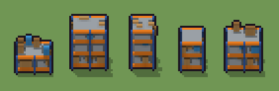

# Scaffale industriale (`moderno-scaffale.xml`)

Classe `mobile`, scatola 20 × 20 × 20 voxel, ambientazione `moderno (neapolis)`.

Lo scaffale di un magazzino con i montanti blu, le traverse arancio e i ripiani di lamiera, carico di scatoloni. Il seme sceglie se ha una campata o due, quanti ripiani ha (due, tre o quattro) e dove stanno gli scatoloni.

## Esito

- validatore (`modelErrors`, `checkProgram`, `analyse` a ogni seme): nessun errore, nessun frammento staccato
- varianza su 5 semi (voxel pieni in un seme e vuoti nell'altro, sui pieni in almeno uno; il colore non conta): **media 0.626**, minima 0.454, massima 0.772 (soglia 0.15) → passa
- voxel per seme: 428, 778, 477, 424, 598; tempo per seme: 25, 28, 24, 24, 25 ms
- avvisi: tocca il soffitto della griglia: forse è tagliato in alto

| coppia | 1-2 | 1-3 | 1-4 | 1-5 | 2-3 | 2-4 | 2-5 | 3-4 | 3-5 | 4-5 |
|---|---|---|---|---|---|---|---|---|---|---|
| distanza | 0.651 | 0.772 | 0.732 | 0.538 | 0.621 | 0.713 | 0.454 | 0.481 | 0.655 | 0.645 |



## Traccia di tre semi a confronto

La traccia di `src/mj/trace.ts` (forma `nodi`): per ogni nodo quante volte gira, quante celle scrive e la scatola di ciò che scrive. Le
righe che cambiano fra i semi sono le scelte del programma.

### Seme 1

```text
Traccia, seme 1: griglia 20×20×20, 58 nodi, 150 passi, finito in 25 ms.
x sinistra→destra, y fondo→davanti, z basso→alto; «.» è la cella vuota; #n è il nodo nell'ordine dell'XML; ×n quante volte ha agito.
Lettere: P=montanti blu, O=traverse arancio, W=ripiani di lamiera, E=scatolone, e=nastro dello scatolone, A=cassa di plastica, m=il dado (marcatore), U=due campate (marcatore), h=le altezze possibili (marcatore), k=la quota del taglio (marcatore), c=uno scatolone che nasce (marcatore).
Alla fine: W 192, E 78, O 60, P 48, e 26, A 24.
#2-6 box×2, prl×1, one×1, all×1: 8007 celle x0-19 y0-19 z0-19, passi 1-62
#23-41 box×18, all×1: 8000 celle x0-19 y0-19 z0-19, passi 63-81
#42-48 box×3, one×1, all×3: 4805 celle x0-19 y0-19 z8-19, passi 82-135
#49-57 all×7, prl×2: 5082 celle x0-19 y0-19 z2-19, passi 136-150
Senza effetto (non hanno mai cambiato una cella):
#7 box at 4 6 0 size 1 1 19 P su X
#8 box at 15 6 0 size 1 1 19 P su X
#9 box at 4 13 0 size 1 1 19 P su X
#10 box at 15 13 0 size 1 1 19 P su X
#11 box at 9.5 13 1 size 10 1 1 O su X
#12 box at 9.5 13 7 size 10 1 1 O su X
#13 box at 9.5 13 13 size 10 1 1 O su X
#14 box at 9.5 13 18 size 10 1 1 O su X
#15 box at 9.5 6 1 size 10 1 1 O su X
#16 box at 9.5 6 7 size 10 1 1 O su X
#17 box at 9.5 6 13 size 10 1 1 O su X
#18 box at 9.5 6 18 size 10 1 1 O su X
… e altri 5
```

### Seme 2

```text
Traccia, seme 2: griglia 20×20×20, 58 nodi, 140 passi, finito in 23 ms.
x sinistra→destra, y fondo→davanti, z basso→alto; «.» è la cella vuota; #n è il nodo nell'ordine dell'XML; ×n quante volte ha agito.
Lettere: P=montanti blu, O=traverse arancio, W=ripiani di lamiera, E=scatolone, e=nastro dello scatolone, A=cassa di plastica, m=il dado (marcatore), U=due campate (marcatore), h=le altezze possibili (marcatore), k=la quota del taglio (marcatore), c=uno scatolone che nasce (marcatore).
Alla fine: W 384, O 120, P 114, E 88, A 48, e 24.
#2-5 box×2, prl×1, one×1: 8 celle x0-2 y0 z0, passi 1-4
 #6 all X. → XX (+1): ×59, 7999 celle x0-19 y0-19 z0-19, passi 5-63, .→U 7999
   r1 X. → XX ×0; r2 U. → UU ×7999
#23-41 box×18, all×1: 8000 celle x0-19 y0-19 z0-19, passi 64-82
#42-57 box×3, one×1, all×9, prl×2: 1149 celle x0-19 y0-19 z2-19, passi 83-140
Senza effetto (non hanno mai cambiato una cella):
#7 box at 4 6 0 size 1 1 19 P su X
#8 box at 15 6 0 size 1 1 19 P su X
#9 box at 4 13 0 size 1 1 19 P su X
#10 box at 15 13 0 size 1 1 19 P su X
#11 box at 9.5 13 1 size 10 1 1 O su X
#12 box at 9.5 13 7 size 10 1 1 O su X
#13 box at 9.5 13 13 size 10 1 1 O su X
#14 box at 9.5 13 18 size 10 1 1 O su X
#15 box at 9.5 6 1 size 10 1 1 O su X
#16 box at 9.5 6 7 size 10 1 1 O su X
#17 box at 9.5 6 13 size 10 1 1 O su X
#18 box at 9.5 6 18 size 10 1 1 O su X
… e altri 6
```

### Seme 3

```text
Traccia, seme 3: griglia 20×20×20, 58 nodi, 137 passi, finito in 22 ms.
x sinistra→destra, y fondo→davanti, z basso→alto; «.» è la cella vuota; #n è il nodo nell'ordine dell'XML; ×n quante volte ha agito.
Lettere: P=montanti blu, O=traverse arancio, W=ripiani di lamiera, E=scatolone, e=nastro dello scatolone, A=cassa di plastica, m=il dado (marcatore), X=una campata (marcatore), h=le altezze possibili (marcatore), k=la quota del taglio (marcatore), c=uno scatolone che nasce (marcatore).
Alla fine: W 240, O 80, P 76, E 37, A 36, e 8.
#2-5 box×2, prl×1, one×1: 8 celle x0-2 y0 z0, passi 1-4
 #6 all X. → XX (+1): ×58, 7999 celle x0-19 y0-19 z0-19, passi 5-62, .→X 7999
   r1 X. → XX ×7999; r2 U. → UU ×0
#7-41 box×16, all×1: 8000 celle x0-19 y0-19 z0-19, passi 63-79
#42-57 box×3, one×1, all×9, prl×2: 975 celle x0-19 y0-19 z2-19, passi 80-137
Senza effetto (non hanno mai cambiato una cella):
#23 box at 1 6 0 size 1 1 19 P su U
#24 box at 10 6 0 size 1 1 19 P su U
#25 box at 18 6 0 size 1 1 19 P su U
#26 box at 1 13 0 size 1 1 19 P su U
#27 box at 10 13 0 size 1 1 19 P su U
#28 box at 18 13 0 size 1 1 19 P su U
#29 box at 9.5 13 1 size 16 1 1 O su U
#30 box at 9.5 13 7 size 16 1 1 O su U
#31 box at 9.5 13 13 size 16 1 1 O su U
#32 box at 9.5 13 18 size 16 1 1 O su U
#33 box at 9.5 6 1 size 16 1 1 O su U
#34 box at 9.5 6 7 size 16 1 1 O su U
… e altri 8
```
