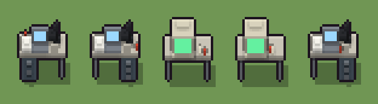

# Scrivania con terminale (`moderno-scrivania.xml`)

Classe `mobile`, scatola 20 × 20 × 20 voxel, ambientazione `moderno (neapolis)`.

Una scrivania d'ufficio con il computer. Il seme sceglie le gambe o la cassettiera (a destra, o a sinistra con il pannello sul retro), che cosa c'è sopra (il terminale a tubo, due schermi piatti col computer sotto, o il portatile con la lampada e le carte) e dove è rimasta la tazza.

## Esito

- validatore (`modelErrors`, `checkProgram`, `analyse` a ogni seme): nessun errore, nessun frammento staccato
- varianza su 5 semi (voxel pieni in un seme e vuoti nell'altro, sui pieni in almeno uno; il colore non conta): **media 0.597**, minima 0.005, massima 0.770 (soglia 0.15) → passa
- voxel per seme: 919, 844, 721, 721, 844; tempo per seme: 51, 50, 43, 45, 42 ms
- avvisi: tocca i bordi laterali della griglia: forse è tagliato; colori mai usati: k S; colori mai usati: K W G Y h

| coppia | 1-2 | 1-3 | 1-4 | 1-5 | 2-3 | 2-4 | 2-5 | 3-4 | 3-5 | 4-5 |
|---|---|---|---|---|---|---|---|---|---|---|
| distanza | 0.697 | 0.770 | 0.770 | 0.697 | 0.756 | 0.756 | 0.005 | 0.006 | 0.756 | 0.756 |



## Traccia di tre semi a confronto

La traccia di `src/mj/trace.ts` (forma `nodi`): per ogni nodo quante volte gira, quante celle scrive e la scatola di ciò che scrive. Le
righe che cambiano fra i semi sono le scelte del programma.

### Seme 1

```text
Traccia, seme 1: griglia 20×20×20, 59 nodi, 147 passi, finito in 45 ms.
x sinistra→destra, y fondo→davanti, z basso→alto; «.» è la cella vuota; #n è il nodo nell'ordine dell'XML; ×n quante volte ha agito.
Lettere: D=laminato, d=bordo del piano, P=acciaio, K=plastica nera, W=schermo azzurro, G=carta, Y=lampadina, u=tazza, h=cassettiera, m=il dado (marcatore), J=cassettiera a sinistra (marcatore), n=il portatile (marcatore), F=la tazza (marcatore).
Alla fine: h 486, D 152, d 96, P 85, G 46, K 36, W 15, u 2, Y 1.
#2-8 box×4, prl×1, one×1, all×1: 8026 celle x0-19 y0-19 z0-19, passi 1-65
#19-25 box×6, all×1: 7829 celle x0-19 y0-19 z0-19, passi 66-72
#26-28 box×1, one×1, all×1: 7245 celle x0-19 y0-19 z0-19, passi 73-133
#45-59 box×8, line×2, all×3, one×1: 7247 celle x0-19 y0-19 z0-19, passi 134-147
Senza effetto (non hanno mai cambiato una cella):
#9 box at 2 6 0 size 1 1 9 P su X
#10 box at 18 6 0 size 1 1 9 P su X
#11 box at 2 12 0 size 1 1 9 P su X
#12 box at 18 12 0 size 1 1 9 P su X
#13 box at 15.5 9 0 size 6 9 9 h su U
#14 box at 15.5 14 7 size 2 1 1 P su U
#15 box at 15.5 14 4 size 2 1 1 P su U
#16 box at 15.5 14 1 size 2 1 1 P su U
#17 box at 2 6 0 size 1 1 9 P su U
#18 box at 2 12 0 size 1 1 9 P su U
#29 box at 8 12 11 size 7 1 5 S su L
#30 box at 8 8 10 size 9 7 7 k su L
… e altri 15
```

### Seme 2

```text
Traccia, seme 2: griglia 20×20×20, 59 nodi, 146 passi, finito in 53 ms.
x sinistra→destra, y fondo→davanti, z basso→alto; «.» è la cella vuota; #n è il nodo nell'ordine dell'XML; ×n quante volte ha agito.
Lettere: D=laminato, d=bordo del piano, P=acciaio, K=plastica nera, W=schermo azzurro, G=carta, Y=lampadina, u=tazza, h=cassettiera, m=il dado (marcatore), U=cassettiera a destra (marcatore), n=il portatile (marcatore), F=la tazza (marcatore).
Alla fine: h 486, D 152, P 87, G 46, K 36, d 19, W 15, u 2, Y 1.
#2-8 box×4, prl×1, one×1, all×1: 8026 celle x0-19 y0-19 z0-19, passi 1-65
#13-25 box×6, all×1: 7829 celle x0-19 y0-19 z0-19, passi 66-72
#26-28 box×1, one×1, all×1: 7320 celle x0-19 y0-19 z0-19, passi 73-132
#45-59 box×8, line×2, all×3, one×1: 7322 celle x0-19 y0-19 z0-19, passi 133-146
Senza effetto (non hanno mai cambiato una cella):
#9 box at 2 6 0 size 1 1 9 P su X
#10 box at 18 6 0 size 1 1 9 P su X
#11 box at 2 12 0 size 1 1 9 P su X
#12 box at 18 12 0 size 1 1 9 P su X
#19 box at 4.5 9 0 size 6 9 9 h su J
#20 box at 4.5 14 7 size 2 1 1 P su J
#21 box at 4.5 14 3 size 2 1 1 P su J
#22 box at 12 5 2 size 13 1 7 d su J
#23 box at 18 6 0 size 1 1 9 P su J
#24 box at 18 12 0 size 1 1 9 P su J
#29 box at 8 12 11 size 7 1 5 S su L
#30 box at 8 8 10 size 9 7 7 k su L
… e altri 15
```

### Seme 3

```text
Traccia, seme 3: griglia 20×20×20, 59 nodi, 139 passi, finito in 63 ms.
x sinistra→destra, y fondo→davanti, z basso→alto; «.» è la cella vuota; #n è il nodo nell'ordine dell'XML; ×n quante volte ha agito.
Lettere: D=laminato, d=bordo del piano, P=acciaio, k=plastica beige, S=schermo verde, u=tazza, m=il dado (marcatore), X=quattro gambe (marcatore), L=il terminale (marcatore), F=la tazza (marcatore).
Alla fine: k 477, D 152, P 36, S 35, d 19, u 2.
#2-7 box×4, prl×1, one×1: 198 celle x0-19 y0-13 z0-9, passi 1-6
 #8 all X. → XX (+2): ×59, 7828 celle x0-19 y0-19 z0-19, passi 7-65, .→X 7828
   r1 X. → XX ×7828; r2 U. → UU ×0; r3 J. → JJ ×0
#9-25 box×4, all×1: 7829 celle x0-19 y0-19 z0-19, passi 66-70
#26-28 box×1, one×1, all×1: 7794 celle x0-19 y0-19 z0-19, passi 71-130
#29-59 box×5, all×3, one×1: 7796 celle x0-19 y0-19 z0-19, passi 131-139
Senza effetto (non hanno mai cambiato una cella):
#13 box at 15.5 9 0 size 6 9 9 h su U
#14 box at 15.5 14 7 size 2 1 1 P su U
#15 box at 15.5 14 4 size 2 1 1 P su U
#16 box at 15.5 14 1 size 2 1 1 P su U
#17 box at 2 6 0 size 1 1 9 P su U
#18 box at 2 12 0 size 1 1 9 P su U
#19 box at 4.5 9 0 size 6 9 9 h su J
#20 box at 4.5 14 7 size 2 1 1 P su J
#21 box at 4.5 14 3 size 2 1 1 P su J
#22 box at 12 5 2 size 13 1 7 d su J
#23 box at 18 6 0 size 1 1 9 P su J
#24 box at 18 12 0 size 1 1 9 P su J
… e altri 22
```
