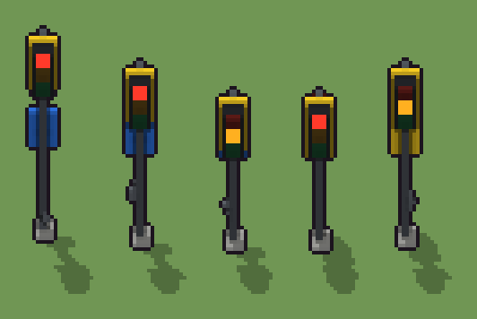

# Semaforo stradale (`moderno-semaforo.xml`)

Classe `monumento`, scatola 20 × 20 × 60 voxel, ambientazione `moderno (neapolis)`.

Un palo d'acciaio con la lanterna a tre luci sul davanti. Il seme sceglie la quota della lanterna, cosa porta il retro del palo (pedoni, seconda lanterna o cartello), a che altezza sta la cassetta dei cavi e quale luce è accesa.

## Esito

- validatore (`modelErrors`, `checkProgram`, `analyse` a ogni seme): nessun errore, nessun frammento staccato
- varianza su 5 semi (voxel pieni in un seme e vuoti nell'altro, sui pieni in almeno uno; il colore non conta): **media 0.558**, minima 0.342, massima 0.812 (soglia 0.15) → passa
- voxel per seme: 725, 697, 669, 921, 949; tempo per seme: 153, 151, 144, 147, 139 ms
- avvisi: colori mai usati: r A G s; colori mai usati: R a G s; colori mai usati: A W w S s; colori mai usati: R W w S s

| coppia | 1-2 | 1-3 | 1-4 | 1-5 | 2-3 | 2-4 | 2-5 | 3-4 | 3-5 | 4-5 |
|---|---|---|---|---|---|---|---|---|---|---|
| distanza | 0.492 | 0.729 | 0.812 | 0.640 | 0.505 | 0.655 | 0.342 | 0.352 | 0.655 | 0.398 |



## Traccia di tre semi a confronto

La traccia di `src/mj/trace.ts` (forma `nodi`): per ogni nodo quante volte gira, quante celle scrive e la scatola di ciò che scrive. Le
righe che cambiano fra i semi sono le scelte del programma.

### Seme 1

```text
Traccia, seme 1: griglia 20×20×60, 58 nodi, 234 passi, finito in 177 ms.
x sinistra→destra, y fondo→davanti, z basso→alto; «.» è la cella vuota; #n è il nodo nell'ordine dell'XML; ×n quante volte ha agito.
Lettere: C=cemento, P=acciaio del palo, K=lanterna nera, Y=pannello giallo, R=rosso acceso, a=giallo spento, g=verde spento, W=omino bianco, w=cartello blu, S=staffa, m=il dado (marcatore), V=lanterna alta (marcatore), E=retro: cartello (marcatore), F=luce rossa da scegliere (marcatore), t=luce gialla da scegliere (marcatore), c=luce verde da scegliere (marcatore), N=cassetta dei cavi, n=dove può stare la cassetta (marcatore).
Alla fine: P 216, K 216, Y 112, w 80, C 25, S 24, g 12, a 12, R 12, N 8, W 8.
#2-27 box×10, prl×1, one×1, all×2: 47862 celle x0-19 y0-19 z0-59, passi 1-112
#28-57 box×7, one×3, all×8, cylinder×1: 46978 celle x0-19 y0-19 z0-59, passi 113-234
Senza effetto (non hanno mai cambiato una cella):
#9 box at 9.5 9.5 31 size 2 2 10 P su X
#10 box at 9.5 11 27 size 8 1 14 Y su X
#11 box at 9.5 13 28 size 6 3 12 K su X
#12 box at 9.5 15 37 size 4 1 3 F su X
#13 box at 9.5 15 33 size 4 1 3 t su X
#14 box at 9.5 15 29 size 4 1 3 c su X
#15 box at 9.5 9.5 31 size 2 2 17 P su U
#16 box at 9.5 11 34 size 8 1 14 Y su U
#17 box at 9.5 13 35 size 6 3 12 K su U
#18 box at 9.5 15 44 size 4 1 3 F su U
#19 box at 9.5 15 40 size 4 1 3 t su U
#20 box at 9.5 15 36 size 4 1 3 c su U
… e altri 12
```

### Seme 2

```text
Traccia, seme 2: griglia 20×20×60, 58 nodi, 235 passi, finito in 174 ms.
x sinistra→destra, y fondo→davanti, z basso→alto; «.» è la cella vuota; #n è il nodo nell'ordine dell'XML; ×n quante volte ha agito.
Lettere: C=cemento, P=acciaio del palo, K=lanterna nera, Y=pannello giallo, R=rosso acceso, a=giallo spento, g=verde spento, W=omino bianco, w=cartello blu, S=staffa, m=il dado (marcatore), U=lanterna media (marcatore), E=retro: cartello (marcatore), F=luce rossa da scegliere (marcatore), t=luce gialla da scegliere (marcatore), c=luce verde da scegliere (marcatore), N=cassetta dei cavi, n=dove può stare la cassetta (marcatore).
Alla fine: K 216, P 188, Y 112, w 80, C 25, S 24, g 12, a 12, R 12, N 8, W 8.
#2-27 box×10, prl×1, one×1, all×2: 47862 celle x0-19 y0-19 z0-59, passi 1-112
#28-57 box×7, one×3, all×8, cylinder×1: 47034 celle x0-19 y0-19 z0-59, passi 113-235
Senza effetto (non hanno mai cambiato una cella):
#9 box at 9.5 9.5 31 size 2 2 10 P su X
#10 box at 9.5 11 27 size 8 1 14 Y su X
#11 box at 9.5 13 28 size 6 3 12 K su X
#12 box at 9.5 15 37 size 4 1 3 F su X
#13 box at 9.5 15 33 size 4 1 3 t su X
#14 box at 9.5 15 29 size 4 1 3 c su X
#21 box at 9.5 9.5 31 size 2 2 24 P su V
#22 box at 9.5 11 41 size 8 1 14 Y su V
#23 box at 9.5 13 42 size 6 3 12 K su V
#24 box at 9.5 15 51 size 4 1 3 F su V
#25 box at 9.5 15 47 size 4 1 3 t su V
#26 box at 9.5 15 43 size 4 1 3 c su V
… e altri 12
```

### Seme 3

```text
Traccia, seme 3: griglia 20×20×60, 58 nodi, 233 passi, finito in 178 ms.
x sinistra→destra, y fondo→davanti, z basso→alto; «.» è la cella vuota; #n è il nodo nell'ordine dell'XML; ×n quante volte ha agito.
Lettere: C=cemento, P=acciaio del palo, K=lanterna nera, Y=pannello giallo, r=rosso spento, A=giallo acceso, g=verde spento, W=omino bianco, w=cartello blu, S=staffa, m=il dado (marcatore), X=lanterna bassa (marcatore), E=retro: cartello (marcatore), F=luce rossa da scegliere (marcatore), t=luce gialla da scegliere (marcatore), c=luce verde da scegliere (marcatore), N=cassetta dei cavi, n=dove può stare la cassetta (marcatore).
Alla fine: K 216, P 160, Y 112, w 80, C 25, S 24, g 12, A 12, r 12, N 8, W 8.
#2-27 box×10, prl×1, one×1, all×2: 47862 celle x0-19 y0-19 z0-59, passi 1-111
#28-57 box×7, one×3, all×8, cylinder×1: 47090 celle x0-19 y0-19 z0-59, passi 112-233
Senza effetto (non hanno mai cambiato una cella):
#15 box at 9.5 9.5 31 size 2 2 17 P su U
#16 box at 9.5 11 34 size 8 1 14 Y su U
#17 box at 9.5 13 35 size 6 3 12 K su U
#18 box at 9.5 15 44 size 4 1 3 F su U
#19 box at 9.5 15 40 size 4 1 3 t su U
#20 box at 9.5 15 36 size 4 1 3 c su U
#21 box at 9.5 9.5 31 size 2 2 24 P su V
#22 box at 9.5 11 41 size 8 1 14 Y su V
#23 box at 9.5 13 42 size 6 3 12 K su V
#24 box at 9.5 15 51 size 4 1 3 F su V
#25 box at 9.5 15 47 size 4 1 3 t su V
#26 box at 9.5 15 43 size 4 1 3 c su V
… e altri 12
```
