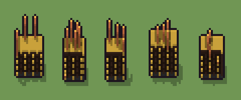

# Archivio pneumatico (`steampunk-archivio-pneumatico.xml`)

Classe `mobile`, scatola 20 × 20 × 20 voxel, ambientazione `steampunk (orichalcum)`.

Uno schedario di legno scuro a cassetti con maniglie d'ottone, da cui salgono tubi pneumatici di rame con capsule ambrate. Il seme sceglie larghezza e altezza dello schedario, quanti tubi escono, dove e come curvano.

## Esito

- validatore (`modelErrors`, `checkProgram`, `analyse` a ogni seme): nessun errore, nessun frammento staccato
- varianza su 5 semi (voxel pieni in un seme e vuoti nell'altro, sui pieni in almeno uno; il colore non conta): **media 0.276**, minima 0.152, massima 0.413 (soglia 0.15) → passa
- voxel per seme: 1230, 1049, 939, 1526, 1126; tempo per seme: 8, 14, 17, 12, 8 ms
- avvisi: tocca il soffitto della griglia: forse è tagliato in alto

| coppia | 1-2 | 1-3 | 1-4 | 1-5 | 2-3 | 2-4 | 2-5 | 3-4 | 3-5 | 4-5 |
|---|---|---|---|---|---|---|---|---|---|---|
| distanza | 0.323 | 0.380 | 0.224 | 0.239 | 0.169 | 0.356 | 0.152 | 0.413 | 0.226 | 0.278 |



## Traccia di tre semi a confronto

La traccia di `src/mj/trace.ts` (forma `nodi`): per ogni nodo quante volte gira, quante celle scrive e la scatola di ciò che scrive. Le
righe che cambiano fra i semi sono le scelte del programma.

### Seme 1

```text
Traccia, seme 1: griglia 20×20×20, 59 nodi, 155 passi, finito in 13 ms.
x sinistra→destra, y fondo→davanti, z basso→alto; «.» è la cella vuota; #n è il nodo nell'ordine dell'XML; ×n quante volte ha agito.
Lettere: D=legno scuro, N=fuga dei cassetti, O=ottone, C=rame, A=capsula ambrata, E=ghisa, h=altezze possibili (marcatore), k=la quota scelta (marcatore), j=larghezze possibili (marcatore), g=dove finisce lo schedario (marcatore), r=il tubo che sale (marcatore), t=dove nasce un tubo (marcatore), V=dove possono correre i tubi (marcatore).
Alla fine: D 931, E 117, O 113, N 36, C 30, A 3.
#2-37 box×36: 2084 celle x0-18 y0-17 z0-15, passi 1-36
#38-41 one×1, all×3: 408 celle x0-19 y0-19 z7-15, passi 37-81
 #42 all [.DNOEk] k → k k: ×7, 2800 celle x0-19 y0-19 z13-19, passi 82-88, .→k 2426, D→k 357, N→k 12, O→k 5
 #43 all k → .: ×1, 3200 celle x0-19 y0-19 z12-19, passi 89, k→. 3200
#44-48 box×1, one×1, all×3: 2017 celle x10-19 y0-19 z0-19, passi 90-134
#49-51 all×3: 2156 celle x2-19 y0-19 z0-19, passi 135-137
 #52 box at 10 10 0 size 20 20 20 V su .: ×1, 6023 celle x1-19 y1-19 z0-19, passi 138, .→V 6023
#53-58 prl×2, one×1, all×3: 69 celle x2-11 y6-17 z11-19, passi 139-154
 #59 all V → .: ×1, 5990 celle x1-19 y1-19 z0-19, passi 155, V→. 5990
```

### Seme 2

```text
Traccia, seme 2: griglia 20×20×20, 59 nodi, 161 passi, finito in 11 ms.
x sinistra→destra, y fondo→davanti, z basso→alto; «.» è la cella vuota; #n è il nodo nell'ordine dell'XML; ×n quante volte ha agito.
Lettere: D=legno scuro, N=fuga dei cassetti, O=ottone, C=rame, A=capsula ambrata, E=ghisa, h=altezze possibili (marcatore), k=la quota scelta (marcatore), j=larghezze possibili (marcatore), g=dove finisce lo schedario (marcatore), r=il tubo che sale (marcatore), t=dove nasce un tubo (marcatore), V=dove possono correre i tubi (marcatore).
Alla fine: D 786, E 90, O 86, C 45, N 36, A 6.
#2-41 box×36, one×1, all×3: 2492 celle x0-19 y0-19 z0-15, passi 1-82
 #42 all [.DNOEk] k → k k: ×6, 2400 celle x0-19 y0-19 z14-19, passi 83-88, .→k 2154, D→k 238, N→k 8
#43-47 all×3, box×1, one×1: 3217 celle x0-19 y0-19 z0-19, passi 89-130
 #48 all g[.DNOE] → gg: ×7, 2800 celle x13-19 y0-19 z0-19, passi 131-137, .→g 2202, D→g 504, E→g 54, N→g 32, +1
 #49 all g → .: ×1, 3200 celle x12-19 y0-19 z0-19, passi 138, g→. 3200
#50-51 all×2: 118 celle x2-11 y9-17 z1-12, passi 139-140
 #52 box at 10 10 0 size 20 20 20 V su .: ×1, 6222 celle x1-19 y1-19 z0-19, passi 141, .→V 6222
#53-58 prl×2, one×1, all×3: 108 celle x2-9 y7-17 z2-19, passi 142-160
 #59 all V → .: ×1, 6171 celle x1-19 y1-19 z0-19, passi 161, V→. 6171
```

### Seme 3

```text
Traccia, seme 3: griglia 20×20×20, 59 nodi, 159 passi, finito in 11 ms.
x sinistra→destra, y fondo→davanti, z basso→alto; «.» è la cella vuota; #n è il nodo nell'ordine dell'XML; ×n quante volte ha agito.
Lettere: D=legno scuro, N=fuga dei cassetti, O=ottone, C=rame, A=capsula ambrata, E=ghisa, h=altezze possibili (marcatore), k=la quota scelta (marcatore), j=larghezze possibili (marcatore), g=dove finisce lo schedario (marcatore), r=il tubo che sale (marcatore), t=dove nasce un tubo (marcatore), V=dove possono correre i tubi (marcatore).
Alla fine: D 709, E 81, O 79, C 33, N 32, A 5.
#2-41 box×36, one×1, all×3: 2492 celle x0-19 y0-19 z0-15, passi 1-81
 #42 all [.DNOEk] k → k k: ×6, 2400 celle x0-19 y0-19 z14-19, passi 82-87, .→k 2154, D→k 238, N→k 8
#43-47 all×3, box×1, one×1: 3217 celle x0-19 y0-19 z0-19, passi 88-129
 #48 all g[.DNOE] → gg: ×8, 3200 celle x12-19 y0-19 z0-19, passi 130-137, .→g 2497, D→g 588, E→g 63, N→g 44, +1
 #49 all g → .: ×1, 3600 celle x11-19 y0-19 z0-19, passi 138, g→. 3600
#50-51 all×2: 111 celle x2-10 y9-17 z1-12, passi 139-140
 #52 box at 10 10 0 size 20 20 20 V su .: ×1, 6319 celle x1-19 y1-19 z0-19, passi 141, .→V 6319
#53-58 prl×2, one×1, all×3: 81 celle x3-10 y7-16 z4-19, passi 142-158
 #59 all V → .: ×1, 6281 celle x1-19 y1-19 z0-19, passi 159, V→. 6281
```
